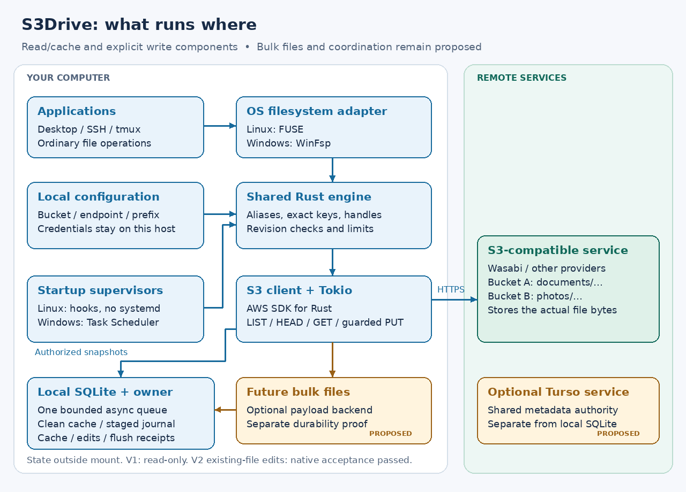

# Architecture and selected managed target

The user selected managed layout with stronger cross-machine coordination on
2026-10-16. The target separates authoritative namespace metadata, immutable S3
payloads and each machine's private SQLite cache/journal. See the executable
[managed authority contract](managed-layout.md) and [Turso research](turso-coordination.md).

The authority and [managed publication library](managed-publication.md) join
SQLite, its HTTP API and the real S3 SDK. Managed native writes and the explicit
[Windows lifecycle](native-windows-lifecycle.md) passed native acceptance at0f6104c.
[Shared HTTPS transport](remote-authority.md) and the explicit
[store/configuration bootstrap](managed-bootstrap.md) are implemented and tested
with private-CA fixtures. [Pinned coordinator supervision](authority-startup.md)
and paired native recovery passed again at f8c4f58 in terminal all-green
CI39097275707, with source/platform-bound21/14 reference artifacts. The older
timeout's cause remains unproven. Offline
[snapshot creation/inspection](authority-backup-recovery.md) subsequently passed
scoped native acceptance at mainbf9509e; writable restore/failover remain
unsupported. The [owned client](owned-authority-client.md) and later manifest/mixed-root
work have since passed their documented exact-source hosted acceptance. Earlier
failed cohorts remain part of the evidence; a passing later cohort does not prove
the cause of an earlier transport failure. Remote deployment and optional Turso
remain unprovisioned. No bucket migration or Turso service is enabled.

## Selected large-file layout: chunks and manifests

The user selected immutable chunks plus a manifest for large managed files.
The coordinator stores normal filenames, directory entries and the current file
root. The Rust client transfers immutable payload objects directly to the S3
service. A manifest identifies the chunks and their integrity information;
unchanged chunks can be reused by a later file generation. These internal object
keys are separate from the paths shown in the mounted drive.

[Mixed upload plans](mixed-plans.md), [dependency uploads](mixed-uploads.md),
[root publication](mixed-root-publication.md) and [clean base epochs](mixed-clean-epochs.md)
have accepted library-level implementations. Mounted writes still use their older
whole-generation path; the chunk pipeline is not yet enabled in filesystem
callbacks. A [clone-sharing guard and cleanup prototype](source-read-guards.md) has passed
component checks. Managed-reader integration and safe reclamation remain required. The [read-pin diagram](source-read-pins.md) shows the current prototype
and the proposed driver integration; its component checks do not establish native
chunk writes or garbage collection.

The existing direct-layout implementation below has native read/cache, explicit
existing-file writes and [guarded file creation](native-creation.md). It remains
available for existing configurations; its physical keys are not the target
managed namespace. [Startup and sessions](startup-and-sessions.md) support MX
Linux without systemd and account-owned Windows mounts.

The [mounted chunk-write source review](native-chunk-integration.md) maps the
remaining callback, SQLite-role, origin and retained-handle boundaries. Its diagram
shows the proposed bridge beside the existing8MiB whole-generation writer. The
current mounted backend deliberately does not enable chunk readers in a writable
configuration; library publication tests do not remove that integration boundary.

## Crate ownership and process model

`s3drive-authority` implements the shared Rust metadata service, launched by
`s3drive authority-serve`. It calls `s3drive-state::namespace` for authoritative
SQLite transactions and exposes an authenticated HTTPS API. Numeric loopback
HTTP remains available for explicit local configurations. Its database is
separate from every client's private cache/journal. `s3drive-managed` joins the
metadata client with the SDK executor and durable logical publication journal.
Clients transfer immutable file payloads directly to S3; the coordinator
serializes metadata changes rather than forwarding file bytes. Turso remains
an optional future backend behind this service contract, not an enabled service.

`s3drive-core` owns configuration validation and path resolution.
`s3drive-fs` owns the shared namespace, inode identities and open
handles. It depends on the S3 reader but not on FUSE or Windows types. OS
adapters translate its errors and project metadata into native structures.

`s3drive-s3` translates read operations to the AWS SDK and retains
ETags/version IDs as opaque validators. Its current implementation exposes
paginated list, head and bounded range reads, a scoped provider probe and a
policy-bound guarded single-PUT executor with durable recovery. Avoid designing a broad
generic VFS trait before the first real adapter reveals the necessary contract.

`s3drive-state` owns SQLite migrations, persistent identity, cache metadata,
local staged generations, remote upload attempts and flush receipts. Its clean cache uses
BLOBs up to 1 MiB so bytes and integrity metadata commit together. P5a1 stages
complete generations as bounded SQLite chunks, with local intent in the same
transaction boundary. Optional external bulk files remain future work. The
cache and journal now share one bounded SQL worker through `worker::Storage`.
Mounted reads use its cache handle; opt-in writable callbacks share the same
owner and immutable-generation APIs. No SQL transaction spans a network request. A local process lock must prevent two daemon instances from owning
the same volume/cache; SQLite locking alone does not coordinate cache files.

The platform crates own only OS callback translation, reply lifetimes, mount
setup and teardown. A long-lived Tokio runtime and bounded workers will serve
network work. Do not create a runtime per callback, block the runtime on SQLite,
or reply after a kernel request has been canceled. Keep callbacks independent
of credentials and object signing.

The core `s3drive` mount process runs in the foreground. A detached per-user
launcher now provides Linux desktop/SSH startup without requiring systemd.
Windows uses an account-owned password-backed scheduled task and a shared NTFS
folder mount; native tests verify reads across distinct authentication sessions.
Both launchers provide start/status/stop/remove. A future local control endpoint
can carry status, unmount, pin, retry and conflict actions.
A tray UI should consume that same API rather than implementing storage logic.

## Multiple buckets in the existing direct implementation

Each source has a stable alias, endpoint, bucket, region and optional prefix.
The initial root is a virtual directory of aliases. Resolving
`documents/reports/a.txt` under prefix `desktop/` produces the literal key
`desktop/reports/a.txt`. Bucket roots and aliases are synthetic and immutable
through filesystem calls. Separate drives can later reference separate configs.

Do not merge same-named paths across sources. Cross-source rename returns
`EXDEV` or the Windows equivalent; a file manager may explicitly copy then
delete. No transparent failover, replication or balancing is promised. Different
providers can have different credentials, latency and capabilities.

Implemented storage cache keys include the credential/configuration binding,
exact object key, size and revision. P4a binds successful read-only opens to the actual
credentials used for HEAD and reads through that handle; new read-only opens
resolve credentials again. Version 2 pins the policy-matching credential
generation at mount startup. It does not implicitly rebind pending writes when
a profile changes. Both modes require online authorization for every new open.
Changed configuration or credentials select a different binding namespace. SQLite
schema 9 retains the binding registry, unbound legacy rows, clean snapshots,
staged generations/local intent and edit operation keys. It adds the
[remote-attempt journal](remote-journal.md) with single-use send claims and
uncertain-result recovery, plus generation-specific flush acknowledgment. The [SDK executor](upload-executor.md) is tested with
local HTTP fixtures; production construction remains gated.
The engine enforces online authorization before cache lookup.
This is not a provider-global account identifier. See the implemented
[provider contract](provider-contract.md) and [migration](storage-and-recovery.md).

## Layout decision

| Model | Benefit | Cost |
| --- | --- | --- |
| Direct objects, existing compatibility prototype | Existing keys remain readable by independent S3 tools | Rename, file metadata and multi-client behavior are constrained |
| Managed layout, selected target | Namespace edits can be separated from data movement | Requires a durable metadata protocol, garbage collection, recovery and interoperability tooling |
| Gateway with authoritative shared metadata | Can serialize namespace operations across clients | Adds an always-available service and deployment responsibility |

A SQLite database on one authority service host can coordinate remote clients
through that service; independent per-machine SQLite files cannot. Turso is an
optional hosted authority backend, subject to the [separate evaluation](turso-coordination.md).
Uploading a SQLite file to S3 does not coordinate clients. The accepted managed
layout uses immutable blobs plus transactional namespace references, not S3
copy/delete rename. Existing direct mounts are not converted implicitly.
