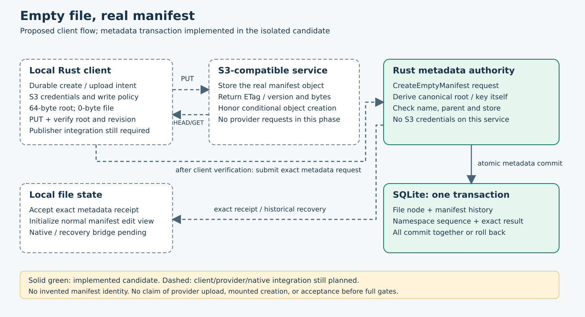

# Atomic creation with a real empty manifest

Declared 2026-10-19. Isolated `codex/empty-manifest-create`, based on locally green
source12a2f2a/schema38. Parent full local and own platform acceptance passed. This phase adds
the canonical codec and metadata authority operation; it does not upload objects,
activate native chunk writes, change old creation semantics or enable reclamation.
A subsequent authenticated publisher must persist, conditionally upload and verify
the actual root before submitting this operation.

Add one canonical empty-root helper: logical length0, level0, no entries, start0,
root ordinal1<<56, exact volume/node/store/generation identities. Preserve all old
wire bytes. Its64-byte page body has both a raw object SHA-256 and the existing
domain-separated page digest; never confuse them. Independent byte vectors fix
the page,120-byte descriptor and derived key. Core output remains structural intent.

Add negotiated feature `atomic-empty-manifest-v1` and Mutation::CreateEmptyManifest
with parent, parent_revision, name, store, upload_operation, etag and version.
The node, root generation and retained reservation IDs all equal the create
operation ID. The authority derives the zero root, body size, both hashes and key
from request identity and its immutable configured store. It accepts no caller
root descriptor, length, hash or arbitrary bytes. Existing upload proof validation
applies; the service itself has no S3 credentials and cannot certify provider I/O.

Use portable names, existing parent/collision/removal checks, configured placement
and current node/upload/operation quotas. Unrelated global sequence advances may
succeed when the exact parent revision still holds, as with guarded CreateEntry.
Future sequence, changed parent, collision or unknown store rejects with no partial
node/history. Commit a File node with zero logical content and a Published payload,
its reservation+publication history, volume sequence and exact operation outcome
in one SQLite transaction. Known exact replay remains historical after subsequent
writes/rename/delete/restart; changed request under the same operation conflicts.
Historical manifest lookup must validate this new creation origin without weakening
old ReserveManifest/Publish receipt validation or substituting a newer live node.

Use schema39 to fence old binaries; no DDL or old request/outcome reserialization.
Before advancing a pre39 marker, reject decodable new-operation rows. Preserve
opaque malformed legacy rows for existing diagnostic behavior rather than repair
or silently adopt them. New operation execution requires39. Refuse attached SQL
triggers before fresh admission or replay, verify exact inserted node/history and
name-key effects again after storing the result, and preserve all old data on error.

Ownership: canonical root helper/vectors; state mutation, authority application,
receipt/history validation, pre39 fence and tests; feature advertisement and HTTP
case; native schema fixture expectations and documentation. No dependency change,
S3 requests, startup settings, native callbacks or user bucket mutation.

Acceptance: independent codec bytes/digests/key, reserved identities; atomic Unicode
creation/history; two independent HTTP clients racing the same portable name;
lost/read-discarded reply and restart; historical replay after changes; changed
request reuse; wrong/future parent/store/proof rejection; upload/node/operation
limits; literal schema38 migration/future-tag refusal; corrupt history/name-key/
receipt; attached trigger refusal; real SQLITE_FULL rollback and process death at
node/history/sequence/outcome/commit boundaries. Run focused core/state/HTTP tests,
workspace all-target Clippy, then freeze and run the full local gate. Require own
platform/source/artifact acceptance and parent acceptance before promotion.

This is one prerequisite for the [native bridge](native-chunk-integration.md).
The actual create publisher must negotiate before physical sends and recover exact
unknown physical/metadata outcomes. Orphan cleanup, typed state composition, normal
native create/write/flush/rename/delete/open-unlinked and retention remain required.

## Focused checks (2026-10-19)

Two independent-vector core cases passed. Nine state cases passed in1.00s,
including actual SQLITE_FULL, all three admission quotas and five actual
killed-owner boundaries. The two-client HTTP collision/discarded-reply/restart
case passed in0.17s. Workspace all-target Clippy passed33.89s; all-target workspace
compilation passed34.78s. Native schema expectations match39. No actual provider
request or mounted empty-file creation was exercised.

Initial compilation failed because the new proof-validation helper was not visible
to its parent module. That exact343-input source/log was retained. Before runtime
tests, source review also corrected dispatch placement and retained the existing
SQL kind encoding (File is derived from the payload). First state run passed8
cases with an unused-mut warning; the warning was removed and the added quota
case passed with the other8. No production assertion was weakened. The full local
and own platform/source/artifact gates are next; parent342 is independently accepted.

## First complete cohort failure (2026-10-19)

Frozen source0c7f8b7/schema39/all349 failed the local gate with504 state cases
passing, one failing and one diagnostic ignored (269.21s). Exact inputs were
unchanged; runner1253500/child1253506 exited101 at18:39:47Z. The inherited
schema37 migration test still asserted the current version was38; the migrated
database correctly reported39. Own hosted Linux118231697493 in CI39302692507
failed at that same assertion. Book118231697807 passed; Windows remains running.
No native acceptance from this failed cohort is claimed. Full failed source,
frozen map and raw logs are retained.

The repair changes only that inherited test's current-version expectation to
SCHEMA_VERSION. Its literal37 source marker, byte-preservation checks and refusal
to launder new observation records remain exact. Production runtime is unchanged.
The repaired source requires a new focused migration check, complete local gate
and its own hosted cohort before promotion. Main remains accepted source12a2f2a.

Focused repaired migration check passed1 case/0.11s. All349 candidate2 inputs
are frozen; only the inherited test expectation differs from candidate1.

## Complete repaired local gate (2026-10-19)

Source29eb23782d7b3e0484c4ae8200fb419ecfa50279/schema39 passed the complete
local gate at18:51:46Z, all349 inputs unchanged. Publication24/172.92s,
state505 (one diagnostic ignored)/259.60s, reader26 (one native-only ignored)/69.42s,
39core/62S3, formatting, workspace all-target Clippy, build and book checks passed.
The log records92 Markdown files and88 chapter-test entries. Ordinary four test
threads and unchanged operation bounds were used.

The [indexed local archive](evidence/empty-create-local-20261019.tar.gz) contains
381 verified members/14504484bytes, SHA-256
`cc8f21b1d0ea061e172280ebf0be6d024f7ef878f1e30a972480d6dd79625f7a`.
It retains exact349 source, the gate/map/runner, focused and failed source contexts,
and independently indexed parent342 local/hosted and first failed-cohort archives.
Full gate log SHA-256
`bb77bad8acb2d23109d9018b918332c5614450b80a24c63bf475b2f585dff5cb`.
Local archiver20230 DONE; never rerun.

[First failed cohort](evidence/empty-create-failed1-20261019.tar.gz):13 verified
members/998889bytes, SHA-256
`4f3c2953358ffa2050b885351ae8486b3e8b87c4b0c5721d5566789d1f052105`.
Own Windows118231698174 also failed the inherited assertion (39 actual/38
expected):499state passed/1failed/1ignored,378.44s. Both OSes failed at the same
assertion; no native acceptance from that cohort is claimed. One-use failed
archiver45994 DONE; never rerun.

Repaired own CI39304491982 attempt1: book118237889657 and Linux118237890146
succeeded. Windows118237890166 and the complete own raw/source/artifact acceptance
remain pending. Parent342 is accepted. This does not upload an S3 root, enable
native chunk creation/writes or prove physical desktop/reboot behavior. Earlier
pending local statuses above are historical.
