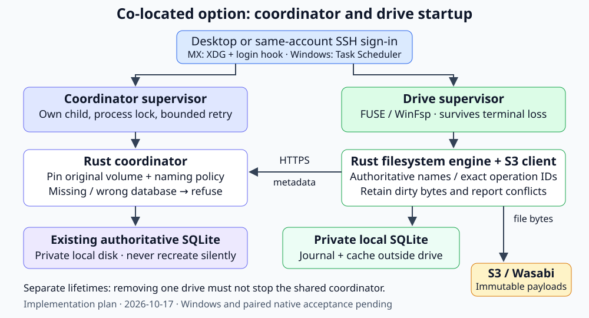

# Coordinator startup and pinned restarts

Design/research dates: **2026-10-17–18**, America/New_York. Current private main
`f8c4f5832e399c6c54567c122c875e2a438ce681` passed all-three terminal
[CI39097275707](https://github.com/marshallr12/s3drive/actions/runs/39097275707).
[Diagnostic acceptance record](evidence/authority-transport-20261018.json).
Hosted Linux and Windows Server2025/WinFsp2.1.25156.ddca7bd passed native and
paired recovery; physical reboot/PAM/actual SSH and Windows10/11 remain separate.
The original timeout/older failures remain unexplained. No startup entry in the
workstation user's real account or hosted metadata deployment was installed.

The designated coordinator host runs the shared Rust service
`s3drive authority-serve` and owns authoritative SQLite metadata. Other machines
run their local drives and use that same service; they must not clone its
SQLite database or start independent authorities for the same volume. Clients
send file bytes directly to S3. A co-located workstation can start both
components at sign-in; a separately hosted coordinator can use its host's
process manager. A managed mount cannot reconstruct the namespace from S3
payloads if its authoritative database is missing.



## Earlier a7994e6 accepted evidence

| Requirement or check | Accepted result | Evidence and limit |
| --- | --- | --- |
| Existing-only restart, WAL, migration and exact receipts | Passed Rust/CLI tests | Actual schema8 migration and WAL-only identity/receipt; missing/wrong/client/foreign inputs refuse before startup |
| Linux coordinator desktop/login supervision | Passed HTTP/HTTPS checks | Real gio/tmux, duplicate starts, killed child, exact replay, missing-DB refusal and removal; no systemd |
| Paired Linux native drive/coordinator | Passed all eight native cases | [Linux117566235370](https://github.com/marshallr12/s3drive/actions/runs/39090568625/job/117566235370): paired PASS02:42:05UTC, exact unknown IDs/no repeated PUT, Unicode/binary/empty data, dirty rival conflict and independent removal |
| Windows non-admin coordinator | Passed standalone and paired checks | [Windows117566235393](https://github.com/marshallr12/s3drive/actions/runs/39090568625/job/117566235393): independent AuthenticationIds, duplicates, same-supervisor child replacement, original volume/receipts and removal |
| Paired Windows real WinFsp recovery | Passed02:56:55UTC | Actual FileStream uncertainty/offline/rival-conflict assertions; exact physical/logical recovery without another PUT; retained staged bytes and independent tasks |
| Full local/workspace regression | Passed | 265/261 Linux/Windows state, ten HTTP, six TLS,17 SDK, five CLI restart/worker and seven managed cases; fmt/Clippy/build and57-doc checks |
| Broader Windows native/reference | Passed | Native lifecycle plus seven broad cases; source/platform-bound21/14 artifacts12123120389/12123325993 matched every typed field and four pinned upstream legacy cases |
| Private publication | Verified fast-forward to a7994e6 | All-three terminal CI, raw native/startup logs, strict artifacts and private local/remote main verified; no root or real provider mutations |

Windows fixture cleanup removed owned tasks/mounts/processes and dummy
credentials. Its locked disposable profiles were retained only under the
explicit successful-acceptance/ephemeral-VM exception and left for VM destruction.
That is not evidence of real workstation installation/uninstallation or reboot.

The previous unexplained metadata-read/rename transport failures were not
reproduced in the accepted run. They remain open; a passing run does not prove
those causes fixed. Physical reboot/PAM/SSH, Windows10/11, real multi-host
partitions, managed Wasabi writes, backup/failover and large files remain work.

## Same-source repeat failure (2026-10-17)

After the primary success and private promotion,
[CI39092631904](https://github.com/marshallr12/s3drive/actions/runs/39092631904)
repeated unchanged a7994e6. Linux/book passed, but
[Windows117572408577](https://github.com/marshallr12/s3drive/actions/runs/39092631904/job/117572408577)
failed paired setup during initial seed, before mounting. The store-apply caller
returned Request/UnexpectedEof; the still-running authority logged HttpTimeout.
These observations do not establish the affected RPC, commit outcome or cause.
The historical success above stands, but repeatable Windows startup reliability
is not established. This is the current priority; snapshots remain deferred.

The follow-up adds only bounded diagnostic observations and focused TLS tests.
Established connections count plaintext bytes read/written, completed flushes,
HTTP elapsed milliseconds and whether parsed headers reached the HTTP service.
A listener-local ordinal distinguishes events without exposing peer/volume/
operation IDs. The dispatch flag does not prove authentication, a complete body
or a database commit. No contents or raw dependency errors are retained.
Existing sixteen-event/one-suppression bounds, deadlines, TLS validation and
no-automatic-retry behavior remain. Client transport errors add only the fixed
request variant. Real CLI tests distinguish idle TLS, partial headers and
partial body, and exercise fresh caller processes plus concurrent reads while
checking exact receipts and sequence. A passing diagnostic run is not a fix.

## Transport failure investigation

The `ce784e4` Windows run failed an authenticated Info read after operation
lookup/exact replay, before the intentional coordinator kill. The task and
supervisor remained running. Its unit `WireError` discarded the cause; a
5.41-second worker duration alone does not prove a particular timeout, TLS,
HTTP or SQLite defect. Earlier native rename failures also remain unexplained.

The diagnostic follow-up retains only enums/numbers: configuration or invalid
input, connect/request/response-body phase, timeout flag, stable socket kind,
HTTP framing predicates, HTTP status, oversized response or invalid reply.
Display/Debug and Error sources cannot disclose endpoint, token, certificate,
request/response body or dependency error text. The client keeps its original
two-second connect/ten-second request deadlines, enabled TLS verification,
redirect refusal and disabled automatic retries. Mutation failures remain
unknown and require inspection of their original durable operation.

The Rust TLS listener logs at most sixteen connection failures using fixed categories and one
suppression notice per listener lifetime. It distinguishes capacity refusal,
handshake rejection/timeout, HTTP timeout/incompleteness/transport failure and
connection lifetime expiry. It never formats peer addresses or dependency
errors. A real CLI test sends24 malformed handshakes, checks that output stops
at the budget without disclosing private input, and verifies authenticated
requests still work afterward. Suppression is diagnostic only; it does not
change acceptance, deadlines or recovery.

Real TLS fault cases cover status503, an oversized advertised body, invalid
JSON, truncated body, no response headers and a stalled response body; tests
also check redaction and absence of a second request. Wrong trust is classified
at connect and bad bearer authorization as status401. These are local wire
checks, not a corrected Windows runtime acceptance claim. The Windows worker
now reports safe completed stages and the last typed readiness failure.

The diagnostic run at `7962058`,
[CI39089283961](https://github.com/marshallr12/s3drive/actions/runs/39089283961),
passed book and the complete Linux native/startup suite. Windows passed its
early native lifecycle, then failed the new TLS fault matrix: the truncated-body
case got a request timeout instead of a body error. Another fixture task reported
header EOF, without a case label. The Windows startup/pairing checks were skipped.
This result does not establish the cause of the original coordinator probe error.

The test follow-up prepares all synchronous certificate/client/acceptor factories
on blocking workers before starting any request deadlines. All six network cases
still run concurrently with their original expectations and deadlines. Per-case
progress, header byte counts, setup/request timing and joined fixture completion
now distinguish a fault that was established from a request that stalled earlier.
It does not increase production timeouts, add retries or weaken TLS checks.
Whether blocking setup explains the Windows failure remains unverified. All six
fault cases passed on both platforms at `a7994e6`. This establishes the revised
fixture's acceptance, not an attributed cause for the older production failures.
The transport error seen in the accepted read-only native suite occurs after
its deliberate coordinator stop; it proves new opens fail while an existing
verified handle remains readable, not an unexplained healthy-service failure.

## Upstream cross-check (2026-10-18)

The [Rustls0.23.46 manual](https://github.com/rustls/rustls/blob/v/0.23.46/rustls/src/manual/howto.rs)
explains that TCP EOF without TLS close-notify may appear as UnexpectedEof.
That error alone cannot locate the original stall or prove a mutation's outcome.
Treating it as successful application completion would require complete framing
and a valid reply; the failed store-apply has neither established. This is an
interpretation of the observed error, not an attributed root cause.

[Hyper4143](https://github.com/hyperium/hyper/pull/4143) fixed a historical
HTTP/1 chunk-terminator flush race. The resolved Hyper1.12.0 dispatch source
already contains the buffered-write flush before yielding. Its described
response-body stall is not evidence explaining this request/header timeout.
No dependency, retry, deadline or TLS changes follow from this cross-check.
Primary sources read2026-10-18; [resolved-source fingerprints](evidence/windows-tls-upstream-20261018.json).

## Diagnostic candidate9b403bb result (2026-10-18)

[CI39095464132](https://github.com/marshallr12/s3drive/actions/runs/39095464132)
passed Linux/book and Windows early TLS focus, replacement reference and native
lifecycle. Windows workspace then failed the new churn test's blanket
zero-server-error assertion. Every client RPC, complete reply, exact receipt
and sequence check had passed. One server event recorded HttpTransport after2ms,
with321 bytes read,481 written, five flushes and dispatch=true. This is a different
failure from the earlier missing reply/header timeout. Later Windows startup
and pairing steps were skipped; neither failure is claimed fixed.

The next candidate distinguishes Hyper's explicit shutdown error from generic
HTTP transport. The [resolved Hyper error API](https://docs.rs/hyper/1.12.0/hyper/struct.Error.html#method.is_shutdown)
identifies failures during AsyncWrite shutdown; its dispatch source wraps that
phase only after the HTTP connection becomes done. Source inspected2026-10-18.
The churn test may permit only that typed phase, with positive read/write/flush
counts and dispatch, after all callers independently validated complete replies.
All generic transport, truncation and timeout events still fail. A deterministic
real Hyper driver injects a shutdown failure after an independently read complete
Content-Length reply to test this boundary. No timeout, retry or TLS changes.
Whether the old untyped event was shutdown remains unproven until classified
Windows evidence is available; byte counts alone are insufficient.

## Scheduling observation hypothesis (2026-10-18)

The launcher does not explicitly set Task Scheduler priority. Microsoft's
[TaskSettings.Priority contract](https://learn.microsoft.com/en-us/windows/win32/taskschd/tasksettings-priority)
documents default7 as below-normal; child creation may inherit a below-normal
parent according to [Windows scheduling priorities](https://learn.microsoft.com/en-us/windows/win32/procthread/scheduling-priorities).
Sources read2026-10-18. These defaults are a reason to measure scheduling, not
evidence that starvation caused the original timeout. No actual Windows
process priority or CPU-starvation correlation has yet been recorded.

The next diagnostic launcher logs only the current supervisor/child priority
classes after launch. Getter errors produce a fixed unavailable marker without
changing child ownership or retry behavior. It does not set priorities, alter
Task Scheduler policy or change network deadlines. Use the next hosted record
with connection counters before deciding whether a scheduling test is warranted.

## Diagnostic checkpoint accepted (2026-10-18)

At f8c4f58, Linux117586223366, Windows117586223172 and book117586223439 all
completed successfully. Linux passed all8 native cases and both no-systemd
HTTP/TLS coordinator profiles. Windows passed standalone recovery04:55:30UTC,
full managed pair04:56:52UTC, lifecycle and seven broad native cases. Independent
AuthenticationIds, original volume/receipts, exact uncertain IDs without another
PUT, Unicode/binary/empty data, retained dirty conflict and independent removal
all passed. Strict21/14 artifacts12124529619/12125676595 matched source, platform
and every typed field; the four pinned upstream legacy cases also passed.

A current managed-engine event was precisely HttpShutdown after1ms, with224
bytes read,247 written, four flushes and dispatch=true, while caller tests passed.
This validates the added distinction; it does not retrospectively attribute the
older untyped event or the separate header timeout. The read-only suite's later
Connect timeout follows an explicit coordinator stop and is expected refusal.
No actual process priority values were printed in the accepted job, so scheduling
remains an unmeasured hypothesis. No priority/deadline/retry/TLS policy changed.

Private main was fast-forwarded from a7994e6 after terminal CI, raw logs and strict
artifacts were checked. [Source-bound record](evidence/authority-transport-20261018.json).
The main push automatically starts a same-source repeat; a new failure remains
new evidence and must not be dismissed by citing this successful run.

## Required restart behavior

Initial `authority-serve` bootstrap may initialize an empty authority and prints
the resulting volume ID. Supervised restarts must instead use an explicit
expected volume and naming policy. They must never generate a replacement ID,
initialize a missing database or adopt a different/local-client database.

The existing-only path acquires the same private local directory ownership and
stable lock. The directory, database and lock must already exist. Links, hard
links, unrecognized files, unsupported local storage and competing owners keep
their existing refusal behavior. Before migrations or attempt recovery, a
read-only SQLite transaction checks the application/schema, volume, naming
policy and root. It reads ordinary WAL state without asserting `immutable=1`
or disabling locking. Immutable mode skips locking/change detection and is
unsuitable for this mutable, restartable authority. Read-only WAL access may
still create operational WAL/shared-memory files; inspection is not a
byte-for-byte filesystem snapshot or a backup operation.
[SQLite URI parameters](https://www.sqlite.org/uri.html),
[SQLite read-only WAL databases](https://www.sqlite.org/wal.html),
checked 2026-10-17.

Only a matching known namespace database can proceed through the existing
transactional migrations and exact recovery. The read-write connection omits
SQLite's CREATE flag and does not initialize a namespace. A mismatch or missing
database fails before listening, printing readiness, or starting a mount.
Keep the original database, staged data, operation IDs and credentials intact.

The offline `authority-check` command checks private startup inputs and
existing identity without starting a listener, migrating schemas or recovering
attempts. It requires exclusive access; stop the foreground bootstrap process
before checking/installing supervision. This does not verify S3/provider access.

## Supervision contract

The per-account launchers have an explicit Authority component, separate
registration namespace and expected-volume settings. Mount registrations keep
their v1 format; Authority uses v2. Manifests contain paths, IDs and listen
settings, never token, TLS key or S3 credential contents. Every supervised
coordinator launch uses the existing-only Rust path and cannot fall back to
bootstrap.

Linux uses a detached process/session, private lock, XDG desktop entry and
optional explicit shell-profile hook, including MX without systemd. Windows
uses an account-owned password-backed Task Scheduler/batch-logon process. Its
password and batch-logon prerequisites are described in
[startup and sessions](startup-and-sessions.md). Real-user installation remains
an operator action; the acceptance harness provisions only a new disposable
ordinary account.

Each supervisor owns at most one child at a time and keeps its lock through up
to four attempts, ten seconds apart. Stop interrupts backoff; normal child exit
and explicit stop terminate supervision. The Windows extension remains under
native acceptance. Stop signals/closes stdin only on the supervisor's own child
object. Runtime PID files are operational hints, not authorization to signal a
PID from a previous run. The native fixture separately verifies a Linux pidfd or
Windows image/parent/pin before injected termination.

Use a stable explicit listen port. Numeric loopback HTTP remains supported;
nonloopback listeners require TLS. Original private token/key/cert rules and
client hostname/CA verification remain unchanged. Coordinator and mount
registrations are independent: drive removal must leave a shared coordinator
available to other clients. Duplicate starts reuse ownership or refuse the
existing database owner. No retry may create a replacement volume, fresh
operation ID, or unconditional provider overwrite.

Status reports supervisor ownership separately from authenticated metadata
health and provider access. A lock, PID, mounted path or readiness line alone
proves neither. The intended terminal-loss behavior is availability to later
same-account desktop/SSH/tmux clients; actual workstation sign-in/reboot/PAM/SSH
acceptance remains separate from process-restart tests.

The foreground Rust server remains usable with a separately provisioned host
process manager. This phase does not choose a hosting provider, enable Turso,
clone authority databases, add automatic failover, or claim leader election.
The user keeps SQLite-host and optional Turso deployment choices open.

## Command interface

Both paired native workflows passed at `a7994e6` on the hosted platforms above. Use the volume ID and naming policy printed by the
original bootstrap. Stop that foreground process before the exclusive offline
check or supervisor installation. All parent directories must already exist.
The following co-located example uses placeholders `VOLUME`, `TOKEN` and
`DATABASE`, not S3 credentials:

```text
s3drive authority-check --directory DATABASE --expect-volume VOLUME --name-policy portable-collision-v1 --token-file TOKEN --listen 127.0.0.1:43128
s3drive authority-serve --directory DATABASE --expect-volume VOLUME --name-policy portable-collision-v1 --token-file TOKEN --listen 127.0.0.1:43128
```

The second command is the foreground existing-only mode. It is also suitable
for an explicitly provisioned host process manager. First initialization omits
`--expect-volume`; a supervisor must always supply it. HTTP remains numeric
loopback-only. Add the original private `--tls-cert`/`--tls-key` pair for HTTPS;
nonloopback listeners require TLS. Clients still use a hostname/IP that matches
the certificate, with their existing explicit trust settings.

For a disposable Linux login registration, with stable executable paths:

```text
python3 scripts/linux-session.py install shared --component authority --executable /absolute/s3drive --authority-directory DATABASE --authority-volume VOLUME --authority-name-policy portable-collision-v1 --authority-token-file TOKEN --authority-listen 127.0.0.1:43128 --shell-profile /absolute/test-profile
python3 scripts/linux-session.py start shared --component authority
python3 scripts/linux-session.py status shared --component authority
python3 scripts/linux-session.py stop shared --component authority
python3 scripts/linux-session.py remove shared --component authority
```

Add `--tls-cert` and `--tls-key` together when needed. The authority manifest,
login block and desktop entry have their own namespace; an existing mount
registration named `shared` is separate. The installed hook supplies the
component explicitly, including when a later SSH shell has no desktop XDG
environment. Status reports ownership and the expected ID; use the existing
`managed info` command for a live authenticated metadata request.

The corresponding Windows interface is:

```powershell
.\scripts\windows-session.ps1 -Action Install -Component Authority -Name shared -Executable C:\S3Drive\s3drive.exe -AuthorityDirectory DATABASE -AuthorityVolume VOLUME -AuthorityNamePolicy portable-collision-v1 -AuthorityTokenFile TOKEN -AuthorityListen 127.0.0.1:43128
.\scripts\windows-session.ps1 -Action Start -Component Authority -Name shared
.\scripts\windows-session.ps1 -Action Status -Component Authority -Name shared
.\scripts\windows-session.ps1 -Action Stop -Component Authority -Name shared
.\scripts\windows-session.ps1 -Action Remove -Component Authority -Name shared
```

Use absolute local Windows paths for the placeholders, and `-TlsCert`/`-TlsKey`
as a pair for HTTPS. Account-password entry stays local and is stored by Task
Scheduler, with the same batch-logon prerequisites as the mount launcher.
Authority startup uses a separate task/state namespace. Stop/removal retains
the database, token, certificates, configuration and logs.

## Acceptance criteria

1. Missing directory/database/lock, local-client state, wrong volume/policy,
   corrupt root and future/foreign schemas fail without new namespace or
   migration/recovery effects. Existing dirty bytes and exact records survive.
2. Matching known old schemas migrate atomically without rewriting existing
   operation identities/results. Actual WAL-only committed state is observed.
3. Exclusive ownership survives duplicate starts and owner termination; a
   killed coordinator resumes exact retained operations and the original volume.
4. Real CLI checks fail before binding/listening for mismatches and malformed
   private inputs. Both HTTP and HTTPS use the pinned restart path.
5. Linux disposable desktop/login hooks survive terminal loss, reuse ownership,
   recover a killed child and remove only their registration; no systemd/root.
6. Windows native non-admin scheduled startup survives independent logons,
   duplicates, child restart and controlled removal with private ACLs.
7. Both native managed drives use the supervised coordinator after initial
   launcher loss and coordinator recovery, preserving Unicode bytes, uncertain
   IDs, dirty data and conflicts. Physical reboot/PAM/SSH and Windows10/11 remain
   separate target-machine acceptance, not inferred from process restarts.
8. Full local gate and terminal exact-source Linux/Windows/book, native,
   startup and strict21/14 reference gates pass before private publication.

The Rust restart/identity work is the prerequisite. Script/supervisor and paired
native acceptance must also pass before this phase is described as implemented
coordinator startup. Backup/failover, real multi-host partition tests, live
managed Wasabi acceptance and large-file support remain subsequent requirements.

## Validation workflows

Run the full local gate from the repository:

```text
bash scripts/gate.sh
```

The eight focused restart-state tests cover missing paths/files, wrong identity
without migration, local-client/uninitialized state, corrupt/future/foreign
roots/schemas, actual schema8 migration, database replacement after preflight,
and killed-owner state whose identity/receipt is provably only in WAL. The real
CLI cases also check an occupied listen port during offline inspection,
refusal before readiness/listening, and exact unread-reply recovery across an
HTTP-to-HTTPS pinned restart.

Separate native commands are required; portable cases cannot replace them:

```text
cargo test -p s3drive-cli --test authority_restart supervised_linux_coordinator_http_and_tls_with_private_ca --locked -- --ignored --nocapture
cargo test -p s3drive-cli --test linux_mount actual_managed_supervised_coordinator_and_drive_recovery --locked -- --ignored --nocapture --exact
cargo test -p s3drive-cli --test authority_restart supervised_windows_coordinator_tls_independent_logons_and_recovery --locked -- --ignored --nocapture --exact
cargo test -p s3drive-cli --test authority_restart supervised_windows_managed_drive_and_coordinator_recovery --locked -- --ignored --nocapture --exact
```

Linux uses disposable XDG/profile paths, gio and a tmux login without inherited
desktop XDG variables. The native paired controller starts before any FUSE file
descriptors open; later control uses pipes. Forking in the native parent with
those descriptors open can itself trigger flushes, so it would distort this
acceptance. Read-only SQLite inspection compares exact active attempt identity;
production ownership/migration rules are unchanged. The current workstation has
`NoNewPrivs: 1`; it must not be bypassed to run FUSE. Hosted native Linux supplies
that acceptance.

Windows tests reuse the randomly created ordinary account, credential pipe,
explicit batch-logon right and controlled cleanup. The account creates its own
private TLS/SQLite files and dummy AWS profile, rebases only local paths in the
copied source policy/plan/report, seeds both stores through the production
publisher, and generates its writable config with the real CLI. Source
credentials are never copied. Fixture endpoints must be numeric loopback HTTP;
no hosted S3 provider is contacted and system certificate trust is not changed.

The Windows pair tests separate AuthenticationIds and duplicate startup. A live
FileStream keeps dirty bytes through a lost PUT response and an exact-owned
coordinator-child kill. The same scheduled supervisor must produce a new child,
recover the original volume/receipts and settle the exact physical/logical
request identities without another PUT. A rival payload must yield a failed
flush while retaining local bytes. Drive removal must leave authenticated
coordinator access working, and journal reopening must find head!=settled and
read the actual staged conflict bytes through the production journal reader.
The `logical_conflicts` table is a later explicit retention acknowledgment; the
fixture must not fabricate that acknowledgment automatically.

A small command/counter file protocol controls only the owned Rust S3 fixture's
reply/observation faults. Cleanup tracks both mountpoints and every owned task
before account disposal, and removes private fixture metadata as its owner.
Windows testing is hosted Server2025/WinFsp2.1.25156.ddca7bd, not this workstation
or accepted Windows10/11 behavior. A disposable-VM-only, already documented
profile sharing violation may defer profile deletion to VM destruction only
after all acceptance assertions pass and dummy credentials are removed.

Portable preparation uses real CLI/SDK/private-CA TLS/SQLite processes, killed
coordinator recovery, exact request snapshots and durable conflicting bytes:

```text
cargo test -p s3drive-cli --test authority_restart paired_windows_fixture_sdk_tls_recovery_and_conflict_preparation --locked
pwsh -NoProfile -NonInteractive -File scripts/test-windows-supervisor-policy.ps1
```

The latter extracts the actual supervisor loop and uses real child exit codes
for normal termination, recovery, four-attempt exhaustion, exclusive ownership
and Stop during backoff. Neither command proves Task Scheduler, ACL, WinFsp or
reboot behavior. CI runs the Windows policy/Authority/pair checks before broader
native regressions for independent evidence; all previous gates remain required.

## Measured failures and corrections

| Source and job | Observed failure | Correction or current disposition |
| --- | --- | --- |
| `d67a17d`, [Linux117547531601](https://github.com/marshallr12/s3drive/actions/runs/39084297874/job/117547531601) | Writable CLI bootstrap rejected exact naming before startup | Portable naming and guarded `MoveEntry` producer rename; portable preparation passed |
| `56a2abe`, [Linux117548875680](https://github.com/marshallr12/s3drive/actions/runs/39084754318/job/117548875680) | Actual mount existed but the Mount component did not write runtime.json | Private atomic hints now cover both components; controller waits for records and always attempts failure cleanup; later paired FUSE acceptance passed at `e48cb09` |
| `8ce3ddc`, [Windows117546161016](https://github.com/marshallr12/s3drive/actions/runs/39083840521/job/117546161016) | Existing cross-store metadata rename returned native1117 | Unresolved; typed callback and safe namespace request/outcome/node diagnostics added; no retries or weakened assertions |
| `d67a17d`, [Windows117547531749](https://github.com/marshallr12/s3drive/actions/runs/39084297874/job/117547531749) | Existing dirty-source replacement returned native1117, with authority transport failure logged | Unresolved; same diagnostics; the later `56a2abe` broad native suite passed but does not explain away these failures |
| `56a2abe`, [Windows117548875636](https://github.com/marshallr12/s3drive/actions/runs/39084754318/job/117548875636) | After successful install/TLS/logons/duplicates, killed-child recovery failed its100-second deadline | Supervisor now owns bounded child retries; corrected native result pending |

The Windows child-death log showed supervisor exit `-1`, followed by Scheduler
events201/102 recording completion with return code4294967295. No replacement
child appeared during the deadline. A subsequent profile cleanup sharing
violation was also reported; the original recovery failure remains visible.
This is one hosted Server2025 observation, not a universal Scheduler rule.

Microsoft documents restart count/interval settings and a one-minute minimum
Scheduler interval. The settings alone did not establish recovery for the
measured child-death case.
[RestartOnFailure schema](https://learn.microsoft.com/en-us/windows/win32/taskschd/taskschedulerschema-restartonfailure-settingstype-element),
[RestartInterval](https://learn.microsoft.com/en-us/windows/win32/taskschd/tasksettings-restartinterval),
checked2026-10-17. The `ce784e4` correction instead keeps one supervisor/lock
through four attempts and interruptible ten-second delays, always using the same
pinned command/private inputs. Scheduler restart properties remain secondary,
unverified launcher policy. Native acceptance must demonstrate recovery under
that same supervisor without issuing Start.


## Snapshot-topic regressions (2026-10-18)

The accepted f8c4f58 main repeatCI39099187117 passed all three jobs, native/
startup logs and newly downloaded strict21/14 artifacts. This does not explain
older intermittent failures. The subsequent snapshot topics supplied new
contradictory reliability evidence.

At f9a52e2, [CI39100010372](https://github.com/marshallr12/s3drive/actions/runs/39100010372)
passed Linux/book and Windows snapshot/library/ordinary-account startup checks,
including the actual private ACL/link/handle cases. Its broad native step later
failed existing-file writes (List/UnexpectedEof, native1117) and mutation setup
(a fresh seed child's Info/UnexpectedEof). Nearby TLS header timeouts reported
connection22/read0/write0/flush1/dispatched=false and connection43 with the same
counters. Those are established TLS sockets with no observed HTTP plaintext;
there is **no proof that either socket was the failed RPC's selected transport**.
A separate deliberate-outage new-open timeout remains an expected passing case.

At33ddfe1, [CI39100806213](https://github.com/marshallr12/s3drive/actions/runs/39100806213)
passed Linux/book but failed the earlier native lifecycle test at cross-store
replacement. That case uses numeric-loopback **HTTP**. The daemon logged Info
request timeout, then PendingRemoval timeout during cleanup; rename returned
native5. This is separate from the TLS socket events and does not establish a
shared cause or a metadata commit outcome. Its snapshot console worker and
later Windows steps were skipped. [Exact records](evidence/authority-snapshot-platform-20261018.json).

A local diagnostic experiment attempted Hyper's public connection-capture
extension. The actual resolved reqwest0.13.5 public conversions preserve
extensions, but its send implementation rebuilds the Hyper request without
forwarding arbitrary extensions. Existing controlled TLS tests independently
received complete requests while the proposed flag stayed false. The observer
was removed; the original transport and fault assertions are restored. Source
fingerprints and the failed control are recorded above. Do not add that flag
without a verified delivery path or reinterpret false as no connection.

Hyper-util0.1.21 also races a pool checkout against connection establishment
and can finish a losing connection in the background. Thus a server's empty
socket can be unrelated to a particular successful or failed RPC; correlation
needs stronger evidence. This is a resolved-source observation, not attribution
to an upstream bug. The historical [pool discussion](https://github.com/hyperium/hyper/discussions/2628)
and [older idle-timeout report](https://github.com/hyperium/hyper/issues/3640)
do not reproduce our pinned stack. These sources were checked2026-10-18; no
pooling, deadline, retry, scheduler or TLS policy was changed.

The new fixture diagnostic runs only after a native lifecycle assertion fails:
check retained coordinator/mount process handles, start a fresh read-only CLI
Info request with its own client/runtime, classify its result without dumping
request/configuration or dependency text, explicitly reap owned processes, then
resume the original panic. A portable control passed against both a live and a
stopped authority, with unchanged metadata sequence and zero new S3 requests.
A later successful control does not prove availability at the instant of the
original failure or establish any earlier mutation outcome. It is additional
diagnostic evidence, not a successful native test or a fix for the production
failure. Existing native and full candidate gates still apply.

At d6d8bd9, [CI39102804077](https://github.com/marshallr12/s3drive/actions/runs/39102804077)
passed Linux/book and the early Windows standalone coordinator/offline-snapshot/
private-console cancellation components. The later HTTP lifecycle test failed
at same-store source-to-target replacement (`lifecycle.rs:364`), with a
PendingRemoval request timeout. The failure-only control found the mount and
coordinator processes alive and received the original volume from a fresh CLI
in28ms. That is evidence after the failure, not proof of availability during
the timed-out request, its database outcome, or a particular pool/runtime cause.
The original failure remains fatal; later Windows gates were skipped. Main
remains f8c4f58. The next candidate's [explicit connection lifetime](remote-authority.md#explicit-metadata-connection-lifetime-candidate-2026-10-18)
is a deliberate transport policy with local socket tests, not a claimed fix.

At e51f737, [CI39103791947](https://github.com/marshallr12/s3drive/actions/runs/39103791947)
passed Linux/book, the Windows workspace, standalone/paired startup and both
ordinary-account snapshot/console workflows. Windows native lifecycle passed,
but the later broad suite finished with six passes and one failure: `native_writes` at `managed.rs:1708`,
`file.sync_all()`, native1117, metadata Info/Request/UnexpectedEof. The nearby
TLS socket24 had read0/write0/flush1/dispatched=false and a5015ms header timeout;
it is still not bound to the failed RPC. A second List/UnexpectedEof near an
empty socket228 occurred inside a passing mutation case. Its cause/intent is
not established and must not be silently treated as an expected outage.

The finite-connection policy did not eliminate the failure. Main remains f8c4f58;
the full-success artifact driver was not run against this failed cohort. The
next [body-poll diagnostic](remote-authority.md#client-body-poll-observation-candidate-2026-10-18)
uses a verified public body wrapper and records no request contents. A body poll
is not a socket write or commit, and false cannot authorize mutation replay.
