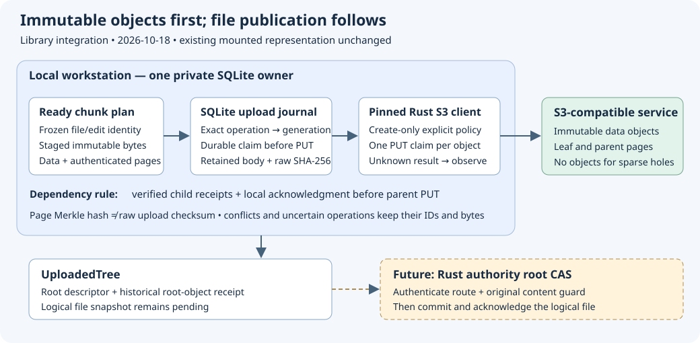

# Chunk and manifest uploads

Implementation date: **2026-10-18**. This library phase connects a
[Ready offline chunk plan](chunk-plans.md) to the existing policy-bound
[single-PUT executor](upload-executor.md). It is not enabled by a mount or CLI
configuration. Authority root publication, large-file mounted reads/writes and
reuse of unchanged remote objects remain separate work.

## Object handoff

`Storage::chunked` uses the executor's exact private SQLite owner. For each
non-hole object, `Transfer` freezes its target, manifest reference, role, raw
body length and raw SHA-256. Its deterministic physical staging operation hashes
the frozen input, attached logical generation/manifest, exact object record and
raw checksum. The existing `staged_operations` table maps that operation to one
physical generation before body materialization. No new table or schema version
is introduced; schema 25 remains current.

A restart after begin, append or seal resumes that physical generation. Missing,
redirected or inconsistent mappings fail explicitly. Sealed bodies are freshly
read and verified against the expected raw checksum before handoff. An incomplete
builder must accept the exact offset-zero replay; incompatible partial bytes are
preserved as a conflict. Source bytes and physical generations are retained.

Data-reference SHA-256 hashes the raw data body. A page reference instead uses
the manifest codec's domain-separated page hash. The upload checksum always
hashes the raw HTTP body, including for pages. Treating these hashes as
interchangeable would make a valid manifest upload fail integrity verification.

## Sending and recovery

`uploads::chunks::Uploader` obtains its planner from the supplied `Executor`.
It verifies the frozen credential/configuration binding before physical staging.
A new or Prepared attempt must pass current create-only prefix, size and evidence
checks. Claimed attempts recover by observation through the existing executor,
including after evidence expiry or policy narrowing. A missing remote object
after an uncertain PUT does not grant another PUT or a replacement guard.

`upload_object` requires exact durable flush receipts for all direct non-hole
children before materializing or sending a page. Matching includes physical
generation, target, create-only guard, raw body checksum and size. A historical
Verified result without committed local acknowledgment is insufficient. Child
receipts provide inductive ordering; they do not establish that a provider still
retains every object at this instant.

`upload_tree` walks data chunks, leaf pages and successive parent levels. Explicit
holes have no S3 objects; their logical staged zeros are freshly verified by the
walk. An empty file uploads its empty leaf page. Failures stop the walk with
completed, rejected and uncertain objects retained under their original IDs.
There is no unconditional overwrite fallback or adoption of a rival object.

The returned `UploadedTree` contains the root descriptor and the root object's
historical receipt. **It is not a file flush receipt.** The original logical
snapshot stays pending until a future authenticated authority-root CAS and local
logical acknowledgment phase succeeds. No logical edits are silently settled.

## Bounds and unfinished work

Each data body is at most 1 MiB; pages have at most 128 entries and 10,432 encoded
bytes. Uploads are sequential in this wrapper and use existing executor limits.
Every physical object consumes an existing staging generation and remote record;
the default 4,096-generation quota also includes logical snapshots. The default
unique retained-payload quota is 1 GiB, excluding database/WAL/index overhead. Quota or
SQLite-full errors preserve admitted data. The offline 64 GiB geometry bound is
not an admitted upload size or mounted-file limit.

Graph validation currently scans admitted metadata repeatedly, including before
object handoffs. Staged reads can also amplify physical checksum work on
fragmented snapshots. This implementation does not establish scalable latency,
constant work per object, a maximum practical tree size or a throughput target.
Optimize authenticated graph traversal and retained-history accounting before
admitting large native workloads. Initial plans publish fresh object generations;
remote reference reuse still requires authenticated base-root retention.

The caller supplies the frozen namespace/store route; this library checks its
local source binding and explicit write policy, not an authority-signed route.
Root capabilities, content CAS, multi-machine retention, range reads and native
activation must be implemented and accepted before using this as the managed
filesystem's large-file format. Existing one-object generations remain unchanged.

## Verification scope

Local tests use private temporary SQLite directories and an ephemeral loopback
S3 model with synthetic credentials. They exercise real SDK HTTP requests,
binary/Unicode content, empty and sparse files, page/raw hash separation,
child-before-parent ordering, exact receipts, rival conflicts, absent uncertain
objects, lost commit responses, restart, expired/narrowed policy recovery and a
multi-level sparse file larger than 128 MiB represented by four uploaded objects.
State tests cover each materialization restart boundary, altered mappings/media,
missing/corrupt receipts, generation quotas and actual SQLite-full rollback.

See the [dated evidence](evidence/chunk-object-uploads-20261018.json) for final
gate results and limitations. No real provider requests or mounted chunked-file
acceptance are inferred from these tests. Earlier Wasabi and native acceptance
remain bound to their separately recorded sources and representation.
