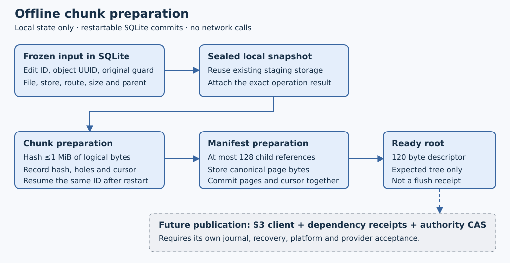

# Durable offline chunk plans

**Implementation date: 2026-10-18.** `s3drive-state::chunked` prepares a full
local snapshot as immutable data chunks and manifest pages. This is local
preparation only. It grants no upload permit, proves no remote durability and
does not activate chunked native files. Existing mounted limits and live payload
formats remain unchanged. The [representation chapter](large-managed-files.md)
explains the eventual complete architecture and the selected chunked format.

## Persist identities before hashing

A caller retains a nonzero edit ID (32 bytes) and an object-generation UUID
(16 bytes), then freezes an `Input` in private SQLite. The input also binds the
volume, file-node, store/root, credential-source fingerprint, original content
CAS guard, local parent generation and final logical size. The guard is opaque
frozen metadata here; this module does not authenticate an authority response.
Changing any input under the same edit ID conflicts. A second edit cannot claim
the same file/store/object-generation scope even under a different ID.

The input derives a local-only staging target and a separate staging operation
key using versioned SHA-256 domains. It does not require a whole-file digest.
The target stays stable for a file/store/root while the operation key changes
with the exact edit input. Materialize the snapshot through the existing staging
journal using that retained operation key and frozen parent. A lost response
must be reconciled through the same operation, never a new ID.

Attachment accepts only the exact sealed staging result: source, target, size,
parent, local base and operation mapping must match. The sealed local manifest
hash is retained. A SQLite `GenerationId` is a positive signed local row ID;
it is not the 16 byte UUID used in S3 object addresses.

## Prepare one step and commit its cursor

`step(id, expected_cursor)` either advances the expected cursor or returns the
current progress without another mutation. SQLite commits the object record and
cursor together. Reopening validates the retained metadata and resumes those
same IDs; it does not start another plan.

- A data step requests at most 1 MiB of logical bytes from the sealed snapshot, verifies its staging
  bytes and computes raw SHA-256. A complete all-zero piece becomes an explicit
  hole. A missing row or object never becomes a hole.
- A page step assembles at most 128 child records. Leaf groups cover fixed bands
  of 128 logical chunks; adjacent holes within a leaf are merged. Parent pages
  group up to 128 pages until one root remains. The final partial chunk is exact.
- Pages use the canonical codec and domain-separated page hash. The plan checks
  file identity, geometry, expected references and complete dependency coverage
  before committing its Ready root descriptor. Every page level has a distinct
  ordinal band, so page addresses cannot alias across levels.

Data ordinals equal logical chunk indices. Page ordinals are
`((level + 1) << 56) | slot`, where level zero is a leaf and slot is its index
within that level. Ordinals are stored as exact eight-byte blobs in SQLite,
not cast to signed integers. The object address also includes its data/page
role, store, file and object-generation UUID. References never adopt an object
just because another object has the same digest.

This initial builder prepares a **complete new object generation** from the
snapshot. Local staging can reuse unchanged chunk storage, and old plans/roots
remain readable after child edits. Reusing unchanged *remote* references still
requires authenticated base-root ancestry and retention; it is not implemented.
Consequently this phase does not yet deliver the small-edit upload savings
which motivate the selected design.

## What Ready means

Ready is a persisted expected tree, not a remote receipt or an atomic check of
current disk media. `info` checks retained graph metadata. `bytes` freshly reads
and hashes a requested data chunk, or checks a page against its expected child
records, before returning bytes. Corrupt or missing staged bytes fail explicitly.
A Ready commitment may outlive damaged local media; it must never authorize a
send or acknowledge a flush without fresh object checks and publication receipts.
Returned buffers are not durable media pins; the future sender must bind the
same verified bytes and expected digest to its claimed physical operation.

The future publisher must journal each physical operation and its unknown
outcomes, verify all transitive dependencies, publish the authority root with
the original content guard, and settle the logical edit. This module provides
none of those permissions or acknowledgments. It also does not perform object
collection, cancellation by deletion or implicit content migration.

## Resource bounds and schema

Schema 25 adds `chunk_plans` and `chunk_objects` to the existing private client
database, outside the mount. Data bytes remain in the staging store; only
expected chunk metadata and bounded page bytes are added. Migration adds empty
tables without rehashing legacy records. Both tables are refused as local data
by authority initialization and authority snapshot preflight.

Defaults allow 16 retained plans, 32,768 reserved object records and at most
4,096 local staging extents per attachment. Hard admission bounds are 256 plans,
262,144 total reserved records, 65,536 chunks per file (64 GiB logical size) and
65,536 staging extents. Reservations include hole records and all expected page
levels. These are offline resource limits, not newly admitted mounted file sizes.
Staged payload quotas and SQLite/WAL/index overhead are additional.

Logical slice buffers and page assembly are small, but `journal::read_data`
can reread and verify a complete stored chunk for each intersecting extent.
Fragmented snapshots can therefore amplify physical reads and checksum work;
1 MiB of requested file bytes is not a 1 MiB cap on total physical I/O/hashing.
Metadata validation also scans the admitted local extent manifest. Reopen and Ready checks validate retained
graph metadata. These operations do not claim constant latency; the future
large-file path needs measured work/latency and further incremental validation.
The existing owner queue/cancellation rules apply: a queued cancelled command
can be skipped, while a lost reply racing execution is conservatively unknown.

## Verification scope

A separate Python generator fixes three expected pages and the frozen-input
hash for a sparse file larger than 128 MiB, with binary/Unicode tail bytes.
Tests verify the resulting authenticated tree, empty/partial files, child edits
and retained old roots, identity/route/guard refusal, cursor replay, process-kill
recovery, missing dependencies, corrupted media/metadata, malformed large cells,
quotas, ignored/deleted SQL effects, actual SQLite disk-full rollback, migration
and authority role isolation. Portable tests do not substitute for real mounts
or separately approved provider checks. The [dated evidence](evidence/chunk-plans-20261018.json) records the actual
completed gate results and the source to which each applies.

The subsequent [chunk object upload bridge](chunk-object-uploads.md) connects these
plans to physical create-only uploads. This offline planner itself still issues
no send permits or authority root capabilities.
