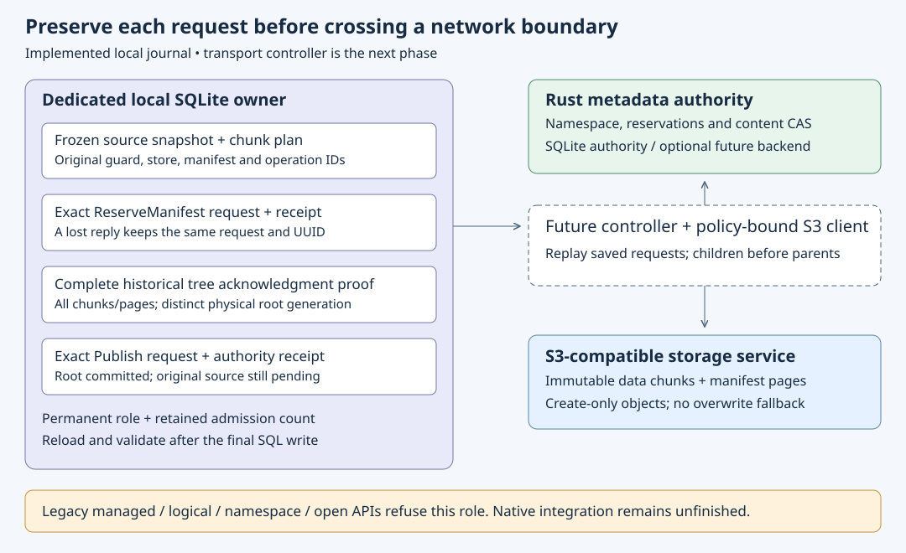

# Isolated chunk-root publication journal

Implementation date: **2026-10-18**. This persistence slice connects the frozen
[chunk plan](chunk-plans.md), [complete historical tree receipt](chunk-tree-receipts.md)
and [authority root contract](manifest-root-authority.md). The [policy-bound controller](chunk-root-publisher.md) is a separate library
layer. No network requests are made by this journal.

## Four durable boundaries

1. **Begin:** freeze the Ready plan, attached source generation and manifest,
   original base node/content guard, store descriptor and distinct reserve/publish
   IDs. The object-generation UUID is also the reservation ID. Persist the full
   reserve request before a controller may send it.
2. **Reserved:** retain the complete matching authority receipt. A rename may
   change its name/revision while the original content guard remains valid.
   Only an exact authority `Conflict` can be retained as terminal rejection;
   transport errors leave the request unresolved.
3. **Prepare publication:** require a fresh complete historical receipt for
   every non-hole object. Bind the root physical generation, upload operation,
   acknowledgment checksum and S3 revision. Persist the full Publish request,
   including its original expected sequence, before it can be sent.
4. **Published:** retain the exact matching authority receipt. This means that
   this tree root was committed historically. It does **not** acknowledge the
   original source snapshot or report a mounted-file flush.

After a lost reply, a controller must resend the complete original request.
Bare operation lookup cannot establish request ownership. A prepared request
cannot be rebased to a new sequence or given a fresh operation ID. Historical
recovery must remain possible after a newer root is published, without requiring
current source payload reads or fresh upload authorization. New object work
still requires the existing policy-bound uploader; the journal grants none.

## Dedicated state and transaction validation

Schema27 adds a separate, versioned, hash-bound log and permanent client-role
marker. A retained admission count detects a missing row, including a completed
one. Both reserve and publish IDs are checked across **both** columns of every
record. Individual SQL uniqueness constraints alone would miss cross-column
collisions. Record size is bounded at 64 KiB and retained admission at 256 plans;
existing staging/plan quotas continue to apply.

This first client requires a dedicated private state directory. Existing
managed/logical/namespace/open APIs refuse its persistent role even after all
publications complete. Admission and every transition reject retained legacy
client or authority records. Generic staging, remote receipts and chunk planning
remain usable. No automatic conversion or role-release operation is provided.
Detached and pending-removal modes remain unsupported. Native integration needs
common lifecycle barriers and versioned logical settlement links first.

Each transaction checks the actual affected-row count and reloads the exact
saved record after its final write. It then rechecks role/count, operation
ownership, isolation, the current frozen plan, attached manifest and complete
graph. Prepared/published stages also reconstruct the complete historical receipt
proof. That temporary proof exists only in the final immutable validation
section of the exclusive-owner command; it crosses no write, callback or await
and is dropped before commit. SQL trigger damage must roll the transaction back.
Reserve and reserve-conflict stages correctly precede physical tree completion.

Store route and SDK configuration fingerprints are distinct identities and are
retained separately. The later controller must bind the route to its reader's
storage fingerprint and the source/configuration binding to its recovery target.
The offline journal cannot authenticate caller-supplied authority metadata.
Receipt names use the authority's general exact-name shape; portable name
admission remains the authority's registered policy.

## Validation and unfinished work

Local controls use real SQLite authority CAS and explicitly synthetic physical
acknowledgments. They exercise restart and lost reserve/publish replies, newer
roots and dirty heads, Unicode/exact-policy names, competing content, incomplete
recursive proofs, reciprocal isolation, operation collisions, ignored/deleted/
rewritten SQL effects, post-write plan/receipt/isolation damage, migration and
actual SQLite-full rollback. They do not establish S3 capability.

All 15 focused controls and the full local gate passed: 349 state/1 ignored,
59 S3, 34 core and 50 authority tests, all 18 managed publication contracts,
formatting/Clippy/build, 64 doc-link files and 60 book chapters. Independent
review matched all 247 frozen runtime/fixture hashes and found no blockers.
Own-source hosted native regression passed at `63164d0`, run39153910031: all
three jobs completed successfully. All15 journal controls passed on Windows
Server2025 and Ubuntu24.04.5. Fresh, source-bound21/14 native reference records
passed strict typed checks, project oracles and all35 raw-record comparisons.
The [indexed hosted archive](evidence/chunk-root-journal-631-hosted-20261018.tar.gz)
retains raw logs, exact artifact metadata and checkers. These are regressions of
the existing mounted format; no mounted chunk or physical reboot acceptance.

See the [dated evidence](evidence/chunk-root-journal-20261018.json) for completed
checks and source binding. The separate controller adds real
SDK/loopback S3 plus authenticated coordinator tests. Logical settlement,
verified range reads, native chunked writes, approved Wasabi acceptance and
physical startup/reboot checks remain separate. Whole graph/history validation
and linear receipt lookup still have substantial cost; no scalable latency or
native large-file limit is claimed.
