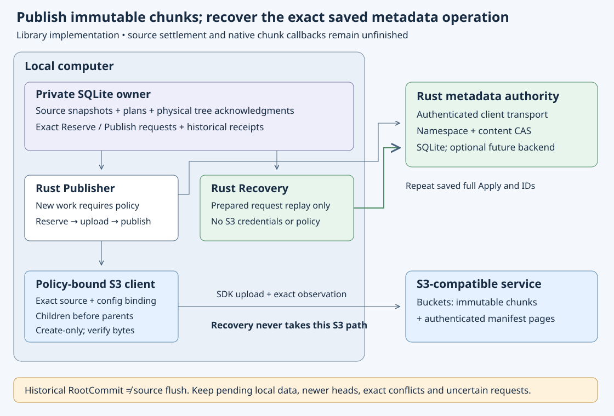

# Policy-bound chunk-root publisher

Implementation date: **2026-10-18**. The user's selected chunks/manifests layout
now has a separate library controller in `s3drive-managed::chunks`. It combines
the [isolated journal](chunk-root-journal.md), [tree uploader](chunk-object-uploads.md)
and authenticated Rust authority client. This phase returns a **historical root
commit**, leaving the original source snapshot pending. Native format activation
and logical file settlement remain unfinished.

## New work and historical recovery

`Publisher::open` validates local isolation, advertised authority features,
volume/name policy and the exact store descriptor. Store route must equal the
SDK reader's storage fingerprint. Admission also checks the independent
source/configuration fingerprint through the executor's exact recovery target.
The authenticated client fetches the base node directly; the legacy Reader
continues to reject manifest bases.

`begin` first looks for retained state. Only the typed Missing result permits a
new admission: corruption cannot become a replacement operation. For a new plan,
it requires a Ready attached source, current create permission and exact base
content guard, then persists the complete ReserveManifest request. Repetition
returns the frozen input without fetching a new base or changing its IDs.

`resume` sends that saved reserve, persists its complete matching receipt, and
uses the existing policy-bound uploader to verify children before parents. It
compares the complete tree result to the frozen plan/source/manifest, then freezes
Publish through fresh local owner validation before sending it. Exact authority
Conflict is retained. Transport or local persistence failure retains unresolved
intent; there is no automatic sequence rebase or replacement UUID.

An already-prepared Publish takes the recovery branch **before** current S3
binding checks, policy checks, uploads or metadata reads. The separate
`Recovery::open(Storage, WireClient, volume, store)` requires no S3 executor,
configuration, credentials or write grant. It validates local retained state,
checks expected volume/store, and can only return a saved receipt or resend the
complete saved Apply request. An unprepared record returns NotPrepared without
an RPC. Known receipt/conflict recovery sends no request at all.

Both entry points await durable local receipt persistence before returning
`RootCommit`. Its private fields expose the original plan/source, physical root
generation and historical authority receipt; it is not a mounted-file flush
receipt. A later root and a newer local dirty head remain intact. No staging
payload read is needed for a prepared replay; this does not prove damaged local
payloads are readable or that the current provider objects remain healthy.

One operation is active per cloned controller family. Independently constructed
recoveries may send the same prepared request concurrently; authority and local
persistence must agree on the same complete receipt. No global network lock,
new schema or wire-format change is introduced.

## Executed controls

A separate CLI integration binary uses the real SDK, owned loopback S3, bearer-
authenticated proxy, real SQLite authority and private local owner. All fixture
credentials are dummy values. Seven scenarios plus the child sentinel passed:

- Binary/Unicode, sparse holes, empty files and a manifest base; lost reserve
  reply; committed PUT hidden from observation until controller reconstruction;
  exact operation recovery without a repeated PUT target.
- Two independent owners reserve against the same base and race to publish;
  one commits and the other retains exact content Conflict and pending data.
- Wrong route/store/source/configuration/base guard/volume/features/name policy
  refuse admission; ignored SQL insert and corrupt retained record send no Apply.
- A 128 MiB +64-byte sparse source requires a two-level manifest. Removing a grandchild
  receipt blocks publication even while direct root dependencies remain valid.
  An ignored prepare write also blocks the metadata send.
- Process death after an unknown committed root; source payloads corrupted and
  S3 credentials/policy removed; a separate Recovery repeats only the saved Apply,
  preserving a newer remote root and newer local dirty head with zero S3 calls.
- Expired and narrowed upload policy still permit prepared metadata replay.
  Failed local receipt persistence leaves the exact request unresolved after
  Applied; two synchronized recoveries then store the same receipt. No S3 calls.
- EXACT-policy names `CON:a. ` and `a:b`, including a rename during publication,
  survive the authority receipt. Portable name policy remains independently checked.

Focused run: **8 passed**,65.90s. The first full lint pass found a redundant unit
expression; it was removed without a behavior change and Clippy then passed.
The final full local gate passed with all249 frozen runtime/fixture hashes
unchanged:349 state/1 ignored,59 S3,34 core,50 authority, all18 existing managed
publication tests and all8 new controls (70.27s), formatting/Clippy/build,
65 documentation files and61 book chapters. Independent static review matched
all249 hashes and found no remaining blockers. The sparse control and two old
quota tests exceeded60s, then passed; state tests took202.17s.

The [13-member indexed local archive](evidence/chunk-root-publisher-local-20261018.tar.gz)
retains the final gate, focused attempts, lint findings/fix, frozen source hashes,
review and exact controller/test source. SVG XML, librsvg rendering, visual review
and HTTP preview passed. See the [dated evidence](evidence/chunk-root-publisher-20261018.json).
Source `cf9d972` is pushed on `codex/chunk-root-publisher`, with a clean tree,
exact remote tip and all249 frozen hashes verified. Public visibility was checked
read-only before/after; main is unchanged. Its own
[Windows/Linux/book cohort](https://github.com/marshallr12/s3drive/actions/runs/39156593000)
failed its Linux workspace job before reaching the new chunk tests. An existing
TLS budget assertion saw exactly17 diagnostics but did not print the mismatched
categories, so the captured cause remains unknown. Windows and the book passed. Windows ran all8 chunk controls in66.40s and its
existing native checks, but the overall cohort failed. All three raw logs and
metadata are retained in the
[10-member failed-cohort archive](evidence/chunk-root-publisher-cf9-failed-20261018.tar.gz).
No independent artifact payload checks or success checker ran on that failed
cohort. Hosted publisher acceptance is not established by it.

The separate fixture repair leaves every production file unchanged, isolates the
flood listener and observes stderr completion. Corrected source`32d7cc7` has its
[own running cohort](https://github.com/marshallr12/s3drive/actions/runs/39158147595);
see [repair evidence](evidence/tls-budget-fixture-20261018.json). Previous cohorts
cannot substitute for its completed source-bound checks.

## Remaining work

The controller is library-only and requires the journal's permanent dedicated
client role. It cannot combine with legacy logical/namespace/open lifecycle state.
There is no detached or removal mode, logical source acknowledgment, verified
manifest range reader or native chunk callback. Old APIs and explicit unsupported
paths remain. No new provider mutation was attempted; Wasabi tree acceptance
requires a separate concrete probe and authorization. Complete graph/history
validation and receipt lookup need measurement before native workloads; the
128 MiB +64-byte sparse fixture establishes correctness of that case, not throughput or
an admitted mounted-file size limit.
