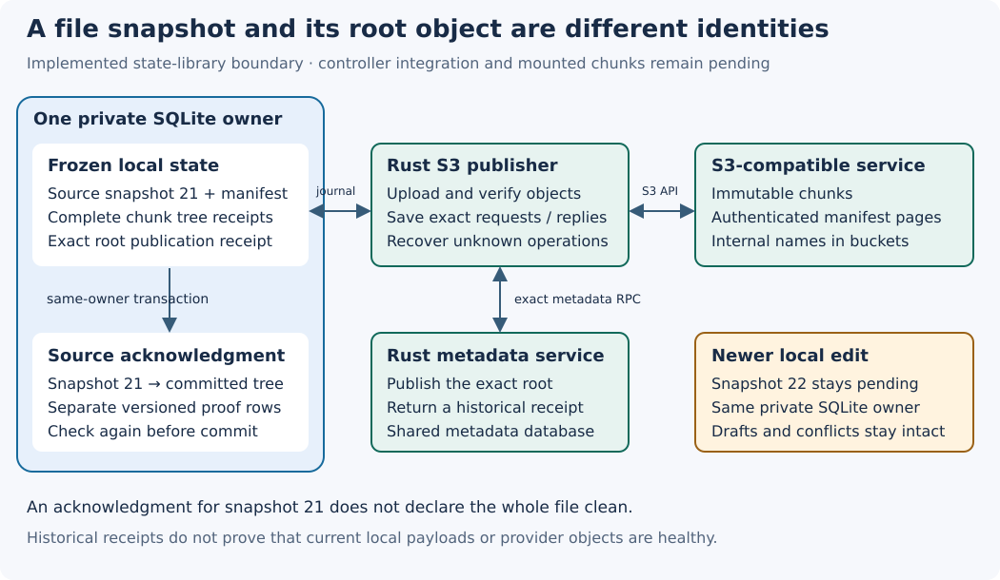

# Exact chunk source acknowledgments

Implementation date: **2026-10-18**. This state-library slice adds an explicit
historical acknowledgment for one frozen chunked file snapshot. It follows the
[root publisher](chunk-root-publisher.md), whose root object and original file
snapshot have different identities and bytes. Controller integration and mounted
chunk callbacks remain unfinished. The full local gate passed; this source's
own hosted acceptance is still pending.

`Storage::chunk_publications().sources()` returns a facade on the same private
SQLite owner. `settle_source(plan_id)` accepts only an admitted plan ID and
returns an opaque `SourceReceipt`. `source_status(plan_id)` returns the complete
publication record, optional exact source acknowledgment and current sealed head.
It keeps unresolved requests and conflicts visible. A matching sealed head says
nothing about building drafts; neither API declares a whole file clean.

The acknowledgment binds the exact source generation and manifest to the complete
committed publication hash, root generation/checksum and historical authority
receipt. It requires an attached source and a successful durable publication
receipt. An unknown or rejected operation cannot become a source acknowledgment.
Callers cannot supply a previously returned root/tree receipt as sufficient proof.

## Persistence and recovery

Schema 28 adds `chunk_source_settlements` and `chunk_source_role`. Existing
publication JSON and hash domains remain unchanged. The new rows have separate
versioned integrity domains, bounded serialized cells and a retained count that
detects missing acknowledgment rows. Permanent reciprocal exclusion of legacy
logical/namespace/open state remains, including orphaned new tables. Authority
initialization, restart preflight and snapshot classification reject nonempty
client settlement state.

An immediate transaction reloads the frozen publication and source mapping,
checks the complete historical chunk receipt tree and validates same-target
ancestry to the current sealed head. It inserts the new proof and retained
count, then reloads the exact effects and repeats the publication/tree, source
lineage and isolation checks after the final write. No mutation or callback
intervenes between that final proof and commit. Repetition returns the identical
receipt. A lost reply requires inspecting/repeating the exact plan; it does not
authorize a replacement operation.

The added lineage walk admits at most 4,096 generations and 1,000,000 total
extents. Exceeding either returns a limit error and retains all history. These
are walk bounds, not a latency guarantee: existing complete publication/tree
validation has separate costs that need measurement before native workloads.
Transitive journal reads now bound the phase field before String conversion and
project chunk digests through a 32-byte substring before allocation. Valid digest
bytes, NULL-hole encoding and existing manifest hashes retain their meaning.

## What the acknowledgment means

The proof records a **historical commit**. It does not hash current local payloads
or query current S3 objects. Same-length local payload corruption after upload
does not invalidate that historical linkage; reading damaged bytes still fails.
Missing or inconsistent retained proof metadata does block acknowledgment.

Settlement of snapshot 21 does not settle snapshot 22 or any ancestor. A later
remote root does not rewrite snapshot 21's authority receipt. The generic staging
pending list, `write_journal.status`, physical remote flushes and physical
settlements remain unchanged. Generic physical upload intent on the exact source
snapshot is refused as mixed semantics. Callers must use the explicit chunk
status rather than infer a generic file flush.

## Verification scope

The focused state suite passed **31 controls**, including **16 new controls**, in
54.76 s. These use real SQLite and its metadata authority, with synthetic physical
upload acknowledgments; they do not establish real-provider behavior.

- Restart, concurrent first acknowledgment, lost local reply and process death
  after the role write, proof write and commit. Every killed child has an
  unsuccessful exit status and is reaped.
- First acknowledgment of an older snapshot after a newer remote root, local
  head and draft exist; acknowledging a newer snapshot leaves its ancestor
  unacknowledged. Generic pending history stays intact.
- Unknown/rejected publication, missing grandchild receipt, mixed physical
  intent, orphan tables, corrupt/oversized cells and schema migration collisions.
- Actual SQLite-full and ignored/deleted/rewritten SQL effects roll back the
  complete acknowledgment. The lineage boundary admits its exact limit and
  refuses the next generation without deleting the historical proof.

Independent static review checked the receipt binding and final immutable
transaction section. It identified the inherited allocation gaps and refinements
to first-acknowledgment/concurrency controls; those were addressed. Projection
inspection establishes the allocation bounds; the corrupt-cell tests establish
rejection, not measured peak memory.

The full local gate passed with all **252 frozen runtime/fixture hashes**
unchanged: 365 state tests / 1 ignored, all 16 new source controls, 59 S3 tests,
34 core tests, 50 authority tests, all 18 existing managed-publication tests,
8 chunk-publication tests, formatting, Clippy, build, 66 documentation files and
62 book chapters. The state suite took 562.46 s. Twelve long-test notices across
the workspace eventually completed; these times are gate observations, not a
benchmark. The [14-member indexed local archive](evidence/chunk-source-settlement-local-20261018.tar.gz)
retains the complete gate, focused controls, review, frozen source map, exact
implementation and runtime delta. Its own hosted cohort remains required. See
the [dated evidence](evidence/chunk-source-settlement-20261018.json).

No payload eviction/reclamation, role release, implicit migration, detached or
removal-owner publication, native chunk activation, fresh provider-health claim
or physical reboot acceptance follows. The next controller slice must connect
root publication/recovery to this facade and prove it with the real SDK and
authenticated loopback authority. Verified manifest range reads and native
lifecycle barriers remain later requirements.
