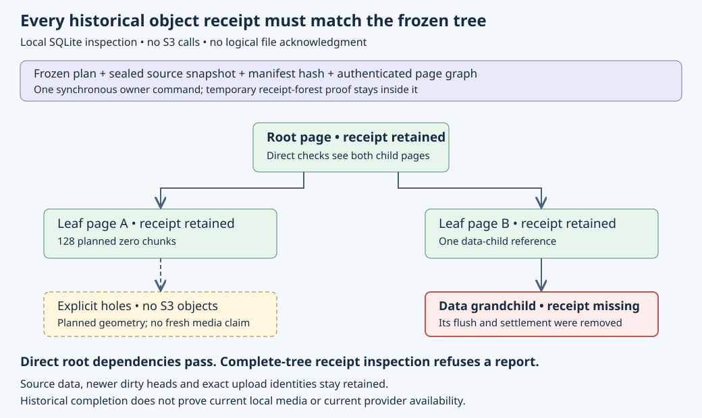

# Complete historical tree receipts

Implementation date: **2026-10-18**. This prerequisite strengthens the
[chunk upload bridge](chunk-object-uploads.md) before a client can publish its
root through the [authority contract](manifest-root-authority.md). It adds no
schema version, metadata RPC, mounted-format option or provider permission.

## Why the root receipt is insufficient

The uploader sends children before parents and requires exact local receipts
before each page. That establishes ordering at upload time. Later, a grandchild's
local flush and settlement records could be lost while its parent and root
receipts remain. Checking the root's immediate children alone cannot detect
this internally consistent but incomplete receipt forest.

`Journal::tree_receipt` runs one synchronous, read-only command on the existing
SQLite owner. It validates the Ready plan, attached sealed source generation and
manifest, all object records and the complete page graph. It then validates the
retained remote receipt forest once and compares **every non-hole transfer** with
its exact physical generation, canonical target, raw checksum, physical size,
create-only guard, Verified phase and single-generation local acknowledgment.
Missing rows are errors; they never become holes.

The temporary `CheckedFlushes` proof stays inside that command. It crosses no
mutation or await and is never cached. The opaque returned `TreeReceipt` contains
the frozen plan, original source snapshot and manifest hash, root descriptor,
root physical receipt, acknowledged-object count and **planned hole-chunk** count.
It is historical data, not a capability to mutate or settle anything.

The S3 `upload_tree` wrapper now finishes through this complete check and compares
its full frozen context with the context captured before the upload walk. Its
existing root/receipt getters remain available. The original source snapshot
still has no remote file-flush acknowledgment.

## Exact scope

This report reads metadata, not current payload media or S3 objects. Planning
originally classified each hole from verified source bytes and recorded its
hash; graph validation reconstructs that planned zero geometry. The uploader
still freshly checks holes during its existing per-object walk. The final report
does not reread every sparse byte in one owner command.

A report can therefore remain valid after local payload corruption: its
historical object acknowledgments still exist, while an ordinary staged read
correctly fails integrity verification. It must not acknowledge that source or
serve as current-media acceptance. Similarly, historical receipts do not prove
that a provider retains every object now. A future publication journal must
reacquire fresh owner validation at its transition rather than trust an old
returned report as authorization.

No constant-latency or scalable-throughput claim follows. Full graph and retained
history validation remain substantial work; receipt lookup currently searches
retained roots linearly, so a full walk can become quadratic. The existing
staging quotas still apply. Optimize and measure this path before admitting
large native workloads.

## Verification and following work

Focused state controls include empty, sparse, binary/Unicode and multilevel
plans; source/manifest binding; all exact receipts; reopen; absent, redirected
and corrupt evidence; no SQL mutations; actual SQLite-full read-only inspection;
and preservation of a newer dirty head. The decisive grandchild test removes
both its flush and settlement, confirms the remaining forest and root's direct
checks still pass, then requires the complete-tree report to fail. Exact local
re-acknowledgment restores the report without any network request.

Real SDK loopback controls check the returned frozen context and counts,
including a sparse file above 128 MiB with four physical objects, unchanged PUT
identities and recovery. These use synthetic credentials and disposable local
fixtures. See the [dated evidence](evidence/chunk-tree-receipts-20261018.json)
for archived logs and source binding. The full local gate passed with 334 state
tests, 59 S3 tests, 34 core and 50 authority tests, all 18 managed publication
contracts, formatting/Clippy/build, 63 doc-link files and 59 book chapters.
Native/provider acceptance and the source-bound hosted cohort remain separate.

The next publication journal needs durable exact reserve/publish requests and
mutual exclusion with namespace/open/logical admission. A one-time absence check
cannot prevent a later removal from closing while a root CAS is unknown.
Legacy `managed::Input`, logical publication links and settlement remain
unchanged and unsupported for manifests. Verified range reading, logical
settlement, native integration and separate provider acceptance remain work.
