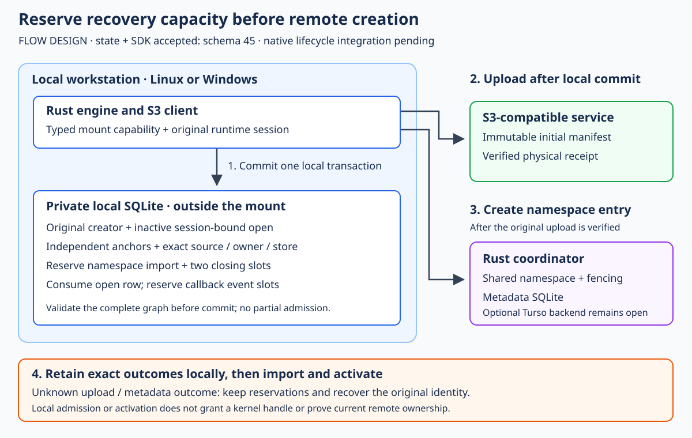

# Prospective creation and open admission

Design reviewed against source on 2026-10-21 at `daf5806`. The
[accepted state layer](creator-open-state.md) now implements step A with
schema 45. [SDK integration](creator-open-sdk.md) is accepted; native integration remains proposed; no user installation was
performed. The selected storage layout is
immutable chunks plus manifests, with ordinary names in the mounted drive.
This phase prepares local recovery capacity for deferred canonical creation;
it does not enable native deletion, replacement or open-unlinked callbacks.

## Problem and acceptance boundary

The accepted [creator import](creator-provenance-import.md) reads a proven
successful creation into the namespace journal. Its quota check happens after
the S3 upload and authority create. Import refusal preserves the creator, but
does not give a native create callback guaranteed capacity to record its open
and eventual cleanup. The next phase must reserve both capacities before the
first mutating remote request.

The current creator durably begins before staging and flushing its initial
manifest. Its input binds the original owner but not an open or mount session.
The open journal separately reserves future callback events when preparing a
controlled open. Combining these in one local transaction is the proposed
change. These facts come from the accepted [creator SDK flow][sdk-flow],
[creator journal admission][creator-begin], [namespace importer][import] and
[open preparation and accounting][opens].

Done means a typed, session-bound creation can never start an upload without
that local transaction committed, and competing local work cannot consume its
reserved closing capacity. It must preserve exact identities through lost
replies, restart, corruption refusal and disk-full rollback. It does not promise
that a later local write cannot encounter disk failure, or that a local receipt
proves current remote ownership.

## Proposed persisted identities and API

Introduce an opt-in creator format 3, with an optional `open` claim containing
the open ID, current mount-session ID, delete-on-close flag and POSIX behavior.
The original creator supplies the volume, operation/node, source, store and
owner. The open is always controlled and session-bound. IDs retain the existing
canonical nonzero lower-case hexadecimal constraints. An `open` claim requires
an owner. Its staging key uses a new format-3 domain; the canonical initial
manifest body and existing authority mutation remain unchanged.

Add a separate optional creator-operation reference to `OpenInput`, omitted
when absent. It is mutually exclusive with the existing full namespace
`admission` field: the authority ETag/request does not yet exist at local
admission time. The row must be derived from the creator, rather than accepting
an independently supplied source, owner or target. Old input serialization,
hashes, staging keys and role proofs must remain byte-for-byte unchanged.
The existing formats and staging-key domains are defined in [creator input][input].

Proposed entry point: `Creator::create_for_open(draft, chunks, open_claim)`.
It requires a retained typed chunk capability on the same SQLite worker, same
volume and source/store binding, and obtains the owner from that capability.
A chunk-bound creator journal performs fresh format-3 admission; the generic
creator journal cannot create one. Generic open preparation cannot fabricate
or reconstruct a prospective open. Exact historical reads remain possible.

Reuse the original Creator's concurrency slot and deadline. Do not construct a
new Creator per call: its recovery object owns the existing send/recovery
serialization. The SDK's old receipt/unknown-upload recovery branches must
remain before fresh policy/probe work. Repeated input must match exactly;
changing the open/session claim under an existing operation is a conflict.
The [typed chunk client][chunk-client] already exposes same-worker and ownership
checks; this is an extension of that capability, not a new caller authority.

## Single local admission transaction

Before any S3 PUT or authority mutation, one immediate SQLite transaction must:

1. Check the retained chunk binding, creator/source controls and current runtime
   session. Reject a foreign worker, changed owner, obsolete session, duplicate
   open, changed retry input or operation collision.
2. Project creator, namespace, open-row and open-event limits together. Reject
   admission before remote mutation if any budget is unavailable.
3. Insert the format-3 creator and update its role projection; insert the
   inactive open row and its retained independent anchor. Register/check the
   original source inside this same transaction.
4. Read back and validate the whole graph, then commit. Only this committed
   result permits the SDK to stage/upload and submit the exact metadata request.

No new table or increased limit is proposed. The creator carries the durable
reservation identity. The existing open row actually consumes row capacity and
reserves callback capacity; it is not a separate counter that could drift.
An admitted open is inactive: no kernel handle or local activation follows
merely from successful local admission.

## Namespace and open budget rules

Current limits are 256 live open rows, 4,096 open-event slots and 4,096 namespace
intent slots. An empty controlled open reserves 11 event slots: activation 1,
cleanup 6 and close 4. Namespace history already accounts for its rows plus
future deferred/pending closure. These are the existing [open calculation][opens]
and [namespace calculation][namespace-budget], not new quota settings.

| Retained prospective creator state | Additional namespace budget | Open budget |
| --- | --- | --- |
| Admitted; no final authority result locally known | 3: future import row plus two deferred closing slots | Actual inactive row and existing controlled-event reservation |
| Successful authority receipt, not yet imported | Same 3; a receipt does not release the reservation | Same; activation is still forbidden |
| Exact successful namespace import exists | 0 additional: the imported row and active deferred history now supply the same budget | Original row; activate only after verified import |
| Exact terminal authority rejection retained | Release prospective namespace 3 | Keep the row until explicit recovery closure/retirement |
| Missing, damaged or contradictory proof | Refuse the operation/load; never interpret damage as released credit | Preserve records; refuse closure inferred from damage |

Every namespace fresh admission, success/rejection acknowledgment and import
capacity check must include unconverted creator reservations. Preserve the
existing reserved credit for legitimate closing transitions. Only the exact
successful canonical import can convert a creator's reservation; a different
mutation with the same operation must be refused. Use checked bounded sums and
validate the reservation before granting credit. Repeat import charges once.

Known rejection must be the exact immutable authority result for the saved
request. A timeout, lost reply, unobserved upload or absent namespace row is not
rejection. Successful import changes no creator input/hash or stage identity.
Subsequent cancellation/closure follows the existing retained history; it does
not recreate the original reservation when the deferred owner disappears.

## Validation graph without recursive loaders

The proposed cross-reference creates a potential cycle: namespace import checks
creator provenance; creator checks its open anchor; the open checks creator
origin and namespace activation. Do not implement this by recursively invoking
the full role loaders.

Separate bounded creator metadata validation from full physical-witness checks.
Metadata validation must still check all creator membership, format, hashes and
role projection. A creator's open-anchor validator reads the bounded raw open
input, owner, row checksum and retained anchor, without reducing its events or
loading namespace history. The full open loader checks its creator origin
through the metadata projection, then validates its own events normally.
Targeted successful-creator access checks the selected physical witness and
selected original open anchor; full-role validation checks all witnesses.

Creator save currently performs immediate full readback. Factor a private
write-only primitive so the creator and open can both be inserted before graph
validation, inside the same transaction. Never expose a half-validated row to
the worker or commit it as an intermediate state. Reuse one open-row insertion
primitive for accounting, retained anchors and readback; avoid duplicating SQL
with different guards. See [creator save][creator-save].

## Activation, restart and abandonment

Fresh activation requires the current runtime's original session, verified
successful creator import, original owner/fence and current acknowledged local
deferred event. It must reject cancellation, successor ownership and unresolved
namespace effects. Persisted activation-proof validation must also match the
frozen creator origin, not merely the node/source. Historical event replay
cannot grant a new kernel handle. Live remote fencing remains a later native
integration requirement.

Old sessions may be inspected and recovered, but never revived as fresh handles.
Today session abandonment checks unresolved namespace/admission work. A
prospective creator can still be uncertain *before* it has a namespace row, so
the new origin reference must become an explicit barrier in recovery preparation,
recovery-proof validation and retirement. Otherwise a restart could classify an
inactive open as having no effect and free the promised capacity while the
remote create is still uncertain. See the current [session recovery][session]
and [retirement conditions][retirement].

Do not release a reservation because a process died, credentials expired, a
staged body was damaged, or the user started another session. Resolve the exact
original outcome first. A known rejected creation can use explicit obsolete-
session closure without fabricating an activation or successful namespace row.
A successful creation must be imported and retain its exact closing work before
abandonment. Physical upload conflicts and outcomes without a terminal authority
result remain retained unless a separately specified proof establishes safe
closure. This phase must not introduce automatic deletion or garbage collection.

## Compatibility and historical recovery

Propose schema 45 as a marker-only change, contingent on the acceptance tests
below. Guard against format-3 creator and creator-referencing open shapes under
older markers **before** any transaction-local marker jump. Preserve schema-44
and schema-43 roles with strict current validation and atomic rollback; retain
the existing pre-44 canonical-import guard against its original version. No old
BLOB, JSON, hash or independent proof may be rewritten. Earlier unsupported
role upgrades stay explicit refusals. Current ordering is in [initialization][init].

Legacy format-1/2 records have no prospective reservation. They remain readable
and exactly recoverable under their original input and staging identity. A
successful legacy creation can still hit import quota; preserve its receipt and
bytes and report that refusal. Do not claim this design retroactively reserves
capacity for it, relabel it format 3, or silently discard another record. A
saturated historical-import recovery/compensation path remains separate work.

## Independently green delivery steps

| Step | Required behavior and evidence |
| --- | --- |
| A — state admission and validation | [Accepted state layer](creator-open-state.md),20420d7/schema45, full local and own Linux/Windows/book/native regression acceptance. No SDK or native call site enabled. |
| B — SDK entry point | [Accepted SDK](creator-open-sdk.md),8022fae3. Same-worker capability and shared concurrency/deadline; no PUT/authority mutation on quota/session/binding refusal; exact replay/observation after uncertain remote outcomes through the real SDK and loopback authority. |
| C — hosted acceptance | State source20420d7 passed these gates. SDK step B source8022fae3 also passed its fresh full local/exact-source Linux and Windows/native regression/strict artifact/source/raw-log gates; physical/provider gates remain separate. |
| D — later native lifecycle | Sparse owned-unlinked publication with original fence/current event, unresolved-effect barriers and FUSE/WinFsp deletion/replacement tests. No lifecycle flag enabled by A–C. |

State acceptance must cover exact/changed retries, operation collisions,
foreign worker/owner/source/store, obsolete sessions, missing or forged
cross-references, self-consistent role rewrites against independent anchors,
and refusal before quota consumption. Fill each budget independently; also fill
the remaining namespace slots with unrelated work after admission, then import
and close the original creator without losing its credit. Exercise concurrent
admissions, success/rejection conversion, repeated import, and the original
closing-transition credits at the limit.

Kill actual workers before/between creator and open writes, before/after commit,
after remote commit but before local acknowledgment, and during import and
activation. Use actual SQLITE_FULL at admission/import/activation and verify
rollback preserves the original source and marker. Metadata-only recovery must
work without credentials or staged body bytes when original proof is sound;
damaged provenance must fail. Use a child-owned current session and an explicit
readiness barrier rather than reusing a parent's obsolete runtime session.

An actual schema-44 binary must refuse a disposable schema-45 database without
changing it; restore and verify the new binary afterward. Portable unit tests
do not establish WinFsp/FUSE, Wasabi, physical sign-in/reboot or multi-host
fencing behavior. The [state layer](creator-open-state.md) has full local and
hosted acceptance; the [SDK step](creator-open-sdk.md) also passed its own full and hosted gates.
**Integrated native lifecycle acceptance remains pending**.

## Original design publication evidence

For the original documentation-only publication, `bash scripts/gate.sh` passed
on 2026-10-21 in 917.02 seconds, exit 0,
with all 729 draft inputs unchanged during the run. All 37 test cohorts passed;
every slow-test notice resolved to a pass. Gate-log SHA256:
`e9f6656fe042bba2cfd873a04efd10f2cc995875ce275093e6aa7ffbf7c62bcb`.
All 377 accepted runtime inputs match the previously accepted runtime exactly.
The SVG was rendered and visually reviewed. Final citation/evidence notes were
checked again with schema-fixture/link checks, mdBook build and mdBook tests.

The additional [main CI run 39605585564](https://github.com/marshallr12/s3drive/actions/runs/39605585564)
at `daf5806` also reports Linux, Windows and book success. That is a status
observation for the existing runtime, not acceptance of this proposal. No new
provider, startup installation, native lifecycle or schema behavior was tested
or enabled by this documentation change.

[sdk-flow]: https://github.com/marshallr12/s3drive/blob/daf580667232900ec10193fd7d23b4e4b891ddec/crates/s3drive-managed/src/creation.rs#L350
[creator-begin]: https://github.com/marshallr12/s3drive/blob/daf580667232900ec10193fd7d23b4e4b891ddec/crates/s3drive-state/src/manifest_creation/journal_impl.rs#L28
[import]: https://github.com/marshallr12/s3drive/blob/daf580667232900ec10193fd7d23b4e4b891ddec/crates/s3drive-state/src/namespace_client/creator_import.rs#L129
[opens]: https://github.com/marshallr12/s3drive/blob/daf580667232900ec10193fd7d23b4e4b891ddec/crates/s3drive-state/src/namespace_client/opens.rs#L537
[input]: https://github.com/marshallr12/s3drive/blob/daf580667232900ec10193fd7d23b4e4b891ddec/crates/s3drive-state/src/manifest_creation/input.rs#L8
[chunk-client]: https://github.com/marshallr12/s3drive/blob/daf580667232900ec10193fd7d23b4e4b891ddec/crates/s3drive-state/src/chunk_mount.rs#L431
[namespace-budget]: https://github.com/marshallr12/s3drive/blob/daf580667232900ec10193fd7d23b4e4b891ddec/crates/s3drive-state/src/namespace_client/removals.rs#L262
[creator-save]: https://github.com/marshallr12/s3drive/blob/daf580667232900ec10193fd7d23b4e4b891ddec/crates/s3drive-state/src/manifest_creation.rs#L319
[session]: https://github.com/marshallr12/s3drive/blob/daf580667232900ec10193fd7d23b4e4b891ddec/crates/s3drive-state/src/namespace_client/opens/session.rs#L285
[retirement]: https://github.com/marshallr12/s3drive/blob/daf580667232900ec10193fd7d23b4e4b891ddec/crates/s3drive-state/src/namespace_client/opens/retirement.rs#L16
[init]: https://github.com/marshallr12/s3drive/blob/daf580667232900ec10193fd7d23b4e4b891ddec/crates/s3drive-state/src/lib.rs#L323
