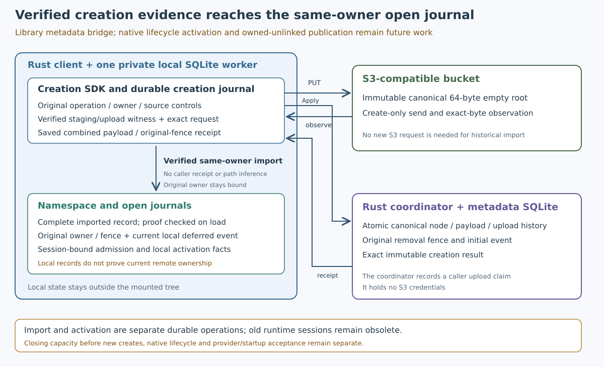

# Verified creator provenance import

Accepted 2026-10-21 at runtime `3c38ad1bdf3aad9f41a202af1e6120ed2e6cfd57`,
schema 44, with 377 runtime inputs and 15 runtime changes from main `25fc926`.
This implements the local metadata bridge between [verified creation](deferred-creation-client.md)
and namespace/open journals. Native lifecycle callbacks remain unsupported in
the chunk profile.

## Implemented contract

`Namespace::import_creation(operation)` requires an existing chunk capability.
It reads the original creator from that capability's SQLite worker. The caller
supplies no receipt, owner, filepath or source replacement. The original creation
must have an acknowledged format-2 request, combined publication/fence receipt,
matching volume/store/source controls and the same retained client owner.
Ordinary, unknown, rejected, foreign-owner or corrupted creation records cannot
be imported. A remote node's existence cannot substitute for a locally saved
exact receipt.

Import inserts the complete original request and successful receipt in one SQL
transaction. No pending namespace surrogate or metadata-empty creation is
fabricated. The loader rechecks the independent creator before returning the
namespace record. A self-consistent rewrite of namespace input/outcome/hash, or
of both namespace and creator records, still fails against the original staging/
upload witness. Fresh generic namespace `begin` refuses this mutation; exact
`get` and repeat import retain historical results.

Targeted provenance reads validate the complete creator role's record/hash/
format projection and then the selected creator's original physical witness.
Full-role APIs continue validating all physical witnesses. Body bytes are not
read or repaired during historical import. Damaged staged bodies and absent
credentials therefore do not prevent recovery when the retained metadata proof
is valid. Damaged provenance does prevent it. No S3 request or new permission is
issued by import.

The new namespace row reserves the existing two closing slots for its deferred
owner. Quota refusal leaves the original creator intact. Import does not reserve
capacity prospectively for a future remote create; native create wiring must
add that admission before sending S3 or authority mutations.

## Open and session behavior

Creation-bound open preparation requires the completed import. Local activation
uses exact retained namespace history, original owner/fence and the current
acknowledged local deferred event. Reimporting an old receipt cannot rewind a
known cancellation or adopt a successor epoch. An import can finish before open
admission; that durable intermediate state can be recovered exactly.

These are local journal facts. They do not prove that an unobserved remote
operation has not happened or grant a live kernel handle. Native integration
must retain its live authority/fence checks. Old runtime sessions remain obsolete
after restart; they cannot be reused for fresh handle preparation. Retained
callback facts and exact historical replay remain available for explicit session
recovery. No obsolete-session, queue, deadline, quota or driver-stack guard was
relaxed.

## Schema and rollback

Schema 44 is a compatibility marker with no DDL or new table. For valid schema-43
chunk roles, an old-shape guard runs before a transaction-local marker change.
Strict role/namespace/open/creation validation then runs before committing the
upgrade. Failure rolls back the marker and every row. Existing JSON/BLOB/hash
bytes and independent witnesses remain unchanged. Imported canonical namespace
shapes under an older marker are refused; missing references cannot launder new
open/event shapes through migration. Earlier unsupported role migrations remain
explicit refusals. Future marker changes must preserve original-version guards
before any transaction-local marker change.

A real Linux binary from accepted schema-43 source `ef26d6d` refused a disposable
schema-44 database without changing its bytes. Cargo restored the actual new
schema-44 binary afterward; its SHA256 matched before and after. State-package
artifacts were invalidated at each worktree switch because shared-target Cargo
freshness alone is not runtime-version evidence. No user database was opened by
this compatibility control.

## Verification and evidence

The complete local gate passed in 874.84 seconds with exit 0 and all 723 source
inputs unchanged. Log SHA256:
`541307c3c948433d62f7222799b5bc58fceb2dbb4ae59a899871417ea0f258d7`.
Own [CI 39599329985](https://github.com/marshallr12/s3drive/actions/runs/39599329985),
attempt 1, passed Linux, Windows and book jobs. Exact GitHub source ZIP/all 723
digests matched (ZIP SHA256
`ee9210b69f9b0a54ed38687e87d0d252a76312fcf7f66f03b8a6945a02783c8f`).

All 14 state cases and three SDK cases passed in both hosted Rust jobs. They
cover seven real-worker kill boundaries, actual SQLITE_FULL rollback during
import/open preparation/activation, closing headroom, unknown local receipts
after real authority commits, independent proof corruption, byte-preserving
43→44 upgrade, failed-upgrade rollback, ordinary/foreign-owner refusal, historical
cancellation/successor separation and metadata recovery with damaged bodies and
no credentials or write-policy file. The [SDK fixtures](https://github.com/marshallr12/s3drive/blob/3c38ad1bdf3aad9f41a202af1e6120ed2e6cfd57/crates/s3drive-cli/tests/chunk_publication/creator_import.rs)
use real HTTP/SDK paths and disposable loopback storage. State physical proofs
and bulk ordinary-directory quota receipts are modeled; they do not establish
live-provider conformance.

Existing real FUSE/WinFsp v8 Unicode directory and canonical chunk file I/O,
flush/resize/remount, the 128KiB callback control and old native/startup regression
gates also passed. Hosted images: Ubuntu24.04/20261018.339.1 and
WindowsServer2025/windows-2025-vs2026/20261007.264.1. These do not certify physical
MX Linux or Windows10/11 reboot/sign-in behavior.

Exact API artifact ZIP digests, independent strict 21 replacement/14 disposition
records, project oracles and every raw-record field/JSON type matched. Full
raw-log review verified later passing completion after all 17 slow notices and
all 15 interleaved reference-test completions. Three disposable Windows VM
profiles stayed locked; dummy credentials were removed and profile deletion was
deferred to VM disposal. Following PASS lines and the cleanup script's failure
list were checked. Tooling/linker deprecations remain in the evidence.

- [Local indexed archive](evidence/creator-import-local-20261021.tar.gz): 412 members, 1039629 bytes; SHA256 `e1aa32aa57c40f392edaeb2f0f955a64baf4a29bc28ceedc11a4d6adfdd39655`. Every member verified.
- [Hosted indexed archive](evidence/creator-import-hosted-20261021.tar.gz): 37 members, 132770 bytes; SHA256 `3f4591648357e92070349af60667cba15e94520aadcb4c13190a0467609d13eb`. Every member verified.

Archive writers are complete and must not be rerun. Earlier development failures
are retained: a missing helper lifetime, missing parent fixture directory,
obsolete-session and ordinary pending-node-read fixture assumptions, and a Debug
formatting error. The corrected worker fixture snapshots committed child setup
at a ready barrier before stopping the target transaction. Existing runtime
session and owned-removal rules remain enforced.

## Following work

Reserve closing capacity before native remote creation, including safe recovery
of already acknowledged but not yet imported creators. Then bind sparse
owned-unlinked reservations/publication to the exact original fence and current
removal event, retain dirty/newer views and block final removal while effects or
local source acknowledgments remain unresolved. Enable native delete-on-close,
save-replace/rename/delete only after their exact state/SDK/FUSE/WinFsp gates.

Cold metadata recovery, retry-forest closure, retention/GC, physical startup,
independent-host partitions/fencing/deployment/restore, packaging and freshly
approved managed Wasabi acceptance remain incomplete. This phase provisions no
service or startup hook and grants no live-provider mutations. Optional Turso
and both coordinator hosting choices remain open.
