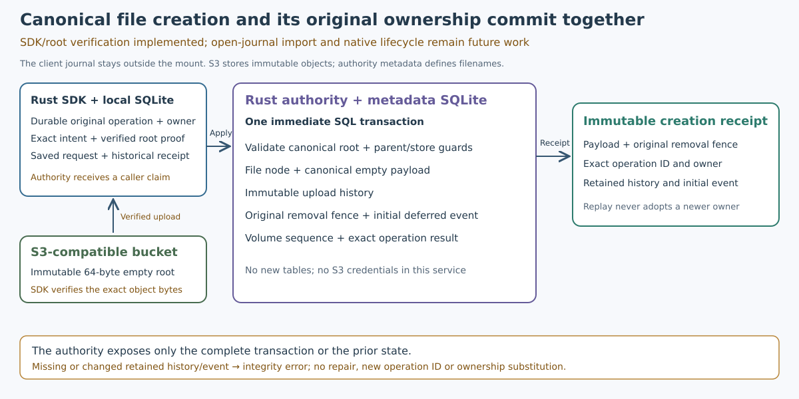

# Deferred canonical creation client

Declared2026-10-21 from accepted main8601973/schema42/runtime372. Accepted runtime9381456/schema43
implements the client library; native lifecycle activation remains future work. The accepted
[authority transaction](atomic-deferred-manifest-create.md) records a combined
canonical payload and original removal fence; the client must now persist its
intent and independently verified physical proof before requesting that effect.

Add explicit `Creator::create_deferred(draft, owner)` alongside ordinary creation.
The original operation/owner/name/parent/store/source must be admitted durably
before staging or sending. Validate the owner as a nonzero32-hex-digit identity;
never derive it from a path or another node. Ordinary Draft/create behavior and
existing format1 JSON/hash/staging keys stay unchanged. An optional owner field
is omitted when absent. Owner-bearing intents use format2 and a distinct,
owner-bound staging-key domain; the immutable canonical root identity and bytes
still derive from the original operation and store.

Use schema43 only as a compatibility marker, without new tables or old BLOB/hash
rewrites. Refuse format2 under earlier markers, including restricted recovery.
A format/owner mismatch is corruption. New request preparation must select
CreateDeferredEmptyManifest, require atomic-deferred-empty-manifest-v1 plus the
existing manifest/history support, and accept only the exact combined receipt
whose fence intent/owner and canonical payload match the original input.

Keep the executor's create-only send/observe discipline. Unknown physical sends
are observed before fresh admission; saved metadata requests and outcomes replay
before fresh policy/features, without a new operation ID or owner. Restricted
recovery keeps its existing no-credentials/no-source-body/no-staging/no-new-intent
capability. A self-consistent owner/request/receipt rewrite must fail against the
independent original staged-operation/upload metadata. Return historical creation
metadata and the original fence only; no active open/removal right is minted.

Done criteria:

- Local format2 intent, staging link, verified proof, prepared exact request,
  combined acknowledgment/rejection and restart work through public journal APIs.
  Preserve format1 bytes/hashes/staging identities through42→43 migration and
  ordinary SDK behavior; reject old markers, wrong owner/fence/format, forged
  receipts and independent-proof disagreement without repair.
- Owned SDK loopback fixtures cover binary canonical root upload, Unicode names,
  empty logical reads, collisions, feature/policy rejection before fresh PUT,
  unknown PUT observation without resend, lost metadata reply and killed-owner
  restricted recovery with damaged body/absent credentials. Exact original owner
  survives historical replay and a successor removal epoch.
- Retain quotas, SQL_FULL rollback, bounded cancellation/queue/owner behavior and
  same-storage chunk capability composition. Complete own unchanged-source local
  and Linux/Windows/book/native regression gates before promotion.

Expected footprint: manifest creation input/format/validation, Creator API and
feature selection, focused state/SDK fixtures, schema marker/native assertions,
book/handoff. No new dependency, native callback, provenance import, sparse
owned-unlinked publisher, GC or service provisioning. The [verified provenance import](creator-provenance-import.md) now retains this
exact creator in the same-owner namespace/open journal. Subsequent publication
must bind the original fence and current event. Real provider and physical
startup acceptance remain separate. Keep both hosting choices/Turso open and
repository visibility public; only read-only visibility checks are authorized.

## Client acceptance —2026-10-21

The full local gate passed841.84s/exit0 with all716 source inputs unchanged.
LogSHA `3f2edc0f7f7010c9b8aa73cd04352f2474ce38c9e0307924176a3479a6f18673`.
All seven new state and six SDK cases pass, including the extended cross-journal
Unicode collision/missing-feature controls and all eight killed-owner boundaries.
The two dispatcher cancellation cases pass. Existing format1 bytes and staging
identities survive42→43 migration unchanged. A real schema42 Linux binary refuses
a disposable43 database without changing its bytes; Cargo restores the new43
binary and its original hash. No real user database was opened by that control.

Own [CI39587227416](https://github.com/marshallr12/s3drive/actions/runs/39587227416)
attempt1 Linux/Windows/book all succeeded. Exact GitHub source ZIP verified all716
input digests (SHA256 `4c0307561831ab841298c105653bbedd9b91deed026b2995ab2d1ccfef67e72a`).
The runtime map covers374 paths, exactly15 changed/added from accepted8601973.
No dependency, DDL table, quota, deadline or callback-stack threshold changed.

Both hosted Rust jobs passed all seven new state and six SDK cases and both
polled/unpolled dispatcher cancellation cases. Existing real FUSE/WinFsp v8
Unicode folders and chunk file create/read/write/flush/resize/remount,128KiB
callback control and old native/startup regression checks also passed. The new
client tests use owned SDK/HTTP fixtures and dummy credentials; they are separate
from real-provider conformance and physical workstation startup acceptance.

Exact API artifact ZIP digests, independent strict21 replacement/14 disposition
records, project oracles and all35 raw-record fields and JSON types matched.
Full raw-log review checked later passing completion after all17 slow notices
and all15 interleaved reference-test completions. Three disposable Windows VM
profiles remained locked; dummy credentials were removed, deletion deferred to
VM disposal and following pass lines reviewed. Tooling/linker deprecations remain
in the evidence. Hosted Linux: Ubuntu24.04/20261012.334.1; Windows:
WindowsServer2025/windows-2025-vs2026/20261007.264.1; book runner:
Ubuntu24.04/20261018.339.1. These results do not certify a physical desktop.

- [Local indexed evidence](evidence/deferred-client-local-20261021.tar.gz):404 members,1028125 bytes; SHA256 `a0ef5ea5ea27aee72b664bd84757dfa7043e01814753d96fff308a99b474b185`. Every member verified; archive writer is complete and must not be rerun.

- [Hosted indexed evidence](evidence/deferred-client-hosted-20261021.tar.gz):36 members,131536 bytes; SHA256 `fb4eb0683ca46c861d7bc44b6af355e83e71d54d4ade0c23033dd65c5e8803c5`. Every member verified; archive writer is complete and must not be rerun.

The additional async creation branch exposed a compiler Send-proof recursion
limit in the existing native dispatcher. Creation uses a boxed mode future;
the private dispatcher constructs its owned Tokio task before returning the
join future, so the join type contains the handle and abort guard. Admission
still happens first, within the public async callback body, with the existing
four-slot limit. No recursion limit, driver stack threshold, deadline or quota
was raised. Tests confirm that cancellation of both a polled and an unpolled join releases
the owned job and permit. This dispatcher change is part of this phase's native
regression footprint; no new native lifecycle operation is enabled.

The [verified provenance import](creator-provenance-import.md) now implements the
same-owner SQLite bridge. A historical receipt alone cannot grant a kernel
handle or change the owner. Prospective closing admission, sparse owned-unlinked
publication and native lifecycle gates remain subsequent work.

Development compiler checks1/2 failed with E0275 while proving Send through the
expanded SDK future. Check3 passed after the boxed creation/join boundary; the
complete accepted gate then ran on unchanged9381456. The compile failures and
all focused/full-gate logs are retained in the local archive. No compiler limit
was increased. The compatibility control explicitly invalidates state-package
artifacts at each shared-target switch and checks actual43/42/43 CLI behavior;
Cargo freshness alone is insufficient. The new binary hash matched before/after.
