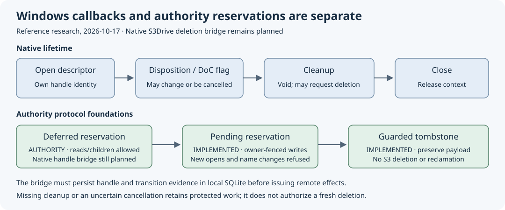

# Deferred removal authority

**Implementation contract, 2026-10-17.** The accepted
[Windows reference results](windows-disposition-reference.md#observed-ntfs-results-2026-10-17)
require a state before pending-open denial. This phase adds the authority and
client-journal foundation; native callbacks remain unsupported until their
complete lifecycle acceptance. It is not the final Windows drive contract.

## State and operation identity

`PrepareRemoval` reserves an existing live node with guarded node/parent and a
stable client owner. Unlike ArmRemoval, it permits nonempty directories and
does not deny reads or ordinary child operations. The operation ID establishes
the fence. Ordinary source/target rename, replacement and removal of the
reserved node remain fenced; explicit owner rename/create-with-deferred-reserve
operations must be added before native delete-on-close support is enabled.

`TransitionRemoval` compares current mode, fence, node and parent revisions.
Deferred to pending requires an empty directory; pending to deferred retains
the same fence. It never silently releases ownership or acquires a fresh claim.
CancelRemoval releases either mode without reverting bytes. CommitRemoval
requires pending mode and an empty directory, then retains the tombstone. A
nonempty deferred final cleanup must explicitly cancel/preserve the directory;
it cannot ignore a failed promotion or leave its name permanently stranded.

Node/payload identity, placement and names are preserved by these transitions.
Owner publication uses the existing complete content guard and immutable
verification path in either mode. A mode change keeps the same ownership epoch;
cancel/commit expire it. Unknown namespace outcomes reconcile with original IDs.
Prepared publications must settle or be explicitly retained as confirmed
conflicts before a local transition. Dirty bytes and original bindings survive.

## Durable transition proof

Schema 16 retains the mode plus append-only events bound to exact authority
operation results. Current mode and reservation must agree with the latest event
for the node. Its origin arm/prepare and latest transition/closing receipt must
validate. Missing rows/events, rollback to an old mode, inconsistent ownership,
ignored SQL effects or receipts fail closed. Current payload may advance only
through the matching owner's verified publication; mode changes have their own
explicit immutable proof and do not weaken that corruption check.

The event's operation foreign key is deferred within the existing transaction,
so mutation, event, sequence and exact receipt commit together. SQLite checks
deferred keys at commit and allows an inner savepoint release before that point.
[SQLite foreign-key documentation](https://www.sqlite.org/foreignkeys.html#fk_deferred),
checked 2026-10-17. Migration validates old active reservations and seeds their
origin events without changing old Node, ordinary guards or stored requests.
Conflicting schema/data must leave the old database and version untouched.

Reserve two future result slots for each deferred reservation (promotion plus
commit), and one for pending. Promotion consumes its reserved slot. Local
capacity uses the same distinction; an unknown closing/promotion request keeps
its original identity and cannot consume future successful-closing headroom
by acknowledging a failure at the limit. This is not a disk-space reservation.
No history pruning, S3 deletion or ownership timeout is introduced.
At exhausted history capacity a rejected mode change can remain locally
unacknowledged: it is not discarded to free a closing slot. Automated
cancel-as-recovery for an unresolved transition is not implemented in this
phase; the native lifecycle must resolve that case before enabling cleanup.

## Acceptance and remaining native work

Require authority and client tests for deferred reads/children, pending denial,
content fencing, same-fence transitions, cancellation, nonempty refusal, replay,
stale modes/guards, corruption/missing evidence, atomic ignored writes, actual
full disk, old-state migration/refusal and closing quota. Independent TCP clients
must race transitions and recover exact dropped results across restart. Actual
SDK owner publication in both modes must preserve binary/empty/Unicode bytes
and avoid duplicate PUTs after client death. Run the repository gate, terminal
exact-tip Linux/Windows/book CI and existing native/reference/startup gates.

Before enabling native deletion, additionally implement atomic deferred create,
owner-fenced rename/replacement and persistent per-descriptor/node-wide state.
Probe multiple delete-on-close descriptors and deferred rename explicitly; NTFS
cross-context observations are not WinFsp equivalence. Retain uncertain cleanup
and cancellation for recovery/diagnostics. No narrower SetDelete-only or
early-open-denying substitute completes the requested Windows filesystem.

Local verification passed on 2026-10-17: repository gate exit 0, 167 state tests,
seven authority TCP tests and nine managed-publication cases. Tests include
actual SQLite-full transition rollback, eight killed authority disposition
boundaries, schema-15 migration/refusal and five killed SDK client stages without
duplicate PUTs. These fixtures are not live Wasabi or native Windows deletion
evidence. Candidate publication additionally requires the unchanged hosted
native/reference/startup suites described above.
