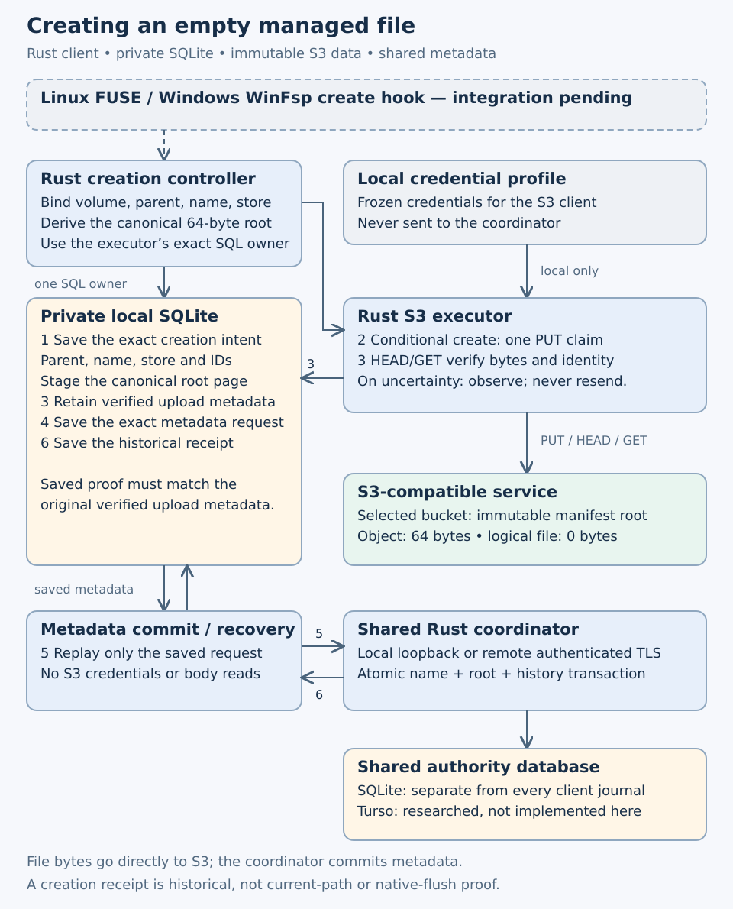

# Empty-manifest client integration

Source review: 2026-10-19. **SDK creation and recovery accepted at950479c/schema40; native chunk-write bridge remains proposed.**
The [atomic authority operation](atomic-empty-manifest-create.md) is accepted
at source29eb237/schema39 after its own complete local and hosted gates. It deliberately cannot prove an S3 upload:
the client must make and verify that upload before submitting the metadata request.
This work must lead into normal native create/write/flush, rather than introduce
another disconnected write profile.

## Reuse and limits found in the current sources

The accepted [S3 executor](https://github.com/marshallr12/s3drive/blob/12a2f2a7d836aab518c7b0d60675234d6470ef97/crates/s3drive-s3/src/uploads.rs)
already provides source-bound create policy checks, exact staging targets,
single-use send claims and observation after uncertainty. Repeated submission of
an already claimed generation observes its original object; it does not acquire
another PUT permission. Reuse that executor for the canonical64-byte page body.
The logical file is empty, but the staged/uploaded object is not.

The [local namespace journal](https://github.com/marshallr12/s3drive/blob/12a2f2a7d836aab518c7b0d60675234d6470ef97/crates/s3drive-state/src/namespace_client.rs)
accepts a fixed list of older namespace mutations; CreateEmptyManifest is not
one of them. Its constructor also enforces legacy-role restrictions. Merely adding
the mutation to that list does not establish safe coexistence with sparse views,
manifest publication and Windows open-handle recovery.

The [shared storage owner](https://github.com/marshallr12/s3drive/blob/12a2f2a7d836aab518c7b0d60675234d6470ef97/crates/s3drive-state/src/worker.rs)
already owns the connection, lock and bounded command queue. Generic immutable
staging can serve physical objects. Keep creation records and staging on that
same owner; do not open a second connection against its private directory or
relax legacy logical-writer isolation. The [native bridge review](native-chunk-integration.md)
identifies the separate typed composition and lifecycle changes still required.

## Client and service architecture

This depicts the candidate SDK path. The dashed native-create hook is not enabled.
The empty logical file has one real64-byte manifest object in S3. File bytes go
directly to S3; the coordinator commits namespace metadata. Its current database
is SQLite; Turso remains optional research. The existing-only recovery owner
replaces the normal worker after it closes, preserving one private SQL owner at
a time. It reads saved requests and independent upload metadata, not source bodies
or S3 credentials. A historical creation receipt does not prove the path is still
live or that a mounted file has been flushed.

## Required durable sequence

1. Bind the exact authority volume, configured store, S3 route, local credential
   generation and create-operation ID. Negotiate atomic-empty-manifest-v1 before
   any fresh upload permission. Refuse unsupported or changed bindings explicitly.
2. Persist the full creation intent: parent/revision, portable name, expected
   sequence, operation IDs and immutable store identity. Derive the canonical root
   locally with node and root generation equal to the create-operation ID. Retain
   a stable, domain-separated staging-operation key; a lost local reply must not
   allocate another object, node or name.
3. Seal precisely the canonical page bytes under the exact derived target.
   Link the generation to its creation intent durably. Before a fresh send, apply
   the existing policy and source checks; use create-only conditional upload and
   full-byte verification. Reject nonmatching remote bytes or identity.
4. Persist the verified physical receipt and then the exact CreateEmptyManifest
   request, including its ETag/version and upload-operation binding, before RPC.
   These are distinct stages: the final metadata request cannot be manufactured
   before a real physical proof exists. SQLite failure after upload retains the
   original generation for observation/recovery.
5. Submit/recover only that saved metadata request. Validate the complete returned
   node, canonical manifest, placement, publication history and operation receipt.
   Save the receipt without substituting a newer live node. Name collision or a
   changed parent is an explicit retained outcome; never choose a new name or
   silently replace the competitor.
6. Initialize the ordinary authenticated manifest edit view through the typed
   native bridge. Historical creation success alone does not prove the name is
   still live: subsequent removal or rename must remain visible as such. Bind
   filesystem handles to the actual node and content epoch, not just a pathname.

Known local receipts should replay before narrowed quotas or fresh feature probes.
A metadata-only recovery facade must work without S3 credentials or source bytes
once the exact metadata request is saved. Earlier unknown physical outcomes still
need the original source-bound observer. Neither path may invent a provider receipt,
resend a claimed PUT, change an admitted parent/name, or erase retained uncertainty.
Orphan uploads remain retained until a separately verified cleanup protocol exists.

## Acceptance tied to the native outcome

Use deterministic SDK/TCP and authority fixtures for fresh creation, Unicode and
empty content, same-name races, absent feature before PUT, wrong route/credentials,
root corruption, policy expiry, lost local replies and physical/metadata responses,
restart and cancellation. Kill the real local owner around staging/link/proof/
request/receipt boundaries and verify SQLITE_FULL rollback and quota behavior.
Exercise historical receipt recovery after rename/removal without resurrecting it.

Then test the composed native path on actual FUSE and hosted WinFsp: create,
write beyond8MiB, sparse extension/truncate, read-your-writes, flush, reopen,
save/replace, rename/delete, open-unlinked handles, owner death and remount. The
same existing-file chunk path must be used by created files. This integration
must preserve the old read-only and whole-generation profile regression suites.
A real Wasabi write test needs a fresh concrete user-approved fixture scope;
physical MX Linux and Windows10/11 sign-in/reboot checks remain separate.

## Declared durable-intent implementation boundary (2026-10-19)

Worktree codex/empty-manifest-intent is based on exact repaired parent29eb237;
parent hosted acceptance is complete; this child phase requires its own gates before promotion. This first implementation
boundary is a client-local SQLite creation journal on the existing Storage owner.
It must support intent admission, exact staging-generation linkage, preparation
of the authority request from a verified local remote-intent receipt, and exact
metadata receipt/rejection recovery. It grants no network or native callback rights.
The subsequent managed facade must use these records and the existing Executor,
then compose with the ordinary native edit path described above.

Proposed schema40 adds bounded creation records and a checked membership projection,
without modifying old request or outcome bytes. Bind volume, create operation,
parent/revision, name, sequence, store, source and configuration fingerprint. Derive
canonical bytes/key and a stable staging-operation key from those identities.
Prepare the final metadata request only from the linked generation's verified
create-only remote record, matching exact target,64-byte body SHA and proof fields.
Known request/receipt recovery cannot require source bytes or credentials.

Known exact retries precede narrowed admission quotas. Fresh and changed-request
reuse, role adoption, triggers, corrupt membership/history or false SQL effects
must fail explicitly and preserve every existing row. Keep generic physical staging
available, allow the declared sparse source owner, and reciprocally exclude old
logical, namespace/open and complete-generation publication roles. This does not
remove their current isolation checks or enable native composition prematurely.

Acceptance requires canonical independent parent vectors; Unicode; exact replay
and changed binding refusal; same-owner async races/lost replies; actual process
death around admission/link/request/receipt; real SQLITE_FULL and bounded quotas;
old-schema byte preservation and migration rollback; source/authority isolation;
self-consistent corrupt proof/receipt rejection; and metadata-only replay after
staged-source loss. The network facade and native acceptance remain required
before a mounted-create capability can be reported.

## Local journal candidate implemented (2026-10-19)

The isolated codex/empty-manifest-intent candidate implements the first boundary
in Rust module manifest_creation, schema40. Existing Storage supplies one bounded
worker/connection/lock. Input binds every create field, physical store and local
source identity; canonical64-byte page, object key and staging-operation key are
derived. Admission reserves bounded record-growth capacity. Known exact intent
replays before narrowed admission quotas; changed input under an admitted operation
conflicts without changing earlier rows.

A sealed generation must use that exact staging key/target and canonical bytes.
Only its verified create-only remote journal record can prepare the final authority
request. The physical proof snapshot, exact request and later complete receipt or
terminal rejection are retained. Metadata replay checks the retained staging header
and operation binding without rereading staged bodies or acquiring credentials.
This has been tested after staged-body corruption and restart; it is not permission
to delete staging headers, operation bindings or other retry namespaces.

The membership projection refuses orphan/missing rows, self-consistent rewritten
request/proof fields, oversized values and unexpected role rows. Reads bound each
value before Rust allocation. SQL triggers are refused before admission or replay.
New role reciprocally excludes old logical, namespace/open and complete-generation
publication journals; sparse dirty views and generic staging can coexist on the
one private owner. Old source/authority isolation and all existing bytes remain.
Migration uses additive040.sql without IF NOT EXISTS; collisions roll back the
transaction and version marker. Test-only old-schema setup removes only the new
empty tables rather than permitting production migration to adopt collisions.

Fourteen focused cases passed in1.17s, including eight actual killed-owner
boundaries, actual SQLITE_FULL rollback/retry, a deterministic lost committed
worker reply, real authority receipt validation, corrupted staged-body recovery,
sparse coexistence in both orders, bounded corruption checks and version fences.
Thirty-five existing migration cases passed37.04s. Workspace all-target compilation
passed30.27s before the later tests and fixture updates. Initial E0624/E0277
visibility/error-conversion compile failures and an E0061 test call were retained;
all assertions remain in place. The first workspace Clippy run rejected two nested
conditionals; the style-only repair passed workspace all-target Clippy32.25s. Full local and own hosted
source/native/artifact gates remain required before promotion.

These are local intent tests: verified physical records are model fixtures, not
new live S3 uploads. The authenticated S3/authority facade, restricted recovery
bootstrap for otherwise unreadable source state, typed namespace/open composition,
and real native chunk-create/write acceptance remain necessary. Native callbacks,
startup settings, credentials and provider write permissions are unchanged.

## First full cohort and snapshot integration repair (2026-10-19)

Frozen source0ec7cfd600aeaba0b445f6b3842c7386a200dfdd/all354 failed its full
local gate at19:39:01Z (exit101, every input unchanged). CLI snapshot round-trip
failed with Snapshot(Validation): the offline authority snapshot validator did not
recognize the two new empty client tables. Own CI39312392108 Linux failed the
same test; book passed. Windows failed earlier at locked-profile cleanup in the
coordinator-supervision fixture,77.91s; its primary failure cause was obscured. A
later green cohort would not establish that earlier Windows failure's cause.

[Indexed first failed cohort](evidence/empty-intent-failed1-20261019.tar.gz):13
verified members/902503bytes, SHA-256
`36ca0c7555201edc2cff0949e2c81337eafe9ca19775b2702e0dcf9ac48cec83`.
It retains exact354 source, frozen map, complete local log/runner and all three raw
hosted logs/API identities. One-use failed archiver99420 DONE; never rerun.

The production repair adds only manifest_creation_role and manifest_creations to
the snapshot's fixed local-table allowlist. Their rows must still be empty. Unknown
tables, views, nonempty local tables, active owners and invalid artifacts remain
refused; the64-table bound and restore prohibition are unchanged. A new native
state test verifies each populated creation table blocks snapshotting without
clearing client rows or producing an artifact. Tests of a latest-version seed use
SCHEMA_VERSION; literal old39/downgraded/future-marker expectations stay exact.

Original CLI snapshot cases passed2/0.24s; snapshot library cases passed10/1.43s,
including real schema8 and the new client-table isolation control. Repaired
workspace all-target Clippy passed9.40s. The repaired354-input source requires
a new complete local and own hosted source/native/artifact cohort before promotion.
Earlier pending statuses are historical. No network facade or native chunk-create
capability has been enabled.

## Repaired cohort running (2026-10-19)

Frozen [sourcebb17161](https://github.com/marshallr12/s3drive/commit/bb17161ecd60d31b34dfc90b341b5ea4d3d6d899),
schema40/all354, is undergoing a fresh full local gate and own
[CI39313836156](https://github.com/marshallr12/s3drive/actions/runs/39313836156),
attempt1. Book118270052958 succeeded; Linux118270053086 and Windows118270053014
remain running. Full acceptance is pending; accepted canonical runtime stays
source29eb237/schema39/all349. No source, provider or native write capability
from this candidate is reported as accepted.

## Complete repaired local gate (2026-10-19)

Sourcebb17161ecd60d31b34dfc90b341b5ea4d3d6d899/schema40 passed the full local
gate at19:57:58Z, all354 frozen inputs unchanged. Publication24/158.91s,
state520 (one diagnostic ignored)/252.87s, reader26 (one native-only ignored)/67.87s,
39core/62S3, formatting/workspace all-target Clippy/build and book checks passed.
The log records93 Markdown files and89 chapter-test entries; ordinary four
threads and unchanged operation bounds were used.

The [indexed local archive](evidence/empty-intent-local-20261019.tar.gz) contains
403 verified members/23660725bytes, SHA-256
`a66a26b0e73fa50afe0267e13ca8f7669cd9a2c5a19ec37cc15a9bd8a42e2d09`.
It retains final354 source, full log/map/runner, all focused and failed source
contexts and independently indexed parent349 local/hosted and first failed-cohort
archives. Full gate log SHA-256
`5423ef96e3169cdfef6fdad9f940a88f80174cadb226a44a57982ec9e7f1cc2b`.
One-use local archiver63176 DONE; never rerun.

Own CI39313836156 attempt1: book118270052958 and Linux118270053086 succeeded;
Windows118270053014 remains running. Complete own raw/source/native/artifact
acceptance remains required. Parent349 is accepted. These tests do not enable
a network creation publisher or native chunk-create/write callbacks; source
proofs in the new state-journal tests remain explicitly modeled local fixtures.
Earlier pending local statuses above are historical.

## Own hosted acceptance (2026-10-19)

Sourcebb17161ecd60d31b34dfc90b341b5ea4d3d6d899/schema40/all354 passed
[CI39313836156](https://github.com/marshallr12/s3drive/actions/runs/39313836156),
attempt1: book118270052958/Linux118270053086/Windows118270053014 all succeeded.
Complete raw logs, exact354 working/committed inputs, own API ZIP digests, independent
typed21+14 records, project oracles and all35 raw fields/JSON types passed. Own
replacement12215769525/disposition12218526631 artifacts were used.

The [indexed hosted archive](evidence/empty-intent-hosted-20261019.tar.gz) contains
119 verified members/441408bytes, SHA-256
`5aa41539617cd261118f87668dcb75a0679c601331e3180fcc60204970cd53bf`.
One-use raw reviewer/source checker52968/comparator+archiver5863 DONE; never rerun.
Observer1442770 CLOSED0/all_success20:13:21Z. All seven slow Linux and three slow
Windows cases completed;15 interleaved reference completions were checked.

Linux520/Windows515 state cases (one diagnostic ignored each),26reader (one
native-only ignored),24publication/39core/62S3 passed. Actual existing native
regressions passed FUSE9/75.65s, WinFsp7/84.86s, manifest ranges/remount1.63s/1.60s,
and paired no-systemd24.10s/Windows78.49s. Actual images: Ubuntu24.04 test image
20261018.339.1 (book image20261012.334.1), WindowsServer2025 windows-2025-vs2026
20261007.264.1. Three locked disposable profiles had dummy credentials removed;
final deletion deferred to VM destruction. Tooling deprecations and unused WinFsp
delay-import warnings were retained/reviewed. Earlier Windows cleanup failure's
primary cause remains unverified; this success does not retrospectively explain it.

This accepts the local creation-intent journal, schema migration/isolation and
snapshot compatibility repair, with existing native regressions. New state-journal
physical receipts are model fixtures. Authenticated S3/authority creation, restricted
metadata recovery, typed namespace/open composition, native chunk writes, retention,
real Wasabi mutations and physical MX/Windows10/11 sign-in/reboot remain separate
work. Earlier pending statuses above are historical.

## Declared SDK coordinator phase (2026-10-19)

Isolated codex/empty-manifest-publisher starts from accepted schema40/all354. Add
an authenticated S3/authority creation coordinator and an existing-only metadata
recovery store/client. No schema or native-callback change is planned. Keep the
current whole-generation writer isolated; this phase prepares the ordinary native
chunk path, without inventing a separate mounted creation profile.

A synchronous factory binds one configured Store/volume to the executor's exact
private owner and physical route. For fresh intent, verify server feature/store/
parent guards before obtaining a new physical send permission. Persist full Input,
seal the canonical body with its stable staging key, link the generation, use the
existing single-attempt verified Executor, persist the exact metadata request,
then submit/recover only that request. Known local receipts and prepared requests
replay before fresh feature/source probes. Claimed uploads observe their original
outcomes before any fresh admission. Competing/changed requests retain explicit
conflict and all bytes; cancellation/deadline cannot grant another PUT.

Existing-only recovery opens the already-owned private directory/database without
creating or migrating it, validates metadata/bindings and permits only inspection
and exact receipt/rejection recording. It must work when ordinary source-state
opening fails on corrupted dirty source data. It must not provide staging, request
preparation, source-byte reads or credential acquisition. Network recovery uses
only the saved authority request, even after source/profile/policy loss.

Acceptance: real SDK/HTTP plus SQLite and authenticated Rust authority fixtures;
one exact64-byte create-only root and zero-byte logical file; Unicode; independent
client/name races; known receipt replay without RPC; absent/mismatched feature or
store before PUT; denied/corrupt/changed root; lost upload/metadata/local replies;
restart and actual killed owners; cancellation/deadline/quota/owner mismatch;
physical recovery before fresh probes; metadata-only replay with unreadable
source state and no S3 credentials; historical creation after rename/removal;
restricted capability and migration/trigger/schema/authority refusal. Run full
local and own hosted source/native/artifact gates before promotion.

These tests use owned loopback services/dummy credentials. No Wasabi mutation,
startup installation, hosting/Turso provisioning, native chunk create/write or
retention capability follows from this phase.

### SDK coordinator candidate, 2026-10-19

The isolated implementation now provides `s3drive_managed::creation::Creator`
and an existing-only `creation::Recovery`. A synchronous local binding retains
historical replay ahead of fresh feature/parent/store checks. The creator uses
its Executor's exact SQLite owner and policy-bound create-only upload, seals the
canonical64-byte root, records verified physical identity and the exact saved
Apply, then validates and durably records the complete authority receipt.
The logical file is zero bytes; the S3 object is a nonempty manifest page.
There are no native callback or schema changes in this candidate.

The restricted owner never opens State, migrates, prepares a new metadata request,
reads staged/sparse bodies or acquires S3 credentials. It admits only existing
creation metadata and exact receipt/rejection transitions. It checks application
and schema markers, role isolation, membership, staged header bindings, trigger
absence and WAL before use. Its bounded queue and explicit close preserve one
private owner. The normal and restricted paths share receipt validation.

Focused state tests:17 passed, including three new restricted-recovery cases
(corrupt dirty sparse body, no create/migrate/prepare, late triggers, worker close
and exclusive lock). Focused actual SDK/authority tests:6 passed, covering Unicode
zero-byte reads; rename/history replay without RPC; feature/store/parent/policy
refusal before PUT; narrowed quotas; independent-owner name collision; lost
metadata response; actual killed-owner restart with corrupt staged body and
removed credential/policy files; uncertain PUT observation before fresh feature
checks under narrowed policy; bounded slot and deadline after authority commit.
Every fixture counts unique immutable PUT targets; no retry sends twice.

Logs: `/tmp/s3drive-empty-creator-state1.log` (17/1.39s) and
`/tmp/s3drive-empty-creator-sdk4.log` (6/10.96s). Initial SDK compilation used a
nonexistent descriptor accessor and failedE0599; it was corrected to the resolved
`ManifestRoot::root()?.length()` API before any SDK case executed. Earlier SDK
runs2/3 passed3/5 cases; run4 includes deadline/quota coverage. All-target check2
passed before the SDK test module was added. Candidate acceptance still requires
its complete local and hosted gates. No mounted chunk-write, provider or physical
desktop startup acceptance is claimed. Independent retention and typed native
namespace/open composition remain required.

The first complete local gate at candidate3e767ac closed101 with unchanged
inputs: formatting/Clippy passed, then27/30 publication cases passed while the
existing flow, source-flow and mixed-lineage child processes aborted with explicit
stack-overflow diagnostics. The new unboxed recovery arm enlarged the shared
async dispatcher. Box that arm consistently with its existing neighboring arms;
do not enlarge thread stacks, disable cases or reinterpret the focused passes
as complete acceptance. `/tmp/s3drive-empty-creator-gate1-{result.json,.log}`
retains this failed cohort. A fresh complete gate and hosted source are required.

The single-arm repair at97aab69 still failed source-flow with an explicit
child stack overflow: complete gate2 closed101,29/30 publication cases passed,
all668 tracked/nonignored inputs unchanged. It is not accepted. Move fixture
selection into a synchronous factory returning one heap-owned erased future,
so the shared async dispatcher no longer retains the concrete state of all
cases. Preserve every existing case and assertion and the original thread stack
limits. The previously failing source-flow passed6.41s using the exact workspace
feature-unified test binary (`stack-focus1.log`), before declaring complete gate3.
This is a fixture-only repair; it does not change creation or filesystem semantics.

### Complete local SDK gate, 2026-10-19

Candidate70680135b2692e5d1266bbe22d5dfe9d19f9a735 completed gate3 with exit0 at
21:03:49Z. All668 tracked/nonignored gate inputs remained byte-identical; the
runtime/workflow/script catalog is357 files, schema40 unchanged. Publication30
passed196.03s; reader26 passed/1 native ignored86.82s; state523 passed/1 diagnostic
ignored332.95s; core39 and S3 executor62 passed. Formatting, workspace Clippy,
workspace build,93 local Markdown link checks and mdBook build/tests passed.
The full log SHA-256 is
`f5fda30cd909d6486054aefb90a563fb495c952657553929825cefcf2347a934`.

[Indexed local source and verification archive](evidence/empty-creator-local-20261019.tar.gz):
384 members,1,276,025 bytes, SHA-256
`9f753c47061452dc84841af047a2ee952f1bc1cc46ee920cbfa6eca63963dbbd`.
It includes every357 runtime input, focused compile/failure/pass contexts, all668
input hashes, the exact tested declarations, failed cohorts and verified hash
references to the already-published parent evidence (parent archives are not
recursively embedded).

[Both failed SDK cohorts](evidence/empty-creator-failed-cohorts-20261019.tar.gz)
remain unaccepted:25 indexed members,135,852 bytes, SHA-256
`29db0fc74c2e535dcd71ee1509db60212589bd23a34eb9d7a8eacfeef430fab2`.
This retains complete local and hosted logs, source differences and exact source/run
identities. Both initial hosted platforms reported explicit child stack overflow;
the repaired single-arm source still failed its complete local gate. Later success
does not retroactively accept either cohort.

Own replacement CI39322651557 tests exactly7068013, with Linux118300362320,
Windows118300362744 and book118300362836. Linux/book have succeeded; Windows and
complete raw/artifact verification remain pending. Main's accepted runtime stays
bb17161/all354 until this cohort is independently verified and promoted. Existing
native regressions are separate from new mounted chunk writes, real Wasabi tests,
physical desktop sign-in/reboot and retention. No such acceptance is claimed here.

### Audit counterexample and independent physical metadata, 2026-10-19

Do not promote7068013 merely from its complete green gate. A subsequent audit
added a regression that rewrites both the saved CreateEmptyManifest request and
its copied physical-proof ETag, then recomputes the record and membership hashes.
The existing checks admitted that self-consistent duplicate snapshot even though
the independently retained verified upload metadata still recorded the original
ETag. The red test failed with `rewritten physical field 0 was admitted` before
the fix (`/tmp/s3drive-empty-creator-proof-red1.log`). No real provider data was
involved. The earlier passing source remains unaccepted for this phase.

The candidate now derives the expected physical snapshot from the original,
checksummed, bounded `remote_intents` record whenever a prepared creation is
inspected. It compares operation, manifest/payload digests, ETag and version,
requiring the original source/target,64-byte canonical body, verified create-only
Missing guard and no replacement anchor. Request preparation uses the same
helper. Both the normal and existing-only recovery stores reject changed snapshots
without repairing rows or reading staged/sparse bodies. The independent remote
metadata must remain retained; this does not grant retirement or GC permission.

The regression covers ETag, upload-operation and version rewrites, including normal
and restricted reopening. State18 passed1.53s and actual SDK6 passed11.12s after
the fix. Existing corrupted-body/no-credentials recovery cases still pass. This is
a coherence check against the independently retained upload metadata, not a claim
of protection against rewriting every piece of local provenance together.
A fresh complete gate4 and its own exact-source hosted cohort are required before
promotion. Earlier creator3 raw/artifact acceptance helpers were prepared only;
do not execute them to accept the corrected source.

### Corrected proof-coherence local gate, 2026-10-19

Source950479ca3aacd19059fe3e8474f548502476f36a completed fresh gate4 with exit0
at21:25:33Z. All670 tracked/nonignored inputs stayed unchanged, including the357
runtime/workflow/script inputs. Schema40 did not change. Publication30 passed
194.43s, reader26 passed/1 native ignored85.89s, state524 passed/1 diagnostic
ignored257.49s, core39 and S3 executor62 passed. Formatting, workspace Clippy,
workspace build,93 Markdown link checks and mdBook build/tests passed. Full log
SHA-256: `28e10b1c8f83b6d9ca82b9826bf27b52ca81be89aed246235a30e16a4c616b0b`.

[Indexed corrected local source and evidence](evidence/empty-creator-proof-local-20261019.tar.gz):
375 members,1,191,971 bytes, SHA-256
`0a004618809fbda20e9703f1c8838013889c9a3eaad1bc4102aaea49d5e6b2d2`.
It includes every357 runtime input, exact declarations, all670 input hashes,
red/green proof-regression contexts and verified references to retained ancestors.
The one-use local archive is complete; do not regenerate it against later docs.

[Superseded passing cohort7068013](evidence/empty-creator-superseded-20261019.tar.gz):
15 indexed members,140,371 bytes, SHA-256
`c09b504e7399699fa3f2f151c46ad385d1e8cadaa0616231a67a2572e3090082`.
All three jobs in run39322651557 ultimately succeeded. This archive also retains
the later red regression and the original production sources. It is explicitly
unaccepted: its existing tests did not cover the consistent request/proof rewrite.
Prepared creator3 acceptance scripts remain obsolete and unexecuted.

Corrected own run39325779322 tests950479c: Linux118311122005 and book118311122026
have succeeded; Windows118311122136 and complete raw/artifact review remain
pending. Source7068013 artifacts cannot substitute for this run. Main remains at
its accepted local-journal prerequisite until corrected hosted verification and
promotion. No new mounted chunk-write, provider, retirement or physical reboot
acceptance follows from these local results.

### Corrected SDK acceptance, 2026-10-19

Source950479ca3aacd19059fe3e8474f548502476f36a/schema40/all357 is accepted for the
creation/recovery SDK after its unchanged complete local gate and own
CI39325779322 attempt1. Linux118311122005, Windows118311122136 and book118311122026
all succeeded. All357 runtime/workflow/script bytes were compared with the exact
tested commit before archiving. The new independent-upload coherence regression
passed on both OSes, together with the six real SDK/authority creation cases.

[Indexed own hosted evidence](evidence/empty-creator-proof-hosted-20261019.tar.gz):
46 members,455,287 bytes, SHA-256
`7855dc88476cc58858f766fa9bbe7e5dd663681b34c9521505dbfa5cb1131677`.
This contains full raw logs, exact run/job/API metadata, own ZIPs and digest
verification, tested source deltas, checkers, strict typed21 replacement/14
disposition results, project oracles, and comparison of every field/type in all35
raw reference records. Own artifact IDs12223045178/12222694397 were used; no older
cohort artifact was substituted. Sixteen slow-test warnings have later explicit
completions, and all15 interleaved reference-test endings were verified.

Existing native regressions passed: FUSE9/77.83s, WinFsp7/105.65s, manifest remount
1.65s/2.42s, paired no-systemd Linux startup24.21s and Windows startup84.66s.
These exercise the existing mounted path, not new native chunk writes. Linux used
Ubuntu24.04 image20261012.334.1 (including book); Windows used Server2025,
windows-2025-vs2026 image20261007.264.1. Three locked disposable Windows profiles
had dummy credentials removed; profile deletion was deferred to VM destruction.
Tooling deprecations, pinned-toolchain override and unused WinFsp delay-import
warnings remain in the raw evidence. No unresolved test/native failure remained.

The SDK now creates a zero-byte logical file backed by one verified immutable
manifest page and can recover an exact saved metadata request without S3
credentials or source bodies. Its receipt is historical. This acceptance does
not enable mounted chunk writes, retention/GC, live managed Wasabi mutations,
Turso hosting, writable authority restore or physical MX/Windows10/11 reboot
acceptance. The next required work is typed namespace/open-state composition and
the ordinary shared filesystem lifecycle, with those independent acceptance gates.
