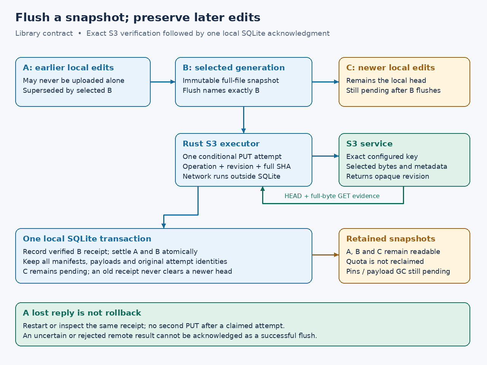

# Generation-specific remote flush

This chapter records its library phase. Subsequent [version-2 native integration](native-writes.md)
adds explicit existing-file editing; the real user configuration remains read-only.

**P5b2d, implemented 2026-10-16:** the library can flush a selected immutable
generation and commit its local acknowledgment. `Executor::flush(generation)`
returns a private-field `remote::FlushReceipt` only after exact remote
verification and a successful SQLite acknowledgment transaction. Existing
mounts remain read-only. No ordinary upload command, payload reclamation,
multipart, delete/rename or writable desktop workflow is enabled.

## What a receipt means

A local seal means the selected bytes committed to local SQLite. `submit`
adds conditional remote execution and exact operation/revision/length/full-SHA
verification, but it does not acknowledge pending local work. `flush` additionally
records a durable receipt for that specific remote operation and settles the
generation's complete local ancestor chain. It does not promise publication of
edits made after the selected snapshot, a globally current remote revision,
or protection against a later authorized external overwrite.

For example, local generations A → B → C may all exist when a verified upload
of B completes. Flushing B settles A and B, leaves C pending and keeps C as the
local head. A was superseded by the selected full-file contents; it need not
have been uploaded separately. If A had its own earlier remote receipt, that
history remains available. A later flush of C uses B's verified ETag anchor.
Nothing implicitly rebases onto a newly observed rival object.

The receipt contains the exact verified `Info`, ancestor count and canonical
SHA-256 checksum through read-only accessors. `covered_generations()` includes
the selected generation and its complete local ancestry, including ancestors
already settled by an earlier flush. It is not a count of uploaded objects or
newly deleted pending rows. A checksum is corruption evidence, not a signed
authorization token or a provider-global transaction ID.

The same [explicit policy](write-policy.md), source/credential binding,
single-use claim, 8 MiB body bound and [observation rules](upload-executor.md)
apply. A conditional rejection, absent/rival observation, corrupt body or
unresolved attempt cannot produce a flush receipt. Errors retain generation and
operation context; inspect the attempt rather than interpreting an error as
rollback or permission to replay PUT.

## SQLite schema 7

Two tables share the existing WAL/FULL connection and bounded owner queue:

| Table | Purpose |
| --- | --- |
| `remote_flushes` | One receipt per exact verified operation/generation, with complete ancestor count and a hash bound to the immutable verified result |
| `write_settlements` | One marker per settled local generation, naming the covering flush, original manifest and canonical marker hash |

The acknowledgment transaction first validates existing records and requires
the exact operation to be `Verified`. It walks the selected generation's
ancestors, checks their targets/manifests and refuses any unresolved ancestor
attempt. It inserts the receipt and missing settlement markers atomically.
Previously settled ancestors keep their original markers. Newer generations
are never traversed, cleared, moved or deleted.

The old `write_journal` row remains the retained sealed-intent marker required
by snapshot validation. `pending()` now excludes settled generations only after
validating the whole acknowledgment forest. Historical reads, copies, seal
replay, local heads, payloads, retained chunk markers and remote attempt records
remain unchanged. There is **no dirty-payload garbage collection**, and
acknowledgment does not release staging quota. Snapshot/reference pin accounting
and safe history compaction still need separate implementation and acceptance.

Startup, new send claims and pending-work inspection reject damaged
acknowledgments rather than using them to hide dirty work. Validation checks
bounded fixed-size row projections, manifest/receipt hashes, verified roots,
parent targets/bases, ancestor coverage and missing markers. An iterative tree
walk avoids recursion and repeated per-receipt ancestor queries; its bookkeeping
is O(n log n), in addition to existing manifest validation. Compact hashes/IDs
are retained in memory, not file bodies or entire metadata histories. There is
a hard bound of 65,536 flush roots and 65,536 settled generations; existing
default staging/attempt quotas are smaller. Fragmented-history performance
remains unmeasured. This is accidental-corruption detection, not authentication
against an owner who can rewrite the entire database and its checksums.

Migration 7 adds empty tables without adopting old verified operations as
acknowledged work. Existing pending bytes and receipts remain intact. A
conflicting table or failed migration rolls back schema/version changes; no
reset or data cleanup is attempted.

## Lost replies and restart

`Storage::uploads().acknowledge(operation)` performs only local work and is
idempotent. `flush_receipt(generation)` inspects a direct receipt;
`settlement(generation)` identifies a covering publication. A superseded local
generation may have a settlement without its own remote flush receipt.

If acknowledgment fails before commit, all receipt/settlement inserts roll
back and the generation remains pending. The remote verified attempt remains
recorded. If commit succeeds but its reply is lost, inspection or repeated
acknowledgment returns the same receipt. Repeating `flush` after a verified
attempt does not send another PUT. If a process dies before remote verification,
the existing uncertain-result path observes the original operation before any
acknowledgment. An expired or narrowed write policy still permits this recovery;
it cannot grant a new send claim.

Local tests kill processes after receipt insertion, settlement insertion and
commit; induce real `SQLITE_FULL` during a multi-generation acknowledgment;
drop the async owner's reply after commit; preserve snapshots/newer heads;
refuse malformed, missing and unrelated markers; and verify schema-6 migration
and rollback. SDK/TCP tests flush binary, empty and Unicode generations, observe
lost successes, recover a killed uploader without another PUT, retain failed
flush bytes, and preserve verified-parent guards across restart. These are local
model/OS-storage tests. They do not extend the completed Wasabi fixture approval
or constitute a physical power-cut, live-provider flush or writable-mount test.

Writable adapters must select the intended generation, call this remote flush
contract at the documented durability boundary, and propagate failure. They
must not treat `seal`, a prepared intent, a successful HTTP header or a generic
`Info` return as a successful remote fsync. Payload reclamation, explicit
uncertain/conflict resolution and credential rebinding, multipart and actual
desktop save/replace workflows remain subsequent work.
