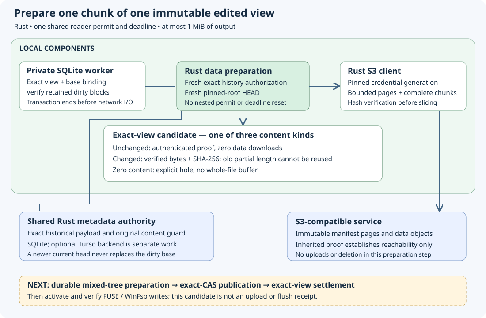

# Incremental data preparation

Implementation date: **2026-10-19**. W3a in `codex/incremental-data` implements
one bounded data-preparation operation on an authenticated immutable edited file.
All19 reader tests and the full portable local gate passed. Own combined platform/native acceptance remains required. This is a building block for the durable mixed-tree
planner; it enables no uploads, settlement or native writes.

`EditedFile::prepare_chunk(chunk)` returns a privately constructed `PreparedChunk`
bound to the exact view ID, complete base binding, logical offset and length.
Callers can inspect its content but cannot substitute bytes or references in that
result. Each operation reads and validates the retained local ledger and dirty
blocks, releases its SQL transaction, freshly authorizes exact history and the
pinned root HEAD, then prepares at most one MiB. The original reader family shares
four active-operation slots and one overall deadline across SQL and network I/O.

A chunk entirely backed by the same base offset can be inherited only if its
new logical length equals the complete old chunk's length. Its opaque `ChunkProof`
is verified against the authenticated frozen base and returned without any data
HEAD or GET. A proof whose reference is absent establishes an authenticated base
hole. This is reachability, not current data availability, a fresh upload receipt,
a provider send permit or permission to reclaim the base.

A changed chunk uses the existing bounded composer, which verifies full remote
data objects before slicing or masking them with local bytes. The result contains
immutable new bytes and their SHA-256, or an explicit hole after all output bytes
have been verified as zero. The full local dirty ledger is checked even when the
selected chunk uses only base references or zeros. A corrupt unrelated retained
patch is an error, never grounds to fall back to remote data or repair the state.

For example, editing one byte in chunk127 prepares only that changed chunk's
bytes; chunk128 remains an inherited reference. A final old17-byte data object
cannot be inherited as a7-byte or33-byte object. Shrink verifies all17 bytes before
using seven; growth verifies the old content and adds zeros. Shrink followed by
growth never resurrects the removed old tail. The future planner must give the
new object its own identity, length and digest.

The operation rejects out-of-file and overflowing chunk indices. Empty files
have no data candidates; a later tree builder must create their valid empty root.
A64GiB grown view can prepare its final hole without allocating or downloading
the file. Individual operations may allocate one MiB; this does not claim constant
latency because existing bounded local-ledger validation scans retained metadata.

The old whole-snapshot planner, its upload-dependency verifier and source receipts
remain unchanged. W3b must persist preparation identity/cursor, authenticated
inherited witnesses and the mixed object graph, including subtree reuse and
height changes. W4 must publish new dependencies before parents using exact
original CAS and operation keys. W5 must acknowledge only the exact prepared view
while preserving newer edits. Legacy/metadata-empty admission and W6 actual native
chunk writes remain required. Wasabi and physical MX/Windows sign-in/reboot/session
acceptance are separate gates.

The [dated evidence](evidence/incremental-data-20261019.json) records the focused
three-test pass and full green gate. The controls use the SDK against owned
loopback fixtures, actual Rust authority history and a private file-backed SQLite
worker. They measure data GET counts, validate inherited witnesses and new byte
hashes, exercise127/128 boundaries, partial shrink/growth,64GiB holes and retained
views after authority/local restart, then test every result kind against denied
history/root access and corrupt retained bytes. A truncated old tail must still
pass complete-object verification. Shared admission, cancellation, overall
operation timeout and independent SQL progress are also controlled.

W3b design notes from source inspection on2026-10-19 (proposal): do not persist a
complete repeated path for every inherited data entry. The existing PageProof
exports an entire authenticated subtree with offset, level, length and reference;
its exact coverage must also be unchanged in the local view before reuse. Persist
shared verified pages once, with bounded counts/bytes and a cursor, rather than
copying the same leaf128 times. The existing whole-snapshot planner defaults to
32768 objects despite its hard262144 ceiling; do not silently raise those limits
or treat its complete-source receipts as mixed-tree evidence. The mixed planner
needs explicit admission accounting for unchanged subtrees, changed data and new
pages. The base descriptor's payload reference is the original edit CAS value,
not the predecessor guard in the base's reservation. Preserve that distinction
through new graph identity, restart and eventual publication.

Full local gate81440 passed with all288 frozen runtime/contract inputs unchanged:
393state (one ignored),37core,19reader (one native ignored),62S3, format/Clippy/
workspace build,75Markdown links and71book chapters. The
[indexed local archive](evidence/incremental-data-local-20261019.tar.gz) retains16
verified members: focused/full logs, exact source map/results, changed runtime
sources and reviewed architecture image. This is portable local evidence; this
new source still needs its own combined Windows/Linux/native regression checks.
