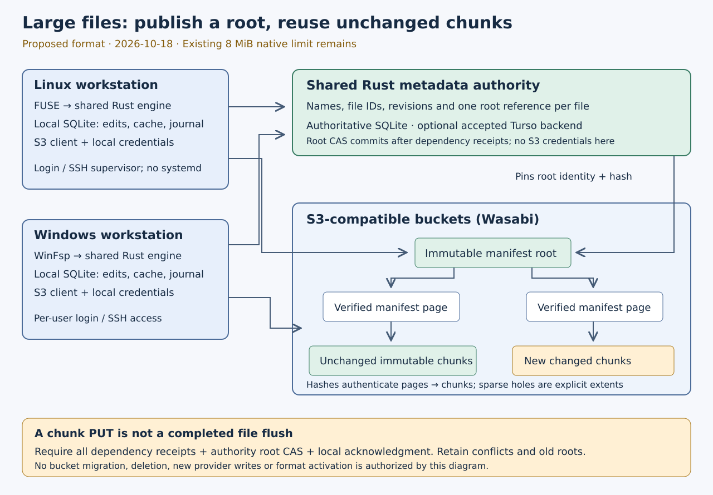

# Large managed files: storage representation

**User decision, 2026-10-18:** use immutable chunks and manifests for large
managed files. Ordinary filenames remain in the shared authority, while S3
contains internal objects. The one-object representation remains a legacy
compatibility format; no existing bucket or retained data is converted implicitly.
The codec below is an offline prototype. Native large files and the new live
storage format are not enabled.

Implementation began under the surfaced recommendation as a provisional offline
default; the user subsequently selected that same option during the phase.
This layout decision does not expand the earlier provider-write approvals or
activate a migration. Existing on-disk and mounted formats remain unchanged.

## What the current code actually does

Audit source: `25753746287aa52a36a9ba42d8bf5162f1de07d1`.

| Boundary | Current behavior | Work required for large files |
| --- | --- | --- |
| `s3drive-managed/src/reader.rs`, `Reader::read` | HEAD and pinned GET of the whole object, full SHA-256 verification, then retained `FileSnapshot` bytes | Bounded verified reads without downloading the whole file at open |
| `s3drive-fs/src/managed/writes.rs` | Existing-file edits construct the complete current payload in a `Vec`; native bound is 8 MiB | Shared patch/truncate engine with bounded memory and durable recovery |
| `s3drive-state/src/logical.rs`, `Input` | Whole-file digest is fixed before beginning an edit; size is bounded to 8 MiB | Freeze edit identity before incremental materialization and hashing, preserving unknown results |
| `s3drive-state/src/namespace/publication.rs` | Reservation/payload represents one physical key and whole-file digest, bounded to 8 MiB | Explicit versioned content representation and compatible content guards; no reinterpretation of old hashes |
| `s3drive-fs/src/edits.rs` | Existing chunk-composition library already copies local/pinned remote ranges, sparse holes and bounded patch data | Reuse where applicable; it is not yet wired into the managed whole-file path |
| `s3drive-state::multipart` | Offline Frozen → Ready plan and part hashes | Network execution, uncertain outcomes and live acceptance remain separate |

The local chunked staging store is an implementation detail today. It does not
make published S3 objects chunked. Raising one constant or adding multipart
uploads would leave other size, integrity and whole-buffer boundaries intact.
The [existing multipart plan](multipart-plan.md) remains valid for the
one-object representation and direct-layout compatibility path.

## Compare the alternatives

| Property | One object per generation | Immutable data chunks and manifest |
| --- | --- | --- |
| Existing protocol | Extends the current reservation/payload model | Requires a new explicitly versioned reference format |
| Initial large upload | Multipart execution and completion reconciliation | Many bounded create-only PUTs, plus manifest publication |
| Small edit | Current proposed executor sends the full new generation; multipart copy is a further alternative | Replace intersecting chunks, reuse immutable references for unchanged chunks |
| Verified random read | Whole digest alone cannot authenticate a subrange; add authenticated per-range digests or verify the entire object | Verify a manifest page from its parent hash, then a chunk from its recorded hash |
| Sparse growth | A contiguous object needs bytes for holes unless a separate representation describes them | A manifest can describe zero extents without uploading zeros |
| Object count and latency | Fewer objects; parallel ranges are possible | More objects, request overhead and chunk read amplification; needs bounded caching/prefetch |
| Retained versions | Repeated generation payloads consume storage | Unchanged chunks can remain shared between generations; metadata and replaced chunks still consume storage |
| Reclamation | Retained generations, open readers and uncertain attempts must be protected | Same protections, plus transitive manifest/chunk references |
| Ordinary S3 tools | Internal key contains a contiguous file payload | Internal keys contain parts and manifests; export must assemble a file |

Amazon documents byte-range GET and single-part-number GET, and does not support
multiple ranges in one GET. These are AWS API facts, not new Wasabi acceptance.
An ETag used for revision pinning does not replace our independent expected
content digest. A single-object design **can** support independently verified
ranges by adding an authenticated digest index; chunk objects are not the only
way to achieve that.
[AWS GetObject](https://docs.aws.amazon.com/AmazonS3/latest/API/API_GetObject.html)

AWS also defines `UploadPartCopy`, including source ranges and source revision
conditions. It could reduce client upload for unchanged portions of a new
contiguous object. It still creates a complete destination generation and
requires source authorization, multipart journaling and provider acceptance;
it does not by itself share stored bytes between generations. No equivalent
Wasabi acceptance has been performed here.
[AWS UploadPartCopy](https://docs.aws.amazon.com/AmazonS3/latest/API/API_UploadPartCopy.html)

**Selected design:** use immutable
chunks and authenticated paged manifests for the managed filesystem. This
matches random file access, small edits and sparse files. Keep the one-object
format readable, and retain multipart research for direct objects, export and
future bulk-transfer optimizations. The recommendation is about the resulting
filesystem, not an assertion that a chunked protocol is already accepted.

## Proposed publication and read contract

1. Freeze a new logical edit ID, original authority content guard and pinned
   base-root identity in local SQLite before doing network work. Retain existing
   dirty heads and uncertain operations under their original identities.
2. Materialize and hash changed chunks using bounded owner commands. Untouched
   ranges reference previously verified immutable chunks. Sparse zero extents
   have an explicit tagged encoding, not an unverified missing-object fallback.
3. Publish changed chunks under new operation-owned keys using the existing
   bounded executor where its contract applies. Each object needs its own
   operation, verified bytes, policy and recovery record. A journal receipt for
   one object does not acknowledge an entire file generation.
4. Publish immutable leaf and parent manifest pages after their dependencies.
   Bind exact canonical encodings, format/hash domains, logical offsets, lengths,
   store identities and child hashes. Validate depth/fanout/page/length limits,
   ordering, complete coverage, overflow and cycles before following references.
5. CAS the file's **root reference** in one authority transaction, with an
   operation result committed alongside it. Keep this reference compact enough
   for the existing 4 KiB request envelope, or explicitly version that envelope.
   A whole manifest cannot be placed unboundedly in the metadata request.
6. Only acknowledge remote flush after all dependency receipts, committed root
   publication and local logical settlement are verified. Unknown CAS results
   resolve through the original operation ID. Never silently publish over a
   rival root or retry an unknown physical write unconditionally.
7. A reader pins an authority root and verifies pages down to the requested
   chunks. It verifies each complete fetched chunk before releasing any bytes
   from it to the caller. Old open handles keep their root after rename,
   replacement or unlink. Online authorization and local credential isolation
   remain required; cache presence is not authorization.

Initially use operation-owned keys rather than global content-addressed
deduplication. A hash verifies content; it does not authorize adopting an object
owned by another operation. Shared unchanged references need proven ancestry,
current authorization and retention. Cross-file deduplication, packing tiny
objects, compression and automatic collection require additional protocols.

The root hash binds the tree; it is **not** the existing SHA-256 of concatenated
file bytes. Never put a Merkle root into the legacy `Reservation.sha256` field.
A format capability and separate hash domain must distinguish these meanings.
Whether to persist an additional whole-file digest is still open; recomputing it
for every small edit would require reading the entire logical file.

The authority remains a Rust service with authoritative SQLite, or a separately
accepted Turso backend. Neither holds the user's S3 credentials. Each workstation
retains its own SQLite journal/cache outside the mount. This changes content
representation, not namespace ownership, Windows handle semantics, login
startup or the no-systemd Linux requirement.

## Offline page codec prototype (2026-10-18)

`s3drive-core::manifest` now implements this specification without SQLite or
network access. It is not wired into authority payloads, native adapters or
object-key derivation. The existing 8 MiB limits still apply there. This codec
is the first step toward efficient large managed-file reads and edits, rather
than an alternative definition of a completed filesystem.

All integers are unsigned, fixed-width **little endian**. The 64-byte header is:

| Byte offset | Width | Meaning |
| --- | --- | --- |
| 0 | 8 | ASCII `S3DMAN01`, including the prototype format version |
| 8 | 1 | Level, 0 for a leaf, 1–7 for an internal page |
| 9 | 1 | Reserved; must be zero |
| 10 | 2 | Entry count, 0–128 |
| 12 | 16 | Nonzero volume identity |
| 28 | 16 | Nonzero file-node identity |
| 44 | 8 | Logical start offset |
| 52 | 8 | Logical byte length covered by this page |
| 60 | 4 | Chunk size; must equal 1,048,576 in this prototype |

An entry starts with a one-byte tag and an eight-byte positive length. Tags are
0 for a sparse hole, 1 for a data object and 2 for a child page. Hole entries
end there (9 bytes). Data/child entries then contain a 72-byte reference:
nonzero store ID (16), nonzero generation ID (16), ordinal (8), expected digest
(32). They occupy 81 bytes. Unknown tags, flags, chunk sizes, versions, missing
fields and trailing bytes fail. The maximum encoded page is therefore
`64 + 128 * 81 = 10,432` bytes. Counts/input lengths are bounded before allocation.

Leaf pages contain only holes/data. Internal pages contain only children.
Adjacent holes within one page must be merged. A data object covers at most one
1 MiB chunk. Every page starts at a chunk boundary; every entry except the
last ends at a chunk boundary. A final partial chunk can reach EOF. Embedding
that page requires the parent to authenticate its exact span, so a partial
child cannot silently become a nonfinal unaligned span. No entry has zero
length. The only empty page is a leaf at offset zero. All page ends and sums
fit a signed 64-bit SQLite length; this arithmetic bound is not an admitted
file-size limit for the unfinished publisher.

These rules define a canonical encoding **of a particular page**. They do not
imply a unique tree partition for every file: holes may cross page boundaries,
and the future builder must decide stable partition/reuse rules. The study's
fanout256 is illustrative; this prototype deliberately uses128. Both illustrate
bounded paging, not interchangeable serialized formats.

Page hashes are `SHA256("s3drive-manifest-page-v1\0" || encoded_page)`, where
`\0` denotes one NUL byte, not a backslash and digit. Chunk hashes are the
ordinary SHA-256 of complete chunk bytes. The hash domains differ deliberately;
neither root/page hashes nor reference ordinals can replace the legacy
whole-file `Reservation.sha256` field.

`Page::decode` proves structure only. `Page::verify_root` additionally checks a
trusted expected hash, volume, file-node, length and start-zero binding and
returns a distinct `VerifiedPage`. Only that type exposes child/data
verification. `verify_child` checks its referenced digest, exact file/volume
and span, and a level exactly one below its parent. Thus a path has at most
eight pages and cannot accept a repeated same-level page as a cycle.
`verify_data` checks exact bounded length and the whole expected chunk digest
before any subrange may be served. `Page::lookup` scans at most128 entries,
allocates nothing and returns the intersecting extent/offset; outside-page and
EOF lookups return `None`. A parsed page's lookup result alone is not trusted.

Data verification is a point-in-time check of the supplied bytes, not a durable
receipt or media pin. The eventual reader must serve that same immutable buffer
and retain its root identity; it must not retain a boolean verification result
after mutating/reloading bytes. This phase does not provide a cache or open-file
handle implementing that lifetime contract.

Expected root identity/hash must eventually come from authenticated authority
metadata. Hash verification does not establish current S3 authorization, key
ownership, publication durability or permission to adopt someone else's object.
The future role-specific object-key builder must distinguish data/page objects
and bind each reference's store, generation and ordinal. No key builder or
deduplication adoption exists in this phase.

`scripts/generate-manifest-vectors.py` independently uses Python `struct` and
`hashlib` to generate fixed empty/leaf/root/data vectors under the core
manifest test fixtures. It imports no Rust codec. Golden page digests are:

| Vector | Bytes | Domain-separated SHA-256 |
| --- | --- | --- |
| Empty | 64 | `6577be00912b4b95f716243622685cb4fa77a32204e5c01f5eb9acb19f0325da` |
| Leaf | 154 | `0fcbed4452ca3f3f050df52278491f1b394e234f28b287c202e2b3c771329177` |
| Root | 145 | `f5ce76e1863fc41050e598bca75748323f0f17ee1cc9fe19a16dac007e6fdc10` |

The focused suite checks every-byte tampering, every truncated prefix, appended
bytes, exact data hashes/lengths, cross-file/position/level substitution even
with a matching child digest, maximum fanout/depth/length, overflow, sparse
holes, empty roots, alignment, roles, EOF and range boundaries. Native large
files and provider acceptance remain later gates.

## Illustrative workload and Wasabi implications

Run `python3 scripts/study-managed-layout.py` from the repository root. The
[reproducible arithmetic](evidence/managed-layout-study-20261018.json) assumes a
1 GiB file, 1 MiB chunks, 100 subsequent 4 KiB edits, immutable versions, and no
compression, deduplication, server-side copy or collection. Manifest bytes and
HTTP overhead are excluded. This is **not a benchmark, bill or size limit**.

| Representation | New data per save | Retained data after initial upload and 100 saves |
| --- | --- | --- |
| Whole new object | 1 GiB | 101 GiB |
| One changed chunk, aligned edit | 1 MiB | 1 GiB + 100 MiB |
| Two changed chunks, boundary-crossing edit | 2 MiB | 1 GiB + 200 MiB |

The chunked initial upload has 1,024 data objects. Even a flat table containing
only 1,024 SHA-256 digests is 32 KiB before keys, lengths or encoding: too large
for a 4 KiB authority request. An illustrative fanout of 256 gives four leaf
pages and one root; a single-chunk edit changes a leaf and its root. These
numbers explain paging; they do not freeze a serialization, chunk size or
request count. Full rewrites still replace every data chunk.

Wasabi charges early-deleted objects for the remainder of the applicable
minimum storage duration; duration depends on the account's pricing model.
**Inference:** repeatedly storing whole large generations can be costly even
when old objects are removed promptly. Shared chunks may reduce new stored
bytes, but more manifests/objects and retained history also cost storage. The
user's actual retention plan has not been inspected.
[Wasabi minimum storage duration](https://docs.wasabi.com/docs/how-does-wasabis-minimum-storage-duration-policy-work)

Wasabi's Stats API documentation distinguishes raw and padded object storage
and describes a plan-dependent 4 KB minimum object-size accounting rule.
Tiny manifest objects may therefore have billing overhead. Do not assume that
documentation describes this account's contract or that objects smaller than
4 KB are forbidden.
[Wasabi storage accounting](https://docs.wasabi.com/apidocs/using-curl-and-jq-utility-with-wasabi-stats-api)

Wasabi documents multipart assembly into one object and automatic incomplete
upload cleanup after approximately 31 days, with charges for uncommitted parts.
That documentation does not independently establish conditional completion or
our crash/reconciliation contract. Chunked objects avoid multipart initiation
for bounded chunks, but still require provider acceptance for their PUT/read
protocol and complete generation publication.
[Wasabi multipart behavior](https://docs.wasabi.com/docs/how-does-wasabi-handle-multipart-uploads)

No credentials, billing policy, lifecycle settings or live provider objects were
changed by this investigation. Existing provider approvals are exhausted; a
future live acceptance run needs a new concrete plan and authorization.

## Implementation sequence and acceptance

The user selected the chunked representation. The offline prototype implements
the codec portion of step1 below; subsequent
integration must preserve explicit versioning and legacy compatibility:

1. Specify and implement a pure Rust bounded manifest codec, domain-separated
   hashes, sparse range lookup and a format capability. Reject malformed,
   overlapping, noncanonical, cyclic or oversized inputs; include independent
   golden vectors. Do not change live authority payloads yet.
2. Add a durable local edit/manifest builder and object-dependency journal with
   bounded SQLite work, cancellation, quotas, process-kill and SQLITE_FULL
   rollback tests. Reuse the existing edit library where it preserves the new
   identity contract. Preserve legacy hashes and unknown requests.
3. Implement real SDK/local HTTP chunk/page publication and verified range
   reads, then explicit authority root CAS and local settlement. Test two
   writers, response loss, missing/corrupt dependencies, retained old roots,
   credential rotation and recovery without a repeated unconditional write.
4. Wire both native adapters to the shared bounded engine. Require real FUSE
   and WinFsp tests with files above 8 MiB, small patches, sparse extents,
   cross-page reads, open-unlinked handles, restart, uncertain flush and rival
   roots. Measure peak memory and work per owner command; small buffers alone
   do not prove bounded latency.
5. Run separately approved Wasabi acceptance and independent-host coordination
   tests. Retention-aware garbage collection is a later explicit phase;
   uncertain operations, retained handles and transitive roots must be pinned.

The retained one-object compatibility path has a separate multipart execution
plan; it is not a prerequisite for the selected chunked managed representation.
The full filesystem still requires transport reliability, deployment/recovery,
workstation startup and provider acceptance; this design study completes none
of those gates.
