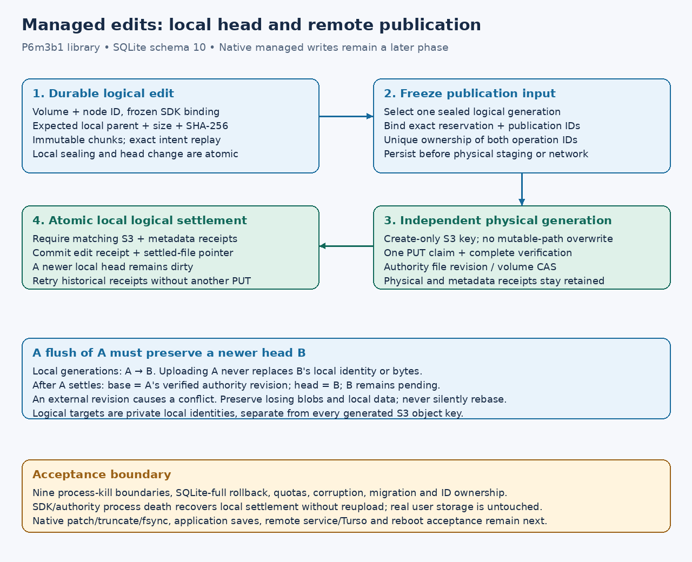

# Durable managed local edits

**P6m3b1 implementation, 2026-10-17.** This joins local logical-file heads to
[immutable S3 publication](managed-publication.md). It is a library/storage
checkpoint underlying [version-4 existing-file editing](managed-write-plan.md). Version-3 native mounts remain
[read-only](managed-native.md); no real bucket, credential, write policy or
startup registration is changed by this phase.



## Identity, admission and local sealing

The client-local `logical_files` row is indexed by volume ID and node ID. Its
frozen binding includes the original authoritative node, selected store, and
actual credential/configuration binding from the SDK executor. The local journal
target is a separate domain-derived identity; it is never an authorized S3
object target. Existing direct heads and physical blob generations retain their
original meaning. A rename or a new generated object key does not identify a
new logical file.

`Publisher::bind_edit_file` fetches authoritative metadata and binds that snapshot.
It does not download base bytes or prove an S3 read. An exact original binding,
or a live node matching this client's last verified publication receipt, reuses
the original local target. New credentials, changed store routing, or an external
revision cannot silently replace the stored base. The version-4 coordinator authorizes/hydrates partial edits and provides explicit verified clean-base observation; this lower-level method still accepts only exact bindings. Dirty or credential rebinding remains explicit.

`Publisher::stage_local` durably records an edit ID, expected local parent,
size and SHA-256, then stages immutable chunks and seals the local generation.
No metadata reservation or S3 request occurs in this operation. Multiple local
edits can be coalesced before selecting one for remote flush. Replaying the exact
intent recovers its builder; changing its parent/size/hash under the same ID fails.
Two builders can race from one parent, but only one can advance the local head.
The other builder and its bytes remain available for inspection.

The full byte hash is checked inside the sealing transaction, together with the
journal's manifest/retention/head changes. A mismatch rolls back sealing and head
advancement. All operations share the existing bounded SQLite owner and directory
lock. Schema 10 originally adds `logical_files`, `logical_edits` and the exclusive publication
operation registry. Migration preserves schema-9 data and refuses conflicting
unknown table shapes without advancing the version. An authority database cannot
host local edits, and a database containing only a logical binding cannot become
an authority.

## Publication and settlement

1. Select one sealed logical generation. `Publisher::stage_edit` persists the
   complete reservation request, publication ID and frozen SDK target binding in
   its logical record **before** physical staging or network effects. The request
   must match its bytes, store and current locally verified base revision.
2. Reserve and publication operation IDs are each exclusively associated with
   that logical edit. They cannot be shared with another local generation.
   Retries keep the exact original request; neither a new global sequence guard
   nor an external file revision may silently replace it.
3. Stage a distinct create-only physical root and use the existing single-attempt
   SDK/authority protocol. A physical PUT, its verification and metadata CAS have
   separate recovery records. Lost outcomes retain their IDs and bytes.
4. `Publisher::flush_edit` requires the verified physical flush and matching
   metadata publication receipt. It then commits the logical edit receipt and
   file settlement pointer in **one local transaction**. A missing physical or
   metadata receipt cannot settle the file.
5. Settlement of generation A leaves a newer head B intact. The file's next
   reservation may use A's confirmed authority revision because that revision
   came from this client's bound receipt. A later explicit flush of B does not
   adopt an unverified external edit. Replaying A cannot rewind B or the file's
   latest settled base.

Logical pending enumeration uses ancestry coverage and validates retained records,
including covered rows. Schema 11 adds a separately hashed verified-base observation without changing original identities or legacy hashes. It does not erase physical attempts that may still need
reconciliation. Generic staged generations remain retained; managed callers must
use the logical pending view for logical dirtiness. Corrupted or missing settlement
markers fail explicitly rather than turning into a clean cache miss.

A crash after metadata commit but before local logical settlement is recoverable
from the same physical/metadata receipt. `flush_edit` can finish that local
settlement without another PUT. Disk full at this final transaction returns an
error and retains the pending logical edit, even though S3 and metadata already
committed. Factory/policy freshness still governs admission of new physical work;
this is not a new permission to upload or silently rebind credentials.

## Limits and acceptance

Complete generations are at most 8 MiB. Four local staging/physical staging
operations across publisher clones bound payload admission. Logical records are
limited to 4,096 files and 4,096 edits, with at most two exclusive publication
operation IDs per edit. Existing staging byte/generation quotas also apply.
There is no payload reclamation. Integrity checks may reread whole local files;
this is a bounded initial implementation, not a large-file performance result.

The phase acceptance commands are:

```sh
cargo test -p s3drive-state --locked
cargo test -p s3drive-cli --test managed_publication --locked
bash scripts/gate.sh
```

Storage tests kill an owner at nine exact boundaries: intent commit, builder
allocation/link, before/after seal commit, before/after publication-input commit,
and before/after logical settlement commit. Other cases cover full-disk rollback,
ignored SQL updates, stale parents, credential/base mismatch, quotas, exclusive
publication IDs, corrupted retained rows, schema migration and role isolation.

The SDK/TCP fixture kills a client after S3 and authority commit while a newer
local head exists. A local predecessor is coalesced without upload. Reopening settles
the original generation without another
PUT, then publishes the newer bytes. A subsequent external metadata rename makes
a prepared revision stale; its losing blob and local bytes stay retained. An empty
local generation is also retained without upload. Exactly three immutable PUTs
cover two successful publications and one losing publication. These are owned
loopback fixtures, not live managed Wasabi acceptance.

Native FUSE/WinFsp and startup regression gates remain separate and necessary
because the SQLite schema and shared publisher changed. They do not certify
managed writable callbacks. P6m3b2 must now connect local edit views, patch/truncate,
remote fsync and recovery to those callbacks. P6m3b3 adds portable names,
create/rename/replace/unlink and real application save workflows. Authority
supervision, remote/Turso deployment and workstation reboot acceptance remain
separate requirements.

## Retained-history scan validation (candidate, 2026-10-18)

This change concerns the **client-local** SQLite journal. The prior pending scan
validated every edit, repeatedly checked the same file, and revalidated the
complete remote acknowledgment forest for each logical receipt. Settled history
therefore made a scan progressively more expensive even when no edit was dirty.

The candidate creates private read proofs for one synchronous command on the
exclusive SQLite owner. It lazily validates the entire remote forest once,
retains compact roots, and reloads/binds each requested complete receipt to its
root. A complete verified file is reused by `(volume, node)` within the scan.
Public `get`/`file` calls create fresh contexts. No context survives a command,
mutation or await, and no SQL data mutation occurs during proof reuse.
The proofs retain metadata rather than file contents. Metadata remains live until
the command ends and grows with retained-file count; peak memory at catalog limits
has not been measured.

Every retained edit still undergoes row/hash, byte, publication, conflict,
receipt-equality and ancestry checks **before** coverage or pagination filtering.
No record or payload is reclaimed. Corrupt covered/off-page rows, an unrelated
remote root/settlement, a validly rehashed foreign settlement and an exact-receipt
mismatch all fail. Success followed by corruption on the same `Journal` instance
fails on the next command. A second volume sharing the same node ID exercises
the full file-cache key; deliberately omitting volume made its control fail.

One local Linux x86_64 study used SQLite3.53.2, 32-byte generations and no network.
The table compares the preserved pre-change implementation with the candidate.
Elapsed times include progress instrumentation and are observational, not a
production flush benchmark or a cross-platform latency guarantee.

| Settled edits | Before: VM progress callbacks | Candidate: callbacks | Before: instrumented elapsed | Candidate: instrumented elapsed |
| --- | ---: | ---: | ---: | ---: |
| 4 | 45,191 | 10,982 | 85 ms | 26 ms |
| 8 | 151,359 | 22,710 | 267 ms | 51 ms |
| 16 | 546,671 | 56,054 | 881 ms | 125 ms |
| 32 | 2,069,199 | 162,294 | 3,246 ms | 350 ms |

SQLite's callback interval approximates VM instructions and can include statement
preparation; the test uses interval1 and an atomic counter without querying or
modifying the connection inside the callback. It asserts less work against an
uncached enumeration using current public validators, without a wall-clock
threshold. That reference also benefits from the new public `file` implementation;
its counts are **not** the exact historical baseline above.
[SQLite progress callback contract](https://www.sqlite.org/c3ref/progress_handler.html).

The full local gate passed276 state and48 authority tests plus workspace/book
checks. The scaling study is intentionally ignored by the default gate and has
its own successful recorded run. Source-bound native gates remain required in the
[dated evidence](evidence/pending-scan-20261018.json). Ancestry walks, complete byte
verification and other catalog checks still cost work; this does not establish
large-history scalability or explain/fix the intermittent Windows HTTP failure.
No schema, public API, network policy, retry, unknown operation or overwrite rule
changes. Large files, reference-aware reclamation and real provider acceptance
remain separate phases.

Exact-source64aa073 Linux
[CI39125456457](https://github.com/marshallr12/s3drive/actions/runs/39125456457)
subsequently passed9 real native cases,32 HTTPS flush iterations, paired recovery
and both no-systemd coordinator startup protocols. The loop's runner-log span
through owned teardown was13.29 seconds versus69.37 seconds at parent90a8357.
These ran on different hosted VMs and are observational fixture spans, not a
controlled latency guarantee. The same source's Windows job also passed32 HTTPS
flushes, lifecycle/startup/recovery/broader native checks and its own strict21/14
reference reports. Completed logs and artifact digests are retained in the dated
evidence. The [source-identical repeat](https://github.com/marshallr12/s3drive/actions/runs/39127440399)
failed Windows paired startup; Linux/book passed. Its matched Info exchange
had469 driver polls but no write polls/bytes before the server's empty-header
timeout. Its success-only artifact checker is ineligible, and later Windows
reference/native steps were skipped. No causal transport fix, repeat acceptance
or physical workstation reboot acceptance follows. There are no new live provider
requests.
