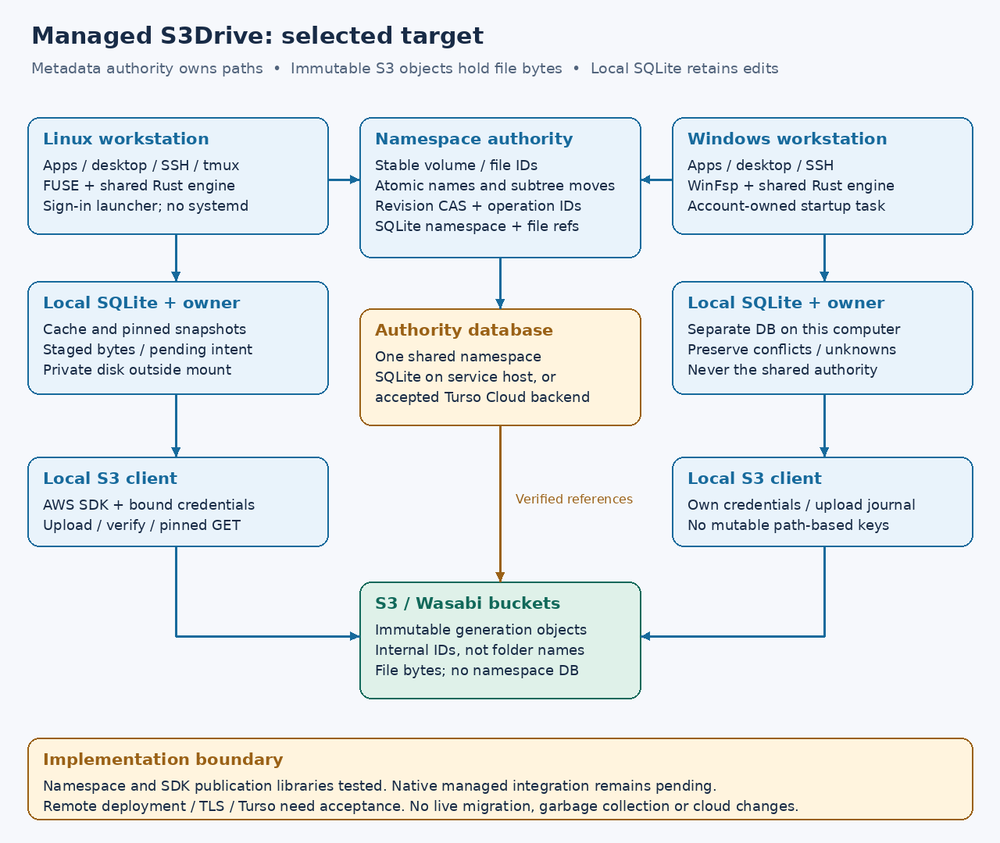

# Managed layout and namespace authority

**User decision, 2026-10-16:** use a managed layout with stronger coordination
between machines. Ordinary S3 tools will see internal generation objects, not
the drive's directory tree. Existing direct-layout mounts are compatibility
prototypes; no existing bucket or configuration is converted automatically.



## Storage and authority

The target design separates three kinds of state:

| State | Owner and purpose | Current implementation |
| --- | --- | --- |
| Local SQLite on each computer | Cache, staged bytes, unknown attempts, recovery; outside the mounted tree | Existing implementation; managed logical-file binding still needs integration |
| One authoritative metadata database | Volume/node identities, directory entries, revisions, operation outcomes, immutable payload references | SQLite namespace and payload references implemented; Turso backend pending |
| One or more S3-compatible buckets | Immutable file-generation bytes; never derive these keys from directory names | [Managed publisher library](managed-publication.md) joins SDK and metadata; [native reads](managed-native.md) passed, native writes pending |

The namespace is authoritative at the service, rather than assembled from S3
LIST results. A directory move changes its parent/name in one metadata
transaction; descendants retain stable node IDs. No folder markers, object
copies or recursive S3 deletes are required for that move. One authority volume
can reference registered stores in multiple buckets. Renames within
that volume need no data relocation; cross-volume atomic rename is unsupported.
This is our design, not a provider feature claim.

Global volume, node and storage IDs must be independent of each workstation's
AWS profile name, credential generation, cache path and source alias. Existing
local source bindings continue to protect credentials; they cannot stand in for
a shared storage identity. Do not reinterpret an existing direct-layout staged
head as a managed file or silently rewrite pending data.

## P6m1: persistent namespace prototype

`s3drive-state::namespace` and `s3drive-authority` implement one volume per private
authority database. Schema 8 adds separate namespace volume, node and operation
tables; the schema-7 client tables and retained bytes are preserved. Initializing
an authority refuses a database containing client source/cache/staging data.
Once initialized, client source registration and staging refuse that database.
The existing private-directory ownership and exclusive process lock apply.

Implemented operations are create-directory, create-**empty-file metadata**,
move without replacement, remove-file and remove-empty-directory. The [managed publisher](managed-publication.md) now adds reservations and
immutable payload-reference publication. Removal retains a tombstone; nothing in S3 is deleted.
Root mutation, cycles, missing/non-directory parents, existing destination
names and nonempty removal fail explicitly. Moving a subtree changes one node.

Every mutation supplies the volume ID, a new 128-bit operation ID, an expected
**volume sequence**, and the complete operation. A SQLite `BEGIN IMMEDIATE`
transaction serializes contenders. SQLite permits a single simultaneous writer;
this gives the prototype a simple authority boundary.
[SQLite transaction behavior](https://www.sqlite.org/lang_transaction.html)

The effect, incremented sequence and operation/request/result record commit
together. This coarse guard intentionally rejects even unrelated stale writes;
clients must inspect state and make a new explicit operation rather than changing
an uncertain original request. A future higher-throughput backend can refine
that protocol only after equivalent invariant tests pass.

A repeated operation ID with the identical decoded request returns its original
committed result, including a rejection, without changing current state. Different
arguments with that ID fail. Operation lookup resolves lost responses. An absent
record while the original request is in flight does **not** establish rollback;
resubmitting the exact request safely converges through the same dedup record.
An internal/transport error can leave an unknown outcome and requires inspection.

The prototype uses a versioned `exact-utf8-v1` name policy: exact UTF-8 bytes,
1–255 bytes per component, no slash/backslash, control characters or `.`/`..`.
Japanese, emoji and composed/decomposed accents are tested. Case and Unicode
normalization variants remain distinct. **This is not Windows name equivalence.**
Before native managed mounts, specify a portable, versioned collision policy and
prove it against WinFsp; never silently fold or merge existing names.

Bounds are 4,096 retained nodes including tombstones, 8,192 retained operation
records, and 1,000 children per listing. An oversized listing fails rather than
silently truncating. Records are not garbage collected; hitting a cap preserves
history and reports a limit. Directory paging and durable operation retention
beyond these prototype bounds require a subsequent protocol.

## Service boundary and verification

The `s3drive-authority` library serves `POST /v1/namespace` on an explicitly
supplied **loopback** listener, with a caller-supplied 256-bit bearer token,
4 KiB JSON limit, eight-command owner queue and eight HTTP operation slots.
SQLite runs on one dedicated thread. Domain results use a versioned JSON
envelope. Unknown fields and unauthorized requests are rejected without echoing
request contents. Shutdown stops admission, drains accepted work and releases
the database lock. The development CLI now creates private tokens and runs a
foreground local authority; it does not deploy a remote service or cloud account.

This is a development/contract-test server, not a deployable remote service.
Cross-machine deployment still needs TLS, device identity and volume ACLs,
request/connection deadlines, admission hardening, backup/restore and single
leader/failover acceptance. Multiple clients on loopback prove the protocol,
not operation over a real network partition or a Turso failover.

```bash
cargo test -p s3drive-authority --locked
cargo test -p s3drive-state namespace --locked
```

Tests use two independent HTTP clients and real ephemeral TCP listeners backed
by a private on-disk SQLite database. They exercise competing create, atomic
subtree moves, opposing directory moves, Unicode names, tombstones, stale
sequences, wrong volumes, operation reuse, lost HTTP replies and restart.
State tests cover process termination after commit, SQLite full, injected
failure after namespace effects/before result persistence, schema-7 migration
and rollback, role separation and retained limits. These are separate from
native OS mounts and live provider acceptance.

## P6m2 publication library and next native integration

[Managed immutable-file publication](managed-publication.md) implements steps
1–5 below with real SDK/HTTP tests and a separate local logical receipt. [Native read-only integration](managed-native.md) is implemented; writable
integration, deployment and reclamation remain planned.


1. Register stable storage identities and reserve an upload operation/new object
   key for a logical file ID and expected file revision. Credentials stay local.
2. Stage locally; send a create-only PUT to that unique key under explicit
   provider policy. Observe exact operation metadata and full bytes before
   accepting a verified payload reference. No metadata transaction spans HTTP.
3. Commit the new payload reference and publication operation result with a
   metadata CAS. Two clients may upload separate generations; only the matching
   revision wins. A losing generation and local edit remain recoverable.
4. Resolve unknown upload/publication outcomes by their separate durable IDs.
   An S3 success alone is not filesystem flush. Flush also needs committed
   metadata publication and local acknowledgment.
5. Bind local staged logical file identity separately from physical blob keys;
   the existing direct executor inherits mutable-key ETags and cannot simply
   be repurposed by changing a path string. Add a distinct managed protocol.
6. Extend the shared engine and both adapters to managed writes, including
   rename-overwrite saves and cross-machine conflict handling. Preserve the
   read-only reader's pinned/open-unlinked snapshots. Require separate writable
   FUSE/WinFsp, approved provider and recovery acceptance.
7. Add reference/pin-aware orphan and payload collection only after uncertain
   publication and open-reader lifetimes are protected. No collector is enabled.

The authority may use SQLite on a service host or an accepted Turso backend.
The [Turso evaluation](turso-coordination.md) remains separate: offline Sync is
not publication authority, and no SQL database makes S3 plus metadata one atomic
transaction. No Turso account, token, deployment, bucket migration or new Wasabi
mutation was created for this phase.

## P6m3a native read integration

Implemented 2026-10-17: [managed read-only drives](managed-native.md), explicit
version-3 config, multi-store routing and private-token authority CLI. The
authority still uses a local SQLite database and numeric loopback transport.
Native writable callbacks and remote/Turso deployment remain later phases.
