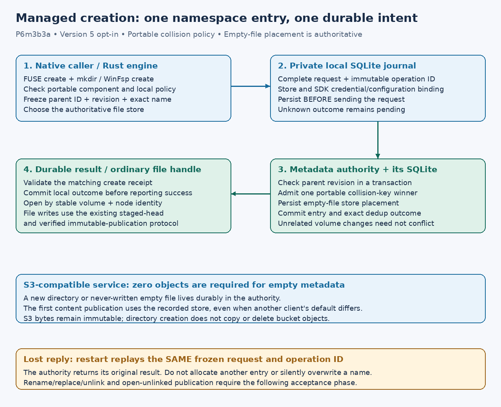

# Managed namespace and application saves

Implementation status and remaining plan, **2026-10-17**. P6m3b2 existing-file editing is
published at `683ec51a405198bfedc64f3a3b1c5eed7e7ed218`, with terminal
[Linux/Windows/book CI](https://github.com/marshallr12/s3drive/actions/runs/39010367651).
Creation is published at `ec0f4902c2572d37300dd4f4c7b262bce2faa40b`, with terminal [Linux/Windows/book CI](https://github.com/marshallr12/s3drive/actions/runs/39014033363).
The remaining namespace/save work is required before calling this an ordinary
editable desktop drive.

## Delivery and acceptance

1. **P6m3b3a: creation and directories — native acceptance passed.** New, explicitly selected portable
   volumes; version-5 managed mount configuration; authority entry CAS; durable
   client namespace intents and exact-request recovery; real FUSE/WinFsp file
   and directory creation. Existing volumes/configurations retain their policy.
   Acceptance includes Unicode, two clients racing for a name, policy bounds,
   lost metadata replies/process death, no incidental S3 PUT/DELETE for empty
   metadata, nested file write/reopen, collisions, and both native drivers.
2. **P6m3b3b: rename, replacement and removal — authority entry CAS and [local/detached publication bridge](managed-unlinked.md) implemented; native integration remains required.** Guard source and destination
   node revisions/identities, parent revisions and expected target absence.
   Commit replacement plus target tombstone atomically. Flush pending source
   bytes before exposing a replacement. Retain displaced/removed objects and
   dirty local generations. Open handles keep their node identity and bytes;
   detached publication must update only a tombstone, never resurrect a path.
   Namespace effects and local acknowledgment need an atomic recovery bridge.
3. **P6m3b3c: real save workflows and recovery.** Exercise application-style
   temporary-file/write/fsync/replace saves on both OSes, directory moves,
   open-unlinked readers/writers, remote races, uncertain metadata outcomes,
   crash recovery and retained conflicts. Do not enable a callback before its
   acceptance passes. Reference-aware garbage collection remains disabled.

This split establishes actual native creation first, then uses the same intent
and authority protocol for full saves; it does not redefine the editable-drive
objective around creation alone.

## Portable collision policy proposal

New `portable-collision-v1` volumes retain the exact UTF-8 display name but reject
unaddressable Windows components and competing names with the same collision
key. The key uses Unicode-17 NFKC plus locale-independent lower/upper closure;
it is a deliberately conservative project collision rule, **not** Windows ordinal
comparison or the Unicode standard's NFKC_Casefold algorithm. Linux lookup remains
exact; Windows lookup uses its native case comparison. Rejecting a broader set
of aliases prevents ambiguity without rewriting filenames.

Pin normalization data and Rust character tables to Unicode 17. The newest
normalization crate inspected locally (0.1.26) uses Unicode 18, while Rust 1.99.1
uses Unicode 17; use inspected 0.1.25 and fail compilation on table-version drift.
Audit the collision rule against every BMP upcase mapping on native Windows CI;
reject the policy rather than assume cross-platform equivalence. Windows 10/11
workstation acceptance remains separate from Server 2025 evidence.

Windows reserved characters, trailing dots/spaces and device names require
validation, including the documented superscript COM/LPT digit aliases.
[Microsoft filename rules](https://learn.microsoft.com/windows/win32/fileio/naming-a-file)
Unicode compatibility normalization can merge distinctions; it is used only for
collision admission, never to rename existing display strings.
[Unicode 17 implementation guidance](https://www.unicode.org/versions/Unicode17.0.0/core-spec/chapter-5/)

## Namespace intent protocol proposal

Persist the complete request, volume, default-store identity and frozen local
credential/configuration binding before network. A request carries an entry ID,
parent revision, collision-checked name and authoritative file-store placement, so unrelated volume changes need not
conflict. The authority commits its effect and exact dedup outcome together.
Record the matching outcome locally; unknown transport/commit results remain
pending and replay only the same request. Bound and checksum retained rows.

Metadata creation is distinct from uploading content: an empty file can be
represented durably at the authority before its first immutable payload. Its store descriptor is recorded at creation; other clients must follow it regardless of their own default store. Reservations for a different store are refused. Legacy unplaced file creation is refused on a portable volume. Policies
still gate admission; version 5 explicitly opts into namespace changes. No S3
DELETE, unconditional overwrite, layout conversion, live Wasabi mutation or
Turso deployment is part of this phase.

WinFsp deletion must follow its cleanup lifecycle; its resolved Rust trait says
`set_delete` records intent and must not delete immediately. That integration
belongs to the replacement/removal phase, not an invented POSIX-style callback.
[WinFsp API header](https://github.com/winfsp/winfsp/blob/master/inc/winfsp/winfsp.h)

## Current creation contract

Use `authority-serve --name-policy portable-collision-v1` for a **new** private
authority and retain that flag when restarting it. Selecting another policy for
an initialized volume fails; no existing names are silently converted. Version-5
managed mount configuration requires that policy and `namespace-create-v1`.
Versions 3/4 retain their existing read/edit behavior. The
[configuration template](../../examples/managed-namespace.toml) is a template,
not a live write policy or a conversion command.

Schema 12 preserves schema-11 rows, adds collision keys and optional authoritative
placement to nodes, and stores private client namespace intents. Legacy node
serialization omits absent placement, preserving existing local receipt hashes.
Checksums cover complete client inputs/outcomes; corrupt sibling keys prevent a
new create from bypassing collision rules. Parent/name admission and authority
idempotency commit together. A receipt failure/full disk leaves the local intent
pending. Mount recovery replays the same request before serving callbacks.
Removing the namespace opt-in does not authorize forgetting an unresolved intent.

The portable test uses the actual CLI authority and SDK fixture, creates nested
Unicode entries, writes/reopens content, verifies collision refusal, and kills a
client after a forwarded create has committed while the proxy withholds its
reply. Restart must adopt the original result without another volume-sequence
increment or S3 PUT. A second client with another default store must publish into
the file's authoritative store. Authority restart must preserve the namespace.
Native acceptance is the separate sixth case in each ignored suite, including
real exclusive creation, nested directories, normal remount, a new file's dirty
restart and a killed mount during that lost metadata reply. Run native suites
serially as documented; portable tests do not certify either driver.

Initial limits remain 8 MiB per file, four retained file snapshots, bounded
node/intent counts and no garbage collection. New opens authorize online;
unpublished empty nodes use authority authorization plus the selected publisher's
policy because there is no object yet. Creation can commit before an open-handle
allocation or subsequent read fails; retained intent IDs resolve that effect.
No native rename/delete, symlinks, ACL mutation or desktop replacement-save
acceptance is implied by creation alone.

## Guarded authority entries (P6m3b3b1, 2026-10-17)

The additive `namespace-entry-cas-v1` capability provides `MoveEntry` and
`RemoveEntry` on portable volumes. This is a metadata contract, not a mounted
rename/unlink acceptance claim. Existing global-sequence `Move`/`Remove` calls
retain their original behavior; existing serialized receipts remain unchanged.
No schema migration or S3 operation is required by the new transactions.

| Guard | Required observation | Rejection |
| --- | --- | --- |
| Source | Stable node ID, live state and exact revision | Conflict if removed or changed |
| Source parent | Stable parent ID and exact directory revision, matching the source's actual parent | Conflict if moved or stale |
| Destination parent | Live directory ID and exact revision | Conflict if stale; non-directories refused |
| Destination absent | No live entry with the requested portable collision key | Already-exists if another entry occupies it |
| Destination present | Exact live node ID/revision at that collision key | Conflict if replaced, removed or changed |

`None` is an explicit absence expectation, not permission to overwrite an entry
that appears later. A case-only/normalization-spelling change supplies the source
itself as the expected destination. The exact UTF-8 requested display name is
preserved. Source and destination parent guards may identify the same directory.
Unrelated volume changes do not reject an otherwise valid guarded request;
a future sequence hint is refused. Directory moves check cycles and destination
child limits; replacement requires matching directory/file categories and an
empty directory target. Removal requires an empty directory, or a regular file.
Root mutation is refused.

Replacement tombstones the expected target and moves the source in one immediate
SQLite transaction, with one volume sequence and exact request/result deduplication.
The receipt includes the displaced tombstone, preserving its complete payload
reference and store placement. Removal also preserves these fields. No payload
is deleted, and replaying an old successful move after a later unlink cannot
resurrect its node. The implementation checks affected rows and reads back the
changed nodes; ignored writes or result insertion failures roll back both names.
Internal/disk-full results remain unknown, with no fabricated terminal receipt.

Seven state tests cover stale source/target/parent/absence guards, retained
payloads/placement, case aliases, cycles, type mismatches, non-empty directories,
child limits, corrupt collision keys, future hints and changed operation IDs.
Trigger failures include ignored target/source/receipt/sequence writes. A real
`SQLITE_FULL` test verifies rollback and exact-request retry after restoring the
page budget. A real TCP test races two independent clients against one target,
restarts the authority, replays both outcomes, unlinks the winner, and checks
that replay does not resurrect it.

The [private namespace acknowledgment and detached publication bridge](managed-unlinked.md) now implements the local transaction and retained unlinked-generation contract. Remaining native integration is mandatory: publish pending source bytes before a replacement, retain open handles, wire FUSE rename/unlink/rmdir and WinFsp rename/delete cleanup, and pass real application save/replacement/recovery tests. Until then native
rename/removal callbacks remain unsupported, and dirty data is retained.
