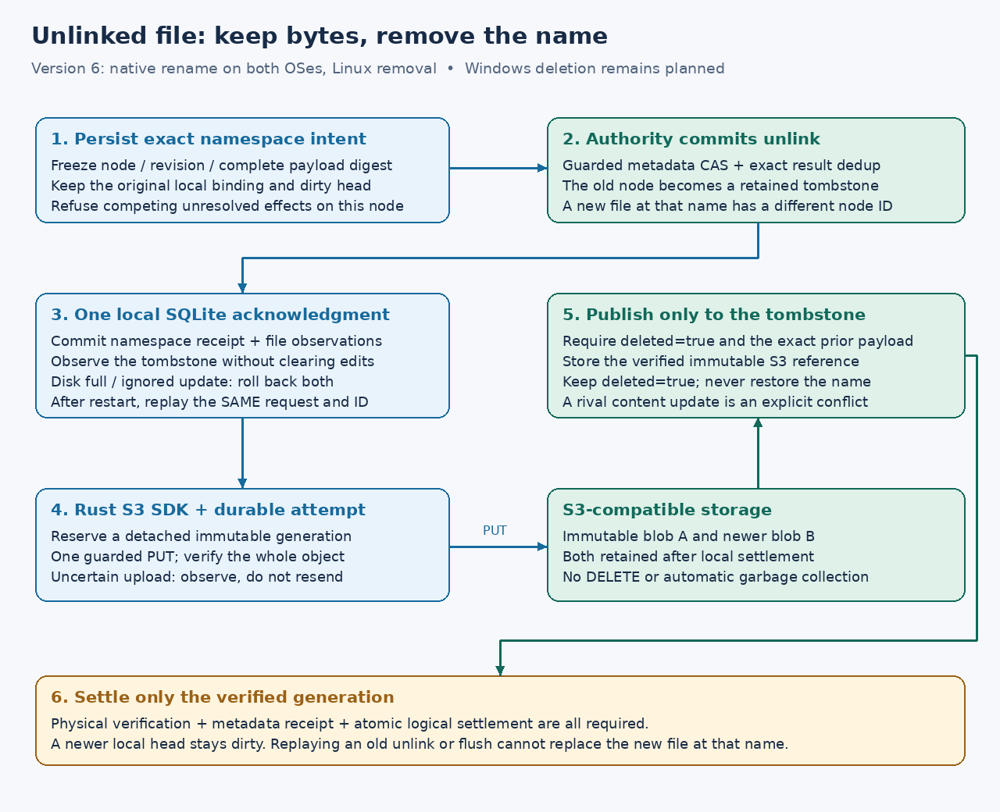

# Managed native rename, replacement and Linux removal

**Native checkpoint, 2026-10-17 (P6m3b3b3).** Explicit managed
`version = 6` adds shared rename/replacement and Linux unlink/rmdir callbacks.
Portable SDK/authority/SQLite tests and both real-driver acceptance steps passed
at `7215087`, [run 39022063662](https://github.com/marshallr12/s3drive/actions/runs/39022063662).
The [snapshot](evidence/managed-native-mutations-2026-10-17.json) records native-step
acceptance; Windows was saving cache at capture. Publication additionally requires
terminal exact-tip Linux/Windows/book CI.
Windows deletion remains unsupported. Version 3 remains read-only, version 4
edits existing files and version 5 creates files/directories. Existing configs
are never upgraded automatically. The [version-6 template](../../examples/managed-mutations.toml)
requires a portable-collision-v1 authority, the guarded-entry and detached-content
capabilities, private local state and an explicit provider-bound write policy.
It does not install a real write policy or authorize new Wasabi mutations.

## Save and rename contract

A rename checks the original node ID and source spelling, both parents, and
expected destination presence/identity. The authority transaction enforces
revision guards, cycle/type checks and empty-directory replacement. Source
placement and payload identity stay fixed across names and folders. Moving a
file from a second bucket does not copy or delete its objects.

The shared engine serializes namespace effects with local publication and edits.
It first recovers unresolved namespace work. A dirty source publishes and obtains
its verified logical receipt before its new name becomes visible; this supports
temporary-file/write/rename-over-target saves without relying on an implicit
close to flush data. A target's already-prepared publication reconciles first;
unprepared dirty target bytes can remain local. Captured source/target revisions
then enter the [durable namespace protocol](managed-unlinked.md). A conflict is
returned explicitly; there is no unconditional retry or automatic external
payload adoption. Metadata-only observation may advance a tracked file with
unchanged complete payload and placement.

Linux supports ordinary replacement and RENAME_NOREPLACE. Exchange and whiteout
remain unsupported. Source spelling uses exact UTF-8 comparison; a different
portable alias is not permission to overwrite an unrelated file. Windows uses
its native name comparison and permits the owner DELETE access needed for
rename only in version 6. File ACL/ownership changes remain unsupported.

## Linux retained handles and removal

A replaced or removed node becomes a tombstone. Existing handles keep their
shared local bytes and stable node identity, report zero links and can still
write and fsync. Detached publication updates that old node while preserving
its tombstone. Recreating the old path allocates a new identity, so a later flush
through the old handle cannot overwrite the new file. The unlink observation also reaches older pinned read revisions after a clean
refresh, even if the newest view has closed. Linux getattr without a handle flag
uses retained metadata for these deleted inodes. Newly opened paths never
resolve the tombstone. No immutable blob is reclaimed.

Unlink refuses directories; rmdir refuses files and nonempty directories. A
successful directory fsync resolves and acknowledges pending namespace work; it
does not implicitly publish every dirty file. Full file durability still requires
the file's own successful fsync/publication receipt.

## Windows boundary

Rename and replacement have a native acceptance case. Windows kernel sharing
rules can reject replacement while the destination is open. DeleteFile,
directory removal, delete disposition and FILE_DELETE_ON_CLOSE remain refused.
WinFsp cleanup cannot return an error, and SetDelete can arm or cancel a later
removal without removing the node. The [reversible disposition protocol](windows-delete-plan.md) is progressing
through authority, client and native phases before deletion is enabled.
[WinFsp callback contract](https://raw.githubusercontent.com/winfsp/winfsp/master/inc/winfsp/winfsp.h),
checked 2026-10-17. Passing rename does not certify full desktop application
compatibility or Windows open-unlinked semantics.

## Bounded work and shutdown

Four owned permits bound admitted managed write operations. Namespace effects
and publication run in owned tasks: cancellation of the caller cannot abandon
an accepted operation while SQLite is closed. Once native callbacks stop,
shutdown closes admission, waits for those permits to drain and then closes the
state owner. Process death still relies on the persistent exact-operation
journal. Error/unknown results never count as successful flushes.

Publication futures cross a boxed, type-erased Send boundary to bound nested
SDK polling frames. The portable engine and process-kill tests run with the
normal stack; increasing RUST_MIN_STACK is not an acceptance workaround.

## Acceptance

The portable scenario covers dirty-source replacement, retained dirty displaced
handles, detached publication, name reuse, two stores, self-renames, replacement
refusal, cycle/type/emptiness checks, and directory fsync. It expects exactly
three immutable PUTs. Two killed-client cases lose committed move/remove replies
and require exact recovery without another namespace effect or PUT. A cancelled
caller case holds the authority reply, verifies shutdown waits and new writes
are refused, then releases it and reopens SQLite successfully. A separate retained-revision
check publishes one external clean refresh, closes its newest view, unlinks the
node and verifies that the older pinned view reports zero links while retaining
its original bytes.

A seventh real-driver case per OS exercises save/replace, Unicode directory
moves, second-bucket identity, cycle refusal and remount. Both lose a committed
native rename reply and kill/remount the daemon. Linux additionally tests
retained replaced/unlinked handles, zero links, name reuse, type/emptiness checks,
directory fsync and lost removal reply. Windows explicitly verifies deletion and
delete-on-close refusal. Native cases stay serialized. See
[verification](development.md#managed-native-mutation-gate-2026-10-17) for results.

Remote authority/Turso deployment, multi-host invalidation, full application
save suites, real managed-provider acceptance, and actual MX/Windows desktop
reboot/SSH checks remain subsequent acceptance. This workstation's executor
cannot perform a new privileged FUSE mount under NoNewPrivs; native Linux and
Windows testing runs on the hosted CI VMs.
