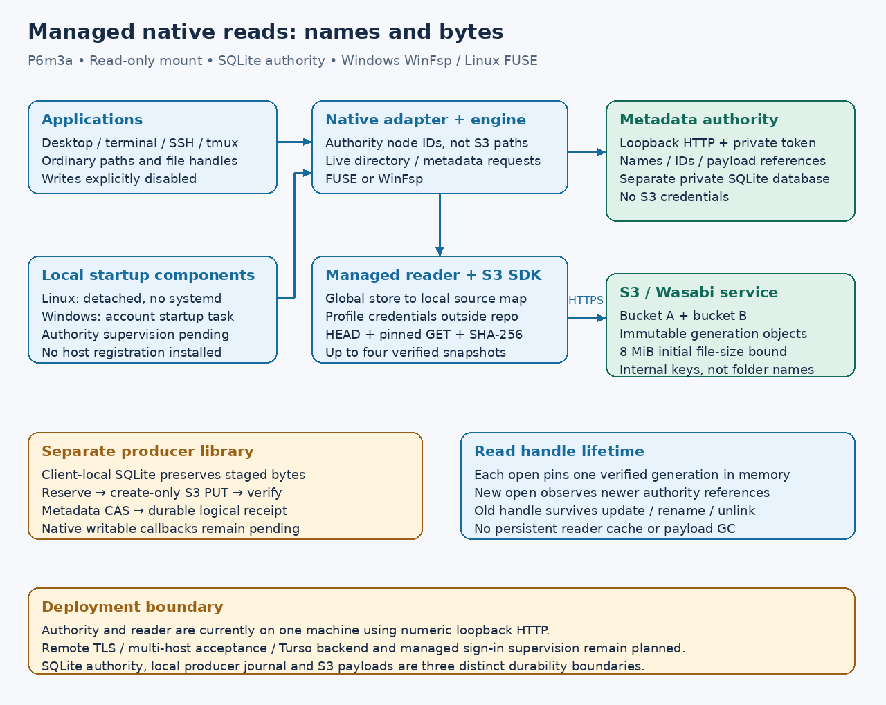

# Managed native read-only drives

Implementation date: **2026-10-17**. P6m3a connects the managed namespace and
immutable-file reader to the existing Linux FUSE and Windows WinFsp adapters.
The version-3 configuration is explicit. Existing version-1/2 configurations
retain their direct layout; no bucket or configuration is converted implicitly.
Native acceptance passed on Linux and Windows at
[`653c804`](https://github.com/marshallr12/s3drive/commit/653c80499cd1c5bf892eebeb45e81d1499fe023b),
[terminal run 39002521132](https://github.com/marshallr12/s3drive/actions/runs/39002521132).
Linux job `117308259596`, Windows job `117308259773` and book job
`117308259813` all succeeded. Both native suites ran four cases, including
the managed reader. This is owned-loopback provider evidence on CI hosts,
not live managed Wasabi or multi-host deployment acceptance.



## Components and read behavior

`s3drive-managed::Reader` requires the authority endpoint, volume ID, private
bearer-token file and 1–16 mappings from global store IDs to local S3 sources.
The routing digest covers normalized endpoint, bucket, region and source prefix.
Local aliases, credential profiles, LIST encoding and addressing style are
excluded; transport options are still validated in each local configuration.
These local settings may differ between computers. Pointing a
registered store ID at a different bucket fails before a mount is established.
The reader requires no upload policy or writer journal. All referenced stores
must be mapped; a missing or mismatched route fails explicitly.

The root directory contains authority-defined names, rather than source aliases.
Files from different buckets can share one directory. Native inode/file-index
numbers are process-local projections of stable authority node IDs; they are not
promised to survive a daemon restart. Listing refreshes names and parent relations
while retaining the native identity of already-seen nodes. Namespace operations
use live authority requests; there is no offline metadata replica or push
invalidation subscription. Native metadata/directory cache timeouts are zero. Listings are limited to
1,000 children and the local native node table to 32,768 entries. The authority
has a lower prototype limit of 4,096 total retained nodes, including tombstones.

A published file opens through live metadata lookup, credential-bound S3 HEAD,
a pinned complete GET, and SHA-256 verification against its authority reservation.
Four retained snapshots across the reader bound complete payload buffers to
32 MiB; each published file is at most 8 MiB. The fifth simultaneous snapshot
fails with a resource/busy error. Empty unpublished files have no S3 payload.
This bounded initial implementation is unsuitable for large-file workloads.

A successful open pins the verified bytes in memory. That handle continues
reading its original revision after another authorized client publishes a newer
revision, renames/unlinks the node, or the authority stops. New opens use live
checks and fail when authorization or the authority is unavailable. Reads from
an old handle do not grant permission to open another file offline. Unlinked
and superseded S3 objects are retained; no garbage collector is enabled.

The original P6m3a authority policy is exact, case-sensitive UTF-8. Linux can expose
`Case` and `case` together. The Windows adapter rejects an ambiguous directory
rather than merging or renaming entries; other unsupported Windows names also
fail explicitly. Subsequent writable phases added portable-collision-v1; choose
that policy for new writable Linux/Windows volumes using the
[setup workflow](managed-bootstrap.md). This is not a claim of general POSIX or
NTFS compatibility.

## Local development setup

The authority is a foreground development service with its own private SQLite
directory, separate from mounted paths and all client cache/journal directories.
It has no S3 credentials. The bearer token grants the trusted client namespace
API access, including mutations; read-only is enforced by the mount, not by a
separate server reader role. The original phase used numeric loopback HTTP;
[HTTPS transport](remote-authority.md) has since passed its native acceptance.
Hosted deployment and optional Turso remain [P6m4 work](turso-coordination.md).
A local listener alone is not cross-machine deployment acceptance.

On Linux, after building the workspace, create the token in an existing private
parent and start a stable local listener:

```sh
cargo run -p s3drive-cli -- authority-token --directory "$HOME/.local/share/s3drive-secrets"
cargo run -p s3drive-cli -- authority-serve \
  --directory "$HOME/.local/share/s3drive-authority" \
  --token-file "$HOME/.local/share/s3drive-secrets/authority.token" \
  --listen 127.0.0.1:43128
```

The token command creates one new owner-private file and refuses to overwrite
it. It prints no token contents. Reads reject links, hard links, incorrect
ownership or permissions/ACLs and oversized content. The service prints one
JSON readiness line with endpoint, generated volume ID and name policy. Use
that actual volume ID in the configuration. `--stop-on-stdin-close` is intended
for supervised test processes; ordinary foreground mode accepts termination
signals. Parent directories must already exist and satisfy local ownership rules.
On Windows use absolute paths on a local drive; the token inherits an account
and SYSTEM-only ACL from its private directory.

A registered store is a prerequisite. The [managed setup CLI](managed-bootstrap.md)
now prepares/applies frozen registrations and generates per-machine read-only
or explicit writable configurations. Existing bucket import remains unsupported.
The acceptance fixture uses that CLI with dummy local credentials; it does not
initialize a real bucket. The following example illustrates an initialized namespace; replace
both IDs and the token path, and keep credentials in an external AWS profile:

```toml
version = 3
mode = "read-only"

[managed]
authority = "http://127.0.0.1:43128/v1/namespace"
volume = "11111111111111111111111111111111" # actual readiness volume
# Windows example: 'C:\Users\you\AppData\Local\S3DriveSecrets\authority.token'
token_file = "/home/you/.local/share/s3drive-secrets/authority.token"

[[managed.stores]]
id = "22222222222222222222222222222222" # an existing registered store
source = "wasabi-local"

[[sources]]
alias = "wasabi-local"
endpoint = "https://s3.us-east-2.wasabisys.com"
region = "us-east-2"
bucket = "s3drivetest"
prefix = ""
profile = "wasabi-s3drive"
path_style = true
list_url_encoding = "form"
```

Save it outside the mount, validate with `s3drive config-check CONFIG`, then use
`s3drive mount CONFIG MOUNTPOINT`. To add buckets, add a `[[sources]]` entry and
its corresponding `[[managed.stores]]` mapping. The metadata authority chooses
where files are stored; these mappings do not create one folder per bucket.
Managed mode rejects writes/cache tables. Direct-key `resolve`, `stat` and `read`
utilities reject managed logical paths; use the mounted filesystem.

Existing sign-in launchers take a config/mountpoint pair and can launch this
mount. They do not yet supervise the authority process, provision its metadata,
or establish a remote connection. A deployable managed sign-in product still
needs authority availability/restart supervision and reboot/SSH acceptance,
including MX without systemd. No real workstation startup entry is installed.

## Verification and remaining phases

The normal gate includes `managed_native` SDK/HTTP/SQLite integration tests and
strict config/private-token checks. The ignored Linux and Windows mount suites
include `actual_managed_namespace_and_immutable_reads`: Unicode and binary data,
empty files, two buckets, old/new handles, external metadata rename/unlink,
S3 denial, authority loss/restart, remount and retained immutable objects. Their
only PUTs are three exact publications by a separate producer; mounted reads
must never issue PUT or DELETE. CI uses real drivers on Linux and a remote
Windows Server 2025 VM, not this Linux workstation or Windows desktop emulation.

[P6m3b1](managed-edits.md) adds durable local logical heads and publication settlement.
[P6m3b2](managed-write-plan.md) adds version-4 local edit views, patch/truncate,
remote fsync and recovery for existing-file callbacks, with its own native case.
P6m3b3 adds [portable names and creation](managed-namespace-plan.md), followed by
[version-6 rename/replacement and Linux retained-handle removal](managed-native-mutations.md).
Windows deferred deletion and full application compatibility remain required.
Service supervision, multi-host/Turso deployment, large files, garbage collection
and live-provider managed acceptance remain unfinished. Existing direct writable
mount evidence does not certify those behaviors.
