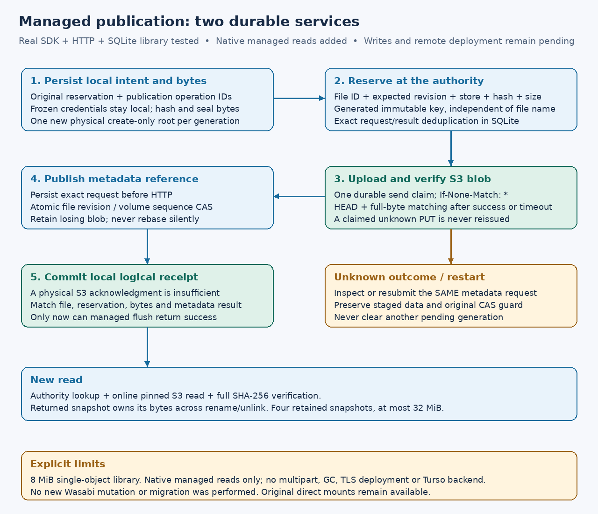

# Managed immutable-file publication

**P6m2 library implementation, 2026-10-16.** The managed publisher now joins the
real S3 SDK executor, the authority HTTP API and each client's private SQLite
journal. [Managed native read-only mounts](managed-native.md) now use the same
verified reader. Native managed writes and a deployed authority remain subsequent
acceptance phases. This library phase changed no real bucket, credentials,
configuration or service.



## Identities and storage layout

The authority registers an immutable store descriptor: a generated store ID, a
routing digest, and a relative internal key root. The digest covers normalized
endpoint URL, bucket, region and configured source prefix. Local profile/alias
names, credentials, LIST encoding and addressing dialect are excluded. Clients
check this route against their configured S3 reader before opening a publisher.
This is a routing check, **not proof of a provider-global principal or tenant**;
store provisioning must establish that all clients access the intended resource.
Credential/configuration bindings still protect every local journal and upload.
Neither those private digests nor S3 credentials enter authority requests.

For example, relative to the configured source prefix:

```text
writable/.s3drive/v1/<volume-id>/<node-id>/<reservation-id>
```

Display names such as `café 日本語 🦀.bin` exist only in metadata. A rename does
not move bytes. A separate reservation allocates each immutable generation key;
local generation IDs never identify files globally. Store roots are canonical
ASCII component prefixes, at most 128 bytes. Provider key/policy limits are
checked before staging. Each publisher selects one store. The native read-only
reader maps up to sixteen stores to local S3 sources; native writable routing
remains a subsequent phase.

## Publication protocol

1. Persist the complete original reservation request, publication operation ID,
   store descriptor and frozen local target binding. Hash all retained record
   fields. Then stage and seal the complete bytes, using an idempotent operation
   key. Each physical blob is an independent `Base::Missing` root with no local
   parent; no mutable-file ETag lineage crosses into this protocol.
2. Confirm the exact reservation at the authority. It binds node ID, expected
   file revision, store, generated key, size and SHA-256. Another client may
   reserve a different generation for that same revision; this is not a lease.
3. Use the existing source/evidence/prefix/size-bound executor to create the blob
   with `If-None-Match: *`. Its durable send claim permits at most one PUT.
   HEAD plus full-byte observation establish the matching remote operation.
   A claimed unknown request is observed after restart, never sent again.
4. After blob verification, persist the complete metadata publication request
   before sending it. The authority checks the reserved file revision and its
   volume sequence in the transaction that changes the payload reference,
   increments the sequence and retains the operation result. A fresh volume
   guard cannot rescue a stale file revision. A losing blob is retained.
5. After confirmed metadata publication, atomically persist a matching local
   managed receipt. Only then return `s3drive_managed::FlushReceipt`.

The existing executor's flush receipt acknowledges the **physical blob**. It
cannot settle the separate logical managed intent. A failed metadata commit,
conflict, lost result or local disk-full error leaves that logical intent pending
and all bytes retained, even if the old physical journal has acknowledged its
upload. Acknowledging one managed record does not clear another edit's record.

Metadata requests are idempotent by their exact original operation/request.
Retries resubmit those same arguments; the authority returns its durable result.
The client does not trust a bare operation lookup to establish request binding.
Once prepared, a publication keeps its original sequence guard across restart.
A conflict is not automatically rebased, and no new upload/publication operation
is invented to hide it. A flush receipt is historical: subsequent namespace
changes or unauthorized external deletion do not rewrite that receipt.

S3 and metadata are not one transaction. No database transaction spans HTTP.
Service-side byte verification is not claimed: this prototype trusts approved,
authenticated clients to perform SDK verification before submitting a payload
attestation. The authority has no S3 credentials and cannot validate dishonest
attestations from a compromised authorized client. Device identity/ACLs and
remote deployment remain acceptance work; arbitrary S3 tools must not edit
managed internal keys.

## Reads, handles and boundaries

A new published-file read checks the authority, performs online S3 HEAD, pins
the recorded ETag/version and verifies the full length and SHA-256. A matching
ETag cannot excuse corrupted bytes. The returned immutable snapshot owns its
bytes; later rename, publication, unlink or a network outage cannot change those
already-read bytes. New opens still need online authorization. An initial
empty-file metadata record with no payload represents zero bytes and needs no
S3 GET; explicit empty blob publication is also tested.

Four retained snapshots per publisher bound the current whole-file read buffers
to at most 32 MiB. Snapshot clones share bytes and one retained permit; admission
fails until an open snapshot releases its permit. Four concurrent stage/reserve/
flush operations are admitted separately. This is not the future chunked mounted
cache or general large-file support. Single objects remain limited to 8 MiB.

Authority limits remain 16 stores, 4,096 retained reservations, 4,096 nodes and
8,192 operation results. Each client retains at most 4,096 managed records.
Tombstones, rejected attempts, old/losing/unlinked blobs and local chunks are not
collected. Pending enumeration verifies settled records too; a damaged receipt
cannot silently hide work. Schema 9 preserves earlier client/namespace state
and adds store, reservation, node-payload and client publication fields.

The new `WireClient` accepts only numeric-loopback HTTP URLs at
`/v1/namespace`, with explicit bearer token, no redirects/proxy/automatic retry,
10-second request deadline, 4 KiB requests and 8 MiB bounded replies. It is not a
remote deployment client. Production TLS, identity/volume ACLs, failover and Turso
remain separate. Managed writable integration must select a portable versioned
name comparison policy; the current read-only adapter uses `exact-utf8-v1`
and rejects unsupported Windows name projections.

## Acceptance evidence and remaining work

```bash
cargo test -p s3drive-cli --test managed_publication --locked
cargo test -p s3drive-state --locked
bash scripts/gate.sh
```

The managed integration test uses the same real CLI write-capability probe,
SDK factory and policy as ordinary execution, with isolated dummy profile files
and an owned loopback S3 fixture. Three independent client processes share the
persistent authority across forced termination. Two client-local databases race
uploads; exactly one metadata reference wins. Five managed blobs receive exactly
five PUTs across lost S3 replies, unknown S3 outcomes, lost reservation replies,
lost metadata publication replies and two process kills. Old and losing payloads
remain present. The test also exercises binary data, an empty blob, Unicode
names, stale file revision despite a fresh volume guard, bounded snapshots,
unchanged-ETag byte corruption, rename/unlink and retained open snapshots.

Local state tests cover sealed-but-unlinked recovery, operation rebinding
refusal, exact receipt matching, corruption refusal, pending enumeration beyond
settled rows, schema-8 migration preserving namespace results/dirty manifests,
real `SQLITE_FULL` during logical acknowledgment after blob verification, and
refusal to acknowledge an ignored database update.
Routing tests prove local aliases/profiles can differ without changing the
storage route, while different bucket/prefix/endpoint scopes differ.

These publication tests alone do not certify native adapters, actual multi-host
network partitions, Turso, physical power-cut recovery or a live managed Wasabi
workflow. Separate [native read-only acceptance](managed-native.md) now covers
FUSE/WinFsp reads and multi-store routing. Managed writable integration still
needs logical-file heads/edit plans, portable naming and atomic replace-save
semantics, then its own native/provider/recovery acceptance. Keep unsupported
writable paths until those criteria pass. No bucket import or deletion/GC is enabled.

## Wasabi generation churn

Research refreshed **2026-10-16**. Wasabi's current Pay-as-You-Go FAQ specifies a
90-day minimum storage duration; other plans/account arrangements can differ.
Deleting an object early can leave timed-deleted-storage charges for the
remaining period. This account's actual contract was not inspected.
[Wasabi pricing FAQ](https://wasabi.com/pricing/faq),
[minimum-duration policy](https://docs.wasabi.com/docs/how-does-wasabis-minimum-storage-duration-policy-work)

Our design implication: uploading a new full generation for every small write
can create substantial retained/billable storage. Native integration should
coalesce local edits before explicit remote flush and measure generation churn;
it must not weaken the durability promised by flush. Delayed GC alone does not
eliminate a minimum-duration charge. No price estimate, account-plan change or
billing API action is part of this implementation.

P6m3a now reuses the verified reader in [explicit managed read-only mounts](managed-native.md).
The publication fixture alone still does not certify native adapters or deployment.
