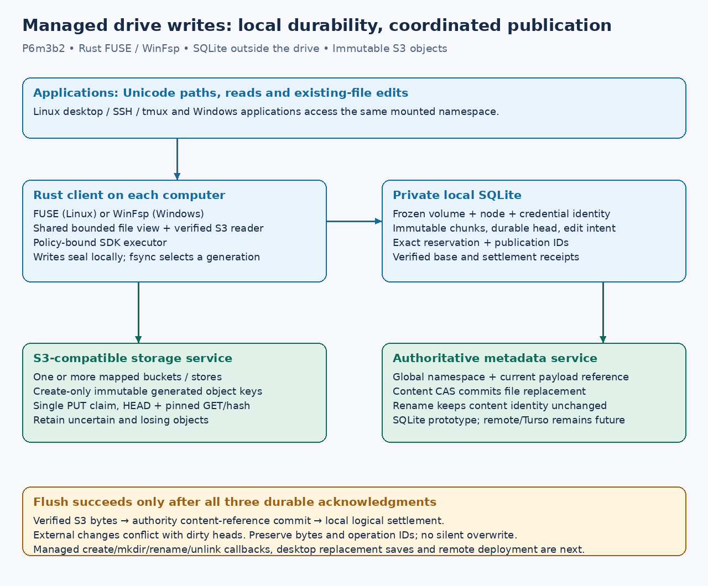

# Managed existing-file editing

**P6m3b2 implementation and acceptance contract, 2026-10-17.** Version 4
connects [durable logical edits](managed-edits.md) to the existing Linux FUSE and
Windows WinFsp callbacks. Version 3 stays read-only. This phase adds existing-file
editing, including unpublished empty files, with explicit per-store write policies.
Both native steps passed at the [verified checkpoint](development.md#verified-native-checkpoint). Full publication remains a separate gate; consult the exact-source CI evidence in
[development](development.md) before treating a platform as accepted.

## Configuration and authorization

[The example configuration](../../examples/managed-writes.toml) uses `version=4`,
`mode='read-write'`, `[managed]` with `default_store`, and `[writes]` with an
absolute private SQLite directory and policy/plan/report paths. A mapped store
needs its own matching policy to be writable. Other mapped stores remain readable.
`default_store` must identify a writable mapped store and selects the destination
for an existing empty authority node that has never had a payload. Published
files retain their payload's store; clean refresh does not migrate local bindings
between stores or credential generations. Source aliases are local configuration,
not global file identity.

The mount checks the authority's `content-cas-v1` capability before opening the
write database. An older authority fails closed. New opens always obtain current
authority metadata. Published files also require an online S3 HEAD, pinned full
GET and complete SHA-256 verification. A writable file binds that verified snapshot
to the publisher's exact SDK credential/configuration identity. Unpublished empty
files require authority authorization and the configured default publisher's policy;
there is no S3 object to download yet. Policies are rechecked before local edits
and before a new physical upload. Existing uncertain attempts retain their original
identity and may still be observed after policy expiry.

## Local writes and remote flush

Handles in one mount share a mutable view of each current logical file. Successful
patch, append, truncate and zero-filled sparse extension seal a complete local
SQLite generation before acknowledging the write. Readers see that durable local
head. Metadata lookup reports the durable dirty size even before the first open after restart. Removing a store's write policy fails closed over its retained dirty head rather than silently exposing old remote bytes. No reservation or PUT happens for each patch. Initial files remain bounded
to 8 MiB, four hydrated file snapshots to 32 MiB, and retained file/edit counts to
the existing journal quotas. Dirty bytes are never evicted to make room.

Explicit fsync or a writable-handle cleanup flush selects the latest sealed head,
coalescing unprepared predecessors. A read-only handle's cleanup does not publish
another handle's edits. On Linux, explicit fsync remains available independently
of close. WinFsp's shared flush/cleanup callback publishes only for a writable
file context; its volume flush processes retained dirty files, including files
with no surviving local handle. Adapter shutdown drains the local SQLite owner;
it does not promise remote settlement of unflushed or conflicting heads.

Before any network effect, the client freezes the exact logical generation,
reservation ID, publication ID, source binding and base content reference. It
recovers attempted ancestors before preparing a newer publication. An incomplete
builder, unknown physical result or rejected metadata commit prevents a successful
flush and retains the bytes/IDs. A successful flush requires verified S3 storage,
committed authority metadata and atomic local logical settlement. No unconditional
PUT or new-ID retry substitutes for an uncertain old operation.

The initial native coordinator serializes publications and local mutation/base
adoption across the mount. Reads continue from owned snapshots. This conservative
limit avoids a write racing clean-base adoption; finer per-file concurrency and
performance tuning are future work. Independent machines/files can still commit
through the authority without unrelated volume-sequence conflicts.

## Content references and conflicts

`ReserveContent` is additive. Its guard is a domain-separated SHA-256 digest of
the complete previous payload reference, including its reservation and revision
proof, rather than a hash of byte content alone. `None` denotes an unpublished
empty node. A metadata-only rename does not change this reference. Another file's
publication does not invalidate it. A competing publication, removal or different
store binding cannot silently become the base of a dirty file.

The authority checks the reference again when publishing, inside its SQLite
transaction. It advances the actual volume sequence and records the exact request's
idempotent result. Stale global sequence hints are allowed only for content-guarded
reservations/publications; future hints are refused. Namespace and legacy
revision/sequence-guarded requests keep their previous behavior. Legacy reservation
serialization omits the new optional guard, preserving existing request/record
hashes. All participating clients must be upgraded before publishing guarded
references: older binaries reject the new payload fields rather than reinterpret them.

A freshly authorized clean file may explicitly adopt a newer verified external
payload through `observe_edit_file`. Schema 11 records that base separately from
the original local identity and retained edit history. Old open handles keep their
bytes and cannot write or flush them over the newer adopted base. Metadata-only
changes may be observed while dirty; different content returns a conflict without
changing the dirty head. Reopening after that conflict also fails closed; recovery
inspection/resolution remains explicit. The mount never silently discards a losing
local generation or deletes its physical blob.

## Acceptance and remaining work

Portable tests use the real SDK, a two-bucket HTTP fixture, the actual CLI authority
and private SQLite process owners. They cover Unicode paths, patch/append/sparse
reads, truncation, empty publication, coalescing, restart, metadata rename, clean
external refresh, stale old handles and retained competing changes. State tests
cover independent content CAS, exact request replay, legacy guards, base observation
and schema-10 migration. Existing process-kill and full-disk tests remain required.

Each native suite has an explicit `actual_managed_existing_file_writes_and_recovery`
case for the real driver, with a producer process started before native handles exist (avoiding fork/exec close-induced FUSE flushes; [source and rationale](development.md)): Unicode and two stores, all edit forms, read-only close,
metadata rename, clean teardown, killing a dirty mount, a committed PUT with lost response and
blocked observation, restart without a duplicate PUT, and a competing publication
whose local loser survives. Passing portable tests cannot substitute for these cases.

Version4 keeps creation/mkdir, native rename/unlink and save-by-replacement
unsupported. Subsequent explicit versions add [creation](managed-namespace-plan.md),
[rename/replacement and Linux removal](managed-native-mutations.md), and the
[version7 Windows lifecycle](native-windows-lifecycle.md). This distinction was
clarified 2026-10-18; existing configurations are never upgraded automatically.
Large files, garbage collection, real
workstation reboot/SSH acceptance, live writable Wasabi acceptance and remote/Turso
service deployment remain separate work. This phase changes no real bucket,
credential, startup registration or user's local configuration.
