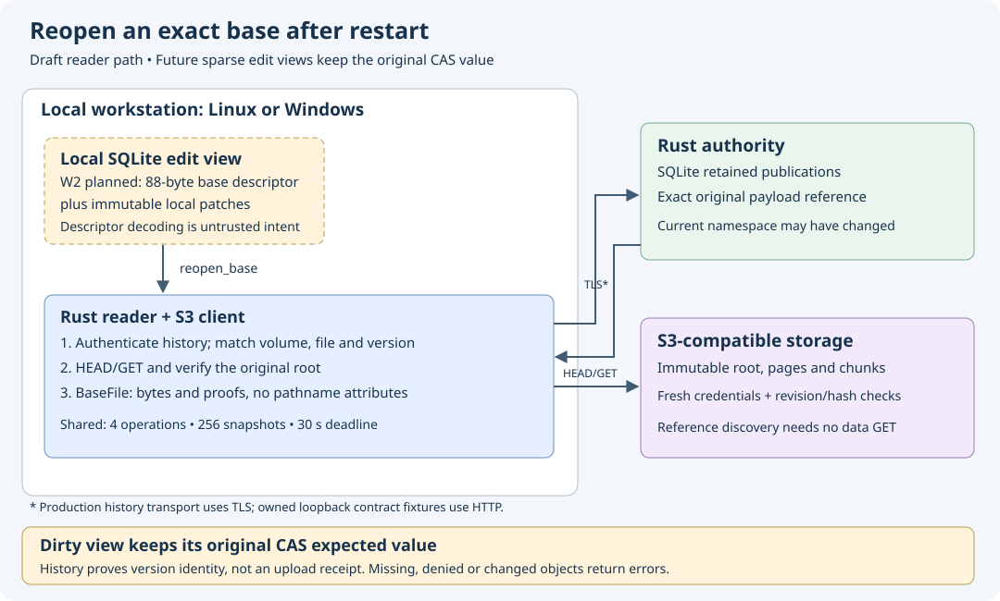

# Reopening a pinned manifest base

Implementation/research date: **2026-10-18**. W1c2 draft on
`codex/payload-history-authority`; not yet accepted by its own complete gates.
The accepted read/proof runtime remains on main separately. This slice neither
activates native chunk writes nor adds a sparse-edit SQLite schema.

## Separate content from namespace attributes

`File` retains the Node metadata captured by ordinary current-version open.
It delegates bytes and proofs to an immutable `BaseFile` content version.
`File::pinned_base()` shares that version and its retained-snapshot permit.
A reopened BaseFile has no API exposing invented historical filename, parent,
revision or inode attributes. It supplies logical size, bounded reads and the
same authenticated chunk/page proof operations.

`File::base_descriptor()` and `BaseFile::base_descriptor()` export a manifest
identity only when the authority advertises `manifest-history-v1`. Ordinary
current-version reads and proof operations continue without that extra capability.
Metadata-empty and legacy files are explicitly unsupported by this export path;
their eventual restart recovery remains required before native write acceptance.
Published-empty manifests do have a valid base descriptor and root.

## Persist identity, then reauthorize

The fixed `S3DBASE1` descriptor contains 88 bytes: an 8-byte marker, 16-byte
volume/node/reservation IDs and the 32-byte payload reference. It contains no
credentials, arbitrary S3 key, cached root bytes or cached Node. Decode checks
shape and reserved IDs; it does not authorize a snapshot. A descriptor for
another legitimate file is an identity for that file, so a future edit view must
also compare it with the view's own immutable target binding.

`Reader::reopen_base()` requires the configured volume and history capability,
then asks the authenticated authority for precisely that historical payload.
It checks the returned volume/file/reservation/reference, manifest format and
configured store route before any S3 access. It independently HEADs and GETs
the original root using current provider credentials and verifies revision,
physical hash, page hash, scope and geometry. It fetches no data chunk merely
to reopen the version. Missing history or roots never substitute current content.

The descriptor's `payload_reference()` is the original edit's CAS expected
value. It is **not** `payload.reservation.guard.expected`, which identifies the
predecessor used to publish this version. Reopening after rename, rival content
publication or deletion preserves that original identity; it grants no write,
settlement or reclamation permission. Reachability witnesses still do not prove
current data availability or successful upload.

## Bounds and evidence

Ordinary File handles and reopened BaseFile handles share the Reader's four
active-operation slots, 256 retained versions and overall deadline (at most
30 seconds). Cloning a handle consumes no new snapshot slot but retains its
existing slot until the final clone drops. Cancelled or failed opens release
both admissions; an existing handle retains its snapshot across read errors.
Existing range/chunk/page bounds are unchanged.

The first focused restart scenario passed in5.19s. It persisted the descriptor
under a Unicode filename, restarted the actual SQLite authority/server, replaced
and removed the live file, rotated the owned dummy AWS profile and launched a
fresh reader process. That process verified old binary/cross-page bytes and
serialized witnesses with the rotated credentials. Controls also cover corrupt
history replies, unsupported capability, descriptor errors, root denial/change,
shared admission/cancellation/deadline and snapshot limits, sparse64GiB metadata
and published-empty roots. The first fixture build imported a non-exported
capacity constant; it now asserts the documented fixed256-slot contract.

All eleven portable reader tests passed (one actual native test ignored) in8.58s,
including the strengthened missing-page witness control. Both architecture SVGs
passed XML/native render checks and their PNGs were visually reviewed. The
[dated evidence](evidence/manifest-base-reopen-20261018.json) retains results and
source/render hashes. The first full gate stopped at the fixed-size slice Clippy lint before workspace
tests; the iteration now uses the pinned standard library's `as_chunks` API.
The fresh full local gate passed with all266 runtime inputs unchanged:
368state tests (one ignored),11reader tests (one native ignored),11authority
namespace tests,12publication tests,62S3 tests and all format/Clippy/build/book
checks. The [indexed local archive](evidence/manifest-base-reopen-local-20261018.tar.gz)
retains21 verified members, including failures and exact source. This combined
source's own Linux/Windows native/raw/artifact cohort remains required. No new live-provider
mutation or physical reboot is claimed. Sparse durable views, mixed inherited/
new-object publication, exact-view settlement and actual native chunk writes
remain later phases.
