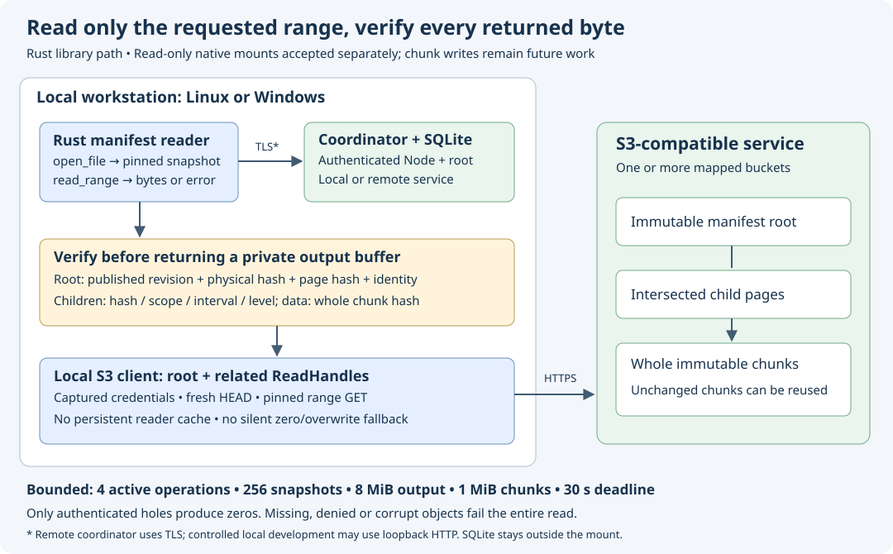

# Verified manifest range reads

Implementation and source review date: **2026-10-18**. The managed library now
has a bounded manifest reader. Its five focused integration controls passed;
the combined full local gate passed. Its source-bound Linux/Windows/book cohort
has also passed. Mounted chunked files, editing and migration remain later work.

## Opening a file

`chunks::Reader::open` takes an authenticated metadata client, expected volume
and at most 16 mapped S3 stores. It checks the manifest feature, volume identity,
name policy and each store's route fingerprint. `open_file(node_id)` obtains
live namespace metadata and validates the node, placement and published payload.
It derives the root key from that authenticated descriptor; callers cannot
substitute a descriptor or object metadata.

The root receives a fresh S3 HEAD. Its physical length, ETag and any published
version must match. The reader fetches the complete bounded root page, checks
its physical SHA-256, then verifies the domain-separated manifest page hash,
volume, file identity, logical length and root level. Opening fetches no child
page or data chunk. The returned cloneable `chunks::File` retains its Node,
logical length, verified root and S3 handle. A rename or newer publication does
not redirect an existing file snapshot. Opening does not download the logical file.

An authenticated live `EmptyFile` without a payload returns a zero-length view
without an S3 request. A published empty manifest has a real root and still
requires HEAD/GET/hash verification. A `File` without a payload is an integrity
error. A directory, deleted node or legacy one-object payload is refused by this
new reader. The existing managed `Reader` and `FileSnapshot::bytes()` retain
their existing behavior; native callback dispatch is unchanged.

## Reading and verification

`File::read_range(offset, length)` returns a complete verified buffer or an
error. It clips to the pinned logical EOF; zero-length and EOF reads require
no network request. Traversal follows only intersected child pages, verifying
each complete page's digest, volume/file identity, start, length and decreasing
level. Every reference in a loaded page must belong to the bound store, including
references outside the requested range. Namespace and role derivation keep page
and data keys scoped to the file.

Each data chunk receives fresh HEAD authorization and a revision-pinned GET.
The reader verifies the **whole chunk** before copying its requested subrange.
Corruption outside that subrange therefore fails the read. Only authenticated
hole entries produce zeros. Missing, denied, changed, oversized, malformed or
truncated objects remain errors. A later chunk failure discards the private
output prefix; no partial buffer escapes.

A new root may refer to an unchanged chunk from an older generation. The reader
uses the authenticated reference's generation and ordinal rather than requiring
that they equal the current publication or logical chunk index. It has no
persistent cache, eviction policy, garbage collector, clean acknowledgment or
write side effects. Local SQLite continues to hold namespace/journal state
outside the mount; this reader adds no database or schema.

## Credentials and finite budgets

Child pages and data use the root handle's
[`ReadHandle::open_related`](pinned-related-reads.md). It preserves the captured
credential generation and source configuration while performing fresh scoped
HEAD authorization for each key. Expired or denied captured credentials fail;
a new independent open may resolve another generation. Editing an INI file is
not a promised hot-reload mechanism: the resolved `aws-config` 1.12.0 profile
provider caches parsed profile files. This dependency finding was verified on
2026-10-18. [AWS profile-provider documentation](https://docs.rs/aws-config/1.12.0/aws_config/profile/struct.ProfileFileCredentialsProvider.html).

Budgets are shared by a reader and its clones:

| Resource | Limit and behavior |
| --- | --- |
| Active open/read operations | 4; excess returns `Busy` before metadata/S3 requests |
| Retained file snapshots | 256; clones share one retained permit |
| Requested/output range | 8 MiB; oversized requests fail, including at EOF |
| Complete data buffer | One chunk, at most 1 MiB, per active range |
| Manifest page | 64–10,432 bytes; no whole-tree cache |
| Traversal | 27 page visits and 9 complete data objects per read |
| Overall operation deadline | 30 seconds, including metadata and provider awaits |

`ReadOptions` can choose a shorter positive deadline; zero and values above
30 seconds fail before requests. Errors, timeout and cancellation release owned
permits. These are library ownership and traversal bounds, **not total SDK/RSS
or native stack guarantees**. Per-request SDK bounds also remain in effect.

The authority's current descriptor policy allows 64 GiB logical length and a
root at level 2. The reader requires the actual verified root level to equal
the descriptor ordinal's level, even though the general codec permits deeper
trees. An unaligned 8 MiB range can intersect nine chunks. Rewalking a path of
at most three pages for each interval gives the conservative 27-visit budget.
The deepest controlled test makes 54 HEAD/GET requests for two child pages plus
one data object across each of nine intervals; cached root visits make no S3
request. This is a correctness observation, not a throughput benchmark.

## Evidence and remaining acceptance

The dedicated `chunk_reader` integration binary uses the actual AWS SDK for
HEAD/GET and an authenticated Rust authority backed by temporary SQLite. S3
objects are seeded in owned loopback memory. It proves neither an S3 upload nor
provider conformance. A child process owns each synthetic credential environment;
listeners, workers, barriers, output collection and child teardown are bounded.
No real credentials or new Wasabi mutations are involved.

The five focused controls passed in **4.68 seconds**, including the child entry
control and four parent-owned scenarios:

- Sparse, binary, empty and Unicode files; two mapped buckets; cross-page reads;
  old-root reads after rename/new publication; reuse of an older chunk; unaligned
  maximum ranges and a sparse 64 GiB, level-2 tree with exact request counts.
- Malformed metadata and descriptor bindings; both root hash domains; wrong root
  level, child identity/length/level/role; foreign-store references; corruption
  outside the requested slice and late failure after a valid first chunk.
- Denied/missing objects, oversized HEAD, changed revision/version, wrong range,
  truncated/extra body; repair followed by a successful verified read.
- Active-operation and snapshot capacity at barriers; clones retain their permit;
  cancellation frees capacity; a shorter overall deadline interrupts a stalled
  read and permits a later successful read.

The first focused run passed four controls and failed the transport fixture:
it expected a GET version mismatch without first supplying an expected version
in HEAD. The fixture now supplies that revision. Production validation was not
weakened. The deepest-tree and older-chunk positive controls were then added;
the second focused run and focused Clippy passed.

Accepted prerequisites are controller source `474601e` and related-read source
`fef9442`, each with its own Linux/Windows/book cohort. They are combined in this
reader branch before its full gate. Its acceptance uses its own hosted cohort;
prerequisite artifacts do not certify its changed source. Native chunk lifecycle,
write/recovery integration, migration, real provider behavior and physical reboot
acceptance remain separate phases. See the [implementation plan](implementation-plan.md),
[dated implementation evidence](evidence/manifest-range-reader-20261018.json)
and [contract audit](evidence/manifest-range-reader-contract-20261018.json).

The combined local gate completed with exit status 0: 12 publication/source
controls, five reader controls, 62 S3 tests, 365 state tests / one ignored,
formatting, Clippy, workspace build, 68 documentation files and 64 chapters.
All 256 frozen source hashes remained unchanged. One existing retained-open
quota control exceeded a minute and then passed; no performance conclusion is
inferred. The [14-member indexed local archive](evidence/manifest-range-reader-local-20261018.tar.gz)
retains logs, source, self-review and checks; every member was verified. Its
SHA-256 is `a1737729817e21d78c356c699987e1d4129f128172c71363007b04d9bb4a2ffd`.

Published source `88d02f7` is on `codex/manifest-range-reader`. Its
[own Linux/Windows/book cohort](https://github.com/marshallr12/s3drive/actions/runs/39171113280)
completed successfully. The clean exact remote and all 256 runtime hashes were verified;
repository visibility remains PUBLIC and main was not changed. All three raw
logs were reviewed; its own finalized reference artifacts passed
independent strict 21/14 records, project oracles and all 35 raw field/type
comparisons. The [22-member hosted archive](evidence/manifest-reader-88d-hosted-20261018.tar.gz)
retains the exact source, logs, payloads and checks. Every indexed member was
verified. Archive SHA-256:
`994942870840d5efd3082d61dd3533e89dbf0bd154844f5b3d2d93b7b37428ac`.

Both platforms passed all five reader controls and 62 S3 tests. Existing native
regression also passed, including Linux no-systemd startup and independent
Windows logons. Those controls use the existing mounted format. They do not
activate or certify mounted manifests. Windows retained three locked disposable
fixture profiles until VM destruction after dummy credential removal; delay-import
and Node notices remain in the logs. Native manifest integration follows separately.

## W1a authenticated chunk-reference proofs (2026-10-18)

Draft implementation on `codex/manifest-reference-proofs`, based on the accepted
reader checkpoint `7c2b454`. `File::prove_chunk` exports an opaque `ChunkProof`
for one data chunk or a clipped chunk within an aggregate hole. Export fetches
only the necessary authenticated child pages (at most two); it shares the
reader's four active slots and overall deadline and never HEADs or GETs data.
The maximum encoded witness is 20,917 bytes. Metadata-empty and published-empty
files have no chunk to prove; out-of-range indexes are errors.

`File::verify_chunk_proof` performs bounded pure validation against that File's
already authorized root, including exact payload binding, path hashes and shape,
store scope, depth, lengths and trailing bytes. An arbitrary byte buffer cannot
construct an authenticated token without such a File. Encoding contains the base
binding, chunk index and path pages; it contains no credentials. Rename preserves
the payload binding. A fresh File opened on another root/file rejects the witness.
A retained old File can still verify its old witness. Restart requires authorized
base re-opening; historical base re-opening is not implemented by this slice.

The witness proves reachability from a pinned base, not successful data
verification, current availability/authorization, upload completion, or a send
permit. A missing data object can have a valid manifest reference and still fail
a subsequent read. `None` from `reference()` means a verified hole. The opaque
`base_binding()` is an identity, not the authority content-CAS guard. Future edit
admission must retain the original authority guard separately and compare the
verified offset, length and base binding with its intended operation. A valid
witness for another reachable chunk must not redirect an edit.

W1a does not export inherited page-subtree reuse or introduce new publication/
settlement proofs. Sparse SQLite edit views, mixed inherited/new-object trees,
exact-view settlement and actual mounted chunk writes remain separate required
phases. It changes no schema, authority wire format, core manifest codec or
native callback. The six focused reader controls passed in4.97s. The full local gate has now passed; own combined-source hosted acceptance
remains pending. This is not a mounted-write claim. The separate
native repair cohort remains bound to source `c633d02`.

[W1a draft evidence](evidence/manifest-reference-proofs-20261018.json) retains
the focused result, interrupted first gate and diagnostic; none substitutes
for a completed full gate.

W1a's fresh full local gate completed successfully with all258 frozen inputs
unchanged (six reader controls,12 publication controls,62 S3 tests,
365 state tests/one ignored,fmt/Clippy/build/book). The first gate exited143
without a test failure report; its termination cause remains unknown. The pending
TLS diagnostic test passed alone; this does not establish the interruption cause.
The [indexed W1a local archive](evidence/manifest-reference-proofs-local-20261018.tar.gz)
retains both runs, the diagnostic, frozen inputs and exact helper/test source.
Every indexed member was verified. Own combined-source hosted acceptance remains
pending. The separate native c633 cohort is now accepted; this does not accept
W1a or activate writes.

W1a acceptance update,2026-10-18: combined source `8c3448f` completed its
[own Linux/Windows/book cohort](https://github.com/marshallr12/s3drive/actions/runs/39184629344).
All three raw logs were reviewed, both actual native controls passed, and own
typed21/14 artifacts/project oracles/all35 raw fields and types matched. The
[combined acceptance](native-manifest-reads.md) and its indexed29-member hosted
archive retain the evidence. This supersedes the earlier pending status above;
it accepts W1a in that combined source. W1b page reuse is developed separately
and still needs its own acceptance. Historical base reopening and writes remain
unimplemented by these read/provenance helpers.

## W1b authenticated page reachability (2026-10-18)

Draft on `codex/manifest-page-proofs`, based on local-green W1a `ed2e93b`.
`File::prove_root()` returns a witness for its already validated manifest root
without refetching metadata. `File::prove_page_containing(offset, level)` walks
at most two authenticated child pages, returning the complete containing page's
actual start, length, level and reference. Both share the reader's four active
slots and overall deadline; neither fetches data objects. A published-empty
manifest has a root witness; a metadata-empty file has no manifest root.

`File::verify_page_proof()` performs bounded pure revalidation against the
authorized File. Its distinct `S3DPREF1` encoding contains a 50-byte header and
at most two length-prefixed pages, at most 20,918 bytes. The root witness needs
only the header. Verification reconstructs the reference from the trusted root
and authenticated parent chain; no supplied object reference is trusted. It
rejects wrong bases, kinds, counts, lengths, hashes, spans and trailing bytes.
The base identity is shared with chunk witnesses, but their encodings cannot be
interchanged. As with W1a, a witness proves pinned reachability rather than
current data health, write permission or an upload receipt.

An old root can become a child because both use the Page key namespace. The
positive fixture grows a 128-chunk leaf root into a 129-chunk level-one root and
inherits the original leaf with its exact span, level, file scope and digest.
The containing new parent's proof authenticates the old object; relabeling the
old standalone root witness to the new base fails. A parent declaring the wrong
child span is refused. Root height must still match its canonical size-derived
ordinal. The initial two-chunk parent fixture violated that rule and was
correctly rejected; production validation was preserved.

Seven focused real-SDK/authority reader controls passed in 5.54 seconds,
including root reuse, a 64 GiB sparse metadata tree, cross-kind/base refusal,
cancellation, shared admission and deadline recovery. The independent full local
gate passed with all260 frozen runtime inputs unchanged. The
[dated evidence](evidence/manifest-page-proofs-20261018.json) and
[indexed16-member local archive](evidence/manifest-page-proofs-local-20261018.tar.gz)
retain both initial failures, the passing focused/full runs and exact helper/test
source. Every indexed member was verified. This checkout has no own hosted
acceptance. Historical base reopening, sparse SQLite edit views, mixed publication,
exact-view settlement and native chunk writes remain separate work.

Combined source `bf2e6ae` includes accepted snapshot/proof checkpoint `da84d3a`.
Its fresh full local gate passed with all261 frozen inputs unchanged, nine
reader/format controls (one native ignored),12 publication controls,62 S3 tests,
365 state tests/one ignored and formatting/Clippy/build/book checks. The
[indexed19-member combined local archive](evidence/manifest-page-proofs-combined-local-20261018.tar.gz)
retains the complete gate, frozen inputs and exact combined helper/native source;
every indexed member was verified. Its own hosted/native acceptance is pending.

The published candidate now runs its
[own Linux/Windows/book cohort](https://github.com/marshallr12/s3drive/actions/runs/39187701991).
It must complete with raw-log and source-bound artifact review before acceptance;
local results and earlier native artifacts do not substitute.

W1b acceptance update,2026-10-18: source `bf2e6ae` completed its
[own cohort](https://github.com/marshallr12/s3drive/actions/runs/39187701991), all3
jobs and raw logs reviewed. Real FUSE1.13s and WinFsp3.04s retained all-format
old-handle/remount assertions. Own artifact API ZIP digests, typed21/14/project
oracles and all35 raw fields/types matched. Earlier artifacts were not reused.
The [indexed31-member hosted archive](evidence/manifest-page-proofs-bf2-hosted-20261018.tar.gz)
retains all logs, artifacts, checks and exact helper/native source; every member
was verified. SHA-256 `7ea07240c7ab082534754536d2809b90168b0f53342cd955c3a0ddc0d8ea3096`.
These results accept the bounded reachability helper; historical base reopening,
sparse edit views, mixed publication, settlement and native chunk writes remain
separate. This supersedes the earlier pending status above.
