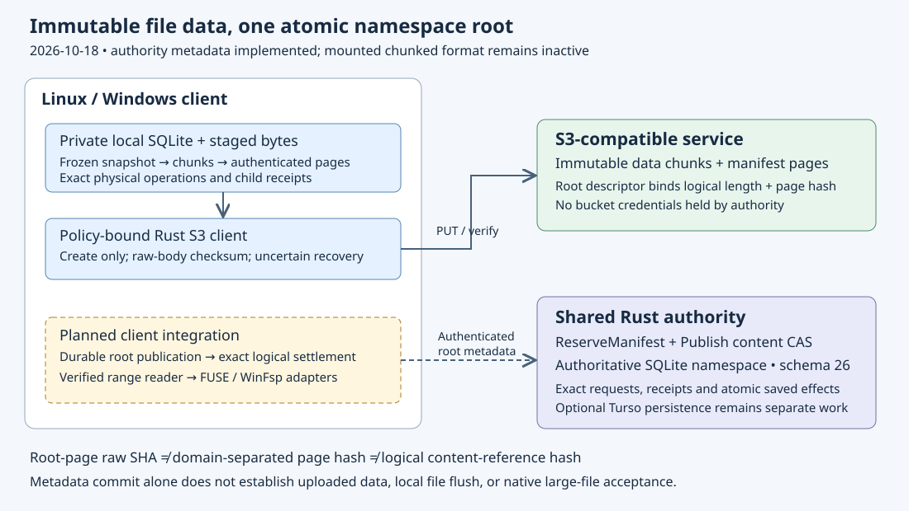

# Manifest root authority

Implementation date: **2026-10-18**. This phase adds a versioned metadata
contract to the existing Rust coordinator. It follows the
[chunk upload bridge](chunk-object-uploads.md). The client publication journal,
logical snapshot settlement, verified range reader and native activation remain
unfinished. This API is not exposed as a mounted large-file option.

## Two kinds of integrity

`ReserveManifest` binds a canonical `S3DROOT1` descriptor to the volume, node,
registered store, immutable object generation and derived `v2` root-page key.
The reservation operation UUID must equal that object generation. The explicit
`s3dman01` format identifies the codec. Unknown fields/formats, uppercase or
noncanonical hex, wrong identities, excessive geometry and non-root ordinals
are refused. Canonical roots cover at most 64 GiB in this metadata contract;
that bound does not increase staging quotas or mounted-file limits.

The reservation's existing `size` and `sha256` describe the **physical root-page
body** and its raw SHA-256. `logical_size()` returns the descriptor's file length.
The descriptor instead contains the **domain-separated page hash**. Page
structure and identity are authenticated expectations; they do not prove that
an S3 object was uploaded or that its children remain available.

The authority has no bucket credentials and trusts authenticated clients to
supply upload proof. A future policy-bound publisher must link the frozen chunk
plan, all exact child receipts and the root's raw upload receipt before asking
for metadata publication. Raw protocol tests use explicit synthetic receipts;
they establish coordinator behavior, not S3 persistence.

## Original-content compare and swap

The mutation requires `ContentGuard`. Publication uses the existing atomic
`Publish` transaction, original content reference, store placement and
pending-removal/detached checks. Rename can retain the same content identity;
a rival content update returns a conflict. Detached publication retains the
old node identity after pathname reuse. It cannot publish into the new file.

Optional manifest metadata is omitted entirely for legacy reservations. Their
serialized bytes, field order and `s3drive-content-reference-v1` hashes remain
unchanged. New references select the separate
`s3drive-manifest-content-reference-v1` domain. Conversion is explicit: no old
file reference, pending request or unknown operation is silently rehashed.

Schema **26** marks the persistent JSON-format extension without rewriting old
rows or adding tables. The existing maximum-schema check makes older binaries
refuse the upgraded database. Tests exercise a schema-25 marker upgrade and
preserve exact legacy request/result/descriptor bytes; running an old executable
against a production upgrade is separate acceptance.

The authority advertises `manifest-root-v1`. Current one-object inputs, logical
bindings and managed readers refuse manifest content explicitly. A reader
returns `UnsupportedContent` before issuing any S3 request. This prevents an
old path from exposing root-page bytes as file contents or acknowledging an
original file from the root object's physical flush alone.

## Durable receipts and recovery

New-format receipts are checked against their exact saved request and immutable
reservation. A historical result may remain valid after a newer file version;
it is not compared with the current node. Substituting another valid publication
into that old result is refused. Before a fresh transaction commits, the code
also checks the exact saved reservation, node, publication and volume sequence.
A successful SQL affected-row count alone is insufficient.

These checks detect tested structural/request/effect inconsistencies. They are
not cryptographic authentication of an arbitrarily modified SQLite database.
Dirty data and exact unknown request identities remain retained. No retry
rebases an uncertain request or falls back to unconditional overwrite.

## Verification and next phase

Fourteen focused state tests cover independent old/new wire and hash vectors,
reserve/publish/reopen, stale writers, rename, detached pathname reuse, removal
fences, both directions of explicit format replacement, actual SQLite-full
rollback, seven fresh SQL fault injections and altered historical results.
A real authenticated TCP contract test covers capability discovery, exact
replay, lookup, operation mismatch and old-client refusal without S3 reads.
The full local gate passed with 329 state tests, 59 S3 tests, all 18 managed
publication contracts, format/Clippy/build and 58 book chapters. A debug-stack
overflow in the existing recovery fixture was reproduced, then resolved by
splitting its four scenarios into separately boxed futures with all scenario
statements and checkpoints preserved. No stack-size increase or assertion
relaxation was used. See the
[dated evidence](evidence/manifest-root-authority-20261018.json) for archived
logs, frozen hashes and the separate source-bound hosted status.

Next, persist a chunk-publication journal that binds the original logical
snapshot, guard, frozen plan, store route, reservation/publish IDs, physical
root receipt and immutable authority request/result. Only then settle that exact
snapshot atomically while preserving newer dirty heads. Verified manifest
traversal, authenticated unchanged-chunk reuse, bounded performance and native
Linux/Windows acceptance follow. No provider calls, user credential changes or
repository visibility mutations are part of this phase.

## W1c1 historical manifest lookup (2026-10-18)

Draft in `codex/payload-history-authority`, based on accepted `da84d3a`.
The additive `manifest-history-v1` capability exposes `ManifestPayload`:
volume, node ID, reservation ID and exact original payload-reference hash.
The reply contains that published manifest payload, not the latest file version.
The existing volume bearer authentication protects this read too. Unknown or
unpublished versions return NotFound, wrong references Conflict, and malformed,
unsupported legacy or inconsistent retained records an explicit error.

The authority uses the existing `namespace_uploads` publication record and
reservation operation/receipt in one SQLite read transaction, without a schema
migration or operation-log scan. Each of the five consulted BLOB fields has a
16 KiB SQL guard before copying into Rust. A valid JSON record padded beyond
that bound was accepted by the first draft; the negative control reproduced
this before the guard was added. Seventeen corruption/binding/size scenarios
now fail while preserving their records. These are consistency checks against
trusted authority storage, not cryptographic authentication of an arbitrarily
rewritten database or an independent proof that S3 contains the bytes.

The three state controls passed, including old versions after replacement,
rename, deletion and restart. The production WireClient/authenticated HTTP
control passed: capability discovery, exact old-version recovery, bearer/volume
enforcement, strict request decoding and unchanged sequence. An attempted
reservation using the old guard still conflicts after a rival publication;
looking up history does not rebase it or authorize overwrite. The HTTP test's
initial module-path compile failure was corrected without changing production.

The full local gate passed with262 frozen inputs unchanged,368 state tests/one
ignored,11 authority namespace tests,8 reader/format controls/one native ignored,
12 publication controls,62 S3 tests and formatting/Clippy/build/book checks. The
[indexed20-member local archive](evidence/manifest-history-local-20261018.tar.gz)
retains initial failures, complete gate and exact source; every indexed member
was verified. Later combined hosted acceptance remains required. This endpoint
does not reopen an S3 snapshot, consume a page witness, activate native writes,
or restore a drive after reboot. Reader integration must revalidate the route,
current provider credentials and original root revision/hash before serving
base bytes. Sparse SQLite views, mixed publication and exact-view settlement
remain subsequent phases. See [dated draft evidence](evidence/manifest-history-20261018.json).
