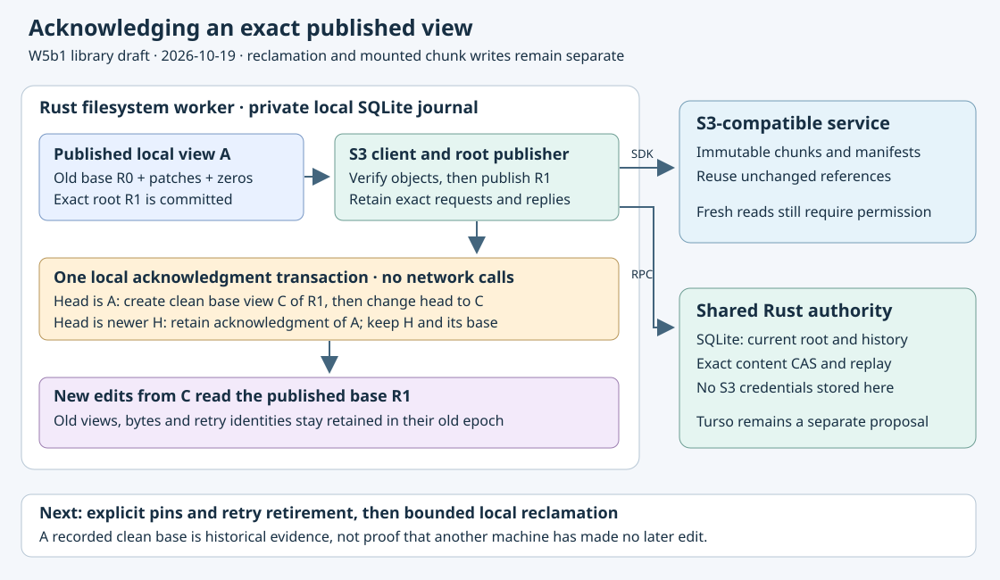

# Acknowledgment and clean base epochs

Declared implementation contract, 2026-10-19. **Implemented draft; full gates pending.**
W5a permits consecutive publications from one frozen source. W5b1 must now make
an exactly published head the next source base without rewriting old views.
No payload reclamation or native activation is part of this slice.

One acknowledgment names its local operation ID and publication plan. The private
owner validates the retained exact root record, full physical/preparation evidence
and immutable source view in one transaction. An unknown, rejected, reservation-
only, wrong-owner or corrupt publication cannot acknowledge data. If that exact
published view is still the file head, derive the next binding from its validated
publication receipt and root descriptor. Keep the same volume/node/store/source/
configuration scope. Add an immutable rebase transition to the existing parent
chain and atomically update the file's active binding and head. Its ranges are
base coverage of the published logical length. Do not copy old patch ranges into
the new binding. New edits use that new base; old immutable reads keep their old
binding, bytes, IDs, requests and hashes.

If a newer head exists, acknowledge only the historical published view and save
which head was observed; leave the active binding/head untouched. Exact replay
returns the first result even after more edits. Never upgrade a historical result
into a later clean transition, invent a second operation ID, or clear newer data.
A different acknowledgment operation for an already acknowledged plan conflicts.
Acknowledgment operations share the sparse-mutation identity namespace, including
historical acknowledgments that created no view. Reusing one for a new write,
resize, initial view or another acknowledgment must fail explicitly.

Extend existing root records with an optional separately versioned acknowledgment;
omit the field on old records to preserve literal bytes and hashes. Schema35 marks
the new record/view formats without rewriting old rows. Metadata-only recovery
may return existing acknowledgment evidence but cannot create it or change source
heads. It must still resolve saved schema33/34 requests without migration or
source BLOB reads. New acknowledgment fields under older schemas are refused.

Source inspection validates each rebase against its exact retained acknowledgment.
Use a bounded metadata-only helper that never recurses into source/preparation
validation. Full root validation separately checks source/preparation/physical
evidence. Validate both directions: no acknowledgment can claim a missing or
changed rebase, and no rebase can exist without its exact acknowledgment. A
scoped current-head API can select a newer base epoch while the existing exact-
binding head API keeps rejecting stale callers. Neither grants S3 permission.

Admission and SQL failures preserve the previous head, binding, all old bytes and
root receipts. Acknowledgment may fail locally after a remote commit; this cannot
be reported as a clean flush, and retry uses the original acknowledgment ID.
Configured limits cannot prevent replay of a committed acknowledgment. New clean
view admission still respects source limits. Retention phases must reserve or
reclaim the required capacity before enabling continuous native writes.

Done evidence: consecutive edit/publish/acknowledge cycles read the new base,
reuse unchanged chunks and retain old reads; newer-head historical acknowledgment
and concurrent writes; exact replay across lost replies/restart; identity conflicts;
actual SQLite-full, attached trigger and self-consistent graph corruption refusal;
kill boundaries covering view/operation/head/root/role/validation/commit; unchanged
old literal rows across migration; same-owner async APIs; real SDK/coordinator
integration and separate full local plus own hosted/native/source gates.

W5b2 pins/explicit retry retirement and W5b3 bounded local reclamation remain
required. All existing patch BLOBs, preparations, physical staging and journals
remain retained in W5b1. S3 object garbage collection, explicit legacy/empty
origins and W6 mounted write/truncate/append/flush/lifecycle gates remain separate.

Initial local evidence: workspace check passed. All17 inherited publication tests
passed. Eleven new state cases passed, including11 actual killed-owner boundaries,
SQLite-full rollback/retry, migration preservation/refusal, self-consistent graph
corruption, recorded acknowledgment recovery without source BLOBs, damaged metadata
refusal, operation collisions, narrowed limits, triggers and owner write/ack races.
The actual SDK/coordinator scenario passed four sparse3MiB+17 edit/publish/ack cycles
across restarts, preserving all old reads, reusing unchanged chunks after quiescent
acknowledgment, preserving a newer head after a historical one, and adopting an
empty manifest base. It used13 owned loopback PUTs in74.36s and checked an8KiB
acknowledgment-future budget. The first SDK harness assertion incorrectly included
preceding authenticated reads in the no-RPC interval; the observation is now scoped
to the acknowledgment itself. Failed source/log retained; no assertion suppression.
Full local and own hosted/native/source acceptance remain required.
