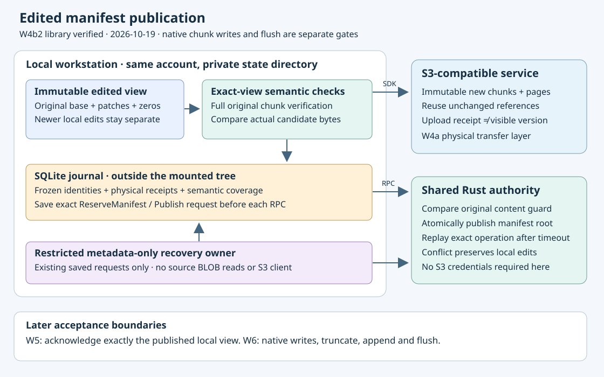

# Publishing an edited manifest root

Design review: 2026-10-19. **Root publication remains proposed.**
The W4b1 offline data-check prerequisite is accepted below; root publication
is being implemented separately as W4b2.
The user selected immutable chunks and authenticated manifests for large managed
files (decision D041). [Mixed dependency uploads](mixed-uploads.md) implements
physical object transfer separately. This chapter specifies the missing transition
from uploaded objects to a visible shared file version. It does not activate
mounted chunk writes or acknowledge a filesystem flush.

## What is already established

Source inspection used runtime `3fd2a87f5d7a999218565e70a3bf9f2efaf14fd2`,
schema 32, in `codex/mixed-uploads`. Its full local gate and own hosted
Linux/Windows/book/native/source cohort passed. W4a is now accepted on main as
`00606e9`, with all304 runtime/contract inputs matching that source. See the
[upload acceptance evidence](mixed-uploads.md). These are repository implementation observations, not
claims about a provider or a released filesystem.

The preparation journal freezes one immutable local view and its original base
identity. The uploader sends only new objects; unchanged references and structural
holes do not acquire fabricated upload receipts. Its distinct `TreeReceipt`
proves historical physical completion and offline graph integrity. It does not
prove fresh source authorization, exact file semantics, root publication or local
clean state. See `sparse_views/preparation/transfers.rs` in the state crate and
`chunks/reader/composition/{uploading,recovery}.rs` in the managed crate.

The existing authority can reserve a manifest and publish its reservation using
a content guard. `namespace/publication.rs::base_matches` compares the current
payload reference with the guard's expected reference, while requiring the
appropriate deletion state. This permits a rename or unrelated namespace change
when file content remains unchanged. A different file payload must conflict.
`namespace.rs::Journal::apply` accepts an older sequence for operations with this
content guard. This is an existing authority capability; no new wire operation
is proposed here.

## Required fresh-publication boundary

A fresh publisher must bind its input to the same private SQLite owner as the
preparation and physical executor. Freeze the plan, immutable view, source route,
store, original base descriptor, original root, new generation, new root and exact
physical root receipt. Validate authority volume, node and store placement. Use
the **original descriptor's payload reference** as the expected current content.
The original reservation's own guard describes its predecessor and is not the
expected value for this edit.

Verify every changed data candidate against the frozen view. A caller can submit
offline preparation bytes; their existence is not semantic proof. For each data
position that uses original content, verify the original manifest ancestry and
**complete** original chunk length and digest before applying retained base spans,
local patches and zero spans. Even a shrink that retains only a prefix must reject
corruption in the discarded original tail. Compare the resulting bytes with the
actual retained candidate, including candidates represented as all-zero content.
Inherited references and structural zero runs need their corresponding coverage
and provenance checks. Never reinterpret a mixed receipt as a full-snapshot
`SourceReceipt`.

A proposed bounded semantic-check ledger can record that a particular
plan/view/root/position/candidate digest passed this check. It must not retain a
second full copy of original remote chunks. The final transaction must require
complete semantic coverage plus exact new-object receipts before saving the
publication request. Such records are historical evidence, not fresh credentials
or an assertion of current object availability. Public check APIs must verify the
witness and bytes themselves rather than accept a caller's boolean assertion.

Prepare the exact `ReserveManifest` request and the distinct publish operation ID
durably before their respective RPCs. The reservation operation ID must match the
new root generation required by the existing `ManifestRoot` context. Keep request
IDs unique across both transitions and all plans. Persist the exact returned
reservation before preparing `Publish`. All network calls occur after releasing
SQLite transactions. A successful response must match the saved request, expected
root and authority identity before it is retained.

## Unknown replies and recovery

Once an authority request is saved, its unknown result must be resolved using
that **same request**, with the same operation ID, sequence, guard and bytes.
Recovery must precede fresh feature, node, source, credential and write-policy
admission. A timeout does not authorize a new operation ID, a fresh guard or an
unconditional overwrite. A terminal content conflict retains the local view,
preparation, objects, exact requests and rejection; no automatic rebase follows.

Normal `State::open_managed` is deliberately strict: its initialization validates
all preparation and sparse-view BLOBs. Consequently a recovery API that first
opens normal state cannot promise to recover an already-saved authority request
when unrelated local source bytes are damaged. Do not weaken normal state opening
to hide this problem.

Instead, propose a restricted metadata-only recovery owner. It must acquire the
existing secure state-directory lock, verify private local storage, recognize only
its supported application/schema and ledger role, and validate the complete
bounded publication metadata. It must neither create nor migrate a database,
recover physical upload intents nor expose generic staging, preparation, cache or
new-publication admission. It may read exact saved requests and retain validated
responses/rejections. Corrupt publication metadata still fails closed. No S3
client or source-reading capability belongs in this recovery object. Drop SQLite
before releasing directory ownership; never open it concurrently with the normal
worker.

This narrow recovery path still needs authority transport credentials to resolve
the existing operation. It does not promise recovery while that authority is
unreachable or refuses authentication.

## State and compatibility plan

Propose an additive schema 33 with separately bounded root-publication and
semantic-check records, hashes over complete serialized identities, and explicit
role isolation. The exact table shapes are an implementation decision; no schema
33 migration exists at this checkpoint. Validate all retained metadata and every
post-write effect. SQLite-full, ignored or foreign trigger effects, collisions,
missing rows and hash substitutions must not acknowledge progress.

Migration must preserve schema-32 dirty bytes, immutable view IDs, plan IDs and
physical operation/generation identities. Legacy full-snapshot publication must
not adopt sparse publication records. Authority snapshots may accept the extra
tables only when empty, with explicit populated-table refusal. Do not change the
existing full-snapshot receipt or recovery contracts to accommodate the new type.
Admission quotas must not block inspection or recovery of previously admitted
work. Newer local heads must survive publication of an older view.

## Acceptance before calling W4b complete

Exercise the actual authenticated authority and S3 SDK against owned loopback
fixtures. Require two independent clients racing on the same base to produce one
winner and an explicit conflict with retained loser bytes. Permit rename and
unrelated namespace changes when the content guard still matches; refuse changed
or deleted bases. Assert exact request replay after lost reservation and publish
responses, worker close and process termination, including source access denial
and expired or narrowed create policy after the request was saved.

Damage source BLOBs after saving a publish request: normal opening must refuse
corruption, while the restricted recovery owner must resolve only the saved
request without S3 access. Corrupt that owner's metadata and require refusal.
Test wrong owner, route, root, physical receipt and forged data/hole candidates;
none may create a new authority request. Include SQLite-full, trigger rollback,
quota, migration-collision, exact-replay and newer-local-head controls.

Run the full local gate and an independent hosted Linux/Windows/book cohort for
the final frozen source, retaining raw native/regression evidence. This phase
produces a distinct root-commit result. W5 still must durably acknowledge exactly
the published local view and handle retention/reclamation; W6 still must wire and
verify native chunk writes, truncate, append and flush. Legacy/metadata-empty
origins, provider conformance and physical session/reboot acceptance remain
separate requirements for the complete drive goal.

## W4b1 implementation checkpoint

A separate `codex/mixed-publication` worktree now implements the offline
`preparation::Journal::check_data` and same-owner asynchronous client API. This
compares one completed plan's actual Data candidate with immutable view ranges.
`OriginalChunk` contains a bounded original chunk witness and, for a data object,
the complete original bytes. A hole witness supplies no data bytes; fully
local/zero candidates require no original material. Debug output is redacted.
The check verifies the full old length and digest before comparing retained
spans, including when a shrink discards an old tail. It uses a single read-only
transaction, returns unit and writes no semantic seal, request or receipt.

This is offline correspondence relative to the frozen root, which the future
managed publisher must still authenticate independently. It is neither fresh
source admission nor root publication. Schema32 and all existing receipt types
remain unchanged. The future semantic ledger must invoke this comparison inside
its own evidence-recording transaction rather than treating a previous unit
return as a lasting token.

Five focused tests passed in0.46s after a refusal-path correction. They cover
forged base/false-zero candidates, complete discarded tails, all-local/zero/hole
material, growth, two-level ancestry, wrong tags/positions/paths, incomplete
plans, unchanged state and private-worker restart. The first four-test version
also passed; the subsequent expanded test exposed an inherited subtree position
being reported as corruption rather than an invalid Data-candidate request.
The validator now distinguishes that request from corrupted retained metadata.
Failed and corrected logs/sources are retained under
`/tmp/s3drive-mixed-semantics-*`. The full local gate passed on306 frozen
runtime/contract inputs; its own hosted acceptance subsequently passed below.

The full local gate runner271909 exited0 at10:42:39Z, retaining all306 input
hashes. It passed417state tests (one ignored),37core,22reader (one native ignored),
62S3,18publication cases, formatting, Clippy, workspace build,78Markdown link
checks and74book chapters. The actual log SHA-256 is
`d6b055ce28634c28afc19ddfbb7e85f1fd24a77976e5e8a2ae04181715826182`.
See [dated verifier evidence](evidence/mixed-semantics-20261019.json) and the
[local exact-source archive](evidence/mixed-semantics-local-20261019.tar.gz).
This verifies the W4b1 local slice; W4b2 publication/recovery and later mounted
acceptance remain required.

Exact source `5112fd25452d0a262ed380c688e45b39d28c4370` is published for its
[own Linux/Windows/book cohort](https://github.com/marshallr12/s3drive/actions/runs/39239546495).
All three jobs passed on attempt1. Parent W4a artifacts did not substitute for this source.

## W4b1 own acceptance

Exact source5112fd2/schema32/all306 inputs passed own run39239546495 attempt1:
book118016754945/Linux118016754543/Windows118016754819. Complete raw/source/own
API ZIP digests, independent typed21+14/project oracles and all35 raw-field/type
comparisons passed. One-use checking and archival are complete. The
[own hosted archive](evidence/mixed-semantics-hosted-20261019.tar.gz) contains86
verified indexed members,346729bytes, SHA-256
`d2b9ca34b9520b52359389b32fcabb7181a96173487557b03295ec11c7f1ae04`.
Artifacts replacement12180169543/disposition12181478025 are from this cohort.

Linux417state/Windows412state (one ignored each),37core/22reader (one native
ignored)/62S3/18publication cases passed. Actual legacy FUSE9/71.77s and
WinFsp7/96.13s, manifest remount1.81s/10.93s and paired no-systemd24.15s/Windows
managed92.42s passed. Runners were Ubuntu24.04 image20261012.334.1 and Windows
Server2025 `windows-2025-vs2026` image20261007.264.1. Three locked disposable
profiles had dummy credentials removed; final deletion relies on VM destruction.
Tooling notices and two unused WinFsp delay-import groups remain in raw evidence.
All long-running tests completed. These checks accept the offline verifier and
existing native regressions, not mounted chunk writes or physical reboot/session
acceptance. W4b2 publication/recovery, W5 settlement and W6 native activation remain.

## Mixed-root successor locally green

Draft W4b2 source `2d9e21369c587f84cd20b9a11c85e7d822a4a957` is published in
`codex/mixed-root-journal`. It implements durable semantic coverage and exact
root requests, content-guarded publication and restricted metadata-only recovery.
Twelve state cases include24 actual kill boundaries and a future-reply budget
reservation regression; three SDK/authority scenarios cover normal/scalar roots,
Unicode, rename, lost replies, process death/source damage and independent clients.
The full local gate passed on317 unchanged inputs:429state tests (one ignored),
37core,22reader (one native ignored),62S3 and21publication cases, formatting,
Clippy, build and docs. The own
[Linux/Windows/book/native cohort](https://github.com/marshallr12/s3drive/actions/runs/39249045883)
is running. [Feature implementation/evidence](https://github.com/marshallr12/s3drive/blob/codex/mixed-root-journal/docs/src/mixed-root-publication.md).
Main remains accepted W4b1; W4b2 promotion requires its own final source/artifact/
native acceptance. No sparse clean settlement or mounted chunk writes are claimed.
