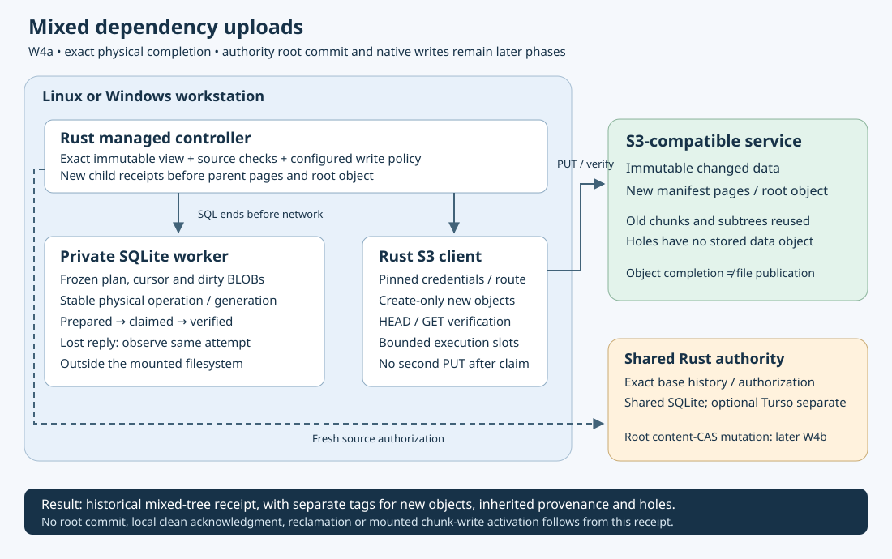

# Mixed dependency uploads

Implementation in progress, **2026-10-19**, isolated `codex/mixed-uploads`.
This draft builds on durable mixed preparation. It does not reserve or publish an
authority root, settle an edit view, reclaim local bytes or activate native writes.
Its full local and own platform acceptance have not passed.

The state handoff derives an exact staging operation from the frozen plan, root
and object bytes. It uses the existing physical staging journal on the same
private SQLite worker. A preparation cannot be paired with an executor attached
to another owner. Construction and raw state metadata grant no provider rights.
Attached SQLite triggers are refused by this handoff before generic staging
commands, which commit separately. Lost replies reuse the original operation.
Raw body SHA-256 remains distinct from the page format's domain-separated digest.

New data and pages require exact physical completion. Inherited references and
whole subtrees carry original-base provenance and never become fabricated upload
receipts. Structural zero runs and verified scalar holes require no object PUT.
A new parent requires the exact retained receipts of its new direct children.
The final `TreeReceipt` is a distinct mixed-tree type: it describes historical
physical completion and offline provenance, not file flush, current payload
health, source authentication or authorization to commit an authority root.

Fresh work checks source/route/credential identity, configured create policy and
managed exact-view semantics. A page also checks its direct child provenance and
hole/data semantics against the authenticated frozen base. SQL ends before
network operations. Each object uses one overall reader deadline, and actual
uploads use the existing executor's four shared execution slots. Cancellation
after claim can leave an uncertain effect; it never establishes rollback.

A previously claimed or uncertain object enters observation using its saved
physical generation before fresh composition or source authorization. It cannot
acquire a new ID or reissue its PUT. A prepared but unsent object still needs
fresh admission. A complete historical mixed-tree receipt can be inspected
without new source RPCs. The later root publisher must perform the separate
checks required before a fresh authority mutation; historical physical evidence
alone is insufficient.

The first SDK test passed in113.48seconds against owned loopback fixtures. It
published a sparse130MiB+17-byte base using the existing full-snapshot publisher,
then verified that a Unicode edit required only one new data object and two new
pages, while an unchanged subtree and127 holes produced no PUTs. It verified the
resulting mixed graph through actual SDK reads and the core verifier, refused a
different SQLite owner and narrowed policy, recovered a hidden committed PUT
without a second PUT or original-source metadata RPC, and preserved a newer dirty
view. Physical uploads left the authority's original root unchanged.

The revised walk paginates only actual new transfers; parent checks still validate
inherited dependencies. Its SDK regression passed in73.02seconds, including
completed historical inspection without source RPCs. These are test durations,
not performance guarantees. The current source additionally validates receipts
with one compact graph check inside one read transaction; no proof is cached
across commands, writes or awaits. The first full gate ended on SIGTERM during the state suite, with no final
result; its log and unchanged303-input map are retained. No gate processes
remained. The owned second runner finished with exit0 on all303 unchanged inputs:
412state tests,37core/22reader/62S3 and13publication cases passed, plus formatting,
Clippy, build,77Markdown link checks and73book chapters. One state and one native
reader test remain ignored in the portable suite. The [local source/evidence archive](evidence/mixed-uploads-local-20261019.tar.gz)
contains327 verified members, SHA-256
`401b33408ec66b7d7e892b443d13039537d0dd5a249f0f3e383ebb6dfc294606`.
This local result precedes the independent recovery change; W4a remains incomplete.

Four focused state tests passed in1.71seconds: inherited old-root reuse,
structural/scalar zeros, empty manifests, parent ordering, missing child receipts,
physical begin/append/seal restart boundaries, attached-trigger refusal, staging
quota and real SQLite-full failure. Quota and disk-full preserved the same plan
and physical generation; restoring capacity resumed exact bytes. Narrowed quota
still allowed sealed replay. Initial compilation exposed a test-only fixture
visibility error; a second failed test revealed that deliberate receipt damage
needed its fixture's FK checks bypassed only for that controlled deletion. Both
failures and corrected results are retained. Final pagination and fresh source-
denial controls were added before the frozen full gate, so focused results alone
do not establish its outcome.

W4b must persist original content-CAS and authority operation identities before
requests, then recover reserve/root replies without rebasing. W5 exact-view
settlement, clean-base transitions and retention/reclamation, legacy and
metadata-empty admission, and W6 actual mounted chunk writes remain required.
Provider and physical reboot/sign-in/SSH/tmux checks remain separate gates.

[Dated implementation evidence](evidence/mixed-uploads-20261019.json).

An implementation review found a remaining restart gap: the current uploader is
constructed from an authenticated `Preparation`. Reopening that handle after a
process restart requires original-base authorization. An independent physical
recoverer is therefore required before W4a acceptance, using only the exact
private worker, executor binding and saved claimed attempt. It must use an
observation-only path, refuse missing/prepared attempts and acknowledge only the
same verified operation. Worker/process restart with denied source metadata,
expired/narrow policy and no additional PUTs remains an explicit acceptance test.
