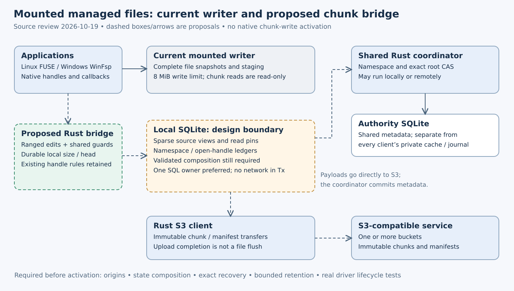

# Mounted chunk writes: the remaining integration boundary

Current status (2026-10-19): explicit same-owner client-state composition is
accepted as a library at66d78db/schema41. Native chunk callbacks, cold metadata-only
namespace/open recovery, deferred manifest creation and owned-unlinked chunk
publication remain subsequent work. [Acceptance record](evidence/chunk-client-composition-20261019.json).

Source review,2026-10-19. **Proposed implementation plan; native chunk writes are
not enabled.** The reviewed filesystem paths match accepted source
`2fc45fed5a15c1a24f0f9713ab7caca02569ec5b`. The accepted schema38 libraries add
retention guards and local clean-adoption intent but do not change these mounted callbacks.

## Verified code boundaries

| Boundary | Observed behavior | Required implementation |
|---|---|---|
| Backend selection | `fs/managed.rs` creates the chunk reader only when `config.writes.is_none()`; write configurations retain the existing publisher | Explicitly select and negotiate a supported mutation profile; preserve validation failures rather than silently falling back |
| Native dirty files | `fs/managed/writes.rs` keeps a complete original `FileSnapshot`; write/truncate assemble the complete new byte vector, with an8MiB maximum | Exact sparse view heads, ranged dirty edits and guarded reads; durable size/head updates before a successful callback |
| SQLite roles | `state/sparse_views.rs::isolation` refuses populated logical/client identity, namespace intent and Windows open journals | A validated state composition/lifecycle contract; removing the exclusion checks alone is not a bridge |
| New/legacy origins | `BaseFile::sparse_binding` requires manifest content; the current edited-view path cannot turn a metadata-empty or legacy payload into a manifest origin | Separate authenticated origin formats and recovery rules, including empty creation and save-by-replacement |
| Unlinked publication | `preparation/publication/journal.rs` persists `ContentGuard { detached: false, removal: None }` | Typed ownership/removal proof for retained unlinked files; preserve existing fences and conflicts |
| Remote refresh and history | Own publication acknowledgments are not proof of observing another machine's new clean base; local history currently remains retained | Explicit clean external-base adoption and validated bounded retirement, with old readers and unknown outcomes preserved |

Source evidence: [backend selection](https://github.com/marshallr12/s3drive/blob/2fc45fed5a15c1a24f0f9713ab7caca02569ec5b/crates/s3drive-fs/src/managed.rs#L122),
[whole-generation writer](https://github.com/marshallr12/s3drive/blob/2fc45fed5a15c1a24f0f9713ab7caca02569ec5b/crates/s3drive-fs/src/managed/writes.rs#L519),
[role exclusion](https://github.com/marshallr12/s3drive/blob/2fc45fed5a15c1a24f0f9713ab7caca02569ec5b/crates/s3drive-state/src/sparse_views.rs#L37),
[manifest-only sparse binding](https://github.com/marshallr12/s3drive/blob/2fc45fed5a15c1a24f0f9713ab7caca02569ec5b/crates/s3drive-managed/src/chunks/reader/composition.rs#L19),
and [linked root request](https://github.com/marshallr12/s3drive/blob/2fc45fed5a15c1a24f0f9713ab7caca02569ec5b/crates/s3drive-state/src/sparse_views/preparation/publication/journal.rs#L172).
These are code observations, not a claim that a proposed bridge has passed tests.

## Proposed sequence and evidence

Scoped-operation and guarded-reader source/platform gates are accepted; see
[combined evidence](managed-reader-guards.md). Next define clean external-base observation and a validated retention cut before
continuous large writes can exhaust the retained-history limits. See
[clean epochs](mixed-clean-epochs.md) and [retention dependencies](mixed-retention-plan.md).
A count-bounded transient pin registry does not reserve dirty-window capacity or
permit deleting preparation, physical-attempt or root records.

The next native design must explicitly decide how source edits compose with the
existing namespace and Windows handle ledgers. Prefer one SQL owner and a durable
atomic transition where possible. If a separate journal is proposed, its cross-
journal recovery protocol must be specified and tested before any callback can
acknowledge success. This decision remains open; the diagram's dashed bridge is
not an implemented database layout. Keep the existing role guards until the new
composition has reciprocal isolation and corruption/recovery tests.

Use a shared Rust filesystem layer for logical open/read/write/truncate/flush and
metadata, with Linux FUSE and Windows WinFsp adapters. Preserve the existing
append/constrained-write, share/delete, cancellation and ownership rules. A writer
must expose its durable local head to subsequent metadata/read callbacks, recover
that head before declaring a remount ready, and return conflicts without dropping
its bytes. Exact remote commit/recovery must retain its original request identity.
Flush must not report completion merely because chunks were uploaded.

A first driver profile needs explicit origins and a complete application lifecycle:
create empty, write beyond8MiB, sparse growth/truncate, flush, rename/save-replace,
delete with retained opens, close and remount. Add one platform-independent engine
scenario, then actual FUSE/WinFsp acceptance of the same scenario with Unicode
names and binary/empty data. Kill the source owner at durable boundaries, lose
commit replies, narrow policy, deny provider requests and race another writer.
Each case must preserve old reads and unresolved data and verify exact retry/no
unconditional-overwrite behavior. Actual sign-in/reboot/SSH acceptance on MX Linux
and Windows10/11 remains separate from hosted native regressions.

Do not activate the mounted path by increasing `MAX_BYTES`, enabling the existing
chunk reader in a writable profile, or substituting publisher types alone. Those
changes leave the observed ownership, origin and recovery boundaries unresolved.

## Empty-file bootstrap option under investigation (2026-10-19)

A real empty manifest could avoid treating a metadata-empty node as if it already
had an S3 manifest. This is a source-reviewed option, not a declared mutation/API
or an implemented native profile. Existing source facts:

- Namespace creation derives the node ID from the create operation and currently
  creates it with no payload. See [creation projection](https://github.com/marshallr12/s3drive/blob/67a75e3047a867e2499ef08ded64fe00b72a4aa9/crates/s3drive-state/src/namespace/creation.rs).
- Namespace preconditions and open records use file IDs, placement and content
  references rather than complete file buffers. They could be reused with typed
  source-state composition. Their constructors currently reject sparse state;
  that guard remains required. See [preconditions](https://github.com/marshallr12/s3drive/blob/67a75e3047a867e2499ef08ded64fe00b72a4aa9/crates/s3drive-state/src/namespace_client/changes.rs)
  and [open journal](https://github.com/marshallr12/s3drive/blob/67a75e3047a867e2499ef08ded64fe00b72a4aa9/crates/s3drive-state/src/namespace_client/opens.rs).
- Manifest history needs the retained reservation descriptor and publication in
  namespace_uploads. A new creation operation must preserve that history, not just
  place a payload on the live node. See [historical lookup](https://github.com/marshallr12/s3drive/blob/67a75e3047a867e2499ef08ded64fe00b72a4aa9/crates/s3drive-state/src/namespace/publication/history.rs).

The candidate sequence is: derive a canonical zero-length manifest and its actual
root bytes/key from the known volume, create-operation/node ID and selected store;
conditionally upload and verify that immutable root; then atomically create the
namespace entry with that manifest payload and its historical publication record.
The logical file has zero bytes; its manifest object has a real encoded body.
The existing authenticated manifest reader can then supply an ordinary initial
clean view. No fabricated reservation or invented provider receipt is needed.

This requires a new negotiated authority operation rather than changing old
CreateEntry semantics. The authority should derive the canonical root itself and
bind the name/parent revision, configured store, creator identity and exact upload
proof fields. An independent unrelated namespace change need not conflict when
the parent guard still holds, matching existing guarded creation. Persist the
node, payload/history and exact operation outcome in one transaction. A known
reply must replay historically after rename/removal/restart. Reject malformed
or foreign proofs and all ignored/partial SQL effects without half-creating a file.

A client must persist its exact physical and metadata intent before sends and
recover unknown results without a second PUT or different namespace request.
An uploaded root whose create conflicts may remain an owned orphan; do not delete
it while the authority outcome is uncertain. Feature negotiation, atomic collision
races, corruption, real SQLITE_FULL and killed-owner boundaries need their own
phase contract and tests before implementation. Actual provider uploads still
require a new concrete authorization scope; no live test follows from this option.

A broader empty-origin binding is another possible design, but would require new
historical authorization and preparation/publication semantics for a base with
no provider object. The real-manifest bootstrap is the next option to evaluate
because it can retain the existing manifest-only edit representation. Legacy
payload conversion, bounded retirement and unlinked writes remain separate work.

## Declared client-state composition phase (2026-10-19)

Isolated `codex/chunk-client-composition` starts from the locally verified SDK
source950479c, with documentation atb146f85. Its baseline SDK Windows/native/artifact
acceptance has now passed at950479c; that evidence does not accept this phase. The SDK worktree stays
unchanged. This phase will make existing sparse/creation, namespace and Windows
open/session journals usable on one private SQLite owner through an explicit
capability. Native filesystem callbacks remain pending until the full lifecycle
is implemented and tested; this is not a new mounted write profile.

The read-only review found more than constructor exclusions. Namespace `begin`
and `acknowledge` unconditionally call the old logical-file journal's entry and
observation helpers. That journal rejects sparse state. A new constructor alone
cannot compose these systems. Manifest base descriptors deliberately contain only
volume, node, reservation and payload reference, not cached parent/name metadata;
namespace acknowledgments must preserve the exact sparse head and content epoch.
Do not substitute a newer remote base or discard dirty bytes during rename/delete.

Proposed implementation footprint:

- Add one bounded, checksummed `chunk_mount_role` record in additive schema41,
  binding one volume, permanent client identity and a retained registry of
  store/source/configuration controls. Preserve all older BLOBs and hashes.
- Admit the role and client identity atomically on the existing owner. Refuse
  adoption of populated legacy logical/namespace/open state; compatible sparse
  and creation intents must match every declared volume/store/source binding.
  Exact known bindings replay before quotas; later controls may append without
  changing a store's immutable route/root or dropping old retry dependencies.
- Return an owner-bound capability for namespace and open/session clients.
  Ordinary legacy constructors continue to reject the new role, including before
  any sparse/creation row exists. Do not auto-select a weaker constructor.
- Make sparse/creation isolation permit client tables only under a valid combined
  role. Validate bounded metadata scope, identity, late triggers and cross-role
  exclusion without requiring source-body reads for saved metadata recovery.
  Authority admission/snapshot validation must still refuse populated client state.
- Replace the old logical namespace barriers with explicit sparse head/reference
  and unresolved-publication checks. Initially require clean, settled source data
  for fresh namespace mutations; acknowledgments retain bindings/heads unchanged
  when only names or deletion state change. Pending/dirty data must produce an
  explicit retained conflict. Detached publication is a subsequent required step,
  not an implicit linked-write fallback.
- Reuse existing namespace/open event, cancellation, removal, session and retired
  evidence validation. Bind all fresh inputs and retained outcomes to the same
  volume, client identity and declared source controls. Preserve independent
  destination controls for replacement across configured stores.

Additional boundary discovered: `CreateEntry`/`CreateDeferredEntry` currently
create metadata-empty files. A chunk-mode namespace capability must not quietly
use those as manifest origins. Fresh files use the canonical manifest creator;
directories can retain the existing namespace mutations. Deferred name reuse
behind an owned removal fence needs an atomic deferred-manifest operation or a
separately verified empty-origin promotion protocol before native save/replace
can be enabled. Merely permitting metadata-empty creation is not completion.

Done criterion: one owner can durably create/recover a canonical empty manifest,
keep a sparse file view, and use scoped namespace and Windows open/session APIs
without adopting old writer roles. Tests must cover fresh and compatible admission,
reverse-order role refusal, wrong owner/volume/store/source, two stores, dirty or
unknown-publication barriers, exact replay at capacity, append/restart, corruption,
oversized fields, late triggers, actual owner kills/SQLITE_FULL, old schema/BLOB
preservation and snapshot compatibility. Use owned SQLite/authority fixtures; no
Wasabi or startup mutations. Run the complete local and own hosted gates before
promotion. Then integrate the ordinary FUSE/WinFsp writer, deferred creation,
owned-unlinked publication and retention, with actual >8MiB lifecycle acceptance.

Initial write footprint: state role/migration/module registration; namespace,
identity and open/session constructors/helpers; sparse namespace/scope inspection;
creation isolation; worker capability factories; reciprocal legacy/authority and
snapshot guards; test-only old-schema fixture setup; the two native schema-marker
fixtures; this book and handoff. Platform dependencies and mount callbacks are
outside this phase. Refine the footprint from actual sources before editing.

### Composition implementation checkpoint (2026-10-19)

The isolated worktree now implements additive schema41 and an explicit
`Storage::chunk_mount(Input)` capability. It binds one volume, the permanent
chunk-mode client identity and up to64 retained source/store controls on the
existing SQLite owner. Namespace and open/session handles come from that
capability; legacy constructors remain excluded even before the first sparse
view exists. Admission is transactional; known subsets replay without an UPDATE,
controls append without replacing store routes, and the independent identity
checksum prevents a removed role marker from masquerading as an old writer.
This role grants no S3 authorization.

The new namespace path checks clean sparse heads, payload references and pending
publication metadata before fresh mutations. Acknowledgments preserve sparse
heads and content bindings, including newer dirty edits; saved metadata recovery
does not read sparse file bodies. Chunk-mode metadata-empty file creation is
explicitly refused. Canonical manifest creation and directory creation retain
their distinct protocols. Open/session events keep the original checksummed
history and retirement semantics. Existing-only creation recovery remains a
separate capability.

This is **accepted library composition** at66d78db after the complete local and
own hosted/source/artifact checks below. New tests exercise killed real owners at
identity/source/role/commit boundaries, full-disk rollback, capacity replay,
retained-control append, schema40 BLOB preservation/collision rollback, session
recovery across restart, late triggers, oversized role metadata, and independent
identity witnesses. A new owned SDK/TCP case connects canonical Unicode creation,
authority rename, a local sparse edit beyond8MiB, retained dirty-head acknowledgment
and restart. These cases have terminal local/hosted completions recorded below. They do not
claim real-provider or native chunk mount success.

The complete local/hosted, source and evidence review passed. Unknown-publication
barriers have a dedicated state case; scope/corruption coverage remains bounded
by the documented tests. Native callbacks still
use the older whole-generation writer. Deferred manifest creation, owned-unlinked
chunk publication, retention and actual mounted >8MiB lifecycle tests remain
subsequent work. No Wasabi writes, startup installation or repository visibility
changes are part of this checkpoint.

Focused terminal evidence (2026-10-19):13 composition state cases passed in1.21s,
including seven killed owners; the publication barrier case passed in0.57s.
The SDK composition case passed in1.18s after adding its expected one-PUT fixture
count to the harness. Its first run reached that missing harness match and failed;
that failure is retained in `/tmp/s3drive-chunk-composition-sdk1.log` rather than
reported as a successful suite. Logs for the passing cases are state5, barrier1
and sdk2 under `/tmp/s3drive-chunk-composition-*.log`. The pre-final broader run
passed532 state cases/one diagnostic ignored in273.48s; it predates added coverage
and cannot accept the final source. Initial workspace Clippy rejected helper
placement after an inline test module; helpers were moved, without suppressing the
lint. The final complete gate and hosted source acceptance subsequently passed below.

Complete local gate (2026-10-19): source66d78db/schema41/all362 runtime inputs
passed `bash scripts/gate.sh` at22:42:13Z. All681 tracked/nonignored inputs stayed
unchanged. State538+1diagnostic ignored/272.48s, publication31/164.46s, reader26+
1native-only ignored/70.48s, core39/S362, formatting, workspace Clippy/build and
mdBook/link checks passed. This includes the new combined-role and unknown-root
namespace barrier cases. [Machine-readable evidence](evidence/chunk-client-composition-20261019.json).
The indexed382-member [local archive](evidence/chunk-client-composition-local-20261019.tar.gz)
is verified, SHA690cf0e1fb7d84c4d187070b9e6fa6d38821b530b87de7d46e2e3e4ef1d527fc.
The one-use local archiver is complete; never rerun it on later documentation.
Own CI39335223526 and complete raw/source/artifact review subsequently passed
as recorded below. Existing-only recovery under a damaged composed sparse tree has no
separate new SDK fixture here; do not infer that extra Cartesian test coverage
from the namespace corruption and pre-existing recovery tests.

The [deferred manifest source review](deferred-manifest-integration.md) records
remaining receipt/fence, saved-open admission and compatibility questions as a
proposal; it is not a resolved protocol or implementation.

Recovery boundary: namespace/open clients still use normal `Storage`/`State`
opening, which validates retained source bodies. The saved-outcome path can avoid
reading those bodies on an already open owner; its compatibility constructor is
not a cold metadata-only namespace/open recovery API. That separate capability
and native restart integration remain required. The creation SDK's existing-only
recovery store is a distinct implemented API. Do not conflate these scopes.

### Library composition acceptance (2026-10-19)

Exact source66d78db94beabb666eb9cfeab2b99503de1af58e/schema41/all362 runtime files
passed own [CI39335223526](https://github.com/marshallr12/s3drive/actions/runs/39335223526)
attempt1: Linux118342911242, Windows118342910955 and book118342911228 all success.
All681 source-archive files matched the locally frozen digests. Own artifact ZIP
API digests, strict independent21 replacement/14 disposition records, project
oracles and every raw-record field/JSON type matched. All17 slow notices and15
interleaved reference endings have explicit completions. The13 composition state
cases, namespace barrier and SDK case have explicit Windows completions too.

Linux538/Windows533 state cases plus one diagnostic ignored each, publication31,
reader26+1native-only ignored, core39/S362 passed. Existing real FUSE9/80.03s and
WinFsp7/93.61s, manifest remount1.74s/2.44s and coordinator startup24.46s without
systemd/81.55s paired Windows regressions passed. These are existing mounted
operations, not new native chunk writes or physical MX/Windows10/11 reboot proof.

Full raw review retained tooling/linker notices and exactly three disposable
Windows locked-profile cleanup notices. Their dummy credentials were removed and
profile deletion was deferred to VM destruction; following success lines were
reviewed. No test faults were found. Actual images: Ubuntu24.04/20261012.334.1 and
WindowsServer2025 windows-2025-vs2026/20261007.264.1.
The indexed27-member [hosted archive](evidence/chunk-client-composition-hosted-20261019.tar.gz)
is verified, SHA7375d1a36588a12b6813620f181b3191d07b0e56d05732b6f02aefff84a0e006.
Both one-use archivers are complete; never rerun them on later documentation.
