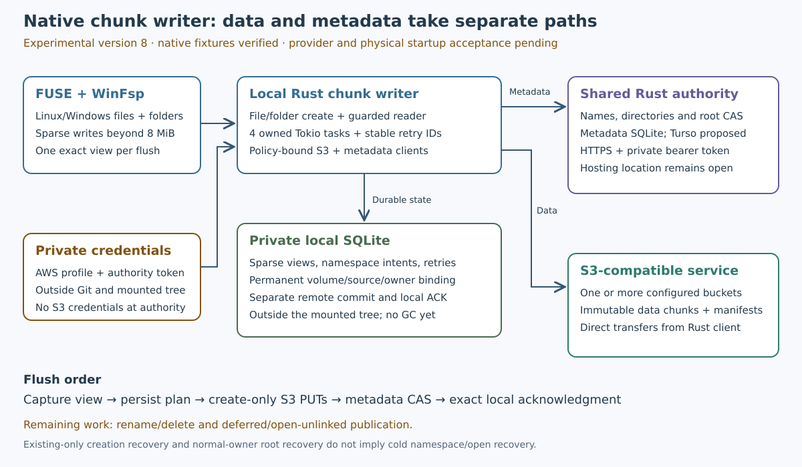

# Native chunk writer implementation

Declared 2026-10-19, isolated `codex/native-chunk-writes` from accepted main
1ce2394/schema41/runtime362. Experimental file-I/O implementation is accepted within the scope recorded below.

This phase connects canonical creation and the existing authenticated sparse
pipeline to the shared filesystem engine and both native adapters. An explicit
managed version 8 write profile selects it, with the same policy-bound executors,
private SQLite owner and immutable bucket objects. Versions3–7 retain their
existing behavior. This is not permission to mutate Wasabi or install startup.

Done criterion: the actual shared filesystem API and real FUSE/WinFsp fixtures
create Unicode canonical files, write/read/flush beyond8MiB without whole-file
hydration, append and constrained-write correctly, shrink/regrow without tail
resurrection, repeat clean flush without new PUTs, close/reopen/remount and recover
exact unknown publication before creating another root. A newer local edit must
survive an older root acknowledgment. Failures retain bytes/requests and return
conflicts; no unguarded overwrite or fresh-ID recovery fallback.

Load-bearing source findings:

- Sparse views expose no bounded all-head enumeration or public clean-state hint;
  shutdown/restart cannot find closed dirty files from in-memory weak references.
- Mixed root recovery can use a normal client only behind a live preparation;
  native startup needs saved-request recovery on that already open owner before
  any fresh base S3 access. The new constructor must retain exact volume/store
  checks and grant no new mutation preparation or physical upload permission.
- A deterministic private domain derives preparation, generation, publication
  and acknowledgment operation IDs from the immutable view ID. Retry must reuse
  original IDs and validate exact saved input. Fresh local edits have new IDs.
- Native writable inodes must keep stable global IDs and report dirty local sizes;
  the immutable-snapshot inode projection used by read-only chunk mounts must
  not conceal writes or substitute a different opened file generation.

Initial footprint: sparse model/worker enumeration helpers; normal mixed-root
recovery constructor; shared filesystem chunk writer and dispatch/config; owned
SDK/shared-engine and FUSE/WinFsp acceptance fixtures; mdBook and handoff. Inspect
actual dependency sources before using new APIs. Preserve target-specific driver
dependencies. No authority schema/mutation, retention deletion or credential work.

This first native writer does not enable directory creation, rename/delete, deferred creation,
delete-on-close or open-unlinked chunk publication. Those require the separately
[reviewed fence protocol](deferred-manifest-integration.md). Unsupported requests
must fail explicitly; this phase is not full lifecycle or goal completion.
Metadata-empty and old whole-object files remain readable by existing paths but
must not be silently promoted into writable sparse origins. Cold metadata-only
namespace/open recovery and full retry-forest retention remain additional work.

Run focused failure/restart cases, the full local gate and own hosted/native gates
on an unchanged candidate before promotion. Native cases cannot be replaced by
portable API tests. New live provider tests require a separately approved plan.

## Historical implementation checkpoints

The candidate adds explicit version 8 dispatch, a shared sparse writer, bounded
head enumeration and a normal-owner saved-root recovery constructor. Flush IDs
are derived from the captured view; unknown Publish recovery uses the original
saved request before a new plan. Stable writable inodes report local sizes;
read-only immutable snapshot projection stays unchanged for version3.

The SDK/shared-filesystem case passed in19.30s, then the expanded policy narrowing
case passed in50.49s. It covers >8MiB sparse edits, Unicode, append/constrained
writes, shrink/regrow, lost Publish reply, owner restart, exact request replay,
no repeated immutable-target PUT, and retained dirty reads under a narrowed
policy. A later regression also tests that a changed live content format cannot
hide a retained local head; it passed in SDK4/52.51s. Bounded head enumeration
and restart/corruption checks passed in0.18s. Workspace Clippy passed after fixing
one collapsible-if diagnostic without suppression.

Local native attempt1 stopped on a test TOML table insertion bug, fixed before
mounting. Attempt2 reached FUSE and was denied with `Operation not permitted`
despite the device being present. No local native success is claimed and no root
or mount permissions were changed. The new real FUSE/WinFsp fixture is an explicit
CI acceptance step; its coverage cannot be replaced by the passing API test.
The candidate is not promoted or natively accepted yet.

Version8 deliberately uses a separate private journal; populated old writer roles
are refused. The example `examples/managed-chunk-writes.toml` is a template, not a
live-provider authorization or automatic conversion. Readable legacy origins do
not gain write permission. Retained heads are registered at restart so a changed
remote representation produces conflict rather than concealing local bytes.

The current64-file/512-view/64MiB dirty defaults, bounded creation/root histories,
and authority history limits are prototypes, not a completed long-running
retention policy. No reclamation, schema migration or bucket deletion is added.

The captured-view concurrency regression passed in the combined SDK5 case/106.13s.
The scenarios were then split without removing coverage: SDK6 passed all three
shared-filesystem cases in19.95s (one real-driver test explicitly ignored). Each
fixture verifies its exact immutable PUT count and that no target was PUT twice.
They independently cover large Unicode writes/restart, policy/format conflicts,
and an older flush preserving a newer dirty edit. This keeps native platform
failures separate from portable shared-engine failures. The full local gate and
own real OS CI cohort are still required before promotion.

Resolved dependency APIs were inspected locally: getrandom0.4.3 `fill`, sha2
0.11.1/Digest, Tokio1.53.3 semaphore/barrier contracts and rusqlite0.40.2 deferred
transactions. No dependency version or platform driver API was changed. Final
pre-freeze workspace Clippy3 passed in5.87s. The accepted main baseline's own
post-publication CI39339566702 also completed successfully; it does not accept
this new writer candidate.

## First complete cohort rejected

Source a6a44fbf8ca1a27e91e3954b46a64853b5cbf8f1, all692 inputs/runtime365,
failed own CI39343852321 before new native acceptance: Linux's existing paired
authority fixture overflowed the managed child stack, and Windows's existing
metadata-flush mount overflowed the CLI main stack. Book passed and all692 remote
source digests matched; neither fact accepts the writer. The local gate was
explicitly stopped with SIGTERM after149.15s, exit-15, inputs unchanged, to repair
the confirmed regression. It is not a passing gate. Raw logs and frozen inputs
are retained under /tmp/s3drive-native-chunk-{gate1,hosted1}*.

The Linux startup failure reproduced locally (stack-red1). Boxing only the sparse
constructor did not fix it (stack-green1 failed). Boxing the new create, flush-all,
namespace-sync and shutdown dispatch boundaries as well made the same existing
fixture pass in3.79s (stack-green2), without larger stacks, skipped tests or changed
semantics. Complete repaired local and OS cohorts remain required.

Repair focused SDK7 passed3 cases/20.91s, one explicit native-only ignored. Clippy4
passed. A temporary compiler layout probe (outside the repository) measured the
shared flush-all future dropping from24656 to2024 bytes and create from23424 to
10272 bytes. This supports the allocation fix but does not replace real platform
acceptance. No stack-size setting, timeout or fixture requirement was weakened.

## Second complete cohort and ready-marker repair

Repaired source390cf0019b3b8f3fe2514d442735da7f2653f61b passed the full local
gate2 at2026-10-20T00:08:39Z,717.08s, all692 inputs unchanged. State539+1ignored,
publication34+1native-only ignored/178.92s, core39 and S362 passed, together with
formatting, workspaceClippy/build and95 Markdown link checks. Log SHA
0047eabd01314e486c40114f21c9de24f241416f6a27cc394b52a951214c54e5.

Own CI39344646208 Linux failed an existing multipart process-kill fixture at
tests.rs594: its generation-ID ready file existed before fs::write filled it,
and the parent parsed an empty string. This is a fixture synchronization race,
not a passing gate or native evidence. The new fix writes a same-directory pending
file and atomically renames it to the ready path. Parent waiting, all five crash
points, actual child kills, deadlines and database recovery assertions remain
unchanged. The repaired source needs its own full local and OS gates.

The atomic marker fixture passed once/0.37s, then20 repetitions/7.60s exercising
100 actual child kills across the same five boundaries. Workspace Clippy5 passed.
No production state format, metadata protocol or timeout changed in this repair.

## Native callback stack repair candidate

Source8f1fb7b817b94d66f96720cbfa1c63400a6efda9 passed the complete local gate3:
736.78s, all692 inputs unchanged, state539+1ignored/337.31s, publication34+1native
ignored/183.85s and reader26+1native ignored/70.26s. Log SHA
1620eb28854f7273309b357feeebdfb13f157b5457665e869147334d7911f500.
Its source ZIP matched all692 inputs. Own CI39346010026 Linux/book passed; real
FUSE9/74.49s, manifest remount1.80s, **native chunk writer1/70.43s** and coordinator
startup24.41s passed. This fixture duration is not a throughput benchmark.

Own Windows failed the new native chunk create in1.45s: the mounted daemon's
unnamed callback thread overflowed its stack, and the caller received Windows995
when I/O was aborted. Earlier source390cf00's Windows new native fixture failed
the same way in1.55s. No native Windows chunk-write success is claimed. The earlier
local and Linux passes do not accept either source cross-platform.

The repair moves version 8 operations into owned Tokio tasks on the existing
runtime. Four permits are acquired before spawning, and the task owns the permit,
file handles, strings and bytes. Dropping a callback requests task cancellation
through an abort-on-drop guard; it must not detach an upload after a callback
timeout. Synchronous metadata projection stays small. Fresh node/format selection
and sparse, read-only chunk and legacy opens run on that worker too. Existing
legacy create/open SDK futures are boxed to keep their inactive branches out of
the callback's large future state. No stack-size setting is increased.

A portable owned-child control uses a128KiB thread, with separate callback-like
invocations for create, open, >8MiB write/read, resize, flush, namespace-sync and
shutdown. The same final fixture with the earlier production files reproduces a
stack overflow during creation (smallstack-red, parent101); both repaired files
were restored in a finally block. The repaired production files, with temporary
probes removed, pass SDK9: all4 cases/22.97s plus one explicit real-driver ignored.
The final small-thread fixture is a pressure control, not a claim about WinFsp's
actual configured stack size or a replacement for its real mount test. Earlier
smallstack1–5 probes failed and are retained. The owned-task cancellation/slot
release unit passes; workspace Clippy6 passed7.02s. Tokio1.53.3 spawn/abort and
JoinHandle ownership contracts were inspected in resolved local source.

Windows's real chunk acceptance now runs earlier in CI for faster feedback;
Linux's remains after FUSE setup. Both run exactly once per OS and all existing
workspace/native/startup/reference gates remain. The repaired source still needs
its own complete local and hosted/native acceptance before promotion. No provider
scope, credentials, startup installation or hosting is changed.

## Thin creation dispatch candidate

Source428581fef30c4f20868031f5f7e872848d502303/runtime366/all693 passed full
local gate4 at2026-10-20T00:54:22Z,702.59s, all693 unchanged. State539+1ignored/
271.73s, publication35+1nativeignored/178.09s, reader26+1nativeignored/70.14s,
filesystem14,95 links and91 chapters passed. Log SHA
3714950eeeb21939c914257347468650b9be2ddbb40b3696dfce51849542a98b.
Own CI39349233353 Linux/book passed; FUSE9/56.06s, manifest1.20s, new chunk
native31.73s and coordinator23.96s. All693 source ZIP bytes matched.

Windows's new real WinFsp chunk fixture **passed39.35s**, but the full workspace
suite rejected the portable128KiB control: it overflowed before creation while
the other34 publication cases passed. This is a rejected complete Windows cohort,
not full acceptance. The actual mount pass and the small-stack failure are
separate evidence. No stack-size setting or test threshold is raised.

The new repair selects sparse versus legacy creation before constructing either
async state. The public factory returns a boxed borrowed Send future; separate
helpers keep inactive legacy SDK state out of sparse creation. Fresh open selection
still runs on the owned worker, and a common small result materializer avoids
reentering the large legacy open state for the newly created file. The same name,
parent, kind, policy and fresh-authorization checks remain. SDK10 all4 cases passed
21.90s; Clippy7 passed7.12s. Both changes still need complete own acceptance.

The Windows128KiB control now also runs early for feedback, followed by the real
chunk mount; standard workspace testing continues to include the control. No
existing gate is skipped and the real chunk test remains once per OS.

## Accepted file-I/O checkpoint — integration review2026-10-21

Source `d95a634` passed its full local gate and
[own Linux/Windows/book CI39351215634](https://github.com/marshallr12/s3drive/actions/runs/39351215634).
Real FUSE and WinFsp fixtures verified Unicode canonical creation, an 11 MiB sparse
file with 2 MiB binary data, exact flush, shrink/regrow and remount using owned
loopback S3/authority services. The 128 KiB callback control passed on both OSes.
Windows testing used a hosted Windows Server 2025 VM; these are not live Wasabi
or physical MX/Windows10/11 reboot results.

The final source is schema41/all366 runtime inputs,14 runtime deltas from accepted
66d78db/all362. No database schema or dependency version changed. Versions3–7
retain their behavior. This accepts ordinary canonical file I/O only; it does not
complete namespace lifecycle, reclamation, provider or physical-session acceptance.

Full local gate5 passed at2026-10-20T01:14:51Z in707.85s, all693 inputs unchanged.
Log SHA332e1065cbd921b084278059cd8cd249612e84bcc5cf9decb0d24cfa2d564e89.
Own CI39351215634 attempt1 all3 jobs succeeded: Windows118395571162,
Linux118395571627 and book118395571467. All693 downloaded source-file digests
matched; ZIP SHA4821e7553ea5a21164076774acb95ac2c5499fd07c9a283dadc8608f7423c874.

Complete raw review covered Windows1956lines/925 parsed outcomes, Linux1585/859
and book645. All17 slow notices and15 interleaved reference endings completed.
Exactly3 known disposable Windows fixture-profile locks remained: dummy credentials
were removed, deletion deferred to VM destruction, and following pass lines
reviewed. No test fault was hidden; tooling deprecations and unused delay-import
warnings remain in the logs. Windows state534+1diagnostic ignored, publication35
+1native-only ignored and reader26+1native-only ignored passed. Real chunk mount
passed57.69s, callback control4.76s, existing WinFsp7/88.43s, manifest remount2.30s
and paired startup77.28s. Linux FUSE9/77.78s, manifest1.62s, chunk mount54.48s
and coordinator startup24.13s passed. These fixture durations are not throughput
benchmarks. Images: WindowsServer 2025/windows-2025-vs2026/20261007.264.1 and
Ubuntu24.04/20261012.334.1.

Reference artifacts replacement12233606617 ZIP SHA
74422aef8525287848836f795b0c4c35c1669c704d51e3967ec532ded0bcbc6f and
disposition12233623535 ZIP SHA0508cc96d99c4a286dd5d829c4127e5ae5263333232884ac0d01be0c26fdc792
matched their API digests. Independent strict21+14, project PowerShell oracles
and every raw-record field/JSON type matched. Duplicate keys/nonfinite JSON were
rejected. Earlier failed source cohorts remain rejected, not superseded by a claim
that their tests passed.

Indexed archives, every member verified (one-use writers are DONE):

| Archive | Members / bytes | SHA256 |
| --- | --- | --- |
| [Pre-dispatch local](evidence/native-chunk-writes-pre-dispatch-local-20261019.tar.gz) |413 /1116225|72f5252595f226750c9424ff5d4e2cc7d76e4933041fe1c2310925d293f0fe75|
| [Rejected dispatch local](evidence/native-chunk-writes-dispatch-local-20261019.tar.gz) |435 /1200163|a198baa95c5b68eab8908bf1da97f89ea434badc7f84bbbe58110ae46ee489c8|
| [Accepted thin-create local](evidence/native-chunk-writes-thin-create-local-20261019.tar.gz) |443 /1278283|f86234d37c5db6ed160081ad6a55dcd45d73f1cd87ff06e8885d8ffc83770c40|
| [Hosted and rejected-cohort evidence](evidence/native-chunk-writes-hosted-20261019.tar.gz) |84 /451636|05ca1a0e5dbee6f1439c0ec58e2d256ba915cc06278c613e0c9097534a85d752|

API review dated2026-10-19: the pinned Tokio1.53.3 implementation was inspected
locally. A bare JoinHandle drop detaches the task; abort requests cancellation,
which may complete later. The live reference served Tokio1.54.0 when checked;
it is supporting API documentation, not a dependency upgrade or a substitute
for checking the pinned source. [Tokio JoinHandle ownership and abort](https://docs.rs/tokio/latest/tokio/task/struct.JoinHandle.html#method.abort),
[owned spawning and Send/static bounds](https://tokio.rs/tokio/tutorial/spawning).
An aborted upload or metadata request can already have committed remotely;
S3Drive retains its exact recovery identity and does not infer rollback from
local task cancellation.

Remaining: directory creation and complete rename/delete/save-replace, deferred
canonical creation and owned-unlinked publication, cold metadata-only namespace/
open recovery, full retry-forest retention/GC, version 8 supervision acceptance,
approved live managed Wasabi work, independent-host deployment/restore and actual
MX/Windows10/11 sign-in/reboot/SSH. Hosting and optional Turso remain undecided.
No user startup or provider policy was installed by this phase.
