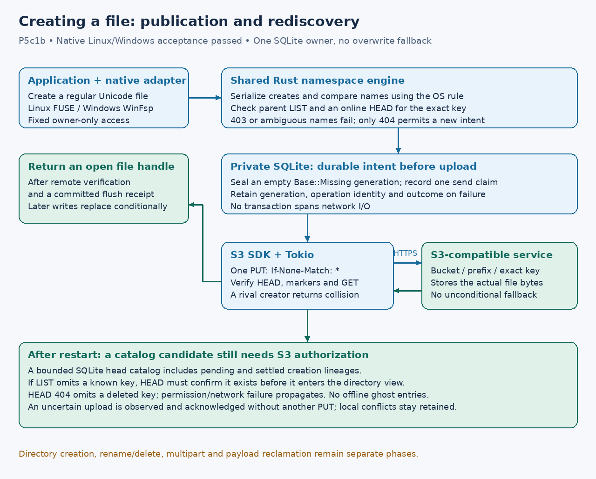

# Native file creation

**P5c1b native acceptance passed, 2026-10-16.** Version 2 creates regular files inside existing, explicitly writable
source directories. No real Wasabi configuration or policy changes, startup
registration or cloud mutations are part of this phase.

A new file starts with a durable empty local generation, a single conditional
create (`If-None-Match: *`), full remote verification and a local flush receipt.
Only then does the adapter return an open handle. Subsequent bytes use the
existing guarded replacement path. A create-and-replace policy is required;
a create-only policy cannot support this empty-file-then-write sequence.
Directory creation, deletion/rename and arbitrary metadata remain unsupported.

One namespace creation lock covers name checks and creation. Adapters supply
Linux exact comparison or Windows native comparison. LIST detects directory
and name collisions; a direct HEAD must confirm absence. Permission errors are
never interpreted as absence. A competing remote create returns a collision,
retains the rejected local generation and never falls back to replacement.
Cross-machine case-insensitive naming cannot be made atomic through S3's
case-sensitive conditional create; ambiguity is rejected when observed.

The bounded SQLite head catalog retains both pending and settled creation
lineages. Missing LIST entries are projected only after online HEAD succeeds.
HEAD failure propagates; confirmed absent keys are omitted. The catalog does
not authorize offline opens or serve stale namespace entries. Current heads
are validated against their binding and authoritative local head pointers.
A failed/uncertain create can leave a remote object and retained local state.
Restart may observe and acknowledge the original attempt; it never resends it.
A new create call is not permission to discard or reuse an old local lineage.

Linux writable parents use fixed owner-only mode 0700 and new files 0600.
Windows keeps the mount's fixed owner-only security descriptor; per-file ACL
mutation, arbitrary attributes and delete-on-close remain unsupported.
This is not a general POSIX/NTFS compatibility or desktop temporary-save claim.

Acceptance requires shared-engine SDK/SQLite tests plus actual FUSE/WinFsp
create, exclusive collision, Unicode bytes, competing create, unobservable
result, restart without replay, LIST omission and read-only regressions. Local
native execution is still constrained by NoNewPrivs; native CI is required.
No real provider mutation is authorized by the earlier consumed probe scope.

## Acceptance evidence

Implementation `f3546ce` passed real FUSE and WinFsp creation suites in
[run 38992535965](https://github.com/marshallr12/s3drive/actions/runs/38992535965):
Linux job 117277841348 and Windows job 117277841110. Each OS runs three native
cases: read-only/cache/session regression, existing-file editing and creation.
Windows runs on GitHub's Windows Server 2025 VM, not this Linux workstation.
Native creation includes Unicode bytes, ordinary create/truncate saves,
exclusive collision, omitted LIST entries, deleted-key omission, uncertainty
across restart without a second PUT, denied HEAD and a competing creator.
Linux also checks case-distinct names; Windows checks native case collisions.

The portable SDK/SQLite test separately races two local creates and validates
bound catalog pagination/corruption refusal. Final acceptance also checks a
callback-future size budget and the 1,024-byte full-key boundary; its shortest
permission probe must not reject valid deep directories. Keys beyond that bound
fail before publication. The final source and documentation refresh requires
exact-tip native CI before publishing main.

Nonexclusive create/open works for an already observed existing file. If a
remote creator wins after the absence check, the failed native create returns
collision and keeps the rejected local lineage. It does not automatically
adopt or overwrite the rival. General conflict resolution remains future work.
The fixed Windows owner descriptor applies to creation; per-file ACLs and
allocation-reservation guarantees are not implemented. Workstation reboot,
Windows 10/11 desktop, and native writable Wasabi acceptance remain separate.
