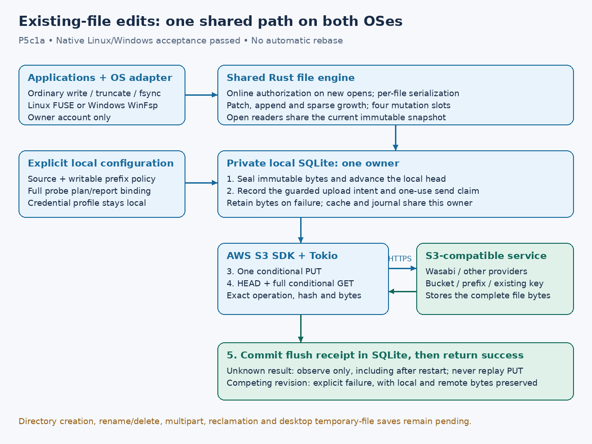

# Native existing-file writes

[Guarded regular-file creation](native-creation.md) extends this phase under separate acceptance.

**P5c1a, native acceptance passed, 2026-10-16.** A separate
version-2 configuration opts selected sources into existing-file editing.
Version-1 configurations remain read-only. The shared engine is connected to
both adapters; local SDK/SQLite integration and native Linux/Windows tests pass. No real Wasabi configuration, policy,
credentials, startup registration or objects are changed by these tests.

This phase edits existing files only. File/directory creation, deletion,
rename, arbitrary timestamps/permissions/ACLs, multipart, payload reclamation
and automatic clean-base rebinding remain subsequent work. A complete desktop
save workflow that creates a temporary file and renames it is not yet supported.

## Data path and durability



Both adapters use the same edit coordinator, credential-bound upload executor
and **one SQLite owner**, including when optional clean caching is enabled.
Four mutations may execute concurrently per mount; operations on one file are
serialized. Native callbacks do not construct independent S3 mutations.

A write/truncate first publishes an immutable local generation, conditionally
uploads its complete bytes, verifies the exact remote operation through HEAD
and full conditional GET, then commits the [flush receipt](flush-receipts.md).
Success therefore includes remote verification. This conservative synchronous
path may upload a whole file for each native write; performance is unmeasured.
Append selects the current end under the file lock. Windows constrained writes
clip to the existing logical end. Growing a file stages explicit zero spans.

Open handles for a writable file share its current immutable snapshot, so an
already-open reader sees completed local edits. New opens still authorize
online. Callback futures are boxed at the shared interface to limit native
stack use. Existing read-only cache/revision semantics are retained.

Flush/fsync uses the current selected generation; repeated flushes do not
reissue a claimed PUT. A prepared, never-claimed older intent may be cancelled
when a newer local edit supersedes it. Claimed attempts are only observed.
Restart/open can reconcile an uncertain attempt through exact matching bytes
and acknowledge it locally, without another PUT. Absence/rival/error cannot
grant replay permission. A conflicting or uncertain result remains a failure
with all local bytes retained. An error can follow local publication; it is not
a promise that the file was unchanged.

An externally changed remote revision can be read through a fresh clean handle,
but writable reopen refuses to silently rebase the retained local lineage.
Already-open writers use the recorded ETag guard; a competing replacement is
preserved, and the failed local edit remains available in SQLite. Explicit
conflict recovery and clean-base advancement are still required.

## Explicit configuration

Keep the existing read-only configuration. Prepare a separate opt-in file only
after selecting the exact writable prefix and accepting its policy, metadata
contract and full local provider evidence. Paths below are illustrative absolute
Linux paths; Windows needs native absolute paths such as `C:\Users\you\...`.
Never put state inside the mount.

```toml
version = 2
mode = "read-write"

[[sources]]
alias = "documents"
bucket = "your-test-bucket"
region = "your-region"
endpoint = "https://your-s3-service.example"
prefix = "desktop/"
profile = "your-local-profile"

[writes]
directory = "/absolute/private/s3drive-state"

[[writes.sources]]
alias = "documents"
policy = "/absolute/private/write-policy.toml"
plan = "/absolute/private/probe-plan.toml"
report = "/absolute/private/full-probe-report.toml"
```

Source settings must match the recorded evidence exactly, including alias,
endpoint, profile, prefix, addressing and LIST dialect. The policy is the
[separate strict document](write-policy.md), with `operations =
"create-and-replace"` for existing-file editing. A create-only policy does not
permit replacement. The mandatory markers-only setting does not preserve
arbitrary prior object attributes. Evidence age limits still apply to new
claims; reconciliation remains available after expiry.

Aliases in `writes.sources` must be unique and match configured sources exactly.
Other sources and files outside each policy's writable prefix stay read-only.
If `[cache]` is also present, its directory must equal `writes.directory` so the
mount shares the same owner. CLI containment checks cover both directory settings
before state initialization. Policy/plan/report inputs are bounded local files;
startup validates them and pins the matching credential generation. It never
runs a probe automatically. A probe report alone does not authorize ordinary
bucket edits, and the completed Wasabi fixture approval cannot be reused.

Use the existing `mount` command and startup launchers with the separate config.
No new service manager is required. Linux still needs `/dev/fuse` and a working
`fusermount3`; Windows needs the installed WinFsp runtime. The Linux adapter
selects an RW mount only for version 2, retains owner-only access and direct I/O,
and keeps directories non-writable in this existing-file phase. Windows grants
write rights only to the mounting SID, clears the read-only attribute only for
permitted files, and continues rejecting delete-on-close and ACL mutation.

Linux size changes can carry automatic timestamp flags; the adapter accepts
automatic mtime-now on a resize while arbitrary timestamp edits remain
unsupported. This distinction follows the kernel's SETATTR translation.
[Linux v6.12 FUSE attribute translation](https://github.com/torvalds/linux/blob/v6.12/fs/fuse/dir.c)

Modification times currently have second precision and do not implement
arbitrary persistent POSIX/NTFS timestamp metadata. Space queries describe the
**local logical staging budget**, not S3 capacity: by default 1 GiB payload and
4,096 retained generations. SQLite/WAL/index overhead and physical disk limits
can fail earlier. Acknowledgment does not reclaim retained payload quota.
New file sizes must fit the explicit policy and the 8 MiB single-PUT bound.

## Evidence and remaining acceptance

Implementation `cf5e456` passed both native suites in
[run 38990445390](https://github.com/marshallr12/s3drive/actions/runs/38990445390):
Linux job 117271446300 and Windows job 117271446336. Each ran the existing-file
write workflow plus lost replies, restart without replay and conflict retention,
alongside read-only/cache/session regressions. Native Windows runs remotely on
GitHub's Windows Server 2025 VM. The final conflict error mapping and documentation
refresh must also pass exact-tip CI before publication.


The local child-process engine test uses the real CLI's full conditional probe,
strict policy factory, SDK TCP transport and SQLite. It exercises binary/Unicode
edits, shared readers, sparse/truncate/append/constrained writes, repeated flush,
restart, read-only handles/prefixes and a real competing 412 replacement. The
competitor's bytes stay unchanged and rejected local bytes remain pending.

Native tests use ordinary file syscalls through actual FUSE/WinFsp and the same
owned loopback fixture. They exercise existing-file writes, shared reads,
truncation, zero growth, append, remote flush, limits, prefix protection and
restart. Lost replies are verified without replay; observation failures retain
local bytes and fail fsync until restart can reconcile the remote operation. Rejected
remote attempts return the shared conflict error (Linux `ESTALE`, Windows
`STATUS_FILE_INVALID`); unknown results remain I/O failures.
Native competing-writer tests retain the rejected local snapshot and verify
that the rival remote bytes remain unchanged.
The fixture's mutation support is explicitly disabled for read-only
regression cases. No cloud account is contacted.

The current local executor has `NoNewPrivs=1`; its setuid FUSE helper cannot
mount. An isolated user/mount namespace mounts read-only FUSE, but maps root
ancestors to an unmapped UID and is refused by the unchanged private-state
checks. Those checks were retained. This phase's driver evidence comes
from Linux CI and the remote Windows Server 2025 VM. Native writable acceptance
on this workstation's normal desktop/login session remains separate work.
