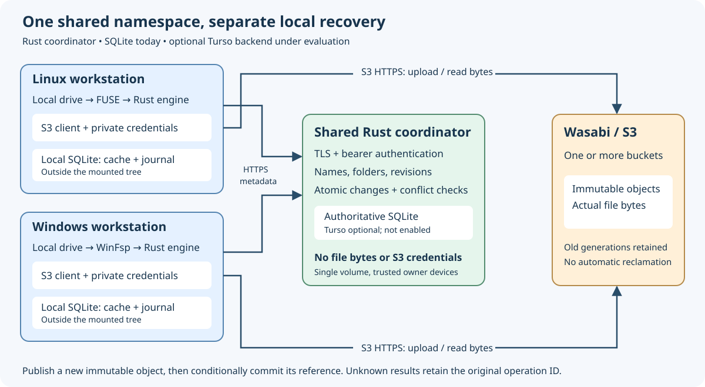

# Shared authority over HTTPS

Design/research date: **2026-10-17**. Accepted at
`a87bd0bd3992bf0af838ac0f97c7a4e97687662e`, terminal all-green
[CI39075749765](https://github.com/marshallr12/s3drive/actions/runs/39075749765).
Both native OS writer suites used the real Rust HTTPS authority with a private
CA. All five TLS and ten HTTP cases passed, along with256/252 Linux/Windows
state tests,17 SDK cases, Linux7 and Windows1+7 native cases, both startup gates
and exact-source typed21/14 reference artifacts. No remote host was provisioned;
these are local/hosted-runner transport and native filesystem results, not real
multi-host or physical reboot acceptance. Metadata transactions, operation IDs
and the S3 layout are unchanged. See [operator setup](managed-bootstrap.md).



## What runs where

The coordinator is a **Rust service** (`s3drive authority-serve`). It owns one
shared volume's namespace and authoritative database. SQLite is the implemented
backend; Turso remains an optional backend proposal requiring separate migration,
transaction and uncertainty acceptance. Hosting preference remains undecided.
Neither option requires putting file contents into the shared database.

Each computer runs its own Rust mount engine, S3 client, private SQLite recovery
journal and cache, with FUSE on Linux or WinFsp on Windows. Clients upload immutable
payloads directly to S3, then conditionally publish their references through the
coordinator. The coordinator has no S3 credentials. Local SQLite remains outside
the mounted tree. Only an online authoritative commit can establish a global
name/revision; TLS does not add offline ownership or turn S3 and SQL into one
transaction. Existing open snapshots and retained local dirty data keep their
documented behavior during a partition.

## Transport and trust contract

HTTP remains restricted to numeric loopback addresses. Nonloopback listeners
require both explicit `--tls-cert` and `--tls-key`; the service terminates TLS
itself. Rustls0.23.46/tokio-rustls0.26.6 provide TLS1.2/1.3, with HTTP/1.1 ALPN.
The server supplies a matching leaf-first PEM certificate chain and unencrypted
PEM private key. The files must pass the same owner-private local-file/link/ACL
checks as tokens, now bounded to64KiB each. Token limits remain66 bytes.
Keys read from disk are held in a zeroizing buffer during initialization; errors
never include PEM contents or source configuration. Files load once at startup;
certificate/token renewal requires an orderly restart in this phase.

The client accepts only `/v1/namespace`, with no URL credentials, query or
fragment. HTTPS verifies the server name and chain. By default it uses platform
trust; optional `managed.authority_ca_file` replaces that trust with the explicit
owner-private PEM roots. It cannot accompany HTTP. There is no insecure-certificate
switch, proxy inheritance, redirect following or automatic mutation retry.
TLS key logging is explicitly disabled. Resolved dependency APIs were inspected;
see [reqwest0.13.5 trust controls](https://docs.rs/reqwest/0.13.5/reqwest/struct.ClientBuilder.html#method.tls_certs_only)
and [tokio-rustls](https://docs.rs/tokio-rustls/0.26.6/tokio_rustls/struct.TlsAcceptor.html),
read2026-10-17. These are dependency contracts, not deployment acceptance.

A 256-bit bearer token grants all namespace operations on this service's one
volume, including mutations. It is intended for trusted devices of one owner;
there are no separate reader roles, device revocation lists or multi-tenant
accounts. Requests for another volume remain rejected by the authority. Share
the token privately with authorized machines; never place it in TOML, command-line
arguments, Git or chat. Each machine still supplies its own S3 credentials.

The TLS listener bounds accepted connections to 32, concurrent database requests
to 8, handshakes and headers to 5 seconds each, and an HTTP connection to 10 seconds.
It disables keepalive and caps header buffering at 16 KiB; JSON requests retain
the 4 KiB limit and clients cap replies at 8 MiB. Client connect/whole-request
deadlines remain 2/10 seconds. Long network delays can therefore produce an unknown
mutation outcome. Reconcile the original durable operation before any subsequent
effect; do not rebind, overwrite, or manufacture a new ID. On shutdown the listener
closes and connections drain; accepted database commands retain their worker
ownership even if the requesting socket disappears.

## Explicit metadata connection lifetime (candidate, 2026-10-18)

The snapshot-topic candidate sends `Connection: close` on every HTTP/1.1
metadata request, for both HTTPS and numeric-loopback HTTP. This makes the
client choose a finite connection lifetime, matching the TLS listener's
existing one-request policy. RFC9112 permits this choice; once the client
declares it, the connection must not carry another request, and the client
closes after the final response. Persistent clients are also allowed by the
standard; the earlier default was not itself a protocol violation.
[RFC9112 sections9.3 and9.6](https://www.rfc-editor.org/rfc/rfc9112.html#section-9.6)
(read2026-10-18).

The resolved reqwest0.13.5 public `RequestBuilder::header` and `http::header`
re-export were inspected locally before use. Dependency versions, timeouts,
TLS trust, request serialization, automatic retries and pool-builder options
remain unchanged.
The cost is a new connection per metadata exchange, including a new TLS
handshake for HTTPS. This is not a throughput improvement or an S3 setting.

Two bounded local wire tests observe actual sockets and complete replies. With
the prior client, sixteen sequential Info calls used one keep-alive socket;
with the candidate, all sixteen receive the expected volume through sixteen
connections declaring `close`. A separate raw peer omits its own close header
and leaves the socket open; the client still returns the complete reply and
closes its side. Fixture tasks are stopped/reaped before assertions. These
tests establish the lifetime policy, **not a reproducer or explanation of the
intermittent Windows failures**. Existing HTTP/TLS fault, native, startup and
strict reference gates remain required. The main branch remains f8c4f58 until
new exact-source acceptance; see the [dated record](evidence/authority-snapshot-platform-20261018.json).

At e51f737, [CI39103791947](https://github.com/marshallr12/s3drive/actions/runs/39103791947)
passed Linux/book and the Windows workspace, lifecycle and paired startup checks.
The later Windows broad suite failed an existing-file flush with
Info/UnexpectedEof and native1117. Six other broad cases passed. The lifetime
policy did **not** eliminate the failure, and this source was not promoted.

## Client body-poll observation (candidate, 2026-10-18)

The next diagnostic snapshots one `body_frame_polled` boolean when classifying a
client transport failure. It means the HTTP consumer polled a data frame by
that instant. It does not measure a socket write, identify a selected connection,
establish server receipt or prove authentication/commit. False is not a safe
unsent result: preserve the original unknown operation and its guards.

The implementation wraps reqwest's original `.json()` body through the public
`Body` interface, forwarding frames, length/end hints and errors. Resolved
reqwest0.13.5, Hyper1.12.0 and http-body1.1.0 sources were inspected; no arbitrary
request extension or private dependency field is used. The earlier rejected
connection-capture experiment remains separate. No dependency, deadline, retry,
trust or connection-policy changes are part of this diagnostic.
The wrapped body is not cloneable, unlike reqwest's original buffered variant;
redirects and retries remain disabled. This is instrumentation with a different
body representation, not proof that every scheduling detail is unchanged.

Local controls passed: a TLS peer received byte-identical serialized mutation
JSON with application/json, the original Content-Length and no chunked transfer;
dropped/truncated/stalled replies report a polled frame, while failed certificate
trust reports false before HTTP. Redirect refusal, absence of a second mutation
and private-error redaction remain required. These observations validate the
marker's meaning, not a correction of the Windows failure. Full local and new
exact-source native/reference/startup gates remain required before publication.

The accompanying native fixture adds32 consecutive positive flushes through a
real mounted Unicode path, each with a distinct32-byte binary payload, a fresh
read and exactly one additional SDK PUT. It has no injected outage or accepted
error and stops at the first unexpected failure. A failure runs the independent
read-only CLI control, reaps owned processes and resumes the original panic;
the fixture does not retry the failed step. Its control sends no mutations.
Blocking filesystem operations yield the test's
Tokio worker with `block_in_place`, so its S3 fixture can continue serving.

Windows CI runs this case explicitly after ordinary-account coordinator/snapshot
checks and before lifecycle/workspace checks. The raw TLS controls run first on
Windows too, so a native failure's marker is not supported only by Linux tests.
The broad Windows step excludes
only the two cases already run explicitly; all earlier checks remain. Linux's
native suite includes the same fixture. Local compilation/workflow parsing
cannot establish either native result; this workstation's FUSE restriction is
preserved, and new hosted acceptance is required.

## Runtime-owned request execution (candidate, 2026-10-18)

At a14ffa3, [CI39106656359](https://github.com/marshallr12/s3drive/actions/runs/39106656359)
passed Linux's nine native cases, including32 flushes, and the Windows six raw
TLS controls and standalone snapshot/console workflow. Windows's fourth flush
failed an Apply request with UnexpectedEof/native1117 and
`body_frame_polled=false`. A nearby empty TLS socket timed out; there is still
no exact socket/RPC correlation. The fresh CLI reached the original volume in
152ms afterward, with both processes alive. No candidate was promoted. The
false observation does not authorize discarding the original uncertain input.

Native adapters call asynchronous filesystem code from callback threads using
their runtime handle. The next candidate executes each metadata RPC in one
owned Tokio task on that current runtime. It clones the exact request once;
it creates no new operation identity, retries no request and changes no trust,
encoding or connection policy. This tests an execution-context hypothesis,
not an identified Tokio/reqwest/WinFsp defect or a proven Windows correction.

A caller-scoped JoinSet aborts its job when the caller disappears. An absolute,
cooperative10-second deadline covers both queuing and RPC work; the existing
two-second connect and ten-second reqwest deadlines remain. Outer timeout
classification uses whether response headers were observed, preserving request
versus response-body phases. Missing runtime/task failures return a fixed
Execution category without formatting dependency/panic details. Any accepted
remote mutation may still finish after cancellation: retain the same unknown
operation and reconcile its original receipt. Abort is not rollback.

The resolved Tokio1.53.3 JoinSet spawn/join/drop, runtime-handle and timeout
contracts were inspected locally. Local controls passed: cancel a queued job
before the single-thread runtime can run it, observe no surviving task or TCP
connection, then complete a real request with the same client; execute mutations
from a foreign thread with exact receipt lookup/replay and unchanged identities;
and cancel after an actual SQLite commit while response bytes are withheld,
recovering its original receipt without a second request or sequence advance.
Existing byte-framing, privacy, trust and timeout controls remain. These are
execution/uncertainty checks, not a native Windows failure reproducer. Windows
now runs all authority wire/execution controls before the unchanged32-flush
native gate, followed by every prior acceptance gate.

## Connector observations (candidate, 2026-10-18)

The runtime-owned candidate949073f failed
[CI39108821537](https://github.com/marshallr12/s3drive/actions/runs/39108821537).
Linux/book succeeded. Windows passed the unchanged32-flush gate, full lifecycle,
workspace, standalone/paired recovery and project reference checks, then failed
opening an existing Unicode file in the broader write case: List/Request/
UnexpectedEof, native1117, body_frame_polled=false. A nearby empty TLS socket
expired after5057ms, but it is not correlated to that exact RPC. Both console
checks exited5ms after cancellation (single observations, no timing guarantee).
Main stays at f8c4f58; runtime ownership did not eliminate the failure. See the
[dated raw-log record](evidence/authority-snapshot-platform-20261018.json).

The next diagnostic uses reqwest's public
[connector_layer](https://docs.rs/reqwest/0.13.5/reqwest/struct.ClientBuilder.html#method.connector_layer)
API, inspected in the resolved local source on2026-10-18. It reports whether a
connector was called under this RPC's task scope and whether such a future
successfully returned a connection. The layer captures that scope at call time,
so later completion cannot attach to a different concurrently polled request.
A single monotonic atomic snapshot distinguishes unobserved, started and at
least one success. Unscoped work is not attributed to any request.

Neither flag identifies the selected socket, proves HTTP bytes were sent or
resolves an unknown mutation. A false flag cannot authorize replay. Error output
contains only these fixed booleans and existing categories; destinations, tokens,
bodies, certificates and dependency error strings are never recorded. Trust,
framing, operation identities and existing deadlines/retry policy stay the same.
The public layer does select reqwest's boxed connector path, so scheduling
transparency is not claimed. This is diagnostic work, not an established fix.

Controlled concurrent TLS exchanges use one cloned client: one peer receives
HTTP then drops its reply; the other accepts TCP but stalls TLS. They must
produce different connector-completion/body-poll flags, with exactly two sockets
and no extra attempt in the bounded observation window. Existing trust, received
bytes, timeout, redaction and no-replay assertions remain. New native acceptance
and strict source-bound artifacts are still required before promotion. The full
local gate passed, including274 state tests, nine TLS cases, three authority
unit cases (two Hyper controls and one scope control), lint/build and57-document
checks. No native mount or live-provider acceptance follows from that gate.

### Upstream triage (researched 2026-10-18)

Hyper's [stale readiness fix](https://github.com/hyperium/hyper/pull/4208) is
already present in the resolved1.12.0 source (`Receiver::poll_recv` withdraws
`want`), with want0.3.2 in Cargo.lock. This is not a missing dependency update.
A separate [queued-request shutdown report](https://github.com/hyperium/hyper/issues/4202)
was closed by [asynchronous dispatcher draining](https://github.com/hyperium/hyper/pull/4222)
on October9, after [1.12.0's October6 release](https://github.com/hyperium/hyper/releases/tag/v1.12.0).
The resolved source lacks that later drain change; no patch has been applied.

That report concerns a queued request stranded after dispatcher closure until
its caller's timeout. Our recorded949 error returned EOF before the10-second
client deadline and lacks queue/socket correlation. A shared cause remains
unproven. Compare the new connector observations before changing dependencies;
upstream recovery of a request does not authorize replaying an uncertain logical
mutation. These findings are research, not a native reproducer or fix.

### Public socket-metadata control (Linux only, 2026-10-18)

An isolated [reproducer archive](evidence/public-connector-probe-20261018.tar.gz)
contains source, manifest, lockfile and instructions. It passed four local
controls: HTTP and HTTPS, each with a complete reply and with a deliberately
lost reply after receipt of request headers. Using only the public
[Connection](https://docs.rs/hyper-util/0.1.21/hyper_util/client/legacy/connect/trait.Connection.html),
[Connected::get_extras](https://docs.rs/hyper-util/0.1.21/hyper_util/client/legacy/connect/struct.Connected.html#method.get_extras)
and [HttpInfo](https://docs.rs/hyper-util/0.1.21/hyper_util/client/legacy/connect/struct.HttpInfo.html)
APIs, the connector observed the same TCP address pair as the independent peer.
No second connection occurred in the bounded observation window; no credentials
or provider requests were involved. Resolved source fingerprints and archive
hashes are in the [dated record](evidence/authority-snapshot-platform-20261018.json).

This establishes a possible diagnostic path even when a reply is lost; the
previous rejected request-extension capture is not required. The experiment is
not part of the production client and does not identify a socket selected by a
failed production RPC. Before adoption, limit output to bounded loopback-only
correlation, preserve request-scope attribution, and test missing metadata and
concurrent candidates. It provides no Windows mount or provider acceptance.

The e988 candidate subsequently failed
[CI39111567111](https://github.com/marshallr12/s3drive/actions/runs/39111567111).
Linux/book passed; Windows passed the controls, standalone snapshot/console,
32-flush gate, full lifecycle and workspace, then failed paired recovery. The
Info/Request/UnexpectedEof error recorded connector_started=true and
connector_completed=true but body_frame_polled=false. A connector returned
successfully before the error; the exact socket/dispatch stage is still unproven.
The nearby empty TLS connection133 expired after5083ms. The fixture's expected
single uncertain PUT was not established; do not claim an upload or commit.
Later14-reference/broad native steps were skipped. A locked disposable profile
also failed cleanup; the original failure was retained. Main remains f8c4f58.

Paired process-class logs showed both supervisors and children BelowNormal.
Actual thread priorities and a causal scheduling explanation remain unmeasured;
no priority change is part of this diagnostic phase. The standalone private-console
cancellation took16ms in one observation. See the
[dated record](evidence/authority-snapshot-platform-20261018.json) for scope and
raw-log hashes. None of this is acceptance for the later loopback-tag source.

## Bounded loopback candidate tags (implementation candidate, 2026-10-18)

The follow-up implements the independently tested public metadata path. A
transport error may now contain one connector candidate with only an IPv4/IPv6
flag and client/server TCP ports. Only the exact `127.0.0.1` or `::1` address pair,
matching families and nonzero ports qualify; other addresses and missing metadata
produce `Omitted`. No address, hostname, certificate, request field or dependency
error is retained. Before any successful connector handoff the tag is `Unobserved`; more than one
successful connector becomes `Multiple` and exposes no individual candidate.
The aggregate uses one atomic snapshot and never replaces the first observation
with a later single candidate.

The connector captures its request scope when called, then records sanitized
metadata before marking connector completion. Server TLS diagnostics record the
same loopback-only port/family tag, alongside their existing connection ordinal,
byte counters and dispatch flag. Existing rate limits and failure classes remain.
Ports can be reused; a matching candidate is not proof that a pooled RPC selected
that socket. It cannot establish delivery, authentication or commit, or permit
replay. Non-loopback deployment intentionally receives no address correlation.

Controlled lost-Apply-reply and concurrent TLS tests compare the client candidate
against the independent peer's actual TCP ports; a stalled handshake remains
unobserved. A real CLI listener's idle, partial-header and partial-body events
must match the caller's socket tag and their original byte/failure assertions.
Unit controls cover missing metadata, cross-scope completion, non-loopback and
mixed-family omission, duplicate candidates and concurrent successes. Existing
wire framing, privacy, trust, timeout and no-replay assertions remain. These
focused local checks and the full local gate passed (including274 state tests,
nine TLS cases and six authority unit cases). A new native cohort is required. The e988 hosted run covers its earlier source without these tags.

## Bounded failure diagnostics (2026-10-17)

The [same-source Windows failure investigation](authority-startup.md#same-source-repeat-failure-2026-10-17)
adds plaintext byte/flush counts, elapsed HTTP milliseconds and a header-dispatch
flag to established-connection failures. These counters do not establish
authentication or commit, and retain no contents or peer/operation identities.
The existing sixteen-event/one-suppression budget remains; client transport
errors add only a fixed request category. No retry or timeout policy changes.

## Operator setup example

This illustrates a future operator-owned host. It is not an installed service
or a request to change firewall, root, accounts, credentials or startup entries.
Prepare a certificate valid for the hostname clients will use, its private key,
and an owner-private token outside the repository and mounted paths. Then run:

```sh
s3drive authority-serve \
  --directory /home/you/.local/share/s3drive-authority \
  --token-file /home/you/.local/share/s3drive-secrets/authority.token \
  --tls-cert /home/you/.local/share/s3drive-tls/server-chain.pem \
  --tls-key /home/you/.local/share/s3drive-tls/server-key.pem \
  --name-policy portable-collision-v1 \
  --listen 10.0.0.10:43128
```

The readiness endpoint reports the bound address. If it is a wildcard or differs
from the certificate name, clients must use the actual reachable DNS name whose
SAN the certificate covers. Keep the generated volume ID and existing store
bindings. A replacement authority with a different volume is not a continuation
of the old drive. Add these fields to an otherwise valid managed configuration:

```toml
[managed]
authority = "https://s3drive.example.net:43128/v1/namespace"
volume = "11111111111111111111111111111111" # actual existing volume ID
token_file = "/home/you/.local/share/s3drive-secrets/authority.token"
# Only for an explicit private CA/self-signed deployment; otherwise omit:
authority_ca_file = "/home/you/.local/share/s3drive-tls/authority-ca.pem"
# Existing stores/default_store/windows-disposition remain as appropriate.
```

Windows uses absolute local paths and owner/SYSTEM-only ACLs for these files.
The CA file must also remain outside the mount tree. This phase does not add an
installer, sign-in supervision of the authority, certificates, firewall rules,
backup/failover or a hosted account. Those remain deployment requirements.

## Acceptance

Require real local TCP/TLS with independent clients and SQLite, bad trust/name/
expiry/token/volume cases, plaintext refusal, slow handshake/header/body bounds,
no redirects/replay, exact operation recovery after an unread reply, and safe
shutdown. Exercise the real CLI and managed writer through HTTPS plus the SDK
fixture, then both native adapters. Full local and exact-source hosted
Linux/Windows/book gates, reference matrices and startup regressions are required
before publication. Tests on one loopback host do not prove WAN availability,
multi-host routing, remote credential handling, real reboot, Turso or production
deployment. Real Wasabi mutations still require their own selected policy and
authorized fixture scope.

## Local checkpoint

The full local gate passed exit0 (`/tmp/s3drive-remote-gate2.log`): 256 state,
ten HTTP and five TLS contract cases, seventeen SDK cases, CLI/shared-filesystem
HTTPS editing/recovery, formatting, Clippy, build and book checks. The diagram
was rendered and visually checked. An earlier gate process was terminated143
during compilation; its cause is unverified and it is not a passing gate.
Native HTTPS and exact-tip hosted acceptance still remain required. This local
checkpoint does not establish remote deployment or Turso support.
