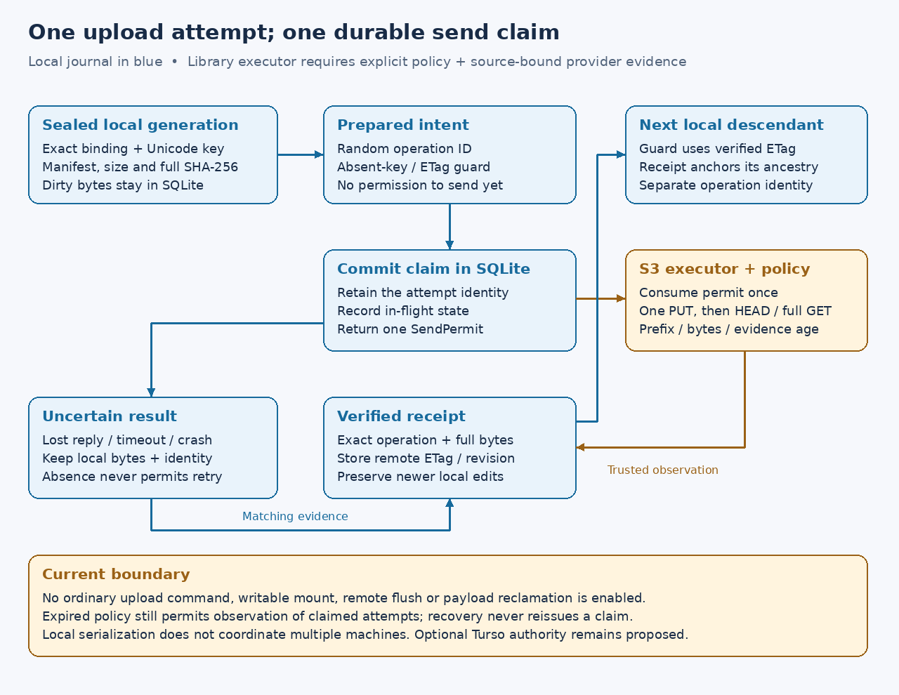

# Durable remote-attempt journal

**P5b2a, implemented 2026-10-16:** schema 6 adds local attempt records on the
same SQLite connection and bounded async owner as cache and staging work.
This is a local recovery library. P5b2b now connects it to a
[policy-bound SDK executor](upload-executor.md), tested with local HTTP fixtures.
P5b2c adds a [source/evidence-bound factory](write-policy.md). Remote flush,
writable mounts, multipart uploads and dirty-data reclamation remain disabled.
The separately authorized [Wasabi single-PUT probe](conditional-uploads.md)
has passed; no real application write policy has been installed.

## What an attempt identifies

Preparing an intent selects the current sealed local head, checks its complete
payload, and records a random 256-bit operation ID, credential/configuration
binding, exact object key, local manifest hash, full SHA-256, size and guard.
Repeated preparation for that generation returns the existing identity; it
cannot make a fresh attempt after cancellation, rejection or uncertainty.

The initial guard is absence or a supported strong quoted ETag from the original
base. A version ID alone cannot supply an ETag guard. After an earlier attempt
has a verified receipt, a descendant's new intent uses that receipt's ETag and
records its operation ID and receipt hash. The parent must belong to the same
binding, key and local ancestry. Verifying an older upload does not change the
current local head, pending records or newer edits.

One prepared, in-flight, uncertain or rejected intent blocks other intents for
the same configuration fingerprint and exact key. Another credential generation
with local or remote history for that locator requires explicit rebinding,
which remains unimplemented. These are local serialization rules, not account
identity, distributed locking or a cross-machine coordinator. ETags retain the
[direct-mode fencing limits](conditional-uploads.md#provider-contract-and-evidence).

## Permission is issued once

| State | Meaning | Permitted next outcomes |
| --- | --- | --- |
| Prepared | Intent exists; no send permission issued | Claim once, or cancel before claim |
| In flight | Claim committed; one non-cloneable in-memory permit returned | Uncertain, verified or rejected |
| Uncertain | A send may have committed, or its result was lost | Matching verification, or a definitive late rejection |
| Verified | Trusted caller supplied matching operation/body/revision evidence | Retain receipt; a newer local descendant may prepare |
| Rejected | Conditional attempt returned 409/412 | Retain bytes and block the target pending explicit resolution |
| Cancelled | Prepared intent was cancelled before claim | Retain identity; never grant permission for this intent |

Claim checks the runtime binding, current local head and complete payload again.
It commits both the in-flight state and a retained-attempt marker before
returning a `SendPermit`. A future transport must consume that permit and issue
at most one SDK attempt. It must not reconstruct permission from `Info` or
interpret a prepared intent as provider authorization.

If a reply is lost after the claim commits, the caller may receive no permit at
all. Inspection still finds the committed claim; claiming again fails. On managed
startup, interrupted in-flight records become uncertain. That deliberately
includes a crash between claim commit and the actual network send: this phase
cannot prove a send did not occur, so recovery cannot grant another permission.

Absence or another operation's object records an unmatched observation and leaves
the attempt uncertain. Neither authorizes a retry, overwrite, cancellation,
cleanup or automatic rebase. This preserves the distinction between a request
that never applied and one followed by another writer's deletion or replacement.

## Verification is a caller obligation

`Verification` is a data-transfer structure, not a proof or capability token.
The network coordinator must establish the exact binding, key, operation
metadata, length, full body SHA-256 and valid revision using its pinned runtime
credentials. The journal checks the supplied fields against the immutable intent
and stores the receipt transactionally. The journal's own unit tests use simulated
observations; P5b2b separately exercises real SDK/TCP observation. Neither is
live-provider conformance or evidence that application uploads are enabled.

Matching verification is idempotent; a different revision for an already verified
attempt fails. A literal `null` version is normalized to no immutable version.
Receipt verification never acknowledges remote `flush`, removes pending local
intent or frees sealed bytes. Reference/pin-aware acknowledgment and reclamation
remain separate required work.

## Bounds, ownership and recovery

This single-PUT phase accepts bodies up to 8 MiB, including empty files. Larger
and sparse local generations remain readable and retained but cannot prepare
an attempt here. Multipart support must extend the protocol before larger files
can upload. The default record quota is 4,096, with a hard maximum of 65,536;
there is no record garbage collection. Quota refusal preserves existing data.

Mutations require managed persistent local storage. Linux tmpfs may still hold
clean cache, but cannot acknowledge a new intent or send claim. SQLite uses the
existing WAL/FULL durability settings, private directory and process lock.
`Storage::uploads()` shares the same eight-command queue, owner thread and close
lifecycle as cache/staging work. A timeout after admission requires inspection.

Canonical hashes bind immutable intent and mutable phase fields. A retained
foreign-key marker prevents forgetting a dispatched record through normal
parent-row deletion. Reads validate shapes before allocating bounded fields;
startup and new claims stream and validate the complete remote journal rather
than trusting its target index. These are corruption checks, not authentication
against an owner who can rewrite the entire database. Damaged records are refused
without resetting or deleting dirty bytes.

Tests cover process termination before/after prepare, claim and verification
commits; lost owner replies; repeated claims; parent receipts with newer dirty
heads; mismatched observations; credential isolation; stale selection; quotas;
real SQLITE_FULL rollback; corruption; and schema-5 migration/rollback. Platform
results are recorded separately in the handoff. Mounted adapters remain read-only.
