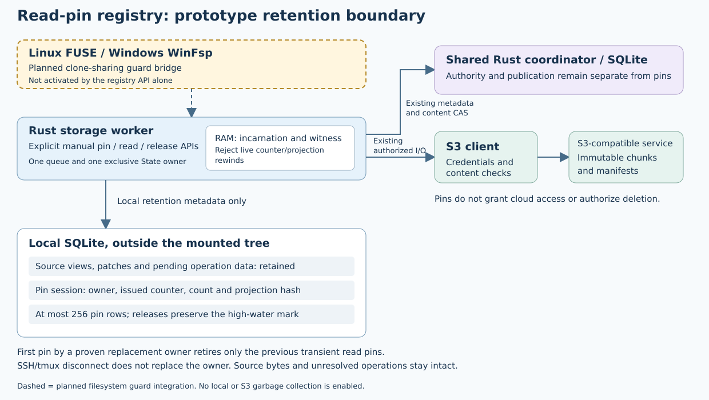

# Transient source read-pin registry

Declared W5b2b1 contract,2026-10-19. **Component checks passed; parent/full/platform acceptance pending.**

Build in codex/source-read-pins from isolated scoped repair1ad9dc6/schema36.
The parent remains unaccepted; batching and scoped-operation acceptance must be
integrated before this phase can be promoted. Main remains W5b1/schema35.

This slice adds the explicit transactional registry, not garbage collection or
managed-reader activation. A follow-up must connect clone-sharing guards and
bounded worker cleanup to every EditedFile before reclamation can be enabled.
No existing reader becomes GC-safe merely because these tables exist.

Reuse State's existing random exclusive-owner incarnation, assigned only after
its kernel directory lock is acquired. Do not introduce heartbeat or wall-clock
expiry. On the first pin acquisition by a replacement owner, atomically replace
the old transient session and clear only its read-pin rows. Old remote outcomes,
preparations, staging, root receipts, source views and bytes remain untouched.
Existing clients from the old worker are closed; an old lease cannot affect the
new session, even when both sessions issue sequence1.

Within one session allocate a strictly increasing sequence, transactionally with
the new pin. Never reuse a committed sequence after release; retain one high-water
value rather than one lifetime tombstone per open. The opaque manual retention token binds owner,
sequence, exact view and derived ID. Releasing a missing old lease is idempotent;
releasing a different session is stale. A late old release must never remove a
new pin. Overflow refuses admission. Active pin rows are bounded to256 per owner;
all transient session metadata remains constant-size apart from those rows.

A role header binds session, issued counter, active count and the digest of all
active lease records. Keep a corresponding in-memory witness in State after each
committed registry mutation. While the owner is live, refuse copied/rewound or
self-consistently rewritten headers that no longer match that witness. After a
crash no old local handle can use the replacement exclusive owner; it may retire
a structurally valid prior read session when acquiring its first new pin.

Integrate read-pin projection into source ledger equality so a trigger cannot
silently remove/change pins during an unrelated source mutation. Verify header,
row hashes/counts, owner/sequence bounds, exact view existence and role isolation.
A pin retains only local data; it does not authorize S3 reads, uploads, root CAS,
clean settlement, current remote freshness or deletion. Network I/O must remain
outside every SQLite transaction.

Use schema37 with additive session/pin tables; preserve all old literal source,
operation, preparation and root rows/hashes. Existing-only metadata recovery may
validate structural headers without reading source BLOBs or starting a session.
Missing current-schema tables fail closed; explicit older-schema fixtures remain
readable. Keep populated pin state isolated from legacy publication/authority
roles and out of authority snapshots. No database lives inside a mounted tree.

Clones of a manual token are metadata copies, not separate lifetime guards.
Explicit release closes the registry entry and pinned reads must then fail. An
unknown acquisition reply conservatively retains any committed entry until
reconciliation or owner replacement; do not treat it as a successful open.

Ownership: state migration037; sparse_views pin module/ledger/header validation;
State witness verification; explicit transactional registry tests and migration/
role fixtures; existing-only metadata recovery; authority snapshot/legacy role
allowlists; native schema expectations; documentation. No managed upload-batch
file is owned by this slice. Do not start Cargo while the upload-batch gate is live.

Done criteria: exact acquire/read metadata and bounded active quota; monotonic
reuse resistance; known release replay; old-session late release after restart;
private-owner exclusion; corrupt/copied/rewound counters and pin rows; trigger and
SQLITE_FULL rollback preserving source bytes/head; real killed-owner boundaries
before/after commits; unchanged old literal rows during migration; current missing
DDL refusal; and reciprocal role/snapshot exclusion. Full local and exact-source
platform acceptance follow parent integration. Native chunk writes and GC remain
unsupported.

Pin mutations refuse attached SQL triggers before any write, including triggers
on unrelated tables. Source mutations separately compare the complete pin
projection so they cannot silently alter retention. The manual registry is
available through sync/same-owner async methods; token clones are metadata copies,
not independent lifetime guards. Automatic guard/cleanup integration remains a
required follow-up before GC. Initial nine focused tests passed27.49s, including
restart/late-release fencing, monotonic reuse resistance, self-consistent rewind,
active quota beyond a lifetime of512 opens, source-trigger rollback, schema36
migration/current DDL loss, roles and same-owner async calls. One unused-mut test
warning was removed; no warning suppression. Further full-disk/counter/kill and
metadata-only recovery tests are not yet verified.

Focused3 passed13 cases/23.48s including13 actual killed-owner boundaries,
SQLITE_FULL rollback, counter exhaustion and the source-only pin role after all
ordinary source rows were removed. Focused2 had12pass/1fixture failure because
its diagnostic files were inside the strictly managed state directory; those
files now live alongside it, with failed source/log retained. No directory
validation was weakened. Metadata-only recorded-ack recovery with active pins
and corrupted source BLOBs passed1/0.56s without rotating the session or clearing
pins. All-target state Clippy passed17.29s with warnings denied. Candidate1 is333
frozen inputs. Broad state regression, parent integration and full/native/source
acceptance remain required; managed guard/cleanup integration and GC are absent.

## Component regression evidence (2026-10-19)

Exact checkpointb336567/schema37/all333 unchanged inputs passed474 state tests
(one diagnostic ignored) in247.54s. Whole-workspace compilation also passed15.47s.
This is a component regression, **not** the full workspace gate or OS/provider
acceptance. [Dated evidence](evidence/source-read-pins-20261019.json) records scope.
The [indexed component archive](evidence/source-read-pins-component-20261019.tar.gz)
contains347 verified members/861266bytes, including exact333 committed/working
inputs, all test/Clippy/check logs, runner/result/map and the failed fixture source.
SHA-256 `b27862b4b6fad34932ca51fe05bc5d1d0910e1ffbbabd103247792b68003fb2b`.
The one-use archive is complete and must not be rerun. The diagram was rendered
and visually inspected; its dashed driver integration remains a proposal.

No byte reclamation or automatic reader lifetime is implemented. Caller token
clones are explicit metadata copies; release invalidates subsequent pinned reads.
Managed clone-sharing guards, robust bounded drop cleanup, parent integration,
full/native/source gates and actual filesystem lifecycle acceptance remain required.
