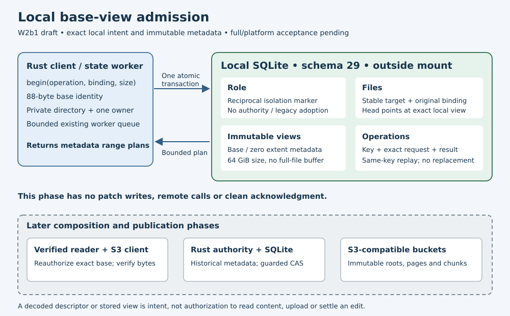

# Local immutable base views

Implementation/research date: **2026-10-19**. W2b1 draft in
`codex/sparse-edit-views`, based on the locally gated core identity codec.
Focused storage/migration controls and the full local gate passed. This new
combined source still requires its own platform/native acceptance. This is the first SQLite slice of W2,
not complete editable storage or mounted chunk-write support.

`Storage::sparse_views()` uses the existing bounded worker queue and private
SQLite directory owner. `Journal::begin()` records the original base descriptor,
store/source/route binding, base size, requested initial size and caller operation
key in one immediate transaction. Repeating the same key and arguments returns
the same view. A changed request or second independent begin for that file fails
explicitly. A store, route or base change cannot create an independent head for
the same volume/file identity. No latest-root substitution occurs.

An initial view describes a base prefix and, when grown,
an explicit zero suffix. Initial truncation keeps only the selected prefix.
A 64 GiB sparse growth uses at most two extent records; it does not allocate
64 GiB. This validates metadata only. Neither the declared base size nor stored
identity proves remote authorization, bytes or availability. W2c must reopen the
exact historical manifest and compare actual size/store/route before composing
base bytes. The current range API returns bounded metadata plans, not file bytes.

Schema29 adds `sparse_view_role`, `sparse_view_files`, `sparse_views` and
`sparse_view_operations`. Counts and BLOB type/length limits are checked in the
same SQLite snapshot before copying rows into Rust. Per-row and cross-table
hash/identity checks validate complete initial admissions. A post-write snapshot
must equal the old immutable records plus the exact new result before commit;
ignored writes, damaged rows and unrelated trigger effects roll back. The local
hashes detect inconsistencies; they do not cryptographically authenticate an
arbitrarily rewritten database or confer provider permissions.

Admission defaults to64 files, with a fixed256-file ceiling. Binding/request
BLOBs are capped at4096 bytes and view records at1 MiB. The initial representation
uses at most two extents per view. Range requests are capped at8 MiB and logical
size at64 GiB. Narrowed quotas still allow known-result replay and old-view reads;
new admissions fail without removing anything. Future editable-view and patch
quotas require their own tested design. No reclamation or clean receipt exists.

The new role rejects authority, legacy logical/namespace and existing complete-
snapshot publication state. Reciprocal constructor and authority preflight guards
reject sparse records, including orphans. Generic cache/staging stays available
for later mixed-object uploads. No complete-snapshot verifier or settlement rule
is weakened. Existing fake-old-schema tests use a shared test-only table-removal
helper; production migration collisions still fail and roll back. Both Windows
schema assertions move to29 with the Rust migration.

Ten focused controls passed, including24 corruption/oversize cases, ignored and
foreign trigger effects, actual SQLite-full rollback and retry, exact reopening,
worker ownership and isolation. Another27 migration controls passed. The
[dated evidence](evidence/sparse-base-views-20261019.json) records results and
remaining gates. These are local owned SQLite tests with no S3 requests.

W2b2 must add immutable patch bytes, write/truncate/grow transitions, older pinned
views, newer-head replay, crash recovery and bounded dirty retention. W2c then
composes verified remote/local bytes. Mixed-tree preparation/publication, exact-
view settlement, legacy/metadata-empty recovery, real FUSE/WinFsp chunk writes
and provider/workstation startup acceptance remain required for the full goal.

The first full gate stopped at the existing offline snapshot CLI round trip:
`Snapshot(Validation)`. The snapshot validator's explicit local-table allowlist
had not yet included the four new schema29 tables. The repair recognizes those
known tables only when empty and adds four nonempty-table refusal controls.
Unknown tables, views and the fixed64-table bound remain rejected. The failed
source map and log are retained; a fresh full gate is required after this change.

The second full gate actually terminated with143 during state tests, without a
reported assertion failure. Its cause was not established; no surviving Cargo/
test children and available memory were verified. The third complete run used
a PTY and four top-level test threads, with the same source, assertions and
production deadlines. It passed with all275 frozen inputs unchanged:378state
(one ignored),37core,11reader (one native ignored),62S3 and all format/Clippy/
build/documentation checks. The [indexed local archive](evidence/sparse-base-views-local-20261019.tar.gz)
retains37 verified members, including both incomplete runs, the failed snapshot
source, repaired source and reviewed architecture diagram. No older hosted cohort
certifies the changed schema29 source; its own platform gate remains required.

Published source `1681ee6` includes current main ancestry and exactly matches all
275 locally gated runtime inputs. Its
[own platform/book run](https://github.com/marshallr12/s3drive/actions/runs/39203016390)
is in progress. This is publication evidence; combined hosted acceptance remains pending.
