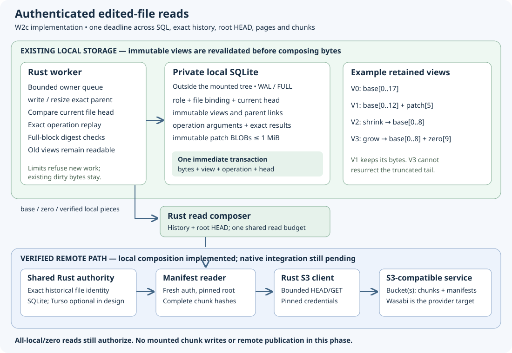

# Authenticated edited-file reads

Implementation date: **2026-10-19**. W2c in `codex/sparse-composition` joins
immutable local patch views with an authenticated historical manifest base.
All16 portable reader tests, the full local gate and this source's own combined platform/native/source checks passed. No mounted chunk writes, publication or clean acknowledgment
are enabled by this source.

`BaseFile::sparse_binding()` derives the descriptor, actual logical base size,
store, source configuration, credential-generation identity and root from an
already authenticated manifest handle. It does not declare a fresh authorization.
`Reader::reopen_edited(client, view_id)` loads the immutable SQLite view, requests
its exact historical payload, verifies its root with current provider access and
compares every binding field with the actual handle. No caller-supplied size or
route can become trusted just because it was stored locally. Legacy and metadata-
empty origins remain unsupported here and required in later phases before W6.

`EditedFile::read_range` returns one complete bounded output or an error. It first
revalidates the local view and full retained patch hashes through the private
worker. That transaction ends before network waits. Every nonempty read then
requests the exact historical payload again, compares it with the pinned payload,
and performs a fresh root HEAD using the pinned credential generation. Root size,
revision, configuration and principal must remain exact. This authorization also
applies when every requested byte is a local patch or zero. The root page already
verified at reopen can be reused after this check; the operation does not claim
fresh root-body media health. Bounds, EOF and zero-length requests preserve the
ordinary reader's network-free behavior because no bytes are returned.

The composer shares the existing reader family's four active-operation slots,
256 retained snapshots and overall deadline (default/maximum30seconds). Its
permit covers SQLite work, authorization and all base fragments; it does not
reacquire a nested slot for each piece. Clones share one retained snapshot permit.
A lost or cancelled read releases its permits without mutating the view. Another
writer can advance the head while a remote read is blocked; the old read keeps
its original immutable view. No SQL owner is held across network I/O.

Calling the ordinary range reader separately for every base fragment would reset
budgets and repeatedly download a complete chunk. Instead, one request-local
session caches verified pages/data and shares a single traversal/data budget.
At most27 unique page visits, nine full data chunks/nineMiB and eightMiB output
are allowed. Pages are verified against each parent even on cache hits. Cached
references and lengths are compared explicitly: object keys contain identity and
ordinal but omit the expected digest, so matching only a key would be insufficient.
No data cache survives into a later read. A late missing, denied, oversized or
invalid object returns an error without exposing an earlier local/base prefix.

The local source identity includes the credential generation, not merely a bucket
or route. Existing handles keep their original keys. A fresh reader with a new
principal may have provider access but cannot silently adopt old private dirty
state; it returns a binding error and preserves the view. Explicit credential-
transition policy remains separate work. No credential values enter bindings,
logs or this repository.

The owned integration controls use real Rust authority history, the SDK against
a loopback S3 fixture and the actual private SQLite worker. They cover:

- Mixed binary/Unicode patches across manifest pages, zeros, truncation/growth,
  older views after replacement/rename/removal, authority restart and reopening
  in an independent process.
- Forty interleaved base fragments fetched as one verified data chunk plus one
  child page, exact page-byte accounting, and request-local cache isolation.
- An unaligned eightMiB output requiring exactly nine complete chunks, with local
  masking, and a64GiB grown view whose tail reads zeros without data GETs.
- Wrong size/store/principal/configuration/root bindings, changed history replies,
  root denials/missing/changed revision, failed fresh-root verification and late
  data denial after an earlier verified chunk.
- Dirty-block corruption after handle open: no cached local bytes, network
  fallback, automatic repair or head change follows.
- Shared four-operation admission with ordinary reads/opens, cancellation,
  overall timeout, 256 shared snapshots, bounded callback future size and
  independent SQLite progress while a provider response is gated.

The [dated evidence](evidence/sparse-composition-20261019.json) records results.
The first compile required making the existing authenticated reopen helper
visible only to its parent module; no public unverified constructor was added.
Two initial test assumptions were corrected: the fragmented range includes one
child-page body, and the fixture's BadEtag injection alters GET rather than HEAD.
The final controls account for the exact child-page size and alter the actual
HEAD revision, retaining strict authorization and download assertions.

W3 mixed-tree preparation must distinguish changed bytes from authenticated
inherited references. W4 exact-CAS publication, W5 settlement preserving newer
heads, legacy/metadata-empty admission/restart and W6 real native chunk writes,
provider and physical workstation/session acceptance remain required.

Full local gate `56076` passed with all286 frozen runtime/contract inputs unchanged:
393state (one ignored),37core,16reader (one native ignored),62S3 and all format/
Clippy/build/74MD links/70book chapter checks. The
[indexed local archive](evidence/sparse-composition-local-20261019.tar.gz) retains19
verified members, including failed/passed compile/focused controls, final sources,
source map, full gate and reviewed diagram. The parent patch source `d37096c` is
accepted in main `6c9f0b5`, with its own complete Windows/Linux cohort and284-input
proof. That acceptance does not certify this changed composition implementation.

Published source `84da0ee633871f862f4a84a276af5ac3322cff42` includes accepted main
ancestry and preserves all286 frozen inputs. Its own
[Linux/Windows/book run39213440204](https://github.com/marshallr12/s3drive/actions/runs/39213440204)
completed successfully; all3 raw/source/own-artifact acceptance passed. Later documentation-only commits
do not replace that runtime source or reuse the parent's platform results.

Own combined acceptance completed2026-10-19 for source `84da0ee`: all three jobs
in [run39213440204](https://github.com/marshallr12/s3drive/actions/runs/39213440204)
succeeded. Full raw logs, both own API artifact ZIP digests, independent typed
21+14 records, project oracles and all35 raw record fields/types passed. All286
frozen working/committed inputs remain exact. The
[indexed hosted archive](evidence/sparse-composition-hosted-20261019.tar.gz)
contains62 verified members (270208bytes, SHA-256
`00aa618e7b4929140cc6337b5c697aafe504798c89b470a8c883625a4a84d737`).

Linux Ubuntu24.04 image20261012.334.1 passed393state (one ignored),37core,
16reader (one native ignored),62S3, real legacy FUSE acceptance (9tests), manifest
FUSE remount and paired/no-systemd recovery. Windows Server2025 image
windows-2025-vs2026/20261007.264.1 passed388state (one ignored),37core,16reader
(one native ignored),62S3, real legacy native acceptance (7tests), manifest WinFsp
remount and paired startup/recovery. Native manifest times were1.42s/2.43s;
these are execution observations, not performance promises. All four new edited
read cases passed on both platforms, including the independent-process helper.

Retained notes: three Windows disposable fixture profiles remained locked;
dummy credentials were removed and profile deletion deferred to VM destruction.
Two unused WinFsp delay-import linker warnings, completed long-running tests,
expected403/rival conflicts, Node deprecation notices and an Ubuntu26 label-
migration annotation remain in the evidence. The actual tested Linux image was
Ubuntu24.04. No current Wasabi, physical workstation/reboot, native edited reads/
writes, publication or clean settlement acceptance follows from these checks.
