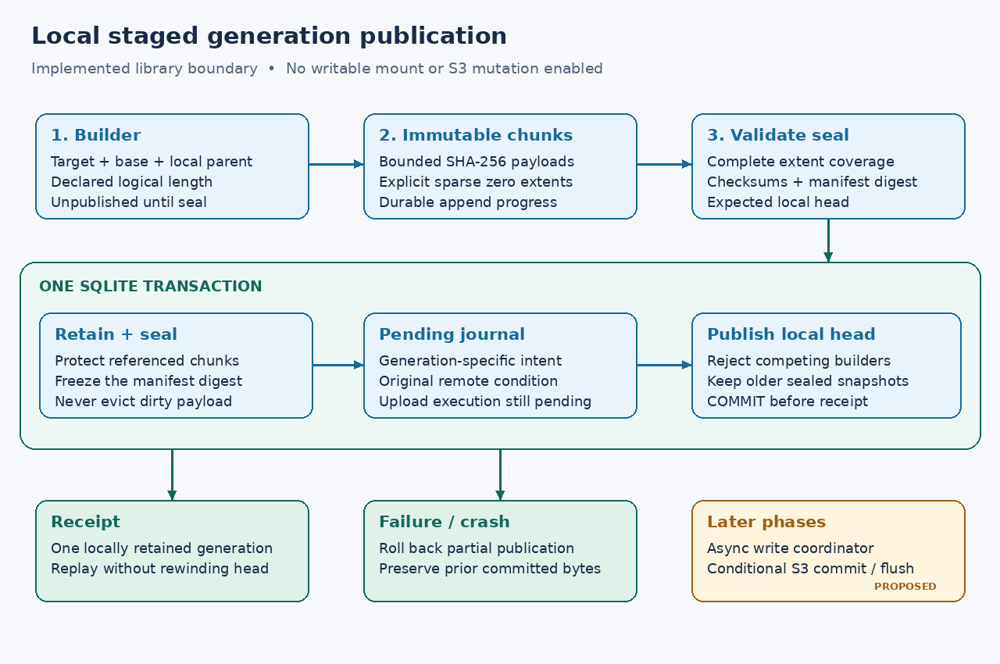

# Local staged generations

**P5a1, implemented 2026-10-16:** `s3drive-state::journal` provides a blocking
owner-thread library for immutable generations and pending local intent.
Filesystem mounts remain read-only. No S3 mutation, upload executor, writable
callback or staging CLI is enabled by this phase.

## Storage decision

Schema 4 stores staged payloads as bounded SQLite chunks. A generation can span
many chunks and explicit sparse zero extents; it is not limited to one BLOB.
This refines the earlier external-generation-file proposal so payload references
and local publication share the database's transaction boundary. External bulk
files remain an optional future backend requiring their own durability proof.

The database uses local WAL and `synchronous=FULL`. SQLite documents an extra WAL
sync for each FULL commit; recovery relies on the OS and storage honoring flush
requests. The resolved bundled Windows VFS calls `FlushFileBuffers` in `winSync`.
Process-kill tests below do not prove hardware power-loss behavior.
[SQLite synchronous](https://sqlite.org/pragma.html#pragma_synchronous),
[SQLite WAL](https://sqlite.org/wal.html),
[SQLite commit assumptions](https://sqlite.org/atomiccommit.html)

Windows documents file-buffer flushing and file moves through separate APIs.
Keeping this phase inside SQLite avoids inventing a cross-file commit protocol
between renamed payloads and SQL records. External-file storage remains viable
once its create/rename/directory durability protocol is established.
[FlushFileBuffers](https://learn.microsoft.com/en-us/windows/win32/api/fileapi/nf-fileapi-flushfilebuffers),
[MoveFileExW](https://learn.microsoft.com/en-us/windows/win32/api/winbase/nf-winbase-movefileexw)

## Generations, intent and identity

A target records the opaque source/credential binding, configuration fingerprint
and exact object key. A base condition is either `Missing` or an existing opaque
ETag/version tuple. Parent generations retain that original remote base;
changing the base silently is rejected. Raw object keys and revision metadata
are private local journal data. Credentials are never stored. Target Debug output
is redacted. These fields do not authenticate an upload or establish a provider-
global account ID. Credential rebinding still needs an explicit recovery policy.

`begin` creates an unpublished builder with a declared logical length and an
expected local parent. Appends advance a contiguous cursor. A missing extent is
an error; only an explicit zero extent produces zeros. SHA-256 addresses payload
chunks and detects their corruption. Identical chunks can be shared by several
generations. A manifest digest covers the target, base, lineage, length, and
ordered extent offsets/lengths/chunk references.

`seal` validates complete coverage, all payload checksums and the expected local
head. One transaction then retains referenced chunks, seals the immutable
manifest, inserts `pending` journal intent and advances the head. A competing
builder receives a local-conflict error and keeps its unpublished bytes.
Retention markers live in a separate table: publication does not update payload
rows, and their foreign key also protects published chunks from deletion.
Sealed data cannot be appended to or discarded through the API. Older sealed
generations remain readable after newer publication.

The returned receipt identifies one **locally committed generation**. It does
not mean S3 accepted a write. Repeating `seal` after losing a response returns
the same receipt without rewinding a newer local head. `append_at` and
`append_zero_at` similarly verify an exact previously committed extent on retry;
they reject a different payload or unexpected cursor. The simpler sequential
append methods require the caller to reconcile progress before retrying.

Pending intent does not yet represent a ready-to-execute upload job. Future
publication must account for parent dependencies or supersession, remote
conditions, credential changes and uncertain outcomes. It must never turn
these records into unconditional overwrites.

## API and recovery boundary

`Journal` borrows the already-owned `State`, so a future worker can combine cache
and journal commands on one connection. Methods are synchronous and belong on an
owner thread. Mutating operations require managed local state; Linux tmpfs is
refused for new staging acknowledgments. Inspection/recovery reads remain
available there. Windows acquisition already requires fixed NTFS; hardware
and virtual-disk persistence still depend on the host storage contract. Callers
must not run these methods on Tokio's executor or hold SQL transactions over
network I/O. The bounded async write coordinator is P5a2 work.

| Method | Result |
| --- | --- |
| `begin` | Unpublished generation ID; validates target, base and expected local parent |
| `append` / `append_zero` | Durable builder progress; no publication receipt |
| `append_at` / `append_zero_at` | Cursor-guarded, idempotent retry of an extent |
| `seal` | Atomic local publication receipt and pending intent |
| `head` / `info` | Inspect current or historical generation metadata |
| `read` | Bounded reads from a sealed, verified manifest |
| `read_draft` | Explicit recovery reads clipped to unpublished progress |
| `pending` / `drafts` | Cursor-based pages of up to 1,000 records |
| `abort` | Explicit disposal of an unpublished builder only |

Abort reclaims only that builder's unretained chunks with no references from
other generations. The chunk foreign key is deferred until that transaction
removes the aborted builder's extents. All remaining references must be valid
at commit. A chunk that was ever published is retained even if its manifest is
later damaged. There is no automatic sealed-generation garbage collection or
remote-acknowledgment cleanup yet.
[SQLite deferred foreign keys](https://sqlite.org/foreignkeys.html#fk_deferred)

Reads verify manifest metadata and requested chunk checksums. Corruption is an
error and preserves rows; dirty bytes are not discarded or refetched from S3.
A missing or rewound head is reported rather than silently adopting an older
generation. Recovery inspection remains available when configured limits are
smaller than existing staged data.

## Bounds and failure behavior

Chunks are at most 1 MiB. Reads return at most 8 MiB. Default limits are 1 GiB
of unique staged payload, 4,096 retained/building generations and 1,000,000
extents per generation. These are library options; no user TOML staging table
is exposed yet. Logical lengths use signed 64-bit offsets, with actual capacity
limited by quotas, SQLite and the local disk. Sparse holes do not allocate their
logical length. Tests include a 3 TiB sparse generation with a few payload bytes.

Quotas exclude DB/index/WAL overhead. Failed allocation returns typed quota
failure or SQLite's disk-full error. Existing dirty generations are never
evicted to make room. Clean-cache LRU operates on separate tables and cannot
reclaim staging payload. This phase retains every sealed generation; future
safe remote acknowledgment and reference-aware cleanup must release space.

The first implementation scans manifest metadata during reads and validates all
payloads at seal. Memory is bounded by range/chunk sizes, but large-generation
throughput and physical disk headroom are not established. No production
large-file performance claim is made.

## Verification and remaining work

Native state tests run on Linux and Windows. They cover sparse/range/EOF reads,
empty files, source/Unicode/NFC/NFD key isolation, immutable historical
generations, cursor retries, competing
builders, base/target changes, payload sharing, quota failures, abort safety,
corrupt metadata/data, missing heads, restart and cache/staging isolation.
Migration tests preserve schema-3 cache rows and roll back conflicting tables.
SQLite's page limit induces real `SQLITE_FULL` during append and proves rollback.

Child processes are killed after chunk insertion, extent insertion, cursor
update and append commit; publication is interrupted after validation, retention,
journal insertion, head update and commit. Reopening keeps the previous receipt,
recovers unpublished progress, or finds the complete new receipt. Separate
injected errors test lost append/seal acknowledgments. These are application-
owned transaction boundaries, not fault injection inside SQLite's `xSync` or a
physical power-cut test.

An in-memory base test changes its revision during hydration and proves no
mixed generation is published. A complete write coordinator still needs patch/
truncate/read-your-writes operations, bounded async commands and broader fake-
storage failure schedules (P5a2). Conditional remote commit/reconciliation (P5b),
writable OS callbacks and desktop save workflows (P5c) remain disabled.
