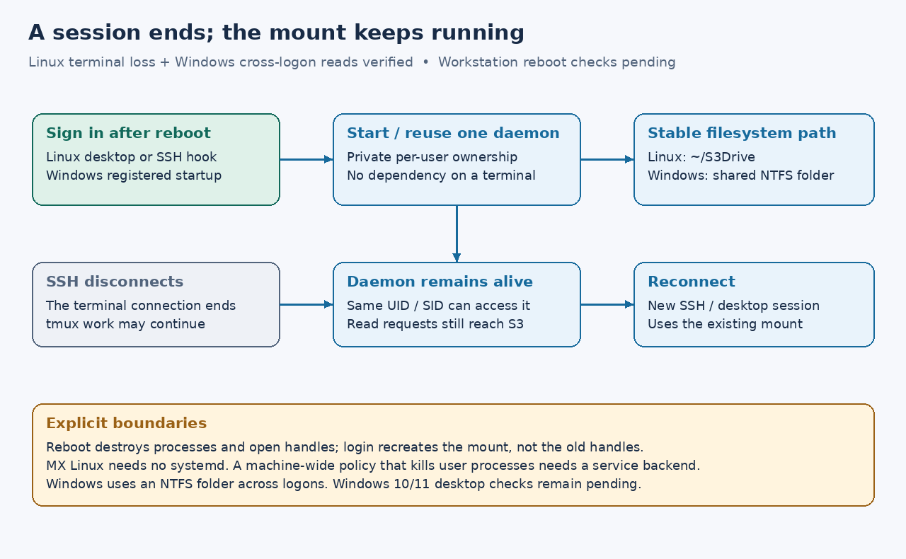

# Persistent mounts and remote sessions

The required behavior is: after reboot, signing in starts the configured mount;
later desktop and SSH sessions under the same account use it. Closing the SSH
connection that launched a tmux/Codex/Claude session must not stop the mount.
The user explicitly requires **MX Linux without systemd**. “Remote SSL session”
is interpreted here as an SSH terminal session.



Reboot recreates the filesystem at its configured path. It cannot preserve
running programs, tmux processes or open file descriptors across power loss.
Persistent mount registration also does not provide offline file contents;
the disk cache is a separate phase.

## Linux, including MX without systemd

`scripts/linux-session.py` provides a per-user launcher using Python's standard
library around the Rust mount executable. It installs an XDG desktop autostart
entry and an optional shell login hook. The detached supervisor has a new OS
session, no controlling terminal, redirected logs and an advisory process lock.
Simultaneous desktop/SSH hooks reuse that supervisor. No root daemon, systemd,
credential copying or shell-based command evaluation is required.
The helper needs Python 3.9+ in a stable location; the mount itself remains Rust.
The existing FUSE runtime and user access to `/dev/fuse` are still required.

Keep a stable executable/configuration outside the mount. For example:

```bash
cargo build --locked
mkdir -p "$HOME/S3Drive"
python3 scripts/linux-session.py install default \
  --executable "$PWD/target/debug/s3drive" \
  --config "$PWD/s3drive.local.toml" \
  --mountpoint "$HOME/S3Drive" \
  --shell-profile "$HOME/.profile"
python3 scripts/linux-session.py start default
python3 scripts/linux-session.py status default
```

Select the profile your login shell actually reads. Bash may use
`~/.bash_profile` instead of `~/.profile`; zsh uses `~/.zprofile`. Without
`--shell-profile`, installation creates a `login.sh` hook for manual sourcing.
A noninteractive `ssh host command` is not guaranteed to read a login profile:
use a login shell or explicitly run the installed manager's `start default`
before a headless command when no earlier session has started the mount.
[Bash startup rules](https://www.gnu.org/software/bash/manual/html_node/Bash-Startup-Files),
[XDG autostart specification](https://specifications.freedesktop.org/autostart/latest/)

```bash
python3 scripts/linux-session.py stop default
python3 scripts/linux-session.py remove default
```

Removal stops the supervisor and removes its own startup entries. It preserves
the configuration, credentials, mount directory and logs. Edited registration
entries require manual resolution rather than overwriting unrelated content.
Logs and registration are private under
`${XDG_STATE_HOME:-$HOME/.local/state}/s3drive/default/`.

Startup checks configuration locally. It does not certify network access or
download a bucket. Use an explicit credential profile in the TOML and a local
credential store accessible to the account; an interactive shell's temporary
environment is not persistent configuration. The supervisor retries failures
with a delay, then leaves diagnostics. It will not forcibly detach an unknown
or stale FUSE mount. Close open descriptors when normal unmount is pending.

On a host whose login manager forcibly kills *all* user processes at logout,
detaching from the terminal is insufficient. An init/service integration must
exempt the daemon from that policy. On systemd hosts, a user service with
lingering is an optional alternative: lingering also starts the user manager
at boot, not just sign-in. It is **not a dependency for MX Linux** and is not
enabled automatically.
[loginctl lingering](https://www.freedesktop.org/software/systemd/man/252/loginctl.html)

## Windows session boundary

A task running only in an interactive desktop session does not establish the
requested headless-session contract. Windows drive-letter namespaces and
account tokens must be considered separately. The proposed persistent backend
runs independently of the launching terminal, as the user's account, and
exposes an NTFS directory mount as the common desktop/SSH path. A drive letter
can remain a convenience inside an individual session.

WinFsp supports directory mountpoints and provides a service architecture for
processes independent of user sessions. A password-backed scheduled task or a
proper service/WinFsp Launcher integration needs explicit account provisioning;
an interactive-only task is not an equivalent substitute. Do not put Windows
passwords or S3 keys into task arguments or repository configuration. This
backend and cross-logon acceptance remain a separate implementation step.
[WinFsp service architecture](https://github.com/winfsp/winfsp/wiki/WinFsp-Service-Architecture),
[WinFsp directory mounts](https://github.com/winfsp/winfsp/wiki/Frequently-Asked-Questions),
[Task Scheduler logon types](https://learn.microsoft.com/en-us/windows/win32/taskschd/principal-logontype)

## Acceptance evidence and remaining checks

The no-systemd Linux gate passed locally on 2026-10-16:

```bash
python3 scripts/test-linux-session.py
```

The startup source checkpoint `664f51cdbf0e44cf2410da4cd3bef606e03fe5fc`
also passed Linux startup, both native filesystem gates and book checks in
[CI run 38933462454](https://github.com/marshallr12/s3drive/actions/runs/38933462454).
The Windows result covers the existing foreground drive, not persistent startup.

It uses a real FUSE mount, the real desktop-entry parser (`gio`), a login hook
inside a temporary tmux server, duplicate startup attempts, destruction of that
terminal, a fresh process accessing the retained mount, and explicit
stop/removal. The login hook also works without inherited desktop XDG variables.
Removal preserves profile text/mode and rejects an edited desktop entry before
changing the profile. Paths include spaces, Unicode, dollar and percent characters.
It checks the synthetic source root without contacting any cloud account.
The existing native mount gates separately verify remote object reads.

Actual workstation reboot, desktop sign-out under its logout policy, incoming
SSH authentication/PAM behavior and Windows cross-logon visibility still need
their own acceptance evidence. No startup was installed into the user's real
desktop or login profile during the isolated tests.
