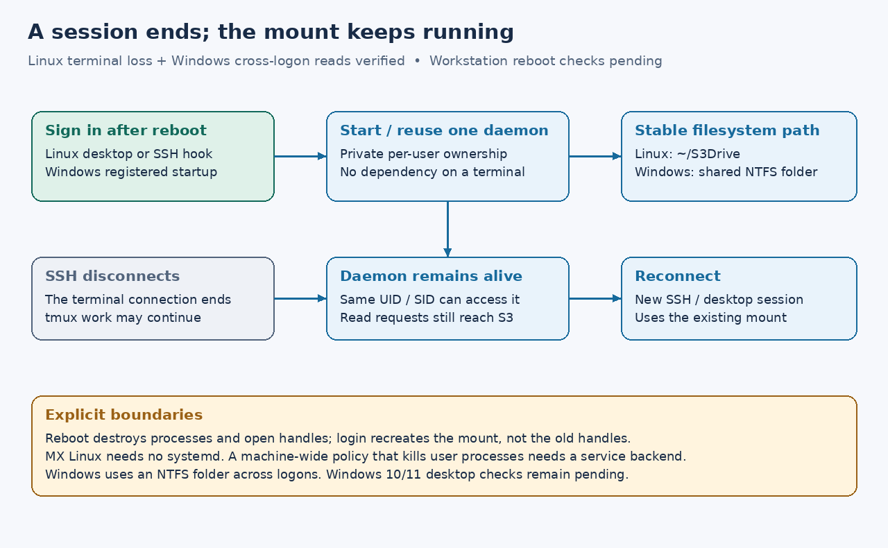

# Persistent mounts and remote sessions

The required behavior is: after reboot, signing in starts the configured mount;
later desktop and SSH sessions under the same account use it. Closing the SSH
connection that launched a tmux/Codex/Claude session must not stop the mount.
The user explicitly requires **MX Linux without systemd**. “Remote SSL session”
is interpreted here as an SSH terminal session.



Reboot recreates the filesystem at its configured path. It cannot preserve
running programs, tmux processes or open file descriptors across power loss.
Persistent mount registration also does not provide offline file contents;
the disk cache is a separate phase.

Managed read-only configurations can use the same mount launcher. The current
launchers do not supervise or provision the metadata authority; managed
authority startup/recovery and full sign-in acceptance remain subsequent work.
See [managed native reads](managed-native.md).

## Linux, including MX without systemd

`scripts/linux-session.py` provides a per-user launcher using Python's standard
library around the Rust mount executable. It installs an XDG desktop autostart
entry and an optional shell login hook. The detached supervisor has a new OS
session, no controlling terminal, redirected logs and an advisory process lock.
Simultaneous desktop/SSH hooks reuse that supervisor. No root daemon, systemd,
credential copying or shell-based command evaluation is required.
The helper needs Python 3.9+ in a stable location; the mount itself remains Rust.
The existing FUSE runtime and user access to `/dev/fuse` are still required.

Keep a stable executable/configuration outside the mount. For example:

```bash
cargo build --locked
mkdir -p "$HOME/S3Drive"
python3 scripts/linux-session.py install default \
  --executable "$PWD/target/debug/s3drive" \
  --config "$PWD/s3drive.local.toml" \
  --mountpoint "$HOME/S3Drive" \
  --shell-profile "$HOME/.profile"
python3 scripts/linux-session.py start default
python3 scripts/linux-session.py status default
```

Select the profile your login shell actually reads. Bash may use
`~/.bash_profile` instead of `~/.profile`; zsh uses `~/.zprofile`. Without
`--shell-profile`, installation creates a `login.sh` hook for manual sourcing.
A noninteractive `ssh host command` is not guaranteed to read a login profile:
use a login shell or explicitly run the installed manager's `start default`
before a headless command when no earlier session has started the mount.
[Bash startup rules](https://www.gnu.org/software/bash/manual/html_node/Bash-Startup-Files),
[XDG autostart specification](https://specifications.freedesktop.org/autostart/latest/)

```bash
python3 scripts/linux-session.py stop default
python3 scripts/linux-session.py remove default
```

Removal stops the supervisor and removes its own startup entries. It preserves
the configuration, credentials, mount directory and logs. Edited registration
entries require manual resolution rather than overwriting unrelated content.
Logs and registration are private under
`${XDG_STATE_HOME:-$HOME/.local/state}/s3drive/default/`.

Startup checks configuration locally. It does not certify network access or
download a bucket. Use an explicit credential profile in the TOML and a local
credential store accessible to the account; an interactive shell's temporary
environment is not persistent configuration. The supervisor retries failures
with a delay, then leaves diagnostics. It will not forcibly detach an unknown
or stale FUSE mount. Close open descriptors when normal unmount is pending.

On a host whose login manager forcibly kills *all* user processes at logout,
detaching from the terminal is insufficient. An init/service integration must
exempt the daemon from that policy. On systemd hosts, a user service with
lingering is an optional alternative: lingering also starts the user manager
at boot, not just sign-in. It is **not a dependency for MX Linux** and is not
enabled automatically.
[loginctl lingering](https://www.freedesktop.org/software/systemd/man/252/loginctl.html)

## Windows default: a drive letter for the signed-in user (2026-11-08)

The owner decided on 2026-11-08 that the installed default should behave like
Google Drive: a new drive letter with an S3Drive icon, mounted for the
signed-in user. `scripts/windows-session.ps1` now does this whenever
`-MountPoint` is omitted or is a bare letter such as `G:`:

```powershell
$app = "$env:ProgramFiles\S3Drive"
& "$app\scripts\windows-session.ps1" -Action Install -Name default `
  -Executable "$app\s3drive.exe" -Config "$env:APPDATA\S3Drive\s3drive.toml"
& "$app\scripts\windows-session.ps1" -Action Start -Name default
```

- **Letter.** Without `-MountPoint` the helper picks `S:` if it is free,
  otherwise the first free letter from `Z:` downward. It skips letters in use
  in this session, remembered network drives (`HKCU\Network`) and letters
  held by this account's other registrations under the default state location.
  An explicit letter that is in use, or `A:`–`C:`, is refused.
- **Session.** The task uses Task Scheduler's interactive-token logon type
  (`TASK_LOGON_INTERACTIVE_TOKEN`) at least privilege, triggered at this
  account's sign-in. It runs in the same logon session as Explorer, so the
  letter is visible there. No Windows password is requested or stored, and the
  *Log on as a batch job* right is not needed. The drive is unmounted when the
  user signs out and comes back at the next sign-in.
- **Icon.** The helper writes the per-user Explorer override
  `HKCU\Software\Classes\Applications\Explorer.exe\Drives\<letter>\DefaultIcon`
  pointing at the installed `s3drive.ico`. It refuses a letter whose icon was
  already customized by something else, and `Remove` deletes only the exact
  value it wrote. The volume label is already `S3Drive`.
- **No console window.** The task starts the installed `s3drive-launch.exe`, a
  Windows-subsystem program that runs the fixed system Windows PowerShell with
  `CREATE_NO_WINDOW`. If the launcher is missing (a development build), the
  helper falls back to `powershell.exe -WindowStyle Hidden`, which can flash.
- **Registration format.** Drive registrations use manifest version 3
  (`mode = "drive"`); the existing directory (version 1) and coordinator
  (version 2) registrations are unchanged and keep working.

Limits. Sign-out ends the mount process without the graceful stdin-close path
(Windows terminates interactive console processes at logoff), so the next
mount relies on the existing journal crash recovery; forced-kill cold remounts
passed on the physical machine on 2026-11-08, but sign-out itself has not been
tested yet. The letter exists only in that user's non-elevated session: an
elevated (Run as administrator) program does not see it unless the machine
enables linked connections. Elevated tools and SSH sessions should use the
directory mode below. Managed volumes still need their coordinator registered
separately with `-Component Authority`; see below.
[Task Scheduler logon types](https://learn.microsoft.com/en-us/windows/win32/taskschd/principal-logontype),
[WinFsp service architecture](https://github.com/winfsp/winfsp/wiki/WinFsp-Service-Architecture)

**Coordinator at sign-in.** A managed drive needs its local coordinator
running first. `-Component Authority` registrations now also default to the
interactive-token sign-in task (manifest version 4, started through the same
windowless launcher), so an account that signs in only with a Windows Hello
PIN, and does not know its password, can register both. Register the
coordinator before the drive; both start at sign-in, and the drive's
supervisor retries a failed start three times, ten seconds apart, if the
coordinator is not ready yet. That ordering has not been tested on a real sign-in.
Pass `-CrossLogon` (or `-Credential`) to keep the previous password-backed
batch logon, which keeps the coordinator running across sign-outs and SSH.

The hosted installer job registers this default from the MSI payload, checks
the task (interactive, least privilege, launcher action), the icon value and
`Status`, then removes it and checks both are gone. It does not start the task:
that needs a real desktop sign-in and remains physical-machine acceptance.

## Windows session boundary

A task running only in an interactive desktop session does not establish the
requested headless-session contract. Windows drive-letter namespaces and
account tokens must be considered separately. The persistent backend
runs independently of the launching terminal, as the user's account, and
exposes an NTFS directory mount as the common desktop/SSH path. A drive letter
can remain a convenience inside an individual session.

Passing an absolute directory `-MountPoint` selects the **directory mode**
described here, which remains the option for SSH and cross-logon access.
`scripts/windows-session.ps1` implements it as a password-backed Task Scheduler
registration. Native cross-logon acceptance passed on the hosted Windows VM.
The scheduled
process uses the mounting account at least privilege in a separate batch logon,
has no execution time limit and ignores duplicate starts. Its private supervisor
launches the Rust child, holds one exclusive owner through at most four attempts
with ten-second delays, and closes stdin for graceful removal. Stop interrupts
that delay; normal exit does not restart. It does not force-kill a delayed
unmount. This bounded retry extension is under native acceptance in the
[coordinator startup phase](authority-startup.md); original cross-logon mount
acceptance does not prove it. Scheduler restart settings remain configured but
are not the contract for a child's nonzero exit.

WinFsp supports directory mounts; their target must **not already exist**.
Use an absolute local NTFS path whose parent exists, without junction/symlink
ancestors. The existing contents of a directory cannot be covered by the mount.
WinFsp creates the new directory and removes it on teardown.
[WinFsp service architecture](https://github.com/winfsp/winfsp/wiki/WinFsp-Service-Architecture),
[WinFsp directory mounts](https://github.com/winfsp/winfsp/wiki/Frequently-Asked-Questions)

The account must have **Log on as a batch job** (`SeBatchLogonRight`) and must
not be denied that logon type. An administrator may need to provision this
right in Local Security Policy or the applicable domain policy. The launcher
does not change account rights or elevate the mount. A task can register yet
fail to start when this prerequisite is absent; Task Scheduler history reports
`0x80070569` (1385). The native test grants/removes this right only for its newly
created disposable account.
[Windows account logon rights](https://learn.microsoft.com/en-us/windows/win32/secauthz/account-rights-constants)

Then run Windows PowerShell as the account that owns the S3 credential profile:

```powershell
.\scripts\windows-session.ps1 -Action Install -Name default `
  -Executable "$PWD\target\debug\s3drive.exe" `
  -Config "$PWD\s3drive.local.toml" `
  -MountPoint "$env:USERPROFILE\S3Drive"
.\scripts\windows-session.ps1 -Action Start -Name default
.\scripts\windows-session.ps1 -Action Status -Name default
```

Installation asks locally for that **Windows account's password**, not an S3
key or Windows Hello PIN. Task Scheduler stores the logon credential; the
application's files and task arguments contain only paths and registration
metadata. Use a stable executable/configuration and an explicit S3 profile in
the account's credential store. Credentials held only in a terminal's temporary
environment will not be inherited by Task Scheduler.

Accounts without a usable password, or machines that deny batch logon through
policy, need a separately provisioned service/WinFsp Launcher alternative; that
alternative is not implemented. S4U is not selected because Microsoft documents
network/encrypted-file restrictions. Password changes require updating/recreating
the scheduled registration. The task has a per-account logon trigger; a headless
SSH command that does not fire that trigger must explicitly invoke `Start` before
accessing the path. Existing mounts remain available to later same-account logons.
[Task Scheduler logon types](https://learn.microsoft.com/en-us/windows/win32/taskschd/principal-logontype)

```powershell
.\scripts\windows-session.ps1 -Action Stop -Name default
.\scripts\windows-session.ps1 -Action Remove -Name default
```

`Stop` unmounts the current instance; the registration still applies to future
logons. `Remove` disables future triggers, stops the mount and deletes its task
and managed files, retaining configuration, credentials and logs. Private state
is under `%LOCALAPPDATA%\S3Drive\startup\default`; optional `-StateDirectory`
selects another private directory. A new installation requires an unused state
directory. Status reports scheduler state, supervisor ownership, path existence
and the log path. Path existence alone is not proof of successful remote reads.
The script refuses to control a task whose owner/action registration was edited.
[Task registration](https://learn.microsoft.com/en-us/windows/win32/taskschd/taskfolder-registertaskdefinition),
[execution time limit](https://learn.microsoft.com/en-us/windows/win32/taskschd/tasksettings-executiontimelimit)

## Acceptance evidence and remaining checks

The no-systemd Linux gate passed locally on 2026-10-16:

```bash
python3 scripts/test-linux-session.py
```

The startup source checkpoint `664f51cdbf0e44cf2410da4cd3bef606e03fe5fc`
also passed Linux startup, both native filesystem gates and book checks in
[CI run 38933462454](https://github.com/marshallr12/s3drive/actions/runs/38933462454).
That earlier Windows result covers the foreground drive. The newer persistent
startup evidence is recorded below.

It uses a real FUSE mount, the real desktop-entry parser (`gio`), a login hook
inside a temporary tmux server, duplicate startup attempts, destruction of that
terminal, a fresh process accessing the retained mount, and explicit
stop/removal. The login hook also works without inherited desktop XDG variables.
Removal preserves profile text/mode and rejects an edited desktop entry before
changing the profile. Paths include spaces, Unicode, dollar and percent characters.
It checks the synthetic source root without contacting any cloud account.
The existing native mount gates separately verify remote object reads.

Windows persistent startup passed the native test at
`029765ec79c99a029037356ba61278fc7de6ab7b` in
[run 38945436975](https://github.com/marshallr12/s3drive/actions/runs/38945436975).
This runs remotely on a GitHub-hosted Windows Server 2025 VM with real WinFsp,
using local HTTP fixtures and dummy S3 credentials. An ordinary account installs
the task; two fresh authentication sessions read the same surviving mount after
the installer exits. Exact S3/Unicode bytes, duplicate starts, another account's
denied access and graceful removal are checked. The fixture account is
provisioned by an elevated test harness; the mounted process runs at least privilege.
The CI VM may retain its locked Windows test profile until VM destruction, after
removing the dummy credentials and account. This explicit, narrow exception
does not bypass any mount or access assertion; see [test cleanup](development.md).

Actual workstation reboot, desktop sign-out under its logout policy, incoming
SSH authentication/PAM behavior and Windows 10/11 desktop behavior still need
their own acceptance evidence. No startup was installed into the user's real
desktop or login profile during the isolated tests.
