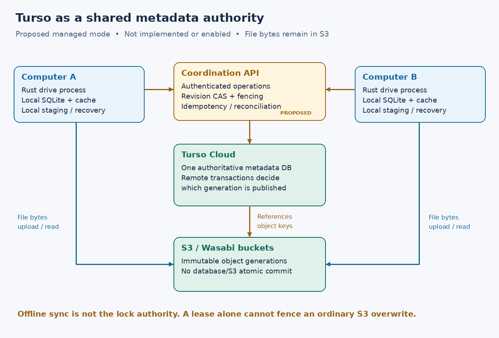

# Turso and coordination between computers

Researched **2026-10-16**. Recommendation: evaluate **Turso Cloud as an optional
authoritative metadata database**, behind a small coordination API. Keep local
SQLite for each computer's cache and recovery. Do not use asynchronous database
sync as the authority for exclusive ownership. This is a design proposal, not
an enabled dependency or a verified Turso integration.



## Current capabilities versus announcements

“Turso” can mean the Rust database engine, the hosted service, or the older
libSQL product. Choose and test an exact engine, SDK, account feature set and
region; a capability in one does not certify another.

| Capability | Evidence as of this research | Relevance to S3Drive |
| --- | --- | --- |
| Rust engine releases | Latest GitHub release is [v0.8.3, October 12](https://github.com/tursodatabase/turso/releases/tag/v0.8.3); [0.8 announcement, September 29](https://turso.tech/blog/turso-0.8.0) emphasizes concurrent writes and group commit | Available engine work, not a promise that our Cloud database runs that version |
| Cloud concurrent writes | [August 3 announcement](https://turso.tech/blog/concurrent-writes-on-turso-cloud) labels it **early preview**, enabled explicitly for `tursodb` databases | Promising for independent metadata records; account rollout/production support must be rechecked before adoption |
| `BEGIN CONCURRENT` | [Transaction reference](https://docs.turso.tech/sql-reference/statements/transactions) specifies snapshot isolation and write/write conflicts requiring rollback and retry | Useful primitive; not evidence of serializability or a turnkey distributed lock service |
| New local-first Sync | [Conflict resolution](https://docs.turso.tech/sync/conflict-resolution) specifies **last push wins** and atomic rollback/replay of local changes during pull | Useful for selected noncritical state; unacceptable as the ownership or publication authority |
| Older embedded replicas | [Documentation](https://docs.turso.tech/features/embedded-replicas/introduction) describes production-supported local reads and default write forwarding to the primary; other replicas refresh on sync | May cache advisory metadata, but a local read must not decide that a lease is free |
| Remote Rust transactions | [`turso_serverless` transaction API](https://docs.rs/turso_serverless/0.1.3/turso_serverless/transaction/struct.Transaction.html) exposes interactive remote transactions; unfinished transactions default to deferred rollback | Candidate coordinator SDK; test commit uncertainty, expiry and cancellation explicitly |
| New embedded Rust engine | [Rust guide](https://docs.turso.tech/connect/rust) uses the `turso` crate for local databases | Separate from the remote client and from our current `rusqlite` dependency |
| Multi-process WAL | [Current reference](https://docs.turso.tech/sql-reference/multiprocess-access) labels it experimental, 64-bit Unix only, and incompatible with MVCC; Windows accepts but ignores the flag | Same-machine process coordination, not cross-machine coordination; not a reason to replace our local SQLite |
| Cloud durability | [Durability reference](https://docs.turso.tech/cloud/durability) says commits are acknowledged after storage in S3/S3 Express, with tier-dependent batching latency | Relevant to acknowledged metadata durability; says nothing about atomicity with our Wasabi objects |
| Cloud schema compatibility | [Limitations](https://docs.turso.tech/cloud/limitations) describe read-only `user_version`/`application_id` and unsupported local WAL/busy-timeout pragmas | Use separate cloud migrations/version tables; do not reuse local bootstrap assumptions |

The newer engine's concurrency work is already released; it is not merely a
roadmap item. However, the available Cloud announcement still calls concurrent
writes an early preview. This investigation did not establish a later blanket
GA guarantee for every account or a linearizable, multi-region lease API.

The [March roadmap](https://turso.tech/blog/we-are-a-year-into-rewriting-sqlite)
discussed engine/Cloud integration and BYOC. Some of that has since appeared in
Cloud, while current documentation still marks several features experimental.
The [October 2 Supabase announcement](https://turso.tech/blog/turso-is-joining-supabase)
says existing databases/APIs continue and deeper integration is planned.
Neither announcement supplies a filesystem coordination protocol. Planned
features must not be prerequisites for protecting users' acknowledged writes.

## What the database could coordinate

This section is our design analysis, rather than a claim about built-in Turso
filesystem features. A shared metadata authority could store volume/device
identities, namespace entries, current immutable object generation, operation
IDs, monotonic fencing counters, advisory leases and a change sequence for
cache invalidation. It should not contain local cache paths, machine-specific
open handles, S3 credentials or bulk file data.

Two computers must make ownership and publication decisions against the
**same authoritative remote database**, using a committed conditional update.
For example, a proposed revision comparison has this shape:

```sql
UPDATE nodes
SET generation = :new_generation, revision = revision + 1
WHERE volume_id = :volume AND node_id = :node AND revision = :expected_revision;
```

Success requires exactly one affected row **and a confirmed transaction commit**.
Zero rows is a conflict. An HTTP timeout is an unknown result, so query an
idempotency record using the operation ID before retrying. Do not substitute a
local replica's affected-row count or a locally committed offline transaction.

For operations spanning records, snapshot isolation needs additional care.
Two transactions can inspect related records and update different rows without
a write/write collision. For rename, ancestry checks or allocation invariants,
make every contender update a common guard/version record in the same
transaction, or serialize through the coordinator. Tests must attempt write
skew and concurrent directory moves; the engine's throughput benchmarks do not
prove those invariants.

## Why a database lease alone is insufficient

A client can pause after obtaining a lease, lose it, then resume an S3 request.
An ordinary S3 PUT does not consult a fencing counter in Turso. Therefore a
lease in Turso cannot, by itself, stop an old client overwriting a newer object.
Use database-side time for lease decisions and monotonic counters for fencing,
but require the publication/storage path to enforce those counters too.

Two designs have different tradeoffs:

| Design | How conflicts are constrained | Limit |
| --- | --- | --- |
| Existing direct-object mode | Verified S3 conditional operations remain mandatory; Turso can coordinate cooperating clients | Other S3 tools bypass Turso, and SQL plus S3 still are not one transaction |
| Optional managed mode | Upload new bytes to an immutable generation key, then conditionally publish its reference in Turso | Changes the on-bucket layout and interoperability; old generations need safe garbage collection |

For managed mode: allocate an idempotent operation, upload immutable bytes,
verify them, then commit the namespace/reference update. Failed publication
leaves an unreferenced generation, not silently overwritten user data. Reconcile
uncertain commits before cleanup; never delete a generation that a committed
reference or open revision may still need. There is no cross-service atomic
transaction with Wasabi, even if Turso itself uses S3 internally.

During a partition, a machine may stage changes locally, but cannot announce
exclusive ownership or global publication. Preserve staged data and report
pending/conflict state. An independent S3 client remains outside this protocol.

## Proposed evaluation, before selecting a dependency

1. Create an isolated metadata database only when a Turso account/endpoint is
   selected. Pin the remote SDK and record the actual Cloud engine/features.
2. From two independent clients, race conditional updates, unique creates and
   guard-record transactions. Assert a single committed winner, including on
   retries and under deliberately stale replica reads.
3. Pause a lease holder, expire/take over the lease, resume the old process and
   prove it cannot publish. Include clock skew, database restart/failover,
   token revocation and delayed acknowledgments.
4. Interrupt each S3 upload / SQL commit / local journal transition. Resolve
   uncertain outcomes by operation ID; demonstrate safe orphan collection.
5. Measure latency and availability effects on filesystem calls. Keep lease
   renewal and metadata publication off the per-chunk read path.
6. Run the same client behavior on Linux (including MX without systemd) and
   Windows. Do not replace the local SQLite engine until its migration,
   recovery and platform tests justify the change.

No Turso account, database, token or subscription was created during this
research. Native Sync is not adopted for locks, and the current read-only
filesystem remains independent of Turso availability.
