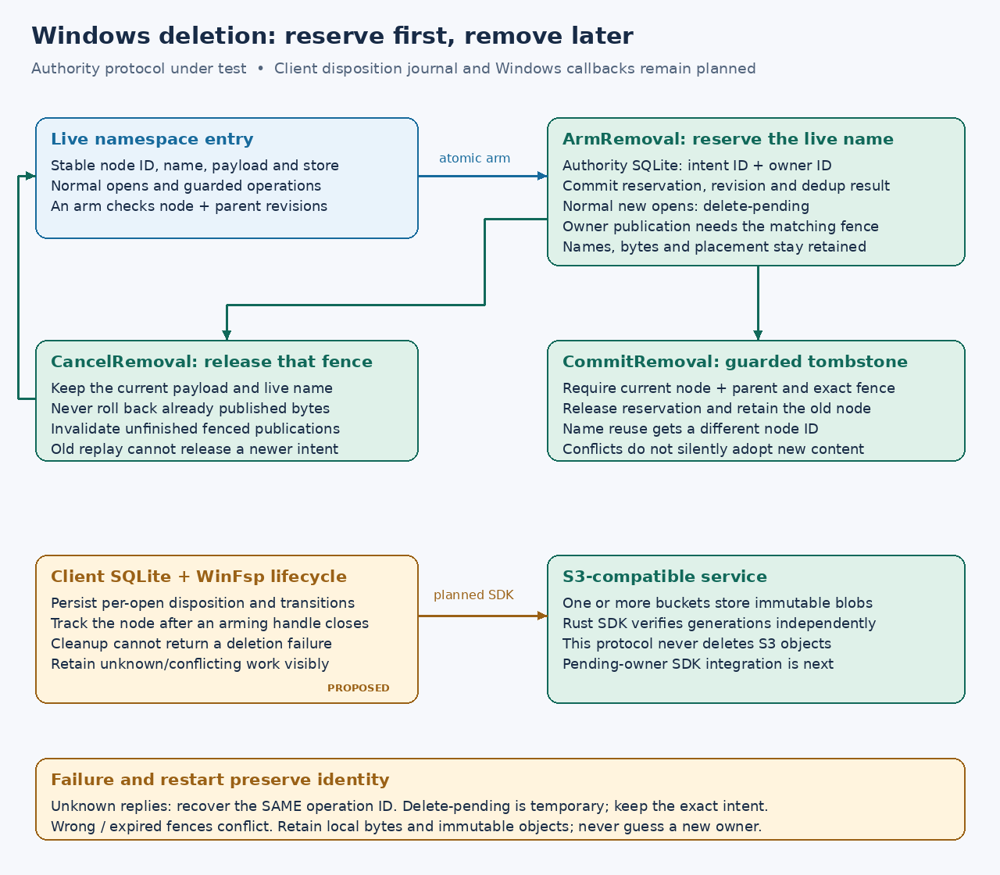

# Windows deletion and durable disposition

**Research and implementation phase, 2026-10-17.** Windows deletion remains
unsupported in the native adapter. This plan extends the managed layout's strong
coordination; it does not replace remote acknowledgment with a local-only queue.

## Verified platform lifecycle

WinFsp 2.1 calls SetDelete to test or change deletion disposition, including
repeated true/false calls. It must not remove the entry. Delete-on-close opens
bypass that callback. Cleanup receives a separate delete flag and cannot return
an error. With POSIX unlink disabled, deleting cleanup is the node's final
outstanding cleanup; it need not use the context that originally armed deletion.
I/O can continue after cleanup until close. See the
[versioned WinFsp header](https://raw.githubusercontent.com/winfsp/winfsp/v2.1/inc/winfsp/winfsp.h),
checked 2026-10-17. Windows also distinguishes ordinary deferred deletion from
[POSIX disposition flags](https://learn.microsoft.com/en-us/windows-hardware/drivers/ddi/ntddk/ns-ntddk-_file_disposition_information_ex).

The resolved Rust binding is WinFsp 0.13.1 + WinFsp 2.1. Its default volume
parameters use descriptor contexts, and each open boxes a new context. The
adapter does not advertise `supports_posix_unlink_rename`. These are inspected
dependency-source facts; the following protocol is our design.

## Chosen protocol

A node-wide authority reservation protects the live name while local per-open
state tracks disposition changes. Each reservation has a random intent ID and a
stable client owner ID. These are operational fences, not an authentication
boundary between trusted volume-owner clients. The existing private authority
token remains the development service's authorization boundary.

- **ArmRemoval:** compare the node and parent revisions, refuse root/nonempty
  directories, preserve names/payload/placement, reserve the entry and advance
  its revision. The arm operation ID is the reservation ID.
- **CancelRemoval:** match the exact reservation and owner, release it and
  advance the current node revision without deleting or reverting file bytes.
- **CommitRemoval:** match the reservation, owner, current node and parent
  revisions; atomically release the reservation and retain a tombstone. This is
  the later namespace effect, not the SetDelete action.

Normal node opens and conflicting namespace mutations fail with delete-pending.
Listings may still show the reserved name; creation cannot reuse it. An explicit
inspection RPC returns the reservation and current node for recovery, without
creating a filesystem read handle. Empty reserved directories refuse new
children. Ancestor movement does not change the reserved node's stable identity;
final cleanup must use node/parent IDs rather than its old path string.

Content publication needs its own fence. A reservation prepared before arming,
or a new ordinary content reservation, cannot publish through the pending state.
`ReservePendingContent` supplies the matching intent/owner plus the complete
prior payload reference. This permits the owner's retained handles to finish
their writes while foreign publication is blocked explicitly. Cancel or commit
invalidates unfinished publications carrying that fence. The client must first
reconcile prepared work; it must never silently replace a failed fence with a
new guard or discard dirty bytes. Fresh content still requires the existing
immutable S3 verification and metadata/logical settlement protocol.

Every authority effect, sequence and exact-operation result commits together.
An uncertain reply is recovered with the same operation ID and bytes.
Delete-pending is a temporary no-effect response, not a memoized terminal result;
clients retain their exact intent. After cancellation, unchanged content guards
can proceed. Wrong or expired fences remain terminal conflicts. Replaying
an old arm/cancel/commit receipt cannot alter a newer reservation or resurrect a
removed path. Operation admission reserves one logical result slot for each pending node;
ordinary work cannot consume the space needed by its matching cancel/commit.
This is not a physical disk-space reservation: a full disk still returns an
unknown result and retains the pending operation.
No clock timeout silently releases ownership, and no S3 object is
deleted or reclaimed.

## Independently green implementation phases

1. **P6m3b3b4a — pending-removal authority, current phase.** Add schema 13,
   reversible mutations, publication fencing, explicit inspection and wire
   capability. Preserve old serialized nodes, ordinary content guards and
   request hashes. Prove exact replay/restart, competing clients, cancellation,
   retained payload/store identity, stale guard refusal, blocked legacy bypass,
   migration, ignored SQL writes and full-disk rollback. Keep native deletion
   and the new SDK publication path unsupported.
2. **P6m3b3b4b — local lifecycle and SDK.** Persist client identity, handle
   dispositions and requested transitions before RPCs. Track node-wide state
   after an arming context cleans up. Distinguish accepted disposition, cleanup
   requested, verified removal and retained conflict in diagnostics. Reconcile
   prepared publications before arm/cancel/commit and atomically observe their
   receipts. Test killed clients, lost replies and local full disk at each
   boundary through the real SDK and authority HTTP transport.
3. **P6m3b3b4c — WinFsp callbacks.** Enable only an explicit new config version
   after normal and delete-on-close opens, cancellation, multiple contexts,
   delayed final cleanup, post-cleanup I/O, reboot/restart recovery, directory
   emptiness, Unicode and concurrent clients pass native acceptance. A void
   cleanup cannot make an unknown remote result a verified deletion. Expose
   retained pending/conflicting work; do not log-and-forget an error.
4. **P6m3b3c — application saves.** Test actual Windows replacement APIs and
   common editor save patterns, plus the corresponding Linux workflows. Basic
   MoveFileEx-style rename acceptance does not establish full application
   compatibility.

No real Wasabi mutation, workstation startup change, remote/Turso deployment or
credential change is authorized by these local protocol tests.

## Current verification boundary

The new state tests cover reversible disposition, guarded/legacy namespace
bypasses, owner content fences, stale guards, name reuse, exact replay,
valid-looking row corruption, ignored writes across every transition, successful
schema-12 migration and non-destructive migration refusal, actual SQLITE_FULL,
operation-capacity headroom for closing reservations, and four killed-owner boundaries. Existing node and ordinary content-guard
serialization stays unchanged. The private namespace journal refuses to settle
a temporary delete-pending response.

Two independent HTTP clients race arming one node. The fixture discards cancel
and commit acknowledgment bodies, restarts the SQLite authority and recovers
exact results. These publications are metadata-only fixtures, not S3 upload
proof. A separate actual-SDK test stages binary dirty bytes, verifies that a
pending disposition admits no PUT, cancels it, kills the client, then resumes the
same intent and settles it with exactly one PUT. This tests ordinary publication
interoperability; it does not claim the new pending-owner SDK path is complete.

Focused logs: `/tmp/s3drive-removal-state-final.log`,
`/tmp/s3drive-removal-tcp-final.log`, `/tmp/s3drive-removal-sdk2.log`.
The repository gate, terminal exact-tip Linux/Windows/book CI and all seven
existing native cases per OS remain publication requirements. The existing native mutation case now also verifies a real directory handle
opens before arm, is refused while pending (with child creation blocked), and
opens again after cancellation, without a PUT. Native Windows deletion itself
is still explicitly refused throughout this authority phase.

Client integration must additionally resolve uncertain cancellation versus a
later kernel cleanup flag. A failed or unknown cancellation is not permission
to silently re-arm with fresh guards after another client changes the file.
The native lifecycle phase must test these orderings and expose retained
conflicts before enabling callbacks.
