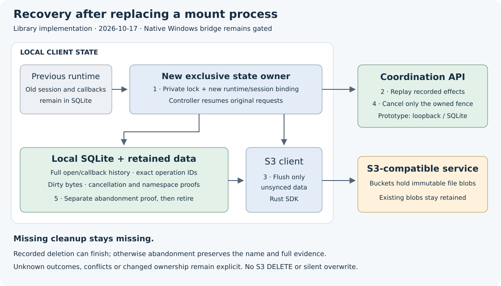

# Mount-session recovery

**Implementation contract, 2026-10-17.** Completed-open retirement is accepted
at `50e7709`, [CI39056932966](https://github.com/marshallr12/s3drive/actions/runs/39056932966).
This phase binds sessions to the existing exclusive local state owner and adds
separate, conservative abandonment recovery before native deletion integration.

The [vector source](images/session-recovery.svg) is retained with the rendered image.
The diagram separates client and service responsibilities. The current API is a
loopback SQLite prototype; hosted coordination/Turso deployment remains planned.

Generate a runtime identity only after acquiring the private directory lock.
Register one immutable session per volume in that owner incarnation. Another
session ID in the same owner cannot supersede a live session. A replacement
exclusive owner can recover older registered sessions; unregistered legacy
evidence remains explicit and cannot silently opt into the new policy.

Recovery replays original admissions and recorded callback/effect requests.
Recorded deleting cleanup can finish its existing deletion. Missing cleanup or
close is never fabricated. After retained content is settled or explicitly
retained as conflict, cancel only the exact locally acknowledged fence to retain
the name. Freeze cancellation and the exact old open hashes before RPC; a killed
replacement owner must resume that request with the original ID. Never cancel
a successor fence or silently rebase a conflicted request.

A separate abandonment proof retains old session bindings, full callback history
and the exact closing namespace result. It can release live admission without
claiming a native cleanup/close happened. Historical proof checks must remain
valid after later owner epochs. New callbacks require the current session;
retired/recovered IDs cannot be admitted again. Unknown or corrupt work stays
quarantined with dirty bytes intact. Disk-full and quota failures retain exact
work for retry. No elapsed-time or PID-only death inference is permitted.

Acceptance requires exclusive-owner/same-owner refusal, original request replay,
missing-cleanup preservation, failed/unconfirmed admission, successor refusal,
full disk/quota/ignored writes/corruption and migration. Use actual SDK/HTTP,
Unicode/empty/binary data and killed owners across cancellation and proof commit.
Run the local gate and exact-tip hosted native/reference/startup gates before
private publication. Native reply-delivery reconciliation, deferred destination
replacement proof and the full WinFsp bridge remain separate acceptance work.
Config6/native unsupported paths, real Wasabi and workstation startup stay unchanged.

Local final gate passed on 2026-10-17: 240 Linux state tests, nine authority
HTTP tests, sixteen SDK cases, formatting, Clippy, builds and book checks.
Twelve new state cases cover owner replacement, same-owner/identity-loss refusal,
missing callback preservation, original cancellation proofs and successor epochs,
ignored writes, actual SQLite-full rollback, malformed indexes, migration and
the full 256-open quota. Old hashes and omitted default fields stay unchanged.

The actual SDK scenario uses five processes, four immutable PUTs and no S3
DELETE. It preserves binary/empty/Unicode fixtures, recovers a lost cancellation
reply and failed local proof after killed owners, completes recorded deletion,
and preserves an uncertain admission without inventing activation or cleanup.
It exposed an existing link-replay barrier bug: exact acknowledged promotion
replay now remains bookkeeping when a later commit is unknown; new effects stay
blocked. A state regression covers that distinction. The diagram was rendered
and visually inspected. Require terminal exact-tip hosted native/reference/
startup acceptance before private publication. These checks do not enable native
Windows deletion or prove receipt of a planned callback response by the kernel.
